# 手把手：從 0 開始準備上課環境

> DevOps 實作課｜課前／Day 1 休息時間
> 這份文件帶你從一台什麼都沒裝的電腦開始，一路做到：**Docker 能跑、範例專案解壓好、環境檢查全部 PASS、mock 服務啟動、範例網站的 image 準備好。** 後面每個模組的手把手文件都假設你做完了這一份。

> ⚠️ **Windows 的步驟還沒在教室的電腦上實際跑過。** macOS 的步驟已經實測；Windows 的指令是照 PowerShell 版腳本寫的，如果在教室看到跟這份文件不一樣的畫面，請直接舉手。

---

## 你會做完什麼

| 步驟 | 做什麼 | 完成的樣子 |
|------|--------|-----------|
| 1 | 確認電腦夠用 | 記憶體 8 GB 以上、磁碟剩 5 GB 以上 |
| 2 | 安裝 Docker | `docker version` 印得出 Server 版本 |
| 3 | 解壓範例專案 | 有一個 `devops-lab` 資料夾 |
| 4 | 認識資料夾內容 | 知道每個檔案是哪個模組用的 |
| 5 | 跑環境檢查 | `selftest env` 沒有 FAIL |
| 6 | 啟動 mock 服務 | `mock-db` 是 `(healthy)` |
| 7 | 準備範例網站的 image | `docker image ls` 看得到 `keypasco-lab-api` |
| 8 | 最後驗收 | 再跑一次 `selftest env`，image 也是 PASS |

**終端機怎麼開**

- Windows：開始選單搜尋「PowerShell」→ 開 **Windows PowerShell**（不用系統管理員，除了第 2 步裝 WSL2）
- macOS：Launchpad →「終端機」（Terminal）
- Linux：你平常用的終端機

這份文件裡，指令有差別的地方會分成 **PowerShell（Windows）** 和 **bash（macOS／Linux）** 兩段；沒分的就是兩邊都一樣。

---

## 1. 確認電腦夠用

| 項目 | 需求 | 為什麼 |
|------|------|--------|
| 作業系統 | Windows 10／11 64 位元、macOS（Intel 或 Apple 晶片）、Linux | Docker Desktop 支援的平台 |
| 記憶體 | 8 GB 以上 | Docker 本身約 2 GB，再加資料庫和網站 |
| 磁碟 | 剩 **5 GB** 以上 | 課程用到的 image 約 3 GB；環境檢查低於 5 GB 會出 WARN |
| Windows 專屬 | BIOS 有開「虛擬化」（Intel VT-x／AMD-V）、可以裝 **WSL2** | Docker Desktop 在 Windows 上靠 WSL2 跑 Linux 容器 |
| 網路 | 第一次建 image 要能連 Docker Hub、mcr.microsoft.com、nuget.org、registry.npmjs.org | 下載 base image 和套件；連不到就改用講師的離線包（第 7 步 B 路線） |

**不需要**安裝 .NET SDK、Node.js、PostgreSQL——它們全部在 Docker 裡跑。

Windows 的完整需求以 Docker 官方安裝頁為準（<https://docs.docker.com/desktop/setup/install/windows-install/> 的 **System requirements**，選 **WSL 2 backend, x86_64** 分頁）：

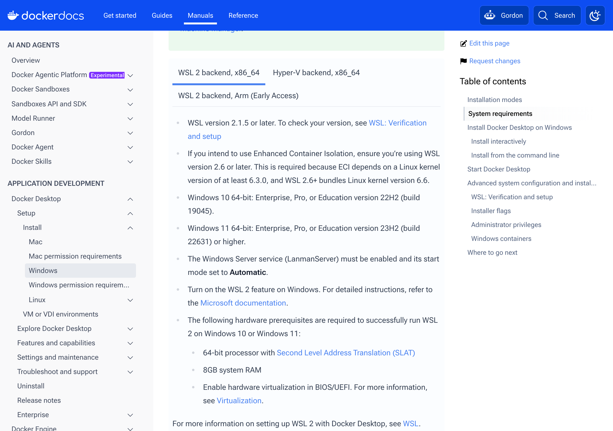

---

## 2. 安裝 Docker

### 2A. Windows：Docker Desktop＋WSL2

1. **先裝 WSL2**。用「以系統管理員身分執行」開 PowerShell：

   ```powershell
   wsl --install
   ```

   > 📷 待補截圖：系統管理員 PowerShell 跑 `wsl --install` 的畫面（需在 Windows 教室電腦擷取）

   跑完**重新開機**。已經裝過的話，這行會說已安裝，直接下一步。

2. 到 <https://www.docker.com/products/docker-desktop/> 下載 **Docker Desktop for Windows**，執行安裝檔。安裝畫面勾 **Use WSL 2 instead of Hyper-V**（預設就是勾的）。

   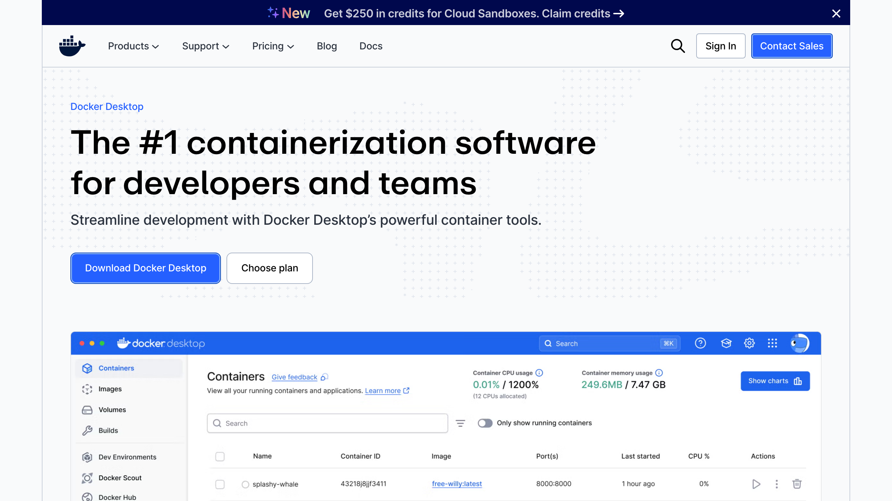

   > 📷 待補截圖：Docker Desktop 安裝精靈、勾 **Use WSL 2 instead of Hyper-V** 的畫面（需在 Windows 教室電腦擷取）

3. 裝完打開 Docker Desktop，等左下角（或系統匣的鯨魚圖示）顯示 **Engine running**。第一次開會要你接受授權條款，可以跳過登入。

   > 📷 待補截圖：Windows 上第一次開 Docker Desktop（授權條款、跳過登入、左下角 Engine running）（需在 Windows 教室電腦擷取）

4. 開一個**新的** PowerShell 視窗，確認：

   ```powershell
   docker version --format '{{.Server.Version}}'
   docker compose version
   ```

   你應該看到兩行版本號，例如：

   ```
   28.4.0
   Docker Compose version v2.39.4-desktop.1
   ```
   <!-- 未驗證：PowerShell 尚未在 Windows 實測（輸出格式取自 macOS 實測，Docker Desktop 兩邊相同） -->

   > 📷 待補截圖：新的 PowerShell 視窗跑這兩行的畫面（需在 Windows 教室電腦擷取）

   版本數字跟這裡不一樣沒關係，**有印出來就對了**。

**如果不是這樣**

| 你看到 | 原因 | 處理 |
|--------|------|------|
| `docker : 無法辨識 'docker' 詞彙` | 裝完沒開新視窗，或 Docker Desktop 沒裝好 | 關掉 PowerShell 重開；還是不行就重開機 |
| `error during connect` / `cannot find the file specified` | Docker Desktop 沒開，或還在啟動 | 開 Docker Desktop，等鯨魚圖示不再轉動 |
| Docker Desktop 說 WSL 2 太舊或沒裝 | 第 1 步沒做完 | 系統管理員 PowerShell 跑 `wsl --update`，重開機 |
| Docker Desktop 說虛擬化沒開 | BIOS 的 VT-x／AMD-V 關著 | 教室電腦請找講師；自己電腦進 BIOS 打開 |

### 2B. macOS：Docker Desktop

1. 到 <https://www.docker.com/products/docker-desktop/> 下載 Docker Desktop for Mac。**選對晶片**：左上角蘋果選單 →「關於這台 Mac」，晶片寫 Apple M 系列選 **Apple Silicon**，寫 Intel 選 **Intel Chip**。

   

2. 打開 `.dmg`，把 Docker 拖進「應用程式」，再從應用程式打開它；第一次會要你輸入 Mac 密碼。
3. 等選單列的鯨魚圖示不再動（Docker Desktop 視窗左下角顯示 **Engine running**）：

   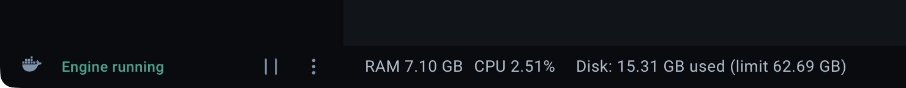

   開終端機確認：

   ```bash
   docker version --format '{{.Server.Version}}'
   docker compose version
   ```

   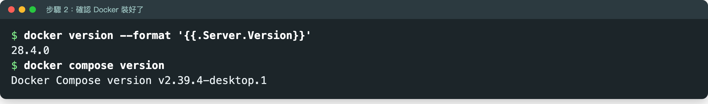

   跟 Windows 一樣，兩行都有版本號就對了。

### 2C. Linux：Docker Engine＋compose 外掛

照 Docker 官方文件安裝 **Docker Engine** 和 **docker-compose-plugin**（Ubuntu：<https://docs.docker.com/engine/install/ubuntu/>，其他發行版在同一頁左側選單）。裝完讓自己的帳號不用 `sudo` 就能跑 docker：

```bash
sudo usermod -aG docker $USER
# 登出再登入（或重開機）才會生效
docker version --format '{{.Server.Version}}'
docker compose version
```

> 注意是 `docker compose`（中間空白，compose 外掛），不是舊版的 `docker-compose`。整門課都用前者。

> **為什麼用 Docker？** M1 會講「在我的電腦上會動」的五個原因，其中「環境差異」和「依賴差異」——Runtime 版本不同、套件版本不同——Docker 一次處理掉：每個人跑的是同一份 image，裡面的 .NET、Node、PostgreSQL 版本都一樣。

---

## 3. 取得並解壓 `keypasco-devops-lab.zip`

1. 從講師提供的位置（電子檔連結或隨身碟）把 `keypasco-devops-lab.zip` 存到**桌面**或你找得到的資料夾。
2. 解壓：

   - Windows：在 zip 上按右鍵 →「解壓縮全部」→ 解壓縮。**不要**直接在 zip 裡面雙擊開檔案來改。

     > 📷 待補截圖：檔案總管 zip 右鍵選單「解壓縮全部」與解壓縮對話框（需在 Windows 教室電腦擷取）

   - macOS：雙擊 zip，會在旁邊出現資料夾。
   - Linux：`unzip keypasco-devops-lab.zip`

3. 解壓後會有一個 **`devops-lab`** 資料夾（Windows 的「解壓縮全部」可能會多包一層 `keypasco-devops-lab`，以裡面那個 `devops-lab` 為準）。用 git clone 的話就是 clone 下來的 `devops-lab`。

4. 在終端機**進到 `devops-lab` 資料夾**——之後所有指令都在這裡下：

   **PowerShell（Windows）**

   ```powershell
   cd $HOME\Desktop\devops-lab
   dir
   ```

   > 📷 待補截圖：PowerShell `dir` 列出 devops-lab 內容（含 `.env.*`）（需在 Windows 教室電腦擷取）

   **bash（macOS／Linux）**

   ```bash
   cd ~/Desktop/devops-lab
   ls -a
   ```

   路徑依你實際解壓的位置調整。小技巧：打 `cd ` 加一個空白，再把 `devops-lab` 資料夾從檔案總管／Finder 拖進終端機視窗，路徑會自動填好。

   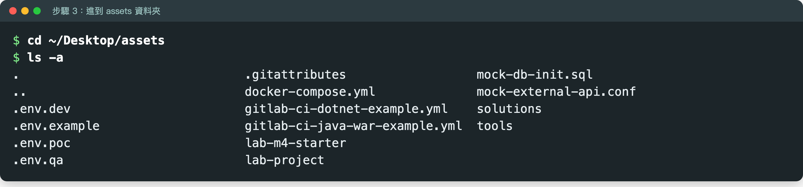

   你應該看到（順序可能不同；bash 的 `ls -a` 另外會列出 `.` 和 `..`，代表「這一層」和「上一層」，不用理它）：

   ```
   .  ..
   .env.dev  .env.example  .env.poc  .env.qa  .gitattributes
   README.md  docker-compose.yml
   apps  docs  instructor  labs  mock-services  tools
   ```

**如果不是這樣**：沒看到 `.env.*` 這幾個檔是因為它們是「點開頭」的隱藏檔——bash 要用 `ls -a`；Windows 檔案總管要在「檢視」勾「隱藏的項目」，PowerShell 的 `dir` 本來就看得到。

---

## 4. 資料夾導覽：每個檔案是做什麼的

```
devops-lab/                      ← 所有指令都在這一層下
├── README.md                    第一次來先看這份：資料夾地圖＋操作順序
├── docker-compose.yml           課堂共用的 mock 服務：資料庫＋外部 API
├── .env.dev / .env.qa / .env.poc    三個環境的設定檔（M2 主角）
├── .env.example                 設定檔範本
├── .gitattributes               讓 Windows 上 git clone 時 .sh／.env 保持 LF 換行
├── apps/                        範例程式（被部署的對象）
│   ├── dotnet-deploylog/        範例網站 DeployLog 完整原始碼（.NET 10＋Vue3），M1–M6 都用它
│   └── java-spring-demo/        Java 組加碼：Spring Boot 對照範例（09 用）
├── labs/                        各模組 Lab 的練習檔
│   ├── m3-ci-pipeline/          M3：要推上 GitLab 的範例程式＋兩份 .gitlab-ci.yml 範例
│   └── m4-preflight/            M4：預檢腳本起始檔（starter/）與參考解答（solution/）
├── mock-services/               docker-compose.yml 用到的 mock 設定（資料庫初始化、假外部 API）
├── tools/                       selftest（環境與 Lab 自我檢查）、講師用離線 image 打包
├── docs/                        手把手教程（就是你正在看的這份）
└── instructor/                  講師用：本機示範 GitLab（學員不用跑）
```

| 檔案／資料夾 | 哪個模組用 | 一句話 |
|------------|-----------|--------|
| `docker-compose.yml` | M2、M4、M5、M6 | 起一個 PostgreSQL（`mock-db`，port 5432）和一個假外部服務（`mock-external-api`，port 8081） |
| `.env.dev`／`.env.qa`／`.env.poc` | M2、M4、M6 | 同一個網站換這三份檔，就變成 Dev／QA／POC 三個環境 |
| `apps/dotnet-deploylog/` | 全部 | 範例網站 DeployLog；M1 介紹、M2 換設定、M3 看 CI、M4 健康檢查、M5 看 log、M6 migrate |
| `labs/m4-preflight/starter/`、`labs/m4-preflight/solution/` | M4 | 部署前預檢腳本的起始檔和解答 |
| `labs/m3-ci-pipeline/` | M3 | 推上 GitLab 練習的範例程式（`sample-repo/`）＋兩份 pipeline 範例 |
| `apps/java-spring-demo/` | 09（Java 組） | 用 Spring Boot 把 M2／M4／M5／M6 再做一次，共用 mock-db 和 `.env.*` |
| `tools/selftest.*` | 課前 | 檢查你的電腦能不能上課 |

`.env.dev` 長這樣（另外兩份只差 `ASPNETCORE_ENVIRONMENT` 和 `DB_NAME`）：

```
# Module 2 Lab — Dev 環境設定
ASPNETCORE_ENVIRONMENT=Development
APP_PORT=5000
EXTERNAL_API_URL=http://localhost:8081
DB_HOST=localhost
DB_PORT=5432
DB_NAME=labdb
DB_USER=labuser
DB_PASSWORD=labpass
```

---

## 5. 跑環境檢查：`selftest env`

這支腳本**只檢查、不改任何東西**（不啟動容器、不佔 port），可以放心跑。

**PowerShell（Windows）**

```powershell
powershell -ExecutionPolicy Bypass -File tools\selftest.ps1 env
```

> 📷 待補截圖：PowerShell 跑 `selftest.ps1 env` 的結果（需在 Windows 教室電腦擷取）

**bash（macOS／Linux）**

```bash
bash tools/selftest.sh env
```

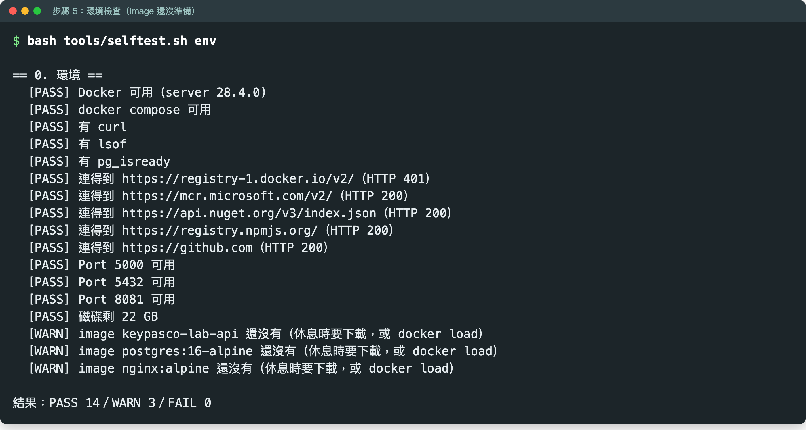

你應該看到（bash 版，image 還沒準備好的狀態）：

```
== 0. 環境 ==
  [PASS] Docker 可用（server 28.4.0)
  [PASS] docker compose 可用
  [PASS] 有 curl
  [PASS] 有 lsof
  [WARN] 沒有 pg_isready（bash 版預檢會用到；Windows 學員做 PowerShell 版不需要）
  [PASS] 連得到 https://registry-1.docker.io/v2/（HTTP 401）
  [PASS] 連得到 https://mcr.microsoft.com/v2/（HTTP 200）
  [PASS] 連得到 https://api.nuget.org/v3/index.json（HTTP 200）
  [PASS] 連得到 https://registry.npmjs.org/（HTTP 200）
  [PASS] 連得到 https://github.com（HTTP 200）
  [PASS] Port 5000 可用
  [PASS] Port 5432 可用
  [PASS] Port 8081 可用
  [PASS] 磁碟剩 26 GB
  [WARN] image keypasco-lab-api 還沒有（休息時要下載，或 docker load）
  [WARN] image postgres:16-alpine 還沒有（休息時要下載，或 docker load）
  [WARN] image nginx:alpine 還沒有（休息時要下載，或 docker load）

結果：PASS 13／WARN 4／FAIL 0
```

Docker 版本、磁碟 GB 數依你的電腦而定。有裝 PostgreSQL 用戶端（例如 Mac 用 Homebrew 裝過 `libpq`）的人，`pg_isready` 那行會是 `[PASS] 有 pg_isready`，結果就變成 `PASS 14／WARN 3`——重點是最後 `FAIL 0`。

PowerShell 版長得幾乎一樣，差別是：沒有 `curl`／`lsof`／`pg_isready` 那三行，改成一行 `[PASS] PowerShell 5.1.xxxxx`（印出你的 PowerShell 版本）；Port 被佔用時不會附 `lsof` 提示。

### 怎麼看結果

| 標記 | 意思 | 要不要處理 |
|------|------|-----------|
| `[PASS]` | 沒問題 | 不用 |
| `[WARN]` | 現在不影響，但某些情況會卡 | 看下表，多半可以先放著 |
| `[FAIL]` | 上課會卡住 | **一定要處理**，最後一行要是 `FAIL 0` |

### 每一項在檢查什麼

| 檢查 | 為什麼要檢查 | 不過的話 |
|------|------------|---------|
| Docker 可用 | 整門課都靠 Docker | **FAIL**：Docker Desktop 沒開，或 Linux 帳號不在 docker 群組（回第 2 步） |
| docker compose 可用 | 起 mock 服務要用 | **FAIL**：Linux 沒裝 `docker-compose-plugin` |
| 有 curl／lsof／pg_isready（只有 bash 版） | M4 的 bash 版預檢腳本會用到 | WARN：macOS 沒有 `pg_isready` 很正常，M4 會再說明；Windows 學員做 PowerShell 版，不需要 |
| 連得到 5 個網址 | 第一次 `docker build` 要從 Docker Hub、mcr、nuget.org、npm 下載 | WARN：連不到就走第 7 步的 **B 路線（docker load）**，可以忽略 |
| Port 5000／5432／8081 可用 | 網站、資料庫、假外部服務要用這三個 port | **FAIL**：有別的程式佔著（見下方疑難排解） |
| 磁碟剩 5 GB 以上 | image 約 3 GB | WARN：清一點空間 |
| 三個 image 已在本機 | 上課時不用再下載 | WARN：第 7 步做完就會變 PASS |

> 輸出的 `HTTP 401` 不是錯：Docker Hub 沒登入時本來就回 401，**有回應**就代表連得到。只有完全連不上（HTTP 000）才會 WARN。

**如果不是這樣**

| 你看到 | 原因 | 處理 |
|--------|------|------|
| `... cannot be loaded because running scripts is disabled on this system` | PowerShell 執行原則擋腳本 | 照上面的寫法加 `-ExecutionPolicy Bypass -File`，不要直接打 `.\tools\selftest.ps1` |
| `請在 devops-lab/ 根目錄下執行` | 目前不在 `devops-lab` 資料夾 | 回第 3 步第 4 點 `cd` 進去 |
| `[FAIL] Port 5000 被其他程式佔用`（macOS） | macOS 12 以後的 **AirPlay 接收器**佔 5000 | 系統設定 → 一般 → AirDrop 與接力 → 關掉「AirPlay 接收器」；或改用 5050：`LAB_PORT=5050 bash tools/selftest.sh env`，之後指令裡的 `-p 5000:5000` 都改成 `-p 5050:5000`、網址改 5050 |
| `[FAIL] Port 5432 被其他程式佔用` | 電腦上本來就裝了 PostgreSQL | 暫停本機的 PostgreSQL 服務（Windows：服務 → postgresql → 停止） |
| `[FAIL] Port ... 被其他程式佔用`，但是 Docker 容器佔的 | — | 腳本會排除 Docker 容器自己佔的 port；如果是上一輪課留下的容器，`docker ps` 看一下，`docker rm -f <名稱>` |

> 📷 待補截圖：直接打 `.\tools\selftest.ps1` 被執行原則擋下的紅字（`running scripts is disabled on this system`）（需在 Windows 教室電腦擷取）

---

## 6. 啟動 mock 服務

```bash
docker compose up -d mock-db mock-external-api
```

（PowerShell 和 bash 一樣。`docker-compose.yml` 裡只有這兩個服務，所以只打 `docker compose up -d` 效果相同。）

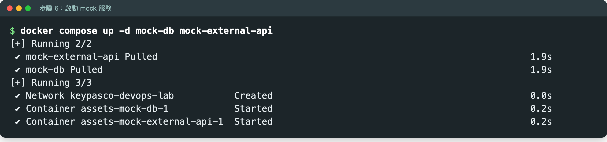

你應該看到（第一次會先下載 `postgres:16-alpine` 和 `nginx:alpine`，所以上面多一段 `Pulled`；下載時間依網路而定）：

```
[+] Running 2/2
 ✔ mock-external-api Pulled
 ✔ mock-db Pulled
[+] Running 3/3
 ✔ Network keypasco-devops-lab           Created
 ✔ Container devops-lab-mock-db-1            Started
 ✔ Container devops-lab-mock-external-api-1  Started
```

容器名稱前面的 `devops-lab-` 是 `docker-compose.yml` 第一行 `name: devops-lab` 指定的專案名稱，Docker Desktop 也會把它們歸在 `devops-lab` 這一組；資料夾改名或用 ZIP 解壓成 `devops-lab-main` 都不影響。

等 10–20 秒，確認狀態：

```bash
docker compose ps
```

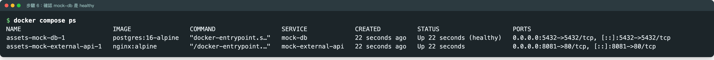

你應該看到 `mock-db` 的 STATUS 是 **`(healthy)`**、`mock-external-api` 是 `Up`：

```
NAME                         IMAGE                COMMAND                  SERVICE             CREATED          STATUS                    PORTS
devops-lab-mock-db-1             postgres:16-alpine   "docker-entrypoint.s…"   mock-db             20 seconds ago   Up 20 seconds (healthy)   0.0.0.0:5432->5432/tcp, [::]:5432->5432/tcp
devops-lab-mock-external-api-1   nginx:alpine         "/docker-entrypoint.…"   mock-external-api   20 seconds ago   Up 20 seconds             0.0.0.0:8081->80/tcp, [::]:8081->80/tcp
```

再確認假外部服務有回應：

**PowerShell（Windows）**

```powershell
curl.exe http://localhost:8081/health
```

**bash（macOS／Linux）**

```bash
curl http://localhost:8081/health
```


你應該看到：

```
OK
```

（`OK` 後面沒有換行，所以 macOS 的終端機可能把它跟下一個提示字元黏在同一行，例如 `OK%`，這樣也是對的。）

用瀏覽器開 <http://localhost:8081/health> 也可以，畫面只有一個 `OK`：


**如果不是這樣**

| 你看到 | 原因 | 處理 |
|--------|------|------|
| `mock-db` 是 `(health: starting)` | 第一次啟動在建資料庫 | 等 10–20 秒再 `docker compose ps` |
| `Bind for 0.0.0.0:5432 failed: port is already allocated` | 5432 被佔（見第 5 步） | 停掉本機 PostgreSQL，或 `docker ps` 找出佔用的容器刪掉 |
| PowerShell 印出一大串 `StatusCode`、`Content` 表格 | Windows PowerShell 的 `curl` 其實是 `Invoke-WebRequest` | 一定要打 **`curl.exe`**，或直接用瀏覽器開網址 |
| `no configuration file provided: not found` | 不在 `devops-lab` 資料夾 | `cd` 回 `devops-lab` |

> **為什麼要 mock 服務？** 每個人在自己電腦上跑一份資料庫和外部服務，互不影響、不依賴教室網路。M4 會故意 `docker compose stop mock-db` 模擬「資料庫連不上」，在自己的電腦上搞壞也沒關係。

---

## 7. 準備範例網站的 image

範例網站 DeployLog 打包成一個叫 **`keypasco-lab-api`** 的 image。兩條路，**擇一**：

| 路線 | 什麼時候用 | 時間 |
|------|-----------|------|
| **A. 自己 build** | 網路順、第 5 步 5 個網址都連得到；**Mac 用這條** | 第一次 1–3 分鐘以上（要下載約 1.7 GB base image），網路慢會更久 |
| **B. 從講師的隨身碟 `docker load`** | 教室網路慢、20 台同時下載、或連不到 Docker Hub／mcr／nuget.org | 約 1 分鐘，不用連網路 |

### 7A. 自己 build

```bash
docker build -t keypasco-lab-api apps/dotnet-deploylog
```

（PowerShell 和 bash 一樣。）

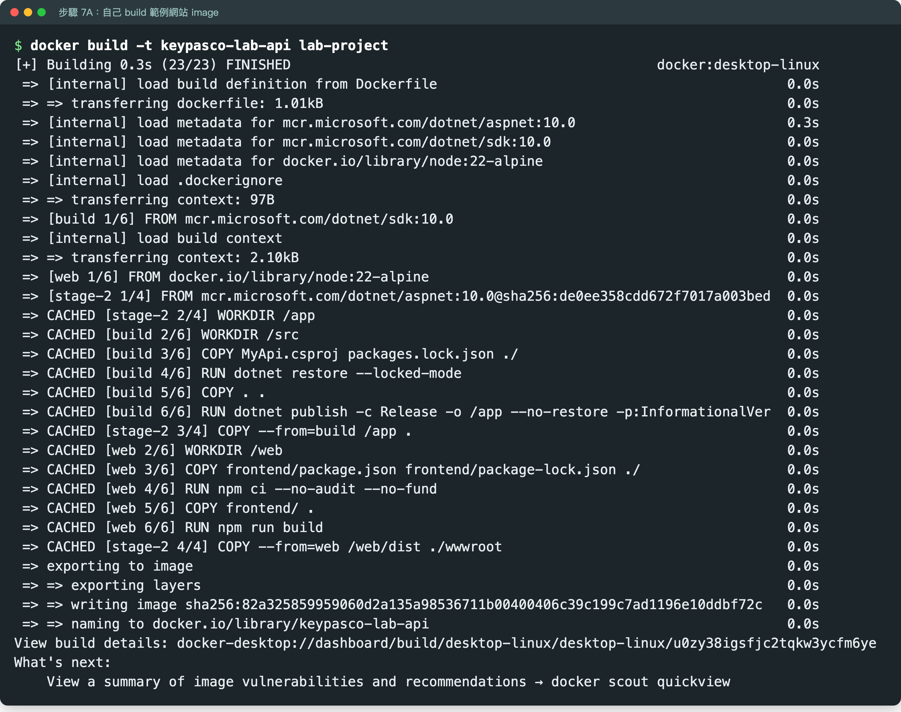

（截圖是講師機第二次 build，每一步都有快取，所以顯示 `CACHED`、總共 0.3 秒；你第一次 build 會看到下載進度，要 1–3 分鐘以上。最後幾行長得一樣。）

畫面會跑一串 `[web 1/6]`、`[build 3/6]`、`[stage-2 1/4]` 之類的步驟，最後幾行類似：

```
 => exporting to image                                                     0.0s
 => => exporting layers                                                    0.0s
 => => writing image sha256:c6845494b7e7…                                  0.0s
 => => naming to docker.io/library/keypasco-lab-api                        0.0s
```

`sha256:` 後面那串每台電腦不一樣。最後可能還有一行 `What's next: … docker scout quickview`，那是 Docker Desktop 的廣告，不用理它。

這一步在做 `apps/dotnet-deploylog/Dockerfile` 寫的三件事：

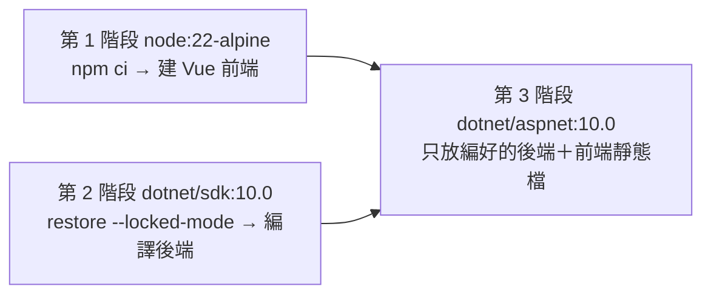

所以**你的電腦不用裝 .NET SDK 和 Node**；套件版本由 `packages.lock.json`、`package-lock.json` 鎖住，每個人 build 出來的內容都一樣（M3 會細講這兩把鎖）。

**如果不是這樣**

| 你看到 | 原因 | 處理 |
|--------|------|------|
| 卡在下載 `mcr.microsoft.com/dotnet/sdk` 很久 | 教室同時下載的人多 | 改走 B 路線 |
| `dotnet restore` 失敗、`Unable to load the service index for source https://api.nuget.org` | 連不到 nuget.org | 改走 B 路線 |
| `npm ci` 失敗、連不到 registry.npmjs.org | 連不到 npm | 改走 B 路線 |

### 7B. 從隨身碟 `docker load`

1. 跟講師拿 `keypasco-lab-images-amd64.tar`（約 600 MB），**複製到 `devops-lab` 資料夾**。
2. 載入：

   **PowerShell（Windows）**

   ```powershell
   docker load -i keypasco-lab-images-amd64.tar
   ```

   **bash（macOS／Linux）**

   ```bash
   docker load -i keypasco-lab-images-amd64.tar
   ```

   你應該看到三行 `Loaded image`：

   ```
   Loaded image: postgres:16-alpine
   Loaded image: nginx:alpine
   Loaded image: keypasco-lab-api:latest
   ```
   <!-- 待補截圖：docker load（需在 amd64 教室電腦擷取） -->
   <!-- 未驗證：講師機只確認 tar 內含這三個 image（manifest）並在打包時載入成功；三行出現的順序、前面的進度條依 Docker 版本可能不同 -->

這個 tar 是講師事先 build 好的 **amd64（Intel／AMD 處理器）** 版本，裡面有範例網站、PostgreSQL、nginx 三個 image，所以第 6 步也不用再下載。Apple 晶片的 Mac 載入後也能跑，但是用模擬的、比較慢——Mac 請優先走 A 路線。Mac 載入後 `docker compose up` 會多印一行 `! mock-db The requested image's platform (linux/amd64) does not match the detected host platform (linux/arm64/v8) …`，就是在說「這是 Intel 版、用模擬跑」，不是錯誤。

> **為什麼一個 tar 檔就夠？** 這就是 M1 要講的「不可變交付物」：image 一旦 build 好就不再修改，複製到哪台電腦跑的都是同一份。講師電腦 build 的、你電腦跑的，內容一模一樣。

### 確認 image 在了

```bash
docker image ls keypasco-lab-api
```

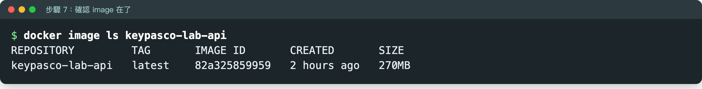

你應該看到一行 `keypasco-lab-api   latest   ...`：

```
REPOSITORY         TAG       IMAGE ID       CREATED         SIZE
keypasco-lab-api   latest    66752073b5aa   2 minutes ago   270MB
```

IMAGE ID、時間每台不同；大小約 270 MB 上下。

---

## 8. 最後驗收

再跑一次環境檢查：

**PowerShell（Windows）**

```powershell
powershell -ExecutionPolicy Bypass -File tools\selftest.ps1 env
```

> 📷 待補截圖：PowerShell 最後驗收 `selftest.ps1 env`（三個 image PASS、FAIL 0）（需在 Windows 教室電腦擷取）

**bash（macOS／Linux）**

```bash
bash tools/selftest.sh env
```

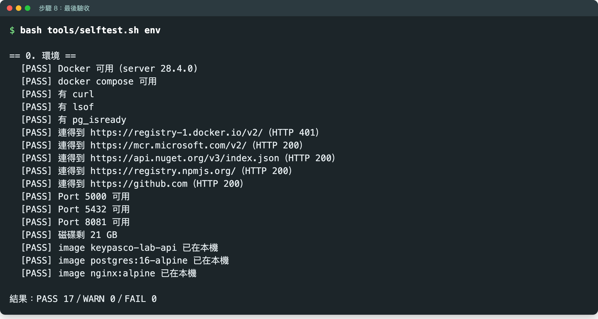

這次最後三行 image 應該都變成 PASS：

```
  [PASS] image keypasco-lab-api 已在本機
  [PASS] image postgres:16-alpine 已在本機
  [PASS] image nginx:alpine 已在本機

結果：PASS 17／WARN 0／FAIL 0
```

WARN 數依你的電腦而定（例如 macOS 沒有 `pg_isready` 會是 `PASS 16／WARN 1`）；重點是 `FAIL 0`。

> mock 服務已經在跑時，Port 5432、8081 仍然會是 PASS——腳本會認出那是 Docker 容器自己佔的。

### 驗收清單

- [ ] `docker version` 印得出 Server 版本
- [ ] 終端機在 `devops-lab` 資料夾裡
- [ ] `selftest env` 最後一行是 `FAIL 0`
- [ ] `docker compose ps`：`mock-db` 是 `(healthy)`
- [ ] `curl.exe`（或 `curl`）`http://localhost:8081/health` 回 `OK`
- [ ] `docker image ls keypasco-lab-api` 看得到 image

全部打勾，就可以進 [M1 手把手](01-m1-operability.md) 把範例網站跑起來。

---

## 疑難排解總表

| 症狀 | 原因 | 處理 |
|------|------|------|
| `docker` 指令找不到／無法連線 | Docker Desktop 沒開 | 開 Docker Desktop，等鯨魚圖示穩定 |
| `curl` 輸出一大串表格 | Windows PowerShell 的 `curl` 是 `Invoke-WebRequest` | 打 `curl.exe`，或用瀏覽器開 |
| `.ps1 cannot be loaded … execution policy` | 執行原則 | 用 `powershell -ExecutionPolicy Bypass -File ...` |
| `port is already allocated` | 上一輪容器沒刪，或別的程式佔用 | `docker rm -f lab-api`；Mac 是 AirPlay 佔 5000 → 改 5050 |
| `mock-db` 一直不是 healthy | 第一次啟動在建資料庫 | 等 10–20 秒再 `docker compose ps` |
| 第二天 image 不見了 | 教室電腦有還原卡，重開機就清掉 | 重做第 6、7 步（7B 最快） |
| 一切都怪怪的，想重來 | — | `docker compose down`，再從第 6 步做一次 |

---

## 下課後

mock 服務會一直佔記憶體，上完課可以停掉：

```bash
docker compose stop
```

下次上課 `docker compose start`（或再跑一次第 6 步）就回來了。想連資料庫內容一起刪：`docker compose down -v`。

---

下一步：[M1 從開發到部署：建立「可維運性」思維](01-m1-operability.md)｜回 [目錄](README.md)
