# 手把手：M1 從開發到部署——建立「可維運性」思維

> DevOps 實作課｜Day 1 開場＋M1
> 這一份分兩半：前半是觀念——**為什麼「在我的電腦上會動」，去客戶那邊就掛掉，以及業界用哪幾個原則避免它**；後半動手——**把這兩天都會用到的範例網站 DeployLog 跑起來，用三種角色各登入一次。**
> 開始動手前，請先做完 [00 環境準備](00-setup.md)。

---

## 你會學到什麼

| 觀念／動作 | 一句話 | 後面哪裡會再用到 |
|-----------|--------|-----------------|
| 環境／設定／依賴三類 | 部署出問題，先問是哪一類 | 整門課 |
| Configuration Drift、Snowflake Server | 每次手改，那台機器就跟別台不一樣了 | M2、M4 |
| The Three Ways | 流動、回饋、持續學習——整門課的地圖 | 每個模組 |
| Twelve-Factor 四條精華 | Config、Dependencies、Build-Release-Run、Disposability | M2、M3、M4 |
| Immutable Artifact／Build 一次 | 測過的那一版＝上線的那一版 | M2、M3、M3b |
| Pets vs Cattle | 讓「重建」便宜到不需要「修理」 | M4、M6 |
| Design for Operations | 寫程式時就想好維運的人怎麼用 | M4、M5 |
| 動手：DeployLog | migrate → 啟動 → `/health`、`/health/ready`、`/whoami` → 三種角色登入 | M2–M6 |

---

## 兩天的地圖

| | 第 1 段 | 第 2 段 | 第 3 段 | 第 4 段 | 收尾 |
|---|---|---|---|---|---|
| **Day 1** | M1 可維運性思維（本文件） | M2 組態管理＋實作＋檢核點 1 | M3 CI Pipeline | M4 前段：部署腳本入門 | 觀念小測驗 |
| **Day 2** | M4 預檢機制＋實作＋檢核點 2 | M5 日誌與排查 | M6 Schema 管理 | 課程總結 | 觀念小測驗 |

- **兩人一組**：一位開發背景＋一位維運背景（系統工程師、MIS、技術支援、QA 都算）。實作時開發的人帶走讀程式碼，維運的人負責下指令。
- **兩次大上機**：Day 1 的 M2 組態切換、Day 2 的 M4 預檢腳本；M6 還有一段短的 Migration 實作。
- **每天一次檢核**：一個實作檢核點＋收尾 5 題觀念小測驗。

---

# 第一部分：觀念

## 1. 你遇過嗎？

> 「我這邊好好的，去客戶那邊就掛掉。」

先停一下，**用一句話寫下你自己遇過的一個案例**（工程師：「我這邊會動」；技術支援／MIS：「到現場才發現」；QA：「測試環境過了、POC 掛了」）。等一下第 2 節會把它分類，最後的練習也會用到。

我的案例：＿＿＿＿＿＿＿＿＿＿＿＿＿＿＿＿＿＿＿＿＿＿＿＿＿＿

---

## 2. 把案例分成三類

幾乎所有「在我的電腦上會動」的問題，都落在這三類裡：

| 類別 | 指的是 | 例子 |
|------|--------|------|
| **環境** | 程式跑在什麼上面 | OS、Runtime 版本、Port、防火牆 |
| **設定** | 餵給程式的值 | 連線字串、API Key、開關值（Feature Flag） |
| **依賴** | 程式需要的其他東西 | 套件版本、沒寫進文件的安裝步驟 |

你剛才寫的案例屬於哪一類？很多案例會同時中兩類——這很正常。

---

## 3. 「在我的電腦上會動」的五個常見原因

把三類再拆細，加上兩個「讓差異越積越多」的原因：

| 原因 | 具體例子 |
|------|---------|
| 環境差異 | OS 版本、.NET／JDK Runtime 版本、Port 被佔用、防火牆規則不同 |
| 設定差異 | 連線字串、API Key、Feature Flag 值不同 |
| 依賴差異 | 套件版本沒鎖定，開發機裝的版本比 POC 新或舊 |
| **Configuration Drift**（組態漂移） | 正式機被人工手動改過、沒回寫版控，久了每台都變成獨一無二的 **Snowflake Server**（雪花伺服器：世界上找不到第二台一樣的） |
| **非 Immutable 部署** | 用「patch 現有伺服器」而不是「整台換新」的方式更新，漂移無法避免 |

前三個是「兩台機器**本來**就不一樣」；後兩個是「兩台機器**越用越**不一樣」。

> **記住一句話**：每次手改，那台機器就跟別台不一樣了。
>
> 到現場手改設定檔，屬於哪一列？——**設定差異＋Configuration Drift**。改的當下是設定差異；改完沒記錄，就開始漂移。

---

## 4. 情境：同一支程式，兩台電腦

把上面的表格「演一次」。左邊每一行都是開發者以為理所當然的事，右邊每一行都是一個原因：

| 開發者的筆電 | 客戶的 POC 主機 | 對應原因 |
|-------------|----------------|---------|
| Windows 11、.NET SDK 10.0.x | Windows Server＋IIS，Runtime 版本不同 | 環境差異 |
| appsettings 裡寫好本機連線字串 | 部署人員到現場手改設定檔 | 設定差異＋Configuration Drift |
| 本機 DB 開著、沒有防火牆 | 防火牆沒開 DB 的 Port | 環境差異 |
| 套件是上個月裝的版本 | 現場重新編譯，抓到新版套件 | 依賴差異＋非 Immutable 部署 |

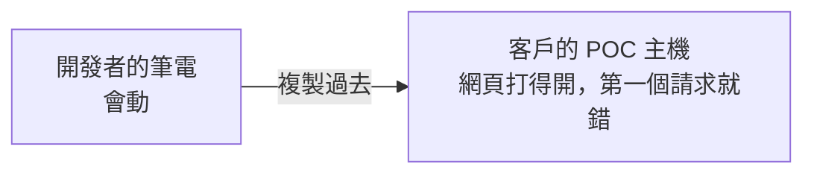

**結果**：網頁打得開，第一個請求就錯——五個原因，現場常常一次中好幾個。

---

## 5. 部署會壞，是業界常態

DORA（Google 支持的軟體交付研究計畫）每年調查上萬個團隊。2025 年版把交付表現拆成 **5 項指標**：

| 類型 | 指標 |
|------|------|
| 吞吐量（快不快） | 變更前置時間、部署頻率、失敗部署復原時間 |
| 不穩定度（穩不穩） | **變更失敗率（Change Failure Rate）**、重工率（Rework Rate） |

2025 年「變更失敗率」的分布：

| 變更失敗率 | 團隊比例 |
|-----------|---------|
| 0–2%（頂尖） | 約 8.5% |
| 8–16%（最大群） | 約 26% |
| 16% 以上 | 約 39.5% |

**每 10 次部署壞 1 次以上，是業界常態，不是你們特別差。重點是：失敗率可以量，量得到就能改善。** 想想看：你們上一季部署了幾次？大概壞了幾次？

> 資料來源：[RDEL #115：DORA 2025 數據整理](https://rdel.substack.com/p/rdel-115-what-are-the-2025-benchmarks)、[CD Foundation：DORA 五項指標](https://cd.foundation/blog/2025/10/16/dora-5-metrics/)。分布數字取自這份二手整理，DORA 原始報告未逐字核對。

---

## 6. DevOps 的三個方法（The Three Ways）

Gene Kim 在《The DevOps Handbook》裡把所有 DevOps 實踐歸到三條原則底下。**這兩天六個模組，就是把這三個方法落到 .NET／Java／Docker 的日常**：

| 方法 | 意思 | 這兩天的對應 |
|------|------|-------------|
| **1. 流動（Flow）** | 讓變更從開發到上線順暢、可預期 | 一次 build 到處部署（M1）、設定與程式分離（M2）、CI 自動建置（M3） |
| **2. 回饋（Feedback）** | 問題越早被發現、越靠近寫它的人越好 | 預檢擋下壞部署（M4）、Health Check（M4）、看得懂的 Log（M5） |
| **3. 持續學習（Learning）** | 從失敗學習，把教訓變成流程 | 事故檢討不究責、Migration 進版控（M6）、把手冊寫成腳本 |

想一想：你們現在**發現問題的時間點**是什麼時候？如果答案是「客戶打電話來」，那就是回饋迴路太長——第二個方法要解的就是這個。

> 下一節的 Twelve-Factor 是「**程式**該長什麼樣」（技術規範）；Three Ways 是「**團隊**該怎麼運作」（方法論）。

出處：Gene Kim〈The Three Ways: The Principles Underpinning DevOps〉（2012）；Kim、Humble、Debois、Willis《The DevOps Handbook》（2016）。

---

## 7. The Twelve-Factor App

- 2011 年 Heroku 的工程師整理出的 12 條 SaaS 應用程式最佳實踐
- 目標：應用程式在任何環境都「可攜、可擴充、可維運」
- 不是教條，是一套「**減少環境差異**」的思維框架
- 全文：<https://12factor.net/zh_cn/>（英文版 <https://12factor.net>）

本課程只深講其中 **4 條**，因為它們剛好對上第 3 節的原因：

| 精華 | 對上哪個原因 | 哪個模組動手 |
|------|-------------|-------------|
| 1. Config | 設定差異、Configuration Drift | M2 |
| 2. Dependencies | 依賴差異 | M3 |
| 3. Build, Release, Run | 非 Immutable 部署、現場重新編譯 | M3、M4 |
| 4. Disposability | 服務一重啟就出事 | M4 |

### 精華 1：Config——設定跟程式碼分離

**定義**：會隨環境改變的設定（連線字串、API Key、Feature Flag）要跟程式碼分離。

| ✗ 反模式 | ✓ 正確做法 |
|---------|-----------|
| 設定寫死在程式碼常數，或塞進進版控的設定檔 | 環境變數＋外部設定檔；程式碼在任何環境都是**同一份** |

不是寫程式的人可以這樣想：**同一台冰箱，插不同國家的插頭轉接器——冰箱不用改。** 程式是冰箱，設定是轉接器。

問問自己：部署到客戶那邊時，你們改的是哪個檔？改完有人記錄嗎？

這是整門課最核心的一條，[M2](02-m2-config.md) 會直接動手做。

### 精華 2：Dependencies——明確宣告所有依賴

**定義**：明確宣告所有依賴，不依賴「系統環境剛好有裝」的套件。

| ✗ 反模式 | ✓ 正確做法 |
|---------|-----------|
| 「我電腦上有裝這個套件」，但沒寫進專案設定，換一台機器就跑不起來 | **.NET**：NuGet＋`packages.lock.json` 鎖版本<br/>**Java**：`pom.xml` 寫死每個依賴版本（不用 SNAPSHOT、不用版本範圍）；Gradle 另有 lockfile |

「要先裝某個 Runtime 才跑得起來，但文件沒寫」——那就是**沒宣告的依賴**。[M3](03-m3-ci-pipeline.md) 會看 CI 怎麼鎖版本。

### 精華 3：Build, Release, Run 分離

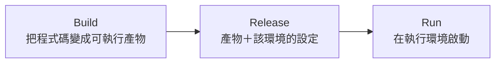

| 階段 | 做什麼 | 在 DeployLog 上 |
|------|--------|----------------|
| Build | 編譯，產出可執行的東西 | `docker build` 出 `keypasco-lab-api` image |
| Release | 把 Build 產物跟**該環境的設定**結合 | image ＋ `.env.poc` |
| Run | 在執行環境啟動 | `docker run` |

三個階段要能**分開追蹤**——「改一下設定」不等於「重新 build 一次」。

> **對照現況**：部署人員到現場手改設定＝在 Run 階段偷改 Release，沒有紀錄。下次出事，沒人說得出現場跑的到底是哪個組合。

### 精華 4：Disposability——快速啟動、優雅關閉

**定義**：服務要能快速啟動、優雅關閉。

| ✗ 反模式 | ✓ 正確做法 |
|---------|-----------|
| 啟動很慢，或關閉時沒處理完手上的請求——容器一重啟就出事 | 啟動快；收到關閉訊號先把請求處理完；外部能知道「這個實例準備好了沒」 |

Docker 容器常態性地被重啟、替換；IIS 的 App Pool 回收、systemd 的 restart 也是同一件事——**服務隨時會被重啟，要扛得住**。「外部能知道準備好了沒」就是 Health Check，Day 2 [M4](04-m4-deploy-scripts.md) 展開；等一下動手時你會先看到它（`/health`、`/health/ready`）。

---

## 8. 不可變的交付物（Immutable Artifact）

**build 出來的產物一旦產生就不再修改。從 Dev 到 QA 到 POC，跑的是「同一份」，只是餵的設定不同。**

產物可以是 Docker image、Java 的 war 檔、.NET 的發佈包。

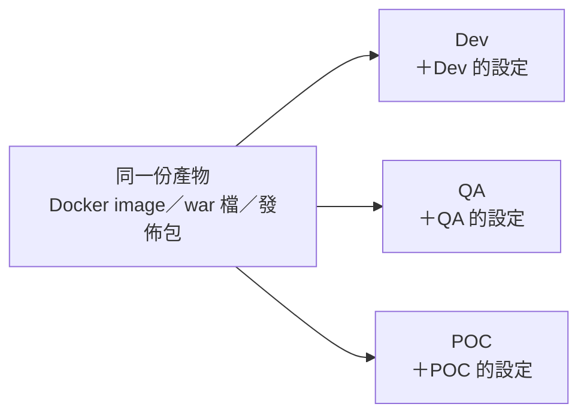

> **問 QA 一個問題**：你測過的那一版，跟上線的那一版，能證明是同一份嗎？答不出來，就是這一節要解的問題。

你在 [00 環境準備](00-setup.md) 第 7 步其實已經體驗過：講師電腦 build 好的 image 存成 tar，複製到你的電腦 `docker load`，內容一模一樣——因為它不會再被修改。

---

## 9. Build 一次 vs 每個環境各自重新編譯

| | ✓ Build 一次，到處部署 | ✗ 每個環境各自重新編譯 |
|---|---|---|
| 風險在哪 | 集中在「這一次 build」，可控 | 分散到「每一次 build」，難追蹤 |
| 一致性 | 保證各環境跑同一份產物 | 無法保證，版本可能悄悄漂移 |
| 長什麼樣 | Docker image／war 檔一次打包 | 反面教材：到現場重新編譯部署 |

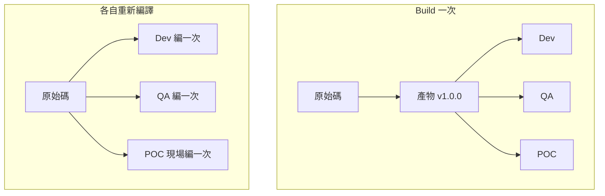

右邊三次編譯，只要套件來源、編譯機的 SDK 版本、甚至前端打包時寫進去的網址有一點不同，產出就不一樣——**看起來是同一份，其實每個環境 build 出來的都不一樣。**

[M3b](03b-gitlab-environments-release.md) 會在 GitLab 上看到這件事的完整樣子：同一個 image 依序部署到 dev、qa、poc，沒有重新 build。

---

## 10. 寵物 vs 牲畜（Pets vs Cattle）

| 🐱 寵物：每台都有名字 | 🐄 牲畜：用編號管理 |
|---------------------|-------------------|
| 生病了要細心照顧（登入進去手動修） | 壞了就換一台新的，不修 |
| 每台設定都有點不一樣（Snowflake） | 每台都從同一份 image＋設定產生 |
| 掛了很心痛，沒人敢重灌 | 重建比修理快，而且結果一樣 |
| 「那台 POC 主機只有阿明知道怎麼弄」 | 「刪掉容器，再 `docker run` 一次」 |

**不是不愛護伺服器，而是讓「重建」便宜到不需要「修理」。**

- 你們有沒有一台「不能重灌」的機器？為什麼不能？——答案通常是「沒人知道上面裝了什麼、改了什麼」，那就是寵物。
- **Windows Server／IIS 也適用**：發佈包＋設定腳本（例如 Web Deploy、PowerShell）能重建一台一模一樣的站，它就是牲畜。Docker 讓這件事變便宜，但不是唯一方法。
- **資料庫是例外**：資料本身是寵物，要備份、要用 Migration 管理 Schema（Day 2 [M6](06-m6-db-migration.md)）。

出處：Bill Baker（Microsoft）約 2012 年談 scale-up vs scale-out 的比喻，Randy Bias 推廣到雲端基礎架構。

---

## 11. Design for Operations（為維運而設計）

**寫程式時就把「維運的人怎麼用」考慮進去。** 三個具體檢查點：

| 檢查點 | 為什麼 | 在哪裡學 |
|--------|--------|---------|
| 有 Health Check 嗎？ | 外部能確認服務活著、準備好了 | Day 2 [M4](04-m4-deploy-scripts.md) |
| Log 看得懂嗎？ | 出事時查得到原因 | Day 2 [M5](05-m5-logging.md) |
| 設定要用猜的嗎？ | 值從哪來一目了然 | 今天 [M2](02-m2-config.md) |

如果你是技術支援或 MIS：**你最希望 RD 多做哪一件事？** 記下來，M5 講 Log 時對照看看。

---

## 12. 打破 Dev／Ops 的邊界

| 傳統心態 | 現實 |
|---------|------|
| 「我負責寫功能，維運是別人的事」 | 越來越多 RD 要自己面對 POC／正式環境部署，維運友善不是選項，是必需 |

> **你寫的程式碼，決定了未來有沒有人半夜被叫醒。**

---

## 13. 這兩天的範例：DeployLog 部署紀錄系統

DeployLog 是課程自己寫的範例網站（不是任何客戶的系統），用來記錄「**哪個客戶環境、裝了哪個版本、結果如何**」。功能刻意做小，讓你一眼看懂，注意力放在部署與維運的零件上：

| 零件 | 用什麼做 |
|------|---------|
| 前端 | Vue3 |
| 後端 | ASP.NET Core 10 API |
| 資料庫 | PostgreSQL＋EF Core |
| 登入 | Cookie 登入＋三種角色權限 |
| 維運零件 | 健康檢查、結構化日誌、稽核紀錄 |
| 打包 | **前後端打包成同一個 Docker image** |

這是常見的 .NET＋Vue3＋Docker 技術棧，學完可以直接對照自己的專案。

```
瀏覽器 ──► 一個容器（keypasco-lab-api）───────────────► PostgreSQL（mock-db）
            ├─ wwwroot/        Vue3 前端（建置後的靜態檔）
            ├─ /api/*          ASP.NET Core 10 Minimal API
            ├─ /health         DB 連得上嗎（M4）
            ├─ /health/ready   DB 連得上＋Schema 是最新版（M6）
            └─ /whoami         吃到哪組設定（M2）
```

### 同一個網站，貫穿六個模組

| 模組 | 在 DeployLog 上看什麼 | 你會動手嗎 |
|------|---------------------|-----------|
| M1 可維運性 | 一個 image 包前端＋後端；頁首顯示環境與版本 | **本文件第二部分** |
| M2 組態管理 | 同一顆 image 換 `.env`：`/whoami` 和頁首色條跟著變 | **Lab** |
| M3 CI Pipeline | `packages.lock.json`＋`package-lock.json` 兩把鎖；GitLab CI 怎麼建它 | 看 |
| M4 預檢與健康檢查 | `start.sh` 先檢查再啟動；`/health` 與 `/health/ready` | **Lab** |
| M5 日誌與排查 | 錯誤畫面上的追蹤編號 → 伺服器 JSON log；稽核紀錄 | 看 |
| M6 Schema 管理 | 沒跑 migrate 會怎樣；版本表 `__EFMigrationsHistory` | **Lab** |

權限控管（後端把關、最小權限）在 M6 收尾時一起看；今天先用三種角色各登入一次，有個印象。

---

## 14. M1 帶走三個觀念

| 觀念 | 一句話 |
|------|--------|
| **Config 與程式碼分離** | 換環境只換設定，不改程式、不重新編譯 |
| **Immutable Artifact** | 測過的那一版，就是上線的那一版 |
| **Design for Operations** | 寫程式時就想好：怎麼確認它活著、出事怎麼查、設定從哪來 |

下一段 [M2](02-m2-config.md)：Config 分離，直接動手做。

---

# 第二部分：動手——把 DeployLog 跑起來

以下指令都在 **`assets` 資料夾**下執行。開始前確認：

- [ ] [00 環境準備](00-setup.md) 做完了：`docker compose ps` 看得到 `mock-db` 是 `(healthy)`
- [ ] `docker image ls keypasco-lab-api` 看得到 image

這一段用 **POC 環境**（`.env.poc`），頁首會是紅色，跟下面的截圖一樣。

> 下面的 `docker run` 指令都寫成**一行**，PowerShell 和 bash 可以直接貼上，不用改。

## 步驟 1：先建資料表（migrate）

```bash
docker run --rm --env-file .env.poc --add-host=host.docker.internal:host-gateway -e DB_HOST=host.docker.internal keypasco-lab-api migrate
```

這個指令用同一個 image、加上 `migrate` 參數，**只做資料庫 Schema 升級就結束**（`--rm`：跑完自動刪掉容器）。

你應該看到三行 JSON 格式的 log（POC 環境的 log 一行一個 JSON，M5 會講為什麼），每行很長，先看 `"Message"` 那一欄：

```
{"Timestamp":"2026-11-02T13:59:28.262Z","EventId":0,"LogLevel":"Information","Category":"Migrate","Message":"資料庫 labdb_poc：已套用 0 個，待套用 2 個 20261027161121_InitialCreate, 20261027161130_AddAuditLogs","State":{…},"Scopes":[]}
{"Timestamp":"2026-11-02T13:59:28.643Z","EventId":0,"LogLevel":"Warning","Category":"Migrate","Message":"已建立預設帳號 admin／engineer／viewer（課堂用預設密碼，正式環境請勿使用）","State":{…},"Scopes":[]}
{"Timestamp":"2026-11-02T13:59:28.643Z","EventId":0,"LogLevel":"Information","Category":"Migrate","Message":"Migration 完成，目前版本 20261027161130_AddAuditLogs","State":{…},"Scopes":[]}
```

（`{…}` 是這裡省略的部分，你的畫面會印完整內容；時間是你跑的時間。）三個 `Message` 依序是：

```
資料庫 labdb_poc：已套用 0 個，待套用 2 個 20261027161121_InitialCreate, 20261027161130_AddAuditLogs
已建立預設帳號 admin／engineer／viewer（課堂用預設密碼，正式環境請勿使用）
Migration 完成，目前版本 20261027161130_AddAuditLogs
```

如果之前已經對 POC 跑過 migrate，會只有兩行：`已套用 2 個，待套用 0 個` 和 `Migration 完成`，沒有「已建立預設帳號」那行——帳號已經在了，**重跑不會壞**（M6 會解釋為什麼）。

**為什麼要另外一步？** Schema 變更是部署流程裡獨立的一步，不在網站啟動時偷偷做：多台同時啟動會搶著改 Schema、改失敗網站也起不來（Day 2 M6 細講）。

**為什麼要 `-e DB_HOST=host.docker.internal`？** `.env.poc` 裡寫的是 `DB_HOST=localhost`，那是給「在你電腦上直接跑的程式」（M4 的預檢腳本）用的。但**容器裡的 `localhost` 是容器自己**，要用 `host.docker.internal` 才連得回你的電腦上的 mock-db。`--add-host=...` 是讓 Linux 也認得這個名字（Docker Desktop 本來就認得）。這一行同時示範了第 7 節的 Config：**同一個 image，靠外部設定決定連去哪裡。**

## 步驟 2：啟動網站

```bash
docker run -d --name lab-api -p 5000:5000 --env-file .env.poc --add-host=host.docker.internal:host-gateway -e DB_HOST=host.docker.internal keypasco-lab-api
```

你應該看到一串 64 個字元的容器 ID（每次都不一樣），例如：

```
86ade8663d2085a8770a9360279bf338b2ed1c81f23a8dbbeaba7326a1ccc8ee
```

| 參數 | 意思 |
|------|------|
| `-d` | 在背景跑 |
| `--name lab-api` | 容器名稱，之後刪除、看 log 都用這個名字 |
| `-p 5000:5000` | 你電腦的 5000 → 容器的 5000 |
| `--env-file .env.poc` | 吃 POC 的設定 |

> Mac 的 5000 被 AirPlay 佔用時：改成 `-p 5050:5000`，下面所有網址的 5000 改成 5050。

## 步驟 3：用指令問網站三個問題

**PowerShell（Windows）**——一定要打 `curl.exe`，不是 `curl`：

```powershell
curl.exe http://localhost:5000/health
curl.exe http://localhost:5000/health/ready
curl.exe http://localhost:5000/whoami
```

**bash（macOS／Linux）**

```bash
curl http://localhost:5000/health
curl http://localhost:5000/health/ready
curl http://localhost:5000/whoami
```

你應該看到（回應最後沒有換行，下一個提示字元可能接在同一行，正常）：

```
Healthy
Healthy
{"environment":"POC","dbHost":"host.docker.internal","dbName":"labdb_poc"}
```

| 網址 | 問的是 | 看到的 |
|------|--------|--------|
| `/health` | 「你活著嗎？資料庫連得上嗎？」 | `Healthy`（HTTP 200） |
| `/health/ready` | 「你準備好接客了嗎？」——資料庫連得上**而且** Schema 是最新版 | `Healthy`（HTTP 200） |
| `/whoami` | 「你現在吃的是哪一組設定？」 | 環境 `POC`、資料庫 `labdb_poc` |

**如果不是這樣**

| 你看到 | 原因 | 處理 |
|--------|------|------|
| `curl: (7) Failed to connect` / `Connection refused` | 網站還在啟動 | 等 2–3 秒再試 |
| `/health` 是 `Healthy`，`/health/ready` 是 `Unhealthy` | 步驟 1 的 migrate 沒跑或失敗 | 回步驟 1 再跑一次，**不用重啟網站**，再問一次 `/health/ready` |
| 兩個都是 `Unhealthy` | 連不到資料庫 | `docker compose ps` 確認 `mock-db` healthy；確認步驟 2 有 `-e DB_HOST=host.docker.internal` |
| PowerShell 印出一大串表格 | 打成 `curl`（那是 `Invoke-WebRequest`） | 改打 `curl.exe` |
| `docker: ... Conflict. The container name "/lab-api" is already in use` | 上一輪的 lab-api 還在 | `docker rm -f lab-api`，再做步驟 2 |
| `port is already allocated` | 5000 被佔 | `docker rm -f lab-api`；Mac 改 5050 |

> **為什麼要兩個健康檢查？** 這就是第 7 節的 Disposability：「活著」不等於「能接客」。服務剛啟動、或資料庫還沒升級時，它可能活著但還不該收流量。Day 2 M4、M6 會用到這兩個網址。

## 步驟 4：打開網站

瀏覽器開 <http://localhost:5000>，會被帶到登入頁：

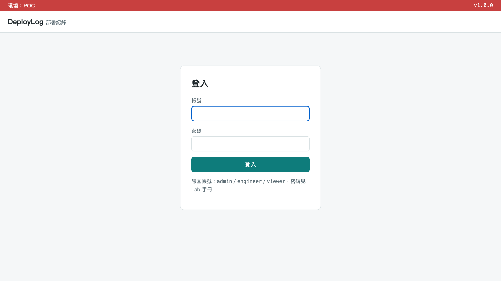

注意兩個地方：

- **頁首色條**：紅色＋「環境：POC」。Dev 是綠色、QA 是黃色——程式沒動，畫面跟著設定走（M2 會親眼看到）。正式系統常用這招，避免把 POC 當測試環境亂操作。
- **右上角 `v1.0.0`**：現在跑的是哪一版，一眼就知道。

課堂帳號有三個，密碼都是 **`Lab@2026`**（只有課堂用，**正式系統不要有預設密碼**）：

| 帳號 | 名稱 | 角色 |
|------|------|------|
| `viewer` | 專案經理 | Viewer 檢視者 |
| `engineer` | 部署工程師 | Engineer 工程師 |
| `admin` | 系統管理員 | Admin 管理員 |

三種角色能做的事：

| 功能 | Viewer 檢視者 | Engineer 工程師 | Admin 管理員 |
|------|:---:|:---:|:---:|
| 看部署紀錄、系統狀態 | ✓ | ✓ | ✓ |
| 登錄／修改部署紀錄 | — | ✓ | ✓ |
| 刪除部署紀錄 | — | — | ✓ |
| 帳號管理、稽核紀錄 | — | — | ✓ |

## 步驟 5：用 viewer 登入

帳號 `viewer`、密碼 `Lab@2026`。

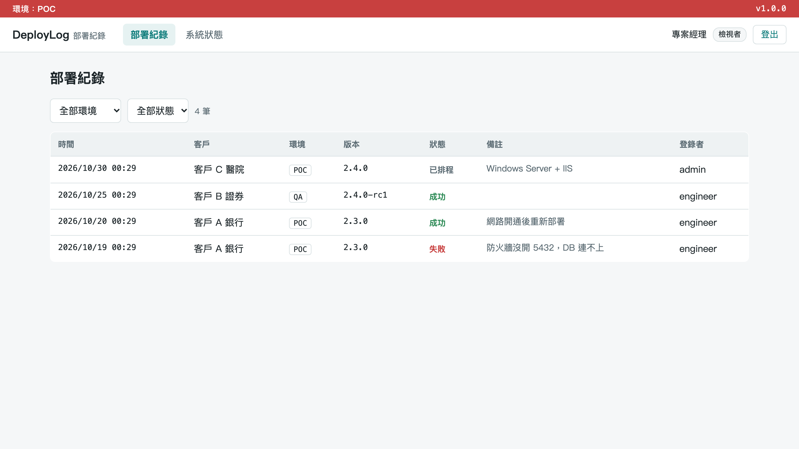

- 右上角顯示「專案經理」＋「檢視者」
- 選單只有 **部署紀錄**、**系統狀態**
- 表格裡**沒有**「登錄部署」按鈕、**沒有**「修改」

表格裡的 4 筆是 migrate 時建的範例資料（日期會依你跑 migrate 的時間不同）。看一下最下面那筆：「客戶 A 銀行，POC，2.3.0，**失敗**，防火牆沒開 5432，DB 連不上」——這屬於三類裡的哪一類？（答案：環境。）

**試試看**：在網址列直接打 <http://localhost:5000/users>（帳號管理頁）——會被帶回部署紀錄頁，因為 viewer 沒有這個權限。

按右上角 **登出**。

## 步驟 6：用 engineer 登入

帳號 `engineer`、密碼 `Lab@2026`。

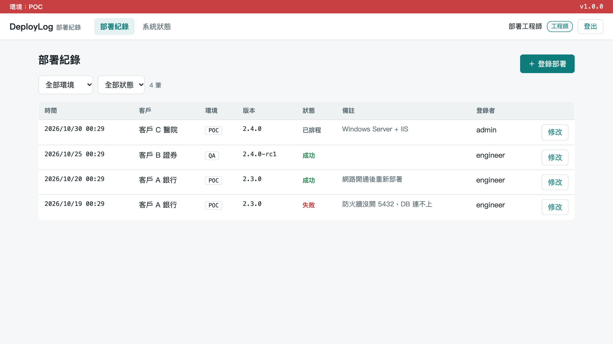

跟 viewer 比，多了右上角的 **＋ 登錄部署** 和每一列的 **修改**。

按 **＋ 登錄部署**，隨便登一筆：

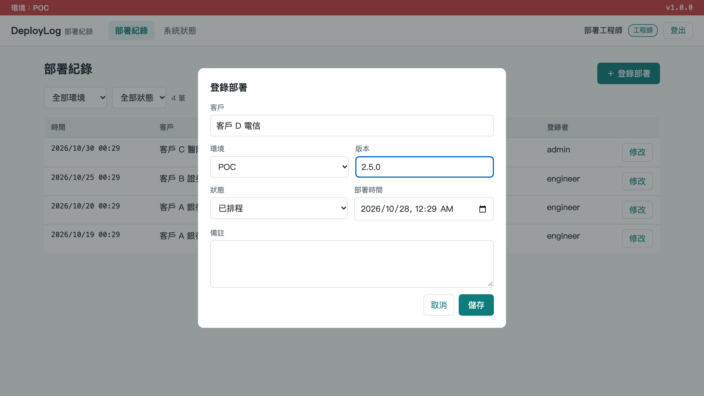

1. 客戶：`客戶 D 電信`
2. 環境：`POC`、版本：`2.5.0`
3. 狀態：`已排程`
4. 按 **儲存** → 列表多一筆，變成 5 筆

engineer **沒有**「刪除」按鈕。按 **登出**。

## 步驟 7：用 admin 登入

帳號 `admin`、密碼 `Lab@2026`。

1. **部署紀錄**：每一列除了「修改」，還多了 **刪除**——只有管理員能刪。
2. 點選單的 **帳號管理**：

   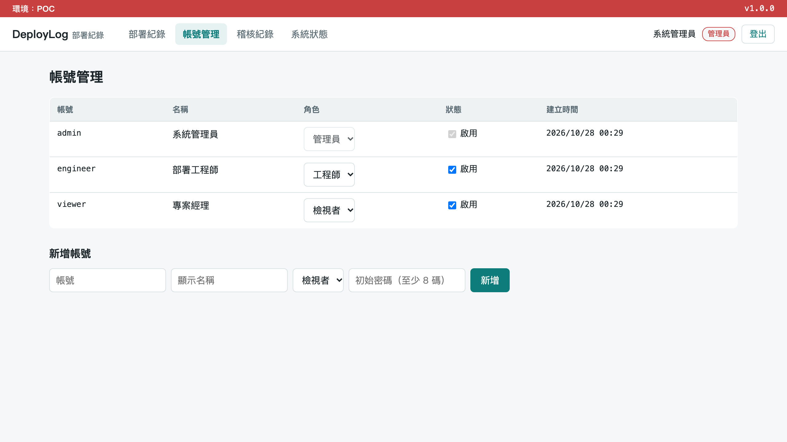

   可以改別人的角色、停用帳號、新增帳號。admin 自己那一列的「啟用」是灰的——**管理員不能停用自己或降自己的權限**，避免系統裡沒有管理員。

3. 點 **稽核紀錄**：

   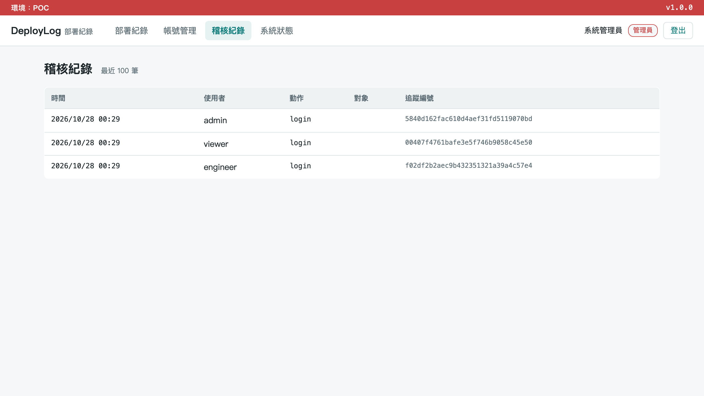

   你剛才 viewer、engineer、admin 的每次 `login`，以及 engineer 的 `deployment.create`（登錄了客戶 D 電信那筆）都在這裡，每一筆都有**追蹤編號**。截圖裡只有三筆 login；你的會比較多。

4. 點 **系統狀態**：

   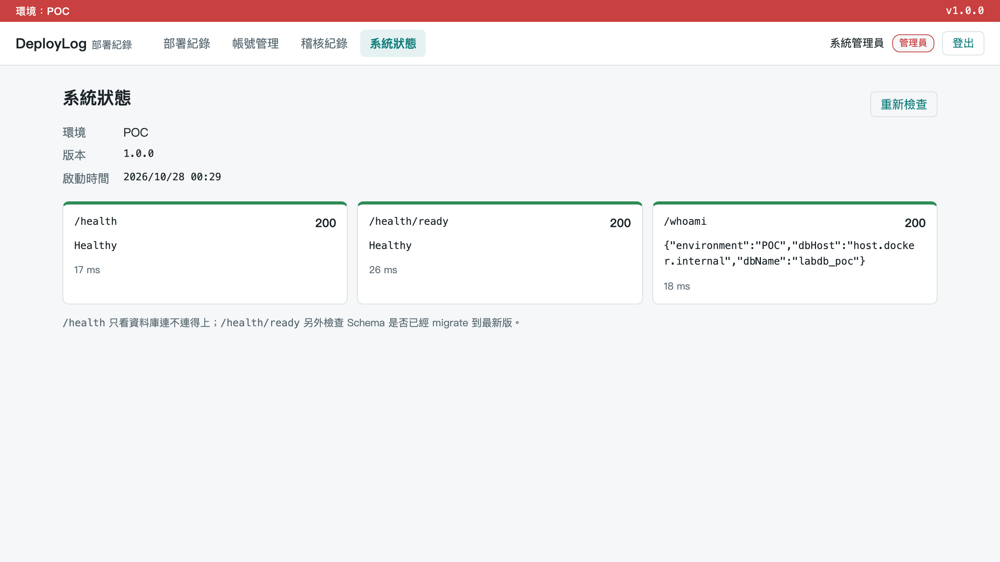

   這一頁就是把步驟 3 那三個網址在畫面上再問一次。**這就是 Design for Operations**：維運的人不用登入主機、不用翻設定檔，打開一頁就知道「這是哪個環境、哪一版、活著沒、準備好了沒、吃的是哪組設定」。

**試試看**：登出，用錯的密碼登入一次（例如帳號 `viewer`、密碼 `wrong`），再用 admin 登入看稽核紀錄——會多一筆 `login.failed`。登入失敗的畫面**不會**告訴你是「帳號不存在」還是「密碼錯」，避免被拿來猜帳號。

## 步驟 8：權限是後端在擋，不只是前端藏按鈕

viewer 看不到「刪除」按鈕，只是畫面方便。真正的把關在後端 API：

1. **登出**後，瀏覽器直接開 <http://localhost:5000/api/deployments>——HTTP **401**（沒登入）。
2. 用 `viewer` 登入後，直接開 <http://localhost:5000/api/users>——HTTP **403**（登入了，但權限不足）。

網站回的是一行 JSON（Chrome／Edge 會直接顯示；有的瀏覽器會改成下載檔案或一頁空白），重點是 `title` 和 `status`：

```
{"type":"https://tools.ietf.org/html/rfc9110#section-15.5.2","title":"Unauthorized","status":401,"traceId":"0b167f94405d9c757a749ba279fea710"}
{"type":"https://tools.ietf.org/html/rfc9110#section-15.5.4","title":"Forbidden","status":403,"traceId":"82f0bdc710e6a06b99f35c959ed2505e"}
```

（`traceId` 每次不同。）按 F12 開「開發人員工具」→「網路（Network）」重新整理，也可以看到狀態碼 401／403。

> 規則寫在 `lab-project/Program.cs` 的 `AddAuthorizationBuilder()`（`CanEdit`、`AdminOnly` 兩條），端點用 `.RequireAuthorization("CanEdit")` 套用。**就算有人繞過畫面直接打 API，一樣會被擋。** M6 收尾會再談最小權限。

## 步驟 9：收掉

```bash
docker rm -f lab-api
```

你應該看到：

```
lab-api
```

一定要刪：M2 的 Lab 會用同一個名字 `lab-api` 起新的容器。**mock 服務（`mock-db`、`mock-external-api`）留著不要停**，M2 還要用。資料庫裡的資料也還在，下次對 POC 啟動網站不用再 migrate。

> **剛剛發生了什麼？** 你刪掉了網站的容器，但沒有任何東西遺失——下次 `docker run` 同一個 image，就是一模一樣的網站。這就是牲畜：**重建比修理便宜**。唯一要小心保管的是資料庫（寵物），這也是為什麼它在另一個容器、用 migrate 管理。

---

# 練習：把「在我的電腦上會動」分類

下面每個情境，判斷它屬於 **環境／設定／依賴** 哪一類（可以多選），並寫出這兩天哪個模組、哪個做法能預防它。最後一題寫你自己在第 1 節記下的案例。

| # | 情境 | 類別 | 怎麼預防 |
|---|------|------|---------|
| 1 | 客戶 A 銀行 POC：防火牆沒開 5432，DB 連不上 | | |
| 2 | 開發機是 .NET 10，客戶主機的 IIS 只裝了舊版的 Hosting Bundle，網站起不來 | | |
| 3 | 部署人員到現場把連線字串改成客戶的 DB IP，打錯一碼 | | |
| 4 | 專案的套件用版本範圍（例如 `8.*`），現場重新編譯時抓到新版，行為變了 | | |
| 5 | 要先手動裝某個系統元件才跑得起來，但安裝文件沒寫 | | |
| 6 | 一台 POC 主機兩年來有好幾個人直接上去改 `web.config`，現在沒人知道上面的設定是什麼 | | |
| 7 | QA 環境的 Feature Flag 是開的，POC 是關的，客戶說功能不見了 | | |
| 8 | POC 主機的 Port 5000 早就被另一個服務佔用 | | |
| 9 | （你自己的案例） | | |

<details>
<summary>參考答案（自己想過再打開）</summary>

| # | 類別 | 怎麼預防 |
|---|------|---------|
| 1 | 環境 | M4：部署前預檢「DB 連不連得上」，連不上就不啟動，直接說是哪一項 |
| 2 | 環境 | Docker image 把 Runtime 一起打包（M1 Immutable Artifact）；不用 Docker 時，M4 預檢 Runtime 版本 |
| 3 | 設定（＋Configuration Drift 的起點） | M2：設定放進版控的 `.env`／CI 變數，不在現場手改；M4 預檢設定值 |
| 4 | 依賴（＋非 Immutable 部署） | M3：lock file（`packages.lock.json`、`--locked-mode`）；M1 Build 一次，不在現場重新編譯 |
| 5 | 依賴 | Twelve-Factor Dependencies：明確宣告；寫進 Dockerfile 或安裝腳本，不靠文件 |
| 6 | 設定＋Configuration Drift（Snowflake Server） | M2 設定外部化＋版控；Pets vs Cattle：能用腳本重建，就不用登入手改 |
| 7 | 設定 | M2：每個環境的設定差異寫在 `.env.*`／CI Environment scope 變數裡，一眼比得出來 |
| 8 | 環境 | M4：預檢「Port 有沒有被佔用」 |

很多情境同時中兩類，答案不是唯一的。重點是：**能說出它是哪一類，就知道該往哪個方向預防。**

</details>

---

## 程式設計：程式要怎麼寫才支援

今天動手時的「同一個 image，先 `migrate` 再啟動網站」，是程式刻意設計出來的。`lab-project/Program.cs` 第 77–81 行：

```csharp
var app = builder.Build();

// Module 6：`docker run ... keypasco-lab-api migrate` 只做 Schema 升級就結束，不啟動網站
if (args.FirstOrDefault() == "migrate")
    return await DbSetup.MigrateAsync(app.Services, config);
```

Disposability（精華 4）也從 `lab-project/Dockerfile` 的最後一行開始：

```dockerfile
ENTRYPOINT ["dotnet", "MyApi.dll"]
```

JSON 陣列（exec 形式）讓 `dotnet` 直接收到 `docker stop` 的關閉訊號，做完手上的請求再結束。整個網站的架構圖、每個維運機制在程式哪裡，見 [08 程式設計 §0 架構全貌](08-app-design-for-ops.md#0-先看全貌deploylog-的架構)；關閉與無狀態見 [§5](08-app-design-for-ops.md#5-無狀態與可拋棄disposability)。

---

## 自我檢查

- [ ] 我能說出「在我的電腦上會動」的三大類（環境／設定／依賴），並各舉一個例子
- [ ] 我能解釋 Configuration Drift 和 Snowflake Server，以及「到現場手改設定」為什麼會造成它
- [ ] 我能說出 Twelve-Factor 本課程講的四條：Config、Dependencies、Build-Release-Run、Disposability
- [ ] 我能用一句話說明 Immutable Artifact，以及為什麼「Build 一次」比「每個環境重新編譯」安全
- [ ] 我能說出 Pets 和 Cattle 的差別，以及為什麼資料庫是例外
- [ ] 我能舉出 Design for Operations 的三個檢查點
- [ ] 我把 DeployLog 跑起來了：migrate → 啟動 → `/health`、`/health/ready` 都是 `Healthy`
- [ ] 我能說出 `/health` 和 `/health/ready` 的差別
- [ ] 我用 viewer、engineer、admin 各登入過一次，知道三種角色能做什麼
- [ ] 我知道權限是**後端**在擋（401 vs 403）
- [ ] 我已經 `docker rm -f lab-api`，`mock-db` 還在跑

---

## 疑難排解

| 症狀 | 原因 | 處理 |
|------|------|------|
| 登入時畫面說「資料庫 Schema 不是最新版」 | 沒跑 migrate | 做步驟 1，不用重啟網站，重新整理 |
| 登入時畫面說「資料庫連不上」 | `mock-db` 停了，或少了 `-e DB_HOST=host.docker.internal` | `docker compose ps` 看 mock-db；`docker rm -f lab-api` 後照步驟 2 重新啟動 |
| 帳號密碼都對卻登不進去 | migrate 時沒有建帳號（資料庫不是空的時候不會再建） | 確認步驟 1 的 log；仍不行請找講師 |
| 頁首不是紅色 POC | `--env-file` 用錯檔 | `docker rm -f lab-api`，確認是 `.env.poc` |
| `http://localhost:5000` 打不開（Mac） | AirPlay 佔 5000 | 用 `-p 5050:5000`、開 `http://localhost:5050` |
| 想看網站的 log | — | `docker logs lab-api`（M5 會細講） |

---

上一步：[00 環境準備](00-setup.md)｜下一步：[M2 組態管理](02-m2-config.md)｜回 [目錄](README.md)
