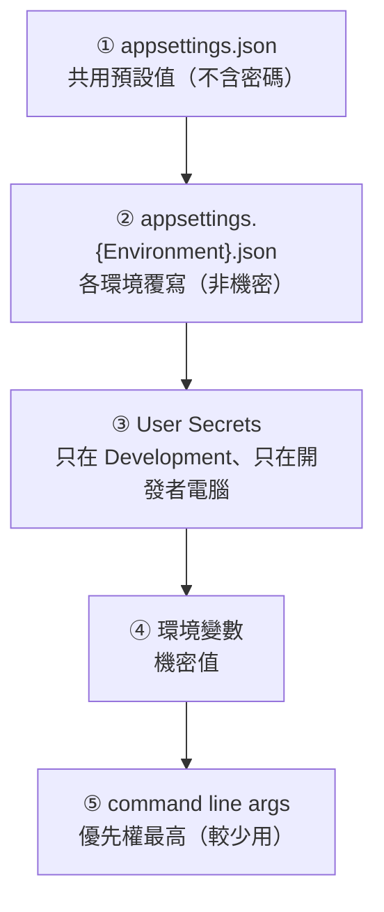
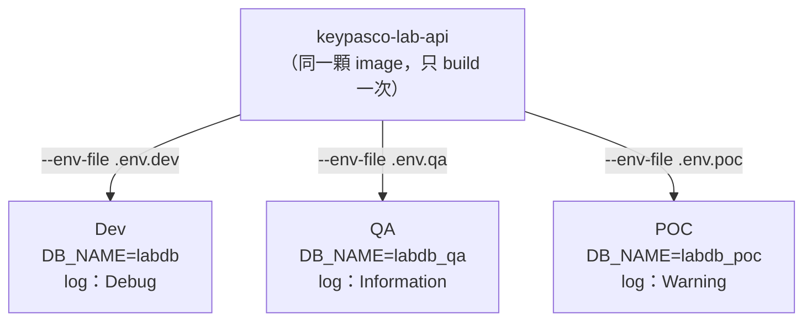
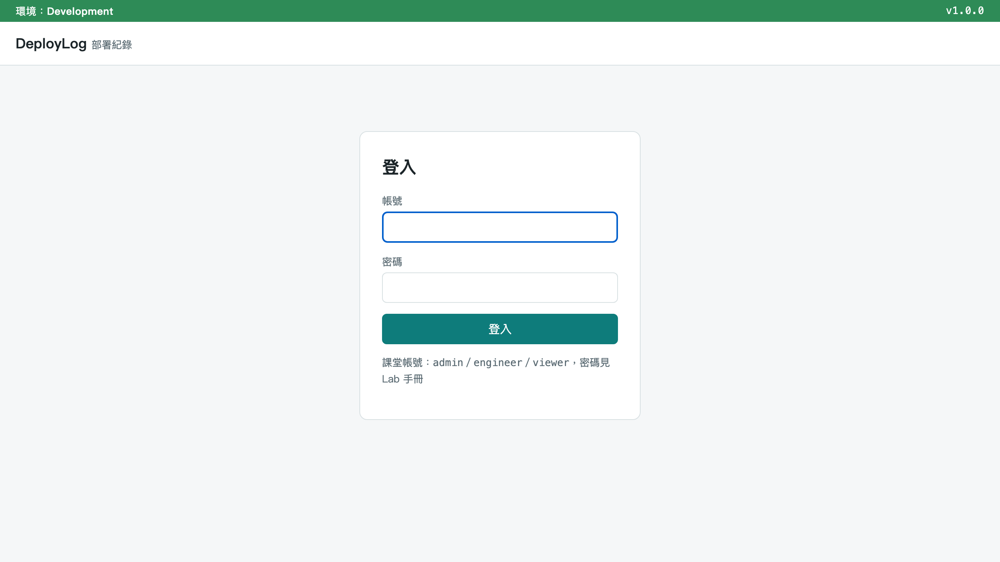
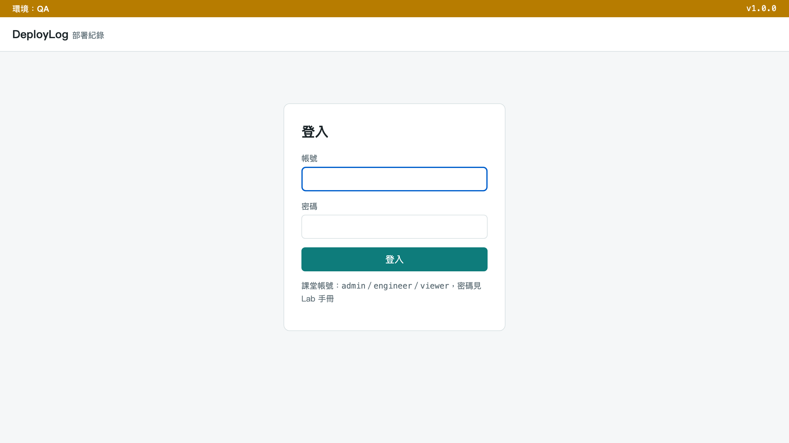
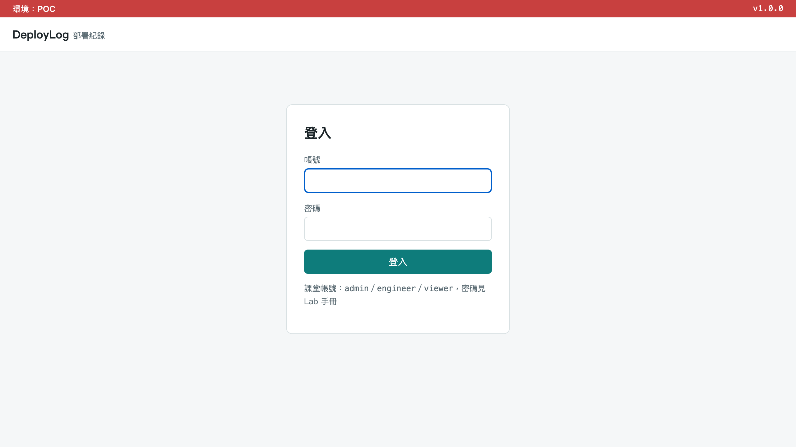
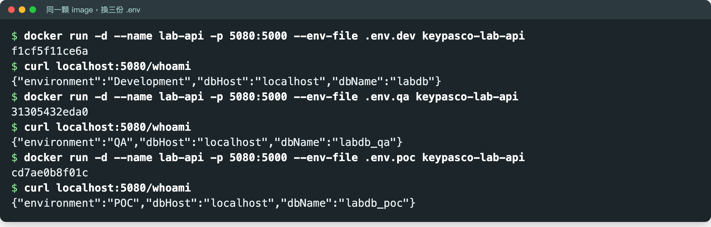

# 手把手：M2 組態解耦與環境配置管理（含 Lab）

> DevOps 實作課｜Day 1 M2
> 這份文件帶你做一件事：**把設定從程式碼裡搬出來，讓同一個 image 不改程式、不重新編譯，就能在 Dev／QA／POC 三個環境之間切換。**

---

## 你會學到什麼

| 觀念 | 在範例專案哪裡 | 接到哪個模組 |
|------|---------------|-------------|
| 設定寫死在程式碼的代價 | 第 2、3 節的反面教材 | M1：不可變交付物（[01-m1-operability.md](01-m1-operability.md)） |
| 為什麼各環境要盡量一樣（Dev/Prod Parity） | 第 4 節 | M3：CI（[03-m3-ci-pipeline.md](03-m3-ci-pipeline.md)） |
| ASP.NET Core 設定分層：後面蓋前面 | `apps/dotnet-deploylog/appsettings*.json`、`Program.cs` | M5：log 等級也走這套（[05-m5-logging.md](05-m5-logging.md)） |
| 機密放環境變數、不進版控 | `.env.dev`／`.env.qa`／`.env.poc` | M3：GitLab 變數注入；[03b](03b-gitlab-environments-release.md)：Environment scope |
| 同一顆 image 切三個環境 | Lab：`/whoami`、網站頁首色條 | M4：預檢讀的是同一組 `DB_*`（[04-m4-deploy-scripts.md](04-m4-deploy-scripts.md)） |

**前置**：已照 [00-setup.md](00-setup.md) 裝好 Docker、解壓 `keypasco-devops-lab.zip`。以下所有指令都在解壓出來的 `devops-lab/` 資料夾裡執行。

> **關於指令**：`docker`、`docker compose` 在 PowerShell（Windows）和 bash（macOS／Linux）寫法一樣，只給一份。寫法不同的地方（`curl`、複製檔案、開編輯器）兩種都會列出來。

---

## 1. 對號入座：設定是怎麼到現場的？

先想想你們團隊現在是不是這樣：

> 資深工程師寫好設定，部署人員到現場打開文字檔手改。

這個做法有三個問題：

| 問題 | 實際長什麼樣 |
|------|-------------|
| **沒有單一真相來源** | 設定散落在「程式碼」和「部署人員的記憶／筆記」兩處，誰也說不準哪份才對 |
| **改錯一個字就掛** | 每到一個新環境，都要有人工改一次文字檔 |
| **事後查不到** | 沒有版控：改了什麼、誰改的、為什麼改，都沒紀錄 |

把一天的流程畫出來，對照學完 M2 之後的樣子：

| | 1 | 2 | 3 | 4 | 5 |
|---|---|---|---|---|---|
| **現在** | 資深工程師寫好設定 | 打包交給部署人員 | 到現場打開文字檔手改 | ❌ 改錯一個字 | ❌ 服務掛了：誰改的？ |
| **M2 之後** | 設定分三層，進版控 | 同一顆 image 交出去 | 現場只設環境變數 | 換環境不用開任何檔案 | ✅ 改了什麼查得到 |

差別在於：設定從「人記得」變成「**放在固定的地方、有紀錄**」。接下來就是在講哪些設定放哪一層、怎麼不改程式就切換環境。

---

## 2. 反面教材：連線字串寫死在程式碼

```csharp
public class OrderService
{
    private const string ConnectionString =
        "Host=10.20.30.40;Database=prod_orders;Username=admin;Password=Sup3rSecret!";

    // 換到 QA 環境？改這一行重編一次。
    // 換到 POC 環境？改這一行重編一次。
    // 部署人員手上沒有原始碼？只好去改編譯後的設定檔文字。
}
```

這一行至少有三個問題：

1. **環境寫死**：IP `10.20.30.40`、資料庫 `prod_orders` 只適用一個環境
2. **帳密進版控**：密碼跟著程式碼進了 Git，所有看得到 repo 的人都看得到
3. **用 admin 帳號**：應用程式連資料庫用最高權限帳號，出事時損害最大（M6 會講最小權限）

不寫程式的人只要看得出「**IP 和密碼寫在程式裡**」就夠了。

---

## 3. 這樣做的代價


**換一次環境，就要走一次這整條路。** 不想走的話，另一條路是部署人員直接改編譯後的設定檔——更危險，因為改錯了沒人知道、也沒紀錄。

這也違反 M1 講的 **Immutable Artifact（不可變交付物）**：一個版本建好、測過之後，從測試到正式都應該是同一份，不該重新編譯。設定寫死，逼得你每個環境都非重編不可——那 QA 測過的，就不是客戶現場跑的那一份了。

> 前端也有同樣的坑：例如 Vite 專案的 `import.meta.env.VITE_*` 是在 **build 時**直接代換成字串寫進產物。API 位址寫在這裡，換環境就得重新 build。

---

## 4. 理論：環境同等性（Dev/Prod Parity）

Twelve-Factor App 第 10 條：**開發、測試、正式環境要盡量相同。** 落差越大，「我這邊會動，你那邊怎麼不會動」就越常發生。它把落差分成三種：

| 落差 | 傳統做法 | 縮小之後 | 本課程對應 |
|------|---------|---------|-----------|
| **時間** | 寫完幾週後才部署 | 寫完幾小時內就部署 | M3 CI |
| **人員** | 開發寫、維運部署，彼此不知道對方環境 | 寫的人也參與部署，維運早期參與 | Lab 兩人一組（開發＋維運） |
| **工具** | 開發用 SQLite／本機 IIS Express，正式用 PostgreSQL／IIS | 各環境用同一種 DB、同一個 image | M1、M2 |

**分層設定就是為了這件事**：能一樣的放 `appsettings.json`，大家共用；真的必須不同的（連線位址、機密），才放到「環境」那一層。範例專案的做法是：開發機、教室、POC 都跑同一個 `postgres:16` image、同一顆應用程式 image，差異只在 `.env`。

出處：[12factor.net/dev-prod-parity](https://12factor.net/dev-prod-parity)、[12factor.net/config](https://12factor.net/config)

---

## 5. ASP.NET Core 設定分層：後面蓋前面

ASP.NET Core 內建的設定系統（`IConfiguration`）本來就支援分層，不用裝任何套件。它**由上往下依序載入，同一個 key 出現在好幾層，後面載入的蓋掉前面的**：



- `{Environment}` 由環境變數 **`ASPNETCORE_ENVIRONMENT`** 決定：設成 `QA` 就載入 `appsettings.QA.json`；沒有那個檔案就跳過那一層，不會出錯。
- ③ User Secrets 是開發者在自己電腦放密碼用的，只在 `Development` 環境、而且專案有設定時才會載入。範例專案沒用到，知道有這一層就好。
- **小問答**：同一個 key 同時出現在 ①、② 和 ④，最後是誰贏？→ **④ 環境變數**。

> **系統工程師／MIS 記住一件事：現場要改設定，改環境變數，不改 json 檔。**

範例專案 `Program.cs` 開頭就寫著這個順序：

```csharp
// 設定值的來源（後面蓋前面）：
//   appsettings.json → appsettings.{環境}.json → 環境變數（--env-file 帶進來的）
// 程式碼裡只寫「要哪個設定」，不寫「值是多少」。
```

下面三小節分別看每一層放什麼。

### 5.1 `appsettings.json`：共用的非機密預設值（進版控）

`apps/dotnet-deploylog/appsettings.json`（節錄，log 格式的細節 M5 再講）：

```json
{
  "Logging": {
    "LogLevel": {
      "Default": "Information",
      "Microsoft.AspNetCore": "Warning"
    },
    "Console": { "FormatterName": "json" }
  },
  "AllowedHosts": "*",
  "DB_HOST": "localhost",
  "DB_PORT": "5432",
  "DB_NAME": "labdb",
  "DB_USER": "labuser"
}
```

注意：**這裡沒有 `DB_PASSWORD`，是刻意的。** 預設值讓開發者在本機跑得起來；拿到正式環境，沒人給密碼就一定連不上——寧可連不上，也不要帶著一組寫死的密碼上線。

### 5.2 `appsettings.{Environment}.json`：非機密的環境差異（進版控）

範例專案有三份：

| 檔案 | 內容 | 套用時機 |
|------|------|---------|
| `appsettings.Development.json` | log 開到 `Debug`、console 改成好讀的 `simple` 格式 | `ASPNETCORE_ENVIRONMENT=Development` |
| `appsettings.QA.json` | `DB_NAME` = `labdb_qa` | `ASPNETCORE_ENVIRONMENT=QA` |
| `appsettings.POC.json` | `DB_NAME` = `labdb_poc`、log 只留 `Warning` | `ASPNETCORE_ENVIRONMENT=POC` |

`apps/dotnet-deploylog/appsettings.POC.json` 全文：

```json
{
  "DB_NAME": "labdb_poc",
  "Logging": {
    "LogLevel": {
      "Default": "Warning"
    }
  }
}
```

只寫「跟共用值不一樣」的那幾個 key，其他的沿用 `appsettings.json`。

> ⚠️ **檔名要跟環境名稱一字不差**：`appsettings.POC.json` ↔ `ASPNETCORE_ENVIRONMENT=POC`。容器和 Linux 主機上檔名**大小寫有差**，設成 `Poc` 就找不到 `appsettings.POC.json`，那一層會被靜靜跳過。這是 Lab 最常卡的地方。

**練習想一想**：你們的系統有哪些「環境之間不一樣，但不是機密」的設定？（例如 DB 名稱、log 等級、外部服務的測試站網址、功能開關）

### 5.3 環境變數：機密值（不進版控）

機密（密碼、API Key、憑證）放環境變數，由**部署端**（伺服器、Docker、之後的 CI）在執行時給，不寫進任何進版控的檔案。

巢狀的設定 key 怎麼用環境變數表示？用**雙底線 `__`**：

```bash
# 巢狀設定用雙底線（__）：ConnectionStrings:Default → ConnectionStrings__Default
export ConnectionStrings__Default="Host=...;Database=...;Username=...;Password=..."
export ASPNETCORE_ENVIRONMENT=POC
```

```powershell
# PowerShell（只對目前這個視窗有效）
$env:ConnectionStrings__Default = "Host=...;Database=...;Username=...;Password=..."
$env:ASPNETCORE_ENVIRONMENT = "POC"
```

- 設定檔裡的階層用冒號表示（`ConnectionStrings:Default`），但冒號在 Linux 環境變數名稱裡不能用；**雙底線各平台都支援**，ASP.NET Core 讀取時會自動轉回冒號。
- Windows／IIS 上，同樣的值設在系統環境變數或 IIS 站台的環境變數，**key 寫法一樣**。

**兩者分工**：

| 層 | 決定什麼 | 進版控？ |
|----|---------|---------|
| `appsettings.{Environment}.json` | 用**哪一組非機密設定** | 進 |
| 環境變數 | **機密值填什麼**（以及現場要臨時改的值） | 不進 |

兩層都不需要部署人員打開任何文字檔手改。

**機密由誰、在什麼時候設進去？** 今天的答案是「部署端」：Lab 裡就是 `docker run --env-file`。下一個模組 M3 會講 CI 怎麼安全注入（GitLab 的 Masked／Protected 變數），見 [03-m3-ci-pipeline.md](03-m3-ci-pipeline.md)。

### 5.4 範例專案實際怎麼組連線字串

範例專案沒有用 `ConnectionStrings__Default` 一整串，而是拆成幾個 `DB_*` 值，由 `Program.cs` 自己組起來：

```csharp
var connectionString =
    $"Host={config["DB_HOST"]};Port={config["DB_PORT"]};Database={config["DB_NAME"]};" +
    $"Username={config["DB_USER"]};Password={config["DB_PASSWORD"]};Timeout=3;Gss Encryption Mode=Disable";
```

為什麼？因為 `docker run --env-file` **不會展開 `$變數`**。如果在 `.env` 寫 `ConnectionStrings__Default=Host=$DB_HOST;...`，`$DB_HOST` 會原封不動變成字串的一部分。拆開寫，一個值只寫一次；M4 的預檢腳本讀的也是同一組 `DB_*`。正式專案兩種做法都常見。

> 另外 `RequiredSettings.cs` 列出 `DB_HOST`、`DB_PORT`、`DB_NAME`、`DB_USER` 四個必填 key，少一個就列出來——M3 的 CI 單元測試會測它，M4 的預檢 0 是同一件事的腳本版。

### 5.5 `.env` 檔長什麼樣

Lab 用的 `.env.qa`：

```
# Module 2 Lab — QA 環境設定
ASPNETCORE_ENVIRONMENT=QA
APP_PORT=5000
EXTERNAL_API_URL=http://localhost:8081
DB_HOST=localhost
DB_PORT=5432
DB_NAME=labdb_qa
DB_USER=labuser
DB_PASSWORD=labpass
```

三份 `.env` 只差兩行：

| 檔案 | `ASPNETCORE_ENVIRONMENT` | `DB_NAME` |
|------|-------------------------|-----------|
| `.env.dev` | `Development` | `labdb` |
| `.env.qa` | `QA` | `labdb_qa` |
| `.env.poc` | `POC` | `labdb_poc` |

幾個你可能會問的：

- **`.env` 裡也有 `DB_HOST`、`DB_NAME` 這些非機密值，不是重複了嗎？** 是刻意的：M4 的預檢腳本要從**同一份檔案**讀到全部的值。環境變數這層蓋在最上面，值跟 json 一樣也沒關係。Lab 的加分題會證明「拿掉 `.env` 的那一行，值就退回 json 那一層」。
- **`APP_PORT` 是什麼？** 給 M4 預檢腳本檢查 port 用的，**不是**網站在容器裡聽的 port。容器裡固定聽 5000（`Dockerfile` 寫了 `ASPNETCORE_HTTP_PORTS=5000`）。所以 `docker run -p 5050:5000` 這種寫法，改的只有冒號**左邊**（你電腦上的 port）。
- **`DB_PASSWORD=labpass` 明文放在講義裡，不是說機密不進版控？** 這是課堂假密碼，只能連你自己電腦上的練習資料庫。真實專案的做法：只把 **`.env.example`**（範本，值留空或假值）放進 repo，真正的 `.env` 寫進 `.gitignore`；正式環境的值由部署端或 CI 注入。
- **`.env.example` 寫什麼？** 列出所有需要的變數名稱，讓下一個部署的人知道要填哪些。好的範本會在變數旁註明「設錯會怎麼壞」，對方就不用猜。

---

## 6. 一張圖看懂：同一顆 image，三個環境



**換環境＝換一份 `.env`，不改程式、不重新編譯。** 這就是等一下 Lab 要做的事。

### 實際畫面：頁首跟著設定走

範例網站 DeployLog 的頁首有一條**環境色條**。同一顆 image，餵不同的 `.env`：

| `.env.dev` → Development（綠） | `.env.qa` → QA（黃） | `.env.poc` → POC（紅） |
|:---:|:---:|:---:|
|  |  |  |

程式裡讀環境名稱的只有這一行，顏色由前端依名稱決定：

```csharp
environment = app.Environment.EnvironmentName   // 來自 ASPNETCORE_ENVIRONMENT
```

程式沒改、沒重新 build——畫面、資料庫、log 等級全部跟著 `.env` 走。環境色條也是正式系統常見的防呆：POC／正式環境一律紅色，避免有人以為在測試環境、按下刪除。Lab 第 L6 步（選做）可以自己跑出這三張畫面。

---

## 7. 機密寫死、外洩的真實事故

| 事件 | 發生了什麼 |
|------|-----------|
| **Uber（2016）** | 工程師把 AWS 存取金鑰放在 GitHub 上的 repo（據報導是私有 repo），攻擊者取得後存取 AWS 上的資料；全球約 5,700 萬名乘客與司機資料外洩 |
| **Toyota（2017–2022）** | 委外廠商把 T-Connect 部分原始碼上傳到公開 GitHub，裡面含資料伺服器的存取金鑰；近 5 年曝險，約 29.6 萬名客戶的資料可能外洩 |
| **Samsung（2019）** | 內部 GitLab 專案設為公開、未設密碼保護，含明文 AWS 憑證，可存取整個 AWS 帳號、逾 100 個 S3 bucket |

> **commit 過一次就當作已外洩——Git 歷史刪不乾淨。** 就算下一個 commit 把密碼刪掉，舊 commit 裡還翻得到。發現金鑰外洩，第一件事是**撤銷／輪替那把金鑰**，而不是去改 Git 歷史。

延伸閱讀：
[FTC：Uber 和解（2016 外洩）](https://www.ftc.gov/news-events/news/press-releases/2018/04/uber-agrees-expanded-settlement-ftc-related-privacy-security-claims)｜
[BleepingComputer：Toyota 金鑰外洩](https://www.bleepingcomputer.com/news/security/toyota-discloses-data-leak-after-access-key-exposed-on-github/)｜
[TechCrunch：Samsung 原始碼與金鑰外洩](https://techcrunch.com/2019/05/08/samsung-source-code-leak/)

業界常見的同類反模式：機密寫死在程式碼、`.env` 忘了加進 `.gitignore` 被 commit、明文存放機密、同一組帳密所有環境共用又長期不換、環境越分越多（dev／staging／qa／某人自己的 staging…）最後沒人說得清每組設定差在哪。

---

## 8. Lab：同一顆 image，切三個環境

**目標**：用三份 `.env`，不改程式碼、不重新編譯，讓同一個 image 跑出三種 `/whoami` 回應。

**兩人一組**：開發背景的人帶 L1 走讀程式（`Program.cs`、appsettings 分層），維運背景的人負責 L2–L5 的 `.env` 與 `docker run`。兩個人最後都要能自己跑出三種輸出、講得出三層各放什麼。

### L1. 走讀：設定在範例專案的哪裡

打開 `apps/dotnet-deploylog/`，只看跟設定有關的兩個地方：

1. **`appsettings*.json` 四個檔**：對照第 5.1、5.2 節，找出哪個檔有 `DB_NAME`、哪個檔改了 log 等級
2. **`Program.cs` 開頭**：找到組 `connectionString` 那幾行（第 5.4 節），再往下找 `/whoami`：

   ```csharp
   app.MapGet("/whoami", () => new
   {
       environment = app.Environment.EnvironmentName,  // 來自 ASPNETCORE_ENVIRONMENT
       dbHost = config["DB_HOST"],
       dbName = config["DB_NAME"]
   });
   ```

   `/whoami` 只回報「我現在吃到的是哪一組設定」，**不連資料庫**。教學用所以不用登入；正式系統不要對外公開主機名稱這類資訊。

**為什麼**：程式碼裡只寫「要哪個設定」（`config["DB_NAME"]`），不寫「值是多少」——值是多少，交給分層設定決定。

### L2. 啟動練習資料庫

在 `devops-lab` 資料夾裡（還沒進去就先 `cd` 到 `devops-lab`，見 [00 第 3 步](00-setup.md)）：

```bash
docker compose up -d mock-db mock-external-api
docker compose ps
```

**你應該看到**：`docker compose ps` 列出 `devops-lab-mock-db-1` 和 `devops-lab-mock-external-api-1`，STATUS 是 `Up …`（`mock-db` 會顯示 `(healthy)`）。已經在跑的話，`up -d` 只會印兩行 `Container devops-lab-mock-… Running`，也是對的。

> 已經照 [00-setup.md](00-setup.md) 啟動過、也 build 過 image，L2、L3 都可以跳過。
> `/whoami` 不連資料庫，所以這一步主要是為了 L6（看網站）和後面的 M4。

### L3. 建置 image（只建這一次）

```bash
docker build -t keypasco-lab-api apps/dotnet-deploylog
```

**你應該看到**：最後幾行出現 `naming to docker.io/library/keypasco-lab-api`，沒有 `ERROR`。

- 編譯在 Docker 裡做（Node 建前端、.NET SDK 編後端、ASP.NET 執行環境跑），**自己電腦不用裝 .NET SDK**。
- 套件版本由 lock file 鎖住（`packages.lock.json`、`package-lock.json`），M3 會講。
- 第一次要下載 base image（.NET SDK＋執行環境約 1.7 GB），網路慢的話會跑幾分鐘。

**如果不是這樣**：restore 階段失敗（連不到 nuget.org 或 npm registry）→ 教室網路擋了套件來源，請講師提供預先建好的 image（`docker load -i <檔名>.tar`）。

**為什麼只建一次**：接下來三個環境用的都是這一顆 image。整個 Lab 再也不會跑 `docker build`。

### L4. 用 Dev 設定跑一次

```bash
docker run -d --name lab-api -p 5000:5000 --env-file .env.dev keypasco-lab-api
```

**你應該看到**：一行很長的容器 ID（一串十六進位字元）。

等 1–2 秒網站起來，查它吃到哪組設定：

```bash
# bash（macOS／Linux）
curl http://localhost:5000/whoami
```

```powershell
# PowerShell（Windows）：要打 curl.exe，不是 curl
curl.exe http://localhost:5000/whoami
```

**你應該看到**：

```
{"environment":"Development","dbHost":"localhost","dbName":"labdb"}
```

看完把容器刪掉，下一步要用同一個名字：

```bash
docker rm -f lab-api
```

**如果不是這樣**：

| 狀況 | 原因 | 處理 |
|------|------|------|
| PowerShell 印出一大段 `StatusCode`、`Content`… 的表格 | PowerShell 的 `curl` 是 `Invoke-WebRequest` 的別名 | 改打 `curl.exe`，或直接用瀏覽器開 http://localhost:5000/whoami |
| `curl: (7) Failed to connect` 或 `curl: (56) Recv failure` | 網站還在啟動 | 等 2 秒再打一次；還是不行看 `docker logs lab-api` |
| `docker run` 報 `port is already allocated`，或 curl 回 403 | 5000 被別的程式佔走（Mac 12 以上的 AirPlay 接收器就會佔 5000） | 把 `-p 5000:5000` 改成 `-p 5050:5000`，curl 改打 `http://localhost:5050/whoami`（之後每一步都照這樣改） |
| `Conflict. The container name "/lab-api" is already in use` | 上一步的容器沒刪 | `docker rm -f lab-api` 再跑一次 |
| `unable to find image 'keypasco-lab-api'`／要去 Docker Hub 拉 | L3 沒 build 成功 | 回 L3 |
| `open .env.dev: no such file or directory`（或 `The system cannot find the file specified`） | 不在 `devops-lab/` 資料夾裡 | 先 `cd` 到 `devops-lab/` |

### L5. 不改程式碼、不重新 build，換成 QA、再換成 POC

**QA**：

```bash
docker run -d --name lab-api -p 5000:5000 --env-file .env.qa keypasco-lab-api
```

```bash
# bash
curl http://localhost:5000/whoami
```

```powershell
# PowerShell
curl.exe http://localhost:5000/whoami
```

**你應該看到**：

```
{"environment":"QA","dbHost":"localhost","dbName":"labdb_qa"}
```

```bash
docker rm -f lab-api
```

**POC**：

```bash
docker run -d --name lab-api -p 5000:5000 --env-file .env.poc keypasco-lab-api
```

```bash
# bash
curl http://localhost:5000/whoami
```

```powershell
# PowerShell
curl.exe http://localhost:5000/whoami
```

**你應該看到**：

```
{"environment":"POC","dbHost":"localhost","dbName":"labdb_poc"}
```

```bash
docker rm -f lab-api
```

**參考：三次跑起來應該長這樣**（截圖是講師的 Mac，5000 被系統佔用所以用 5080；教室用 5000，除了 port 數字，輸出要一模一樣）：



**如果不是這樣**：

| 狀況 | 原因 | 處理 |
|------|------|------|
| `environment` 對了，但 `dbName` 還是 `labdb` | `--env-file` 打錯檔（例如三次都打 `.env.dev`） | 看清楚 `docker run` 那行的檔名 |
| `environment` 顯示 `Development`，不是 QA／POC | `.env` 裡的 `ASPNETCORE_ENVIRONMENT` 被改掉了 | 打開 `.env.qa` 確認那一行 |

**為什麼**：三次 `docker run` 用的是**同一個 image**，只有 `--env-file` 不一樣，`environment`、`dbName` 就跟著變。這就是 M1 的 Immutable Artifact＋M2 的組態外部化：測過的那一份，原封不動送到每個環境。

#### 拆解 QA 那一行：每個值是從哪一層來的

| 欄位 | 值 | 哪一層給的 |
|------|----|-----------|
| `environment` | `QA` | 環境變數 `ASPNETCORE_ENVIRONMENT=QA`（`.env.qa`），同時讓程式去載入 `appsettings.QA.json` |
| `dbHost` | `localhost` | 環境變數 `DB_HOST`（`appsettings.json` 也是 `localhost`，被蓋掉但值一樣） |
| `dbName` | `labdb_qa` | 環境變數 `DB_NAME`（`appsettings.QA.json` 也寫了 `labdb_qa`，`appsettings.json` 的 `labdb` 被蓋掉） |
| （密碼，`/whoami` 不顯示） | `labpass` | **只有**環境變數這一層有 |

### 練習：自己加第四個環境 `.env.staging`

不動任何程式碼，新增一個 Staging 環境。

1. 複製 `.env.poc`：

   ```bash
   # bash
   cp .env.poc .env.staging
   ```

   ```powershell
   # PowerShell
   Copy-Item .env.poc .env.staging
   ```

2. 用編輯器打開 `.env.staging`（Windows：`notepad .env.staging`；Mac：`open -e .env.staging`，或用 VS Code），改兩行後存檔：

   ```
   ASPNETCORE_ENVIRONMENT=Staging
   DB_NAME=labdb_staging
   ```

   Windows 記事本存檔時換行會變成 CRLF，`docker run --env-file` 讀得懂，不用另外處理（已實測：CRLF 的 `.env` 跑出的 `/whoami`、migrate 都正常）。

3. 跑起來看看：

   ```bash
   docker run -d --name lab-api -p 5000:5000 --env-file .env.staging keypasco-lab-api
   ```

   ```bash
   # bash
   curl http://localhost:5000/whoami
   ```

   ```powershell
   # PowerShell
   curl.exe http://localhost:5000/whoami
   ```

   **你應該看到**：

   ```
   {"environment":"Staging","dbHost":"localhost","dbName":"labdb_staging"}
   ```

   ```bash
   docker rm -f lab-api
   ```

**為什麼**：範例專案裡**沒有** `appsettings.Staging.json`，所以那一層直接跳過，其餘沿用 `appsettings.json`（log 等級 `Information`），`DB_NAME` 由環境變數給。多一個環境＝多一份 `.env`，程式和 image 都不用動。

### 加分題：親眼看「後面蓋前面」

**A. 拿掉環境變數那一層**

1. 複製一份 `.env.qa`（不要改原檔）：

   ```bash
   # bash
   cp .env.qa .env.qa-nodbname
   ```

   ```powershell
   # PowerShell
   Copy-Item .env.qa .env.qa-nodbname
   ```

2. 用編輯器打開 `.env.qa-nodbname`，**刪掉 `DB_NAME=labdb_qa` 那一行**，存檔。
3. 跑起來：

   ```bash
   docker run -d --name lab-api -p 5000:5000 --env-file .env.qa-nodbname keypasco-lab-api
   ```

   再用 `curl`（bash）或 `curl.exe`（PowerShell）打 `http://localhost:5000/whoami`。

   **你應該看到**：`dbName` 仍然是 `labdb_qa`：

   ```
   {"environment":"QA","dbHost":"localhost","dbName":"labdb_qa"}
   ```

   ```bash
   docker rm -f lab-api
   ```

**為什麼**：環境變數那一層沒給 `DB_NAME`，值就退回下一層 `appsettings.QA.json` 的 `labdb_qa`。想一想：如果改刪 `.env.poc` 的 `DB_NAME`，會退回什麼？如果是 `.env.dev` 呢？（提示：沒有 `appsettings.Development.json` 寫 `DB_NAME`）

**B. 最上面那一層：command line args**

image 名稱後面接的參數會傳給程式，優先權比環境變數還高：

```bash
docker run -d --name lab-api -p 5000:5000 --env-file .env.qa keypasco-lab-api --DB_NAME=labdb_cli
```

再打一次 `/whoami`。**你應該看到**：

```
{"environment":"QA","dbHost":"localhost","dbName":"labdb_cli"}
```

```bash
docker rm -f lab-api
```

`.env.qa` 明明寫 `DB_NAME=labdb_qa`，還是被參數蓋掉。實務上很少這樣用（參數會出現在程序清單裡，機密尤其不要這樣傳），知道有這一層就好。

### L6.（選做）看完整網站換環境

`/whoami` 是給 curl 看的；同一個 image 也是一個完整的網站。讓容器連到 mock-db、先建資料表（`migrate`，M6 會講），再用瀏覽器開。

1. 對 QA 的資料庫跑一次 migrate：

   ```bash
   docker run --rm --env-file .env.qa --add-host=host.docker.internal:host-gateway -e DB_HOST=host.docker.internal keypasco-lab-api migrate
   ```

   **你應該看到**：三行 JSON log，`"Message"` 欄位依序是（節錄）：

   ```
   資料庫 labdb_qa：已套用 0 個，待套用 2 個 20261027161121_InitialCreate, 20261027161130_AddAuditLogs
   已建立預設帳號 admin／engineer／viewer（課堂用預設密碼，正式環境請勿使用）
   Migration 完成，目前版本 20261027161130_AddAuditLogs
   ```

   每行實際長這樣：`{"Timestamp":"…","EventId":0,"LogLevel":"Information","Category":"Migrate","Message":"資料庫 labdb_qa：已套用 0 個…","State":{…},"Scopes":[]}`。

   第二次跑會變成「已套用 2 個，待套用 0 個」，也是正常的。

2. 啟動網站：

   ```bash
   docker run -d --name lab-api -p 5000:5000 --env-file .env.qa --add-host=host.docker.internal:host-gateway -e DB_HOST=host.docker.internal keypasco-lab-api
   ```

3. 瀏覽器開 http://localhost:5000 ，帳號 `engineer`、密碼 `Lab@2026`。

   **你應該看到**：頁首色條是 **QA（黃）**（見第 6 節的截圖）。

4. 看完刪掉：

   ```bash
   docker rm -f lab-api
   ```

換成 `.env.poc`（記得也要先對 POC 跑一次 `migrate`）就變 **POC（紅）**；`.env.dev` 是 **Development（綠）**。程式沒動，畫面跟著設定走。

**為什麼要加 `-e DB_HOST=host.docker.internal`**：容器裡的 `localhost` 指的是**容器自己**，不是你的電腦，所以 `.env` 裡的 `DB_HOST=localhost` 其實連不到 mock-db（L4、L5 的 `/whoami` 不連資料庫，才沒出事）。`-e` 寫在 `--env-file` 後面、蓋掉同名的值，`host.docker.internal` 指回你的電腦。這件事 M4 會正式處理，見 [04-m4-deploy-scripts.md](04-m4-deploy-scripts.md)。

---

## 程式設計：程式要怎麼寫才支援

分層設定是框架內建的（`WebApplication.CreateBuilder(args)`），程式要做的是**只讀 `config["KEY"]`、不寫值**（第 5.4 節）。還差一步：`RequiredSettings.cs` 寫好了、M3 也測了，但 `Program.cs` 啟動時**沒有呼叫它**。建議加在 `var config = builder.Configuration;` 下一行（範例，已編譯、實測）：

```csharp
// 範例：必填設定少一個就不啟動（Fail Fast）；放在 Build() 之前，migrate 指令也一樣會被擋
if (RequiredSettings.Missing(config) is { Length: > 0 } missing)
{
    Console.Error.WriteLine($"缺少必填設定：{string.Join(", ", missing)}，服務不啟動");
    return 1;
}
```

⚠️ 只加這段還不夠：`appsettings.json` 替四個必填 key 都放了預設值（`localhost`、`labdb`…），**完全沒給**時會靜靜退回預設值，只有「給了空值」才擋得到。開發用的預設值應該放 `appsettings.Development.json`。另外，連線字串用字串內插組，密碼裡有 `;` 就會壞。這三件事的完整說明與改法見 [08 程式設計 §1](08-app-design-for-ops.md#1-組態外部化與分層)。

**Java 組**：同一份 `.env.poc` 給 Spring Boot 用、換 `SPRING_PROFILES_ACTIVE` 切環境，實際跑一次見 [09 步驟 2、5](09-java-spring-demo.md#步驟-2用-poc-環境的設定啟動m2)。

---

## 9. 自我檢核

做完 Lab，對照下面三種輸出（在 `devops-lab/` 下）：

```
docker run --env-file .env.dev ...  → {"environment":"Development","dbHost":"localhost","dbName":"labdb"}
docker run --env-file .env.qa  ...  → {"environment":"QA","dbHost":"localhost","dbName":"labdb_qa"}
docker run --env-file .env.poc ...  → {"environment":"POC","dbHost":"localhost","dbName":"labdb_poc"}
```

- [ ] 我用三份 `.env` 跑出上面三種輸出，過程中**沒有重新編譯**（整個 Lab 只跑過一次 `docker build`）
- [ ] 我說得出 `appsettings.json`／`appsettings.{Environment}.json`／環境變數各放什麼
- [ ] 我能指出連線字串、密碼、API Key 該放哪一層，以及**為什麼不進版控**
- [ ] 我知道 `ASPNETCORE_ENVIRONMENT` 決定載入哪個 `appsettings.{Environment}.json`，而且大小寫要一致
- [ ] 我知道同一個 key 出現在好幾層時誰贏（後面蓋前面，環境變數蓋 json）
- [ ] 現場要改設定時，我知道該改環境變數，不是打開 json 檔手改
- [ ] （選做）我加了 `.env.staging`，沒動程式就多一個環境

> **同一顆 image、三種輸出——這就是 M1 的 Immutable Artifact。**

---

## 10. M2 帶走三個觀念

| 觀念 | 一句話 |
|------|-------|
| **Config 與程式碼分離** | 程式碼只寫「要哪個設定」，值從外面給；同一份程式到哪個環境都一樣 |
| **appsettings 三層分工** | 共用預設值 → 各環境的非機密差異 → 環境變數放機密，後面蓋前面 |
| **機密不進版控** | commit 過一次就當作已外洩；機密由部署端注入，外洩就撤銷、輪替 |

**課後可以做什麼**：

- 檢查你們現有專案：有沒有連線字串、API Key 直接寫死在程式碼，或寫在進版控的設定檔裡？
- 部署流程裡「到現場手改文字檔」的步驟，能不能改成「設環境變數」？（M4 的預檢腳本會接著做）

---

## 下一步：同一套做法搬進 GitLab

這一章用三份 `.env` 檔切換環境，機密由「下 `docker run` 的人」提供。下一段：

- **M3**（[03-m3-ci-pipeline.md](03-m3-ci-pipeline.md)）：讓打包也自動化，機密改由 GitLab CI 變數注入（Masked 只遮 log、不是加密，所以 Protected 更重要）。
- **GitLab 環境切換**（[03b-gitlab-environments-release.md](03b-gitlab-environments-release.md) 第 2 節）：`.env.dev`／`.env.qa`／`.env.poc` 三個檔案，變成 GitLab 裡同一個變數名稱、三個 **Environment scope** 各一個值；deploy job 宣告 `environment: qa`，GitLab 就只注入 qa 那組——不會被誰在現場手改、改了有紀錄、密碼可以 Masked。

---

## 疑難排解總表

| 狀況 | 原因 | 處理 |
|------|------|------|
| PowerShell 的 `curl` 印出一大段表格 | `curl` 是 `Invoke-WebRequest` 的別名 | 打 `curl.exe`，或用瀏覽器開 |
| `port is already allocated`／curl 回 403（Mac） | AirPlay 接收器佔用 5000 | `-p 5050:5000`，curl 打 5050 |
| `container name "/lab-api" is already in use` | 上一個容器沒刪 | `docker rm -f lab-api` |
| 自己加的環境（例如 `Poc`）log 等級沒照 `appsettings.POC.json` 走；`.env` 沒給的 key 退回 `appsettings.json` 的值 | 環境名稱和 json 檔名大小寫不一致，那一層被跳過（`.env` 有給的值不受影響，所以 `/whoami` 不一定看得出來） | 環境名稱改成跟檔名一字不差 |
| `/whoami` 正常，但網站登入失敗 | 容器裡的 `localhost` 是容器自己，連不到 mock-db | 照 L6 加 `--add-host` 和 `-e DB_HOST=host.docker.internal` |
| 登入時出現紅框「資料庫 Schema 不是最新版／這個環境可能還沒執行 migrate」 | 這個環境的資料庫還沒 `migrate` | 照 L6 第 1 步，對**該環境的** `.env` 跑一次 `migrate`，不用重啟網站，重新整理再登入 |
| `docker build` 在 restore 失敗 | 連不到 nuget.org／npm registry | 請講師提供預建 image，`docker load -i <檔名>.tar` |
| 收工 | — | `docker rm -f lab-api`；`docker compose stop` 停掉練習資料庫 |
