# 手把手：M3 自動化打包與持續整合（CI Pipeline）

> DevOps 實作課｜Day 1｜.NET 與 Java war 同一套邏輯
> 這份文件帶你搞懂：**為什麼打包不能靠某個人的電腦、一條 GitLab CI pipeline 怎麼讀、版本怎麼追溯、機密怎麼安全地交給 CI。**
> 上一份：[02-m2-config.md](02-m2-config.md)｜下一份：[04-m4-deploy-scripts.md](04-m4-deploy-scripts.md)｜目錄：[README.md](README.md)

---

## 你會學到什麼

| 觀念 | 在哪裡看得到 | 跟哪個模組有關 |
|------|-------------|---------------|
| 手動編譯的風險、標準化的 build 三步 | 第 1、2 節 | M1：「在我的電腦上會動」 |
| 鎖版本（lock file）寫在專案裡 | 第 3 節、Part A 步驟 3 | M1：Twelve-Factor Dependencies |
| Pipeline＝stage＋job，前一站沒過不往下流 | 第 4 節、Part B 步驟 1–5 | — |
| `.gitlab-ci.yml` 一行一行怎麼讀（.NET、Java） | Part A 步驟 1、2 | — |
| 版本號：commit SHA vs git tag，同一個 image 兩個名字 | 第 6 節、Part A 步驟 5、Part B 步驟 6–7 | M1：不可變交付物（Immutable Artifact） |
| commit → pipeline → 產物 三者對得起來 | 第 7 節、Part B 步驟 8 | M5：出事時查得到 |
| 機密怎麼注入 CI：Masked／Protected | 第 8 節、Part B 步驟 9–10 | M2：`.env` 不進版控 |
| Pipeline 本身就是攻擊面 | 第 9 節 | — |
| 部署到 dev／qa／poc、Rollback、Releases | 見 [03b-gitlab-environments-release.md](03b-gitlab-environments-release.md) | M2、M4、M6 |

**這份文件分三部分：**

1. **觀念**（第 1–11 節）：讀懂就好，不用動手。
2. **Part A：自己電腦上做**：讀兩份 pipeline 檔、看 lock file、用 Docker 體驗「同一個 image 兩個名字」。只需要 Docker 和 Day 1 M2 已經 build 好的 `keypasco-lab-api` image。
3. **Part B：講師示範：GitLab 實機畫面**：GitLab 只在講師電腦上跑，你跟著截圖一步一步看。

---

# 觀念

## 1. 手動編譯的三個風險

| 風險 | 實際長什麼樣子 |
|------|---------------|
| **漏東西** | 忘了帶某個檔案或設定就打包，上線才發現少了 |
| **「我這台是好的」** | 別人電腦上的套件版本不一樣，同一份程式碼編出來的東西不一樣 |
| **步驟靠記憶** | 沒有一致的流程，每次部署都可能漏一步；會編的人請假，就沒人編得出來 |

> 想一想：你們現在的正式版，是**誰的電腦**編出來的？那個人請假時怎麼辦？

CI（持續整合）要解決的就是這三件事：**打包的步驟寫成檔案、放進版控、交給一台固定的機器每次照做。**

---

## 2. Build 標準化：.NET 和 Java 都是三步

### .NET

```bash
dotnet restore --locked-mode             # 1. 抓套件：依 packages.lock.json 還原，對不上就失敗
dotnet build -c Release --no-restore     # 2. 編譯：Release 組態，不再抓套件
dotnet publish -c Release -o ./publish   # 3. 打包：產出部署用的最終資料夾
```

不寫程式的同仁只要看懂這三行在做什麼：**抓套件 → 編譯 → 打包成可交付的資料夾**。

> ⚠️ **沒有 lock file 時，`--locked-mode` 不會報錯——等於沒鎖。**
> 專案要設 `<RestorePackagesWithLockFile>true</RestorePackagesWithLockFile>`，並把 `packages.lock.json` commit 進版控。（課程已在 .NET SDK 10 容器實測：缺 lock file 照樣還原成功，不會提醒你。）

實際 pipeline 裡的 `dotnet publish` 會**指定要發布的專案**（例如 `src/Api/Api.csproj`），不是對整個 solution 下 `-o`——否則測試專案也會被混進輸出資料夾。Part A 步驟 1 會看到。

### Java（war）

```bash
mvn compile                # 1. 抓套件＋編譯
mvn test                   # 2. 跑測試
mvn package -DskipTests    # 3. 產出 war 檔（測試上一步跑過了）
```

Maven 有固定的生命週期，**跑後面的階段會自動先跑前面的**：

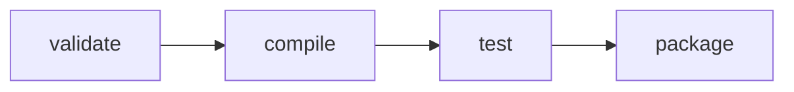

所以只打 `mvn package` 也會先 compile、test；上面拆成三行，是為了在 CI 裡把「測試」獨立成一站（第 4 節）。

**重點：Java 跟 .NET 一樣是三步——抓套件編譯 → 測試 → 打包。**

> 想一想：你們的 war 檔，現在是誰、在哪裡打的？

---

## 3. 依賴管理：鎖版本是寫在專案裡的

| 語言 | 鎖版本機制 | 常見反模式 |
|------|-----------|-----------|
| .NET | `packages.lock.json`（要開啟並 commit）＋ `dotnet restore --locked-mode` | 沒開 lock file，CI 跟本機抓到不同版本的套件 |
| Java | `pom.xml` 每個依賴寫死版本＋多模組用 `<dependencyManagement>` 統一；`.m2` cache 只是加速，**不負責鎖版本** | 用 `SNAPSHOT` 或版本範圍；`scope` 設錯，測試用的套件混進正式包 |

**鎖版本是寫在專案裡的，不是靠某台電腦剛好有。**

### 範例網站 DeployLog 的兩把鎖

這兩天用的範例網站（`lab-project/`）前端是 Vue、後端是 .NET，兩邊**各鎖一把**。打開 `lab-project/Dockerfile` 就看得到：

```dockerfile
# 第一階段：前端（npm）
COPY frontend/package.json frontend/package-lock.json ./
RUN npm ci --no-audit --no-fund        # 只照 lock file 裝，不會順手升版

# 第二階段：後端（NuGet）
COPY MyApi.csproj packages.lock.json ./
RUN dotnet restore --locked-mode       # lock file 跟 csproj 對不上 → 直接失敗
```

| | 宣告「要什麼」 | 鎖定「實際裝了哪一版」 | 嚴格照 lock file 還原 |
|---|---|---|---|
| .NET | `MyApi.csproj` | `packages.lock.json` | `dotnet restore --locked-mode` |
| Vue／Node | `package.json` | `package-lock.json` | `npm ci`（**不是** `npm install`） |
| Java | `pom.xml` | Maven：版本直接寫死在 pom.xml；Gradle：lockfile | Gradle：`--write-locks` 產生 lockfile |

> 常見的坑：前端用 `npm install` 而不是 `npm ci`。`npm install` 會依 `package.json` 允許的版本範圍**更新** lock file，等於沒鎖。

**兩個生態系、同一個原則：lock file 進版控，建置時只照它裝。**

---

## 4. GitLab CI Pipeline 是什麼

把專案根目錄放一個 `.gitlab-ci.yml`，GitLab 就會在**每次 push** 時照著它跑一遍。

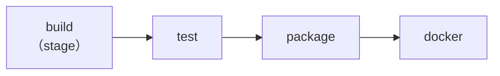

| 名詞 | 意思 | 工廠比喻 |
|------|------|---------|
| **Pipeline** | 一次 push 觸發的一整條流程 | 一條產線 |
| **Stage** | 一個階段，例如 build、test | 一個工作站 |
| **Job** | stage 裡實際執行的一件工作；一個 stage 可以有好幾個 job，同時跑 | 工作站上的一位作業員 |
| **Runner** | 真正執行 job 的那台機器（程式） | 作業員本人 |

兩個關鍵性質：

- **每次 push 自動觸發**：取代「有人照 SOP 手動跑」。
- **前一站沒過，不往下流**：測試沒過，就不會打包；問題擋在打包之前，不會把壞掉的版本交給部署的人。

### 持續整合不只是裝 GitLab：四個紀律

Martin Fowler〈Continuous Integration〉（2006，2024 年改版）列了十幾條實踐，跟部署穩定度最直接相關的是這四條：

| 紀律 | 意思 |
|------|------|
| **每天合回主線** | 分支活越久，合併越痛；小步、常合 |
| **每次 push 都自動 build＋測試** | 「我電腦上有編過」不算數，CI 上綠燈才算 |
| **紅燈第一優先** | 主線壞了就先修，其他人別再往上堆 |
| **build 要快** | 建議約 10 分鐘內；太慢大家就不等結果 |

**工具是 CI 的一半，另一半是團隊願意遵守這四件事。** 第 3 條最常被打破：紅燈掛著好幾天沒人修，大家習慣了，就等於沒有 CI。

一句話記法：CI 是「每次有人改東西，就自動驗一次貨」。

---

## 5. 兩份 pipeline 對照，以及 Jenkins 對照

課程提供兩份範例 pipeline（Part A 會一行一行讀）：

| 階段 | .NET 版（`gitlab-ci-dotnet-example.yml`） | Java 版（`gitlab-ci-java-war-example.yml`） |
|------|---------|---------|
| build | `dotnet restore --locked-mode` → `dotnet build` | `mvn compile`（`.m2` cache 加速） |
| test | `dotnet test` | `mvn test` |
| package | `dotnet publish` | `mvn package -DskipTests` |
| docker | `docker build` ＋ `push` | `docker build` ＋ `push` |

**共同點：四段式、都鎖版本、都產出不可變交付物（M1）。** 混合技術棧的團隊，每個人要懂的是 pipeline 的「概念」，不是死背某個語言的指令。

**用過 Jenkins？** 概念一樣，寫法不同。課程以 GitLab CI 為準：

| | GitLab CI（`.gitlab-ci.yml`） | Jenkins（`Jenkinsfile`） |
|---|---|---|
| 階段 | `stages: [build, test]` | `stages { stage('build') { … } }` |
| 要執行的指令 | `script: - dotnet test` | `steps { sh 'dotnet test' }` |
| 在哪個環境跑 | `image: …/dotnet/sdk:10.0` | `agent { docker { image '…' } }` |
| 保存產物 | `artifacts: paths: [publish/]` | `archiveArtifacts 'publish/**'` |
| 測試報告 | `reports: junit: …` | `junit '**/test-results.xml'` |
| 機密 | CI/CD Variables（Masked／Protected） | Credentials ＋ `withCredentials` |
| 誰來跑 | Runner | Agent（Node） |

---

## 6. 版本號控管：commit SHA 與 git tag

| 做法 | 用途 | 特性 |
|------|------|------|
| **commit SHA 當 image tag**（例如 `keypasco-demo:0c18a755`） | 追溯「這個 image 是哪次 commit 建的」 | SHA 是內容算出來的，**不能被改指向別的內容** |
| **git tag 對應正式發布**（例如 `v1.0.0`） | 給人看的版本號 | CI 把**同一個 image 再多掛一個名字**，不重新 build |

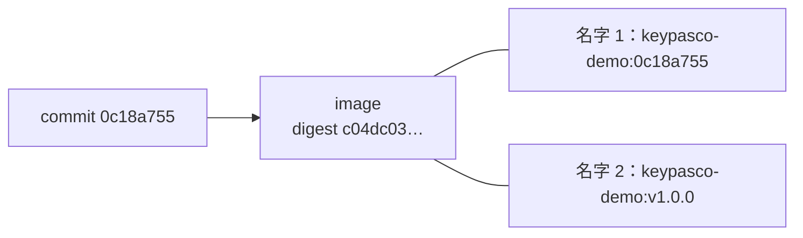

> ⚠️ **tag 可以被移動。** git tag、image tag 都能被改指向另一個 commit／另一個 image。部署與引用外部套件時，要追溯就看 **SHA／digest**。第 9 節的 tj-actions 事件，就是攻擊者把版本 tag 改指向惡意 commit。

**為什麼不重新 build？** 重新 build 出來的就不是「測過的那一份」了（M1 的不可變交付物）。正式版不是重新編出來的，是把測過的那一份多掛一個名字。

---

## 7. Release Artifacts：commit、pipeline、產物三者要對得起來

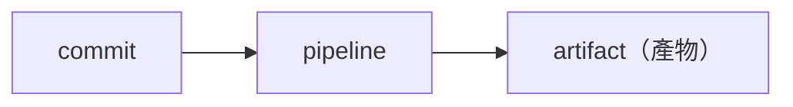

| 問題 | 答案 |
|------|------|
| 產物放哪？ | GitLab **Container Registry**（image）、**Package Registry**（套件）、每個 job 的 **artifacts**（檔案） |
| 為什麼要對得起來？ | 出事時才查得到「這版到底是什麼」：從產物反查 commit，再看那次改了什麼 |

> 想一想：客戶說「上週那版有問題」，你能在 **5 分鐘內**找到那版是哪個 commit 嗎？

Part B 步驟 6–8 會在 GitLab 畫面上實際看到這三者怎麼連起來；正式版的發版紀錄（Releases）見 [03b 第 8 節](03b-gitlab-environments-release.md#8-releases正式版本的發版紀錄)。

---

## 8. 機密怎麼在 CI 裡安全注入

M2 的 Lab 用 `.env` 把密碼交給程式；到了 CI，同樣的值改從 GitLab 注入，**一樣不寫進 repo**。

| 變數 | 誰設定 | 特性 |
|------|-------|------|
| `$CI_REGISTRY_USER`、`$CI_REGISTRY_PASSWORD` | GitLab **預先定義** | 每個 job 自動產生，job 結束就失效，不用自己設 |
| 自己的機密（DB 密碼、部署帳密、私有套件 token） | **Settings → CI/CD → Variables** | **Masked**：job log 裡顯示成 `[MASKED]`<br>**Protected**：只有 protected branch／tag 的 pipeline 拿得到 |

> ⚠️ **Masked 只遮 log，不是加密。** job 裡的程式仍讀得到明文。所以 **Protected 更重要**：它才是真正的權限邊界——一般開發分支（就算有人在 MR 裡改了 `.gitlab-ci.yml`）也拿不到正式環境的密碼。
> Masked 的值有格式限制（例如至少 8 個字元、只能一行），不符合就不能勾。

**一句話：Masked 擋住「不小心印出來」，Protected 擋住「一般分支拿到正式環境的密碼」。** Part B 步驟 9–10 有實際畫面。

### 你們在第幾階？機密管理成熟度

| 階 | 做法 | 問題／好處 |
|----|------|-----------|
| 0 | 寫死在程式碼 | 改密碼要重新編譯；commit 過就算外洩 |
| 1 | 放在進版控的設定檔 | 看得到 repo 的人都看得到密碼 |
| 2 | 環境變數／`.env`（不進版控） | 本課程 M2 的做法；靠部署端保管 |
| 3 | CI 的 Masked＋Protected 變數 | **本課程 M3**；只有受保護分支拿得到 |
| 4 | Secret Manager（Vault、Azure Key Vault 等） | 集中管理、可輪替、誰在什麼時候讀了哪個機密有紀錄 |

不用一次跳到第 4 階；**先離開第 0、1 階，就擋掉大部分外洩事故。**

---

## 9. Pipeline 本身就是攻擊面

CI 手上有原始碼、有部署憑證、能推 image——被入侵的話，損害比單一台伺服器大得多。

| 事件 | 發生了什麼 |
|------|-----------|
| SolarWinds Orion（2020） | 攻擊者入侵**建置環境**，把後門植入官方更新；依 SEC 申報，可能裝了受污染版本的客戶少於 1.8 萬 |
| Codecov（2021） | CI 用的上傳腳本遭竄改約 2 個月，把 **CI 環境變數**（含憑證、token）送到外部 |
| CircleCI（2022–23） | 工程師筆電中毒、通過 2FA 的 SSO session 被偷 → 客戶的環境變數、token 外洩，官方要求所有客戶輪替 secrets |
| **tj-actions/changed-files（2025/3）** | 熱門 GitHub Action 的**多個版本 tag 被改指向惡意 commit**，把 CI secrets 印進 build log；約 2.3 萬個 repo 使用，估計約 218 個實際洩漏 |

最後一個跟第 6 節直接相關：大家都寫 `uses: …@v35` 這種 **tag**，tag 一被移動，所有人同時中招。

> 想一想：你們的 pipeline 引用外部 image／套件，用的是 **tag** 還是 **SHA／digest**？
> 範例 pipeline 第 18 行的註解也提醒了：build 用的 image 要完全可重現，就寫成 `mcr.microsoft.com/dotnet/sdk:10.0@sha256:...`。

來源：[CISA：SolarWinds](https://www.cisa.gov/news-events/cybersecurity-advisories/aa20-352a)｜[Codecov 事故報告](https://about.codecov.io/apr-2021-post-mortem/)｜[CircleCI 事故報告](https://circleci.com/blog/jan-4-2023-incident-report)｜[CISA：tj-actions](https://www.cisa.gov/news-events/alerts/2025/03/18/supply-chain-compromise-third-party-tj-actionschanged-files-cve-2025-30066-and-reviewdogaction)

---

## 10. 延伸：CI 裡該放哪些測試（測試金字塔）

| 層 | 數量 | 例子 |
|----|------|------|
| 端到端／UI 測試 | 少：慢、容易誤報，只測最關鍵的流程 | 登入 |
| 整合測試 | 中：API＋真的資料庫 | 「Viewer 新增紀錄要回 403」 |
| 單元測試 | 多：快、穩定 | `RequiredSettings` 的 3 個測試（Part B 步驟 4 看到的就是它們） |

越往下越快、越多。**CI 每次 push 都跑底層，上層可以只在合併前或每晚跑。**（出處：Mike Cohn《Succeeding with Agile》，2009）

想知道 CI 做得好不好，可以量 DORA 的「變更前置時間」（commit 到上線要多久）和「部署頻率」——一張 Excel 就能開始記。

---

## 11. M3 帶走三個觀念

| 觀念 | 一句話 |
|------|-------|
| **自動化取代手動記憶** | 打包步驟寫在 `.gitlab-ci.yml`，不在某個人腦子裡 |
| **雙語言同一套 pipeline 邏輯** | .NET、Java 都是 build → test → package → docker |
| **版本可追溯** | commit SHA 當 image tag；正式版多掛一個 tag 名字，不重新 build |

下一段 [M4](04-m4-deploy-scripts.md)：產物有了，怎麼把它「啟動」起來？

---

# Part A：自己電腦上做

**事前確認**

- 終端機已經在 `assets/` 資料夾裡（解壓 `keypasco-devops-lab.zip` 的地方）。
- Day 1 M2 已經 build 好 image：

  ```bash
  docker image ls keypasco-lab-api
  ```

  看得到一行 `keypasco-lab-api` 就好。沒有的話重 build 一次（約 1–3 分鐘，要能連網路）：`docker build -t keypasco-lab-api lab-project`。

> 這一部分的 `docker` 指令在 **PowerShell 和 bash 完全一樣**；不一樣的只有讀檔（`grep`／`Select-String`）和 `curl`（PowerShell 要打 `curl.exe`），會分開寫。
> **你的電腦不需要安裝 .NET SDK 或 Maven**，這一部分也不會叫你跑 `dotnet`、`mvn`。

---

## 步驟 1：一行一行讀 .NET 版 pipeline

用編輯器（VS Code、記事本都可以）打開 `gitlab-ci-dotnet-example.yml`，對照下表往下讀。

> **路徑說明**：這份檔案寫的是講師示範專案的目錄結構（`src/Api/Api.csproj`、`tests/`、`frontend/`），跟你手上的 `lab-project/`（`MyApi.csproj` 在根目錄、沒有測試專案）**不一樣**。搬到自己專案時，路徑依實際 repo 調整。

### 1-1 開頭註解：用之前要先準備好的三件事（第 1–8 行）

| 行 | 內容 | 白話 |
|----|------|------|
| 5–6 | `RestorePackagesWithLockFile` ＋ `packages.lock.json` commit 進 repo | 第 2 節那個坑：沒 lock file，`--locked-mode` 等於沒鎖 |
| 7 | 測試專案加 `JunitXml.TestLogger` 套件 | 沒有它，第 55 行的 `--logger "junit;..."` 不能用 |
| 8 | Runner 要開 privileged | `docker-build` job 要在容器裡再跑 Docker（dind） |

### 1-2 `stages` 和 `variables`（第 10–19 行）

```yaml
stages:
  - build
  - test
  - package
  - docker

variables:
  IMAGE_TAG: "$CI_REGISTRY_IMAGE:$CI_COMMIT_SHORT_SHA"
  DOTNET_SDK_IMAGE: "mcr.microsoft.com/dotnet/sdk:10.0"
```

| 行 | 白話 |
|----|------|
| 10–14 | 四個工作站，**照這個順序**跑 |
| 17 | image 名稱＝`專案的 registry 位址:commit 短 SHA`。`$CI_` 開頭的都是 GitLab 自動提供的變數 |
| 19 | 所有 .NET job 用同一個 SDK image；註解提醒要完全可重現就改成 `@sha256:` digest（第 9 節） |

### 1-3 `build` job（第 21–35 行）

| 行 | 白話 |
|----|------|
| 22 | 屬於 `build` 這一站 |
| 23 | 在 .NET SDK 容器裡跑——Runner 本身不用裝 .NET |
| 26 | `dotnet restore --locked-mode`：照 lock file 抓套件，對不上就失敗（錯誤碼 NU1004），**不會偷偷升版** |
| 27 | `dotnet build -c Release --no-restore`：編譯 |
| 28–34 | `artifacts`：把 `bin/Release/` **和 `obj/`** 存起來，交給後面的 job |
| 35 | `expire_in: 1 hour`：中間產物，一小時後 GitLab 自動清掉 |

**為什麼 `obj/` 一定要帶？** 每個 job 都在**全新的容器**裡跑，上一個 job 的檔案只有放進 `artifacts` 的才會傳過來。課程實測（SDK 10）：少了 `obj/` 或後面的 job 沒先 restore——

- `dotnet publish` 直接失敗（NETSDK1004／NETSDK1064），這還好，至少是紅燈；
- **`dotnet test --no-build` 更糟：一個測試都沒跑，卻回 exit 0，pipeline 一片綠。**

> 綠燈一定代表測過了嗎？不一定。看 log 裡有沒有 `Total: 3` 這種數字（Part B 步驟 5）。

### 1-4 `build-frontend` job（第 37–48 行）

| 行 | 白話 |
|----|------|
| 38 | 也在 `build` 這一站——跟 `build` **同時跑** |
| 39 | 用 Node 22 容器 |
| 43 | `npm ci`：只照 `package-lock.json` 裝，跟 `package.json` 對不上就失敗（前端的那把鎖） |
| 44 | `npm run build`：產出 `frontend/dist/` |
| 45–47 | 把 `frontend/dist/` 交給後面的 `publish` |

### 1-5 `test` job（第 50–59 行）

| 行 | 白話 |
|----|------|
| 54 | 再 restore 一次：新 job 的 NuGet cache 是空的（1-3 那個坑） |
| 55 | `dotnet test --no-build`：用 build job 編好的結果跑測試，並輸出 JUnit 格式的報告 `test-results.xml` |
| 57 | `when: always`：**測試失敗也要上傳報告**——失敗那次的報告最重要 |
| 58–59 | `reports: junit:`：GitLab 會讀這份報告，做出 pipeline 的 **Tests 分頁**（Part B 步驟 4） |

### 1-6 `publish` job（第 61–74 行）

| 行 | 白話 |
|----|------|
| 62 | `package` 這一站 |
| 65 | 註解：Immutable Artifact 的第一步——這裡產出的東西，後面所有環境直接用，不重新編譯 |
| 68 | `dotnet publish src/Api/Api.csproj ... -o ./publish --no-build`：**指定 API 專案**；對整個 solution 下 `-o` 會把測試專案也混進來 |
| 70 | `cp -R frontend/dist publish/wwwroot`：前端靜態檔放進後端的 `wwwroot`——前後端是同一份產物、同一個 image |
| 71–74 | `publish/` 保留 1 週，可以從 GitLab 直接下載（Part B 步驟 8） |

### 1-7 `docker-build` job（第 76–99 行）

| 行 | 白話 |
|----|------|
| 78–80 | 用 `docker:27` ＋ `docker:27-dind`（Docker in Docker）在 CI 裡 build image |
| 84 | 用 GitLab 預先定義的 `$CI_REGISTRY_USER`／`$CI_REGISTRY_PASSWORD` 登入 registry；`--password-stdin` 讓密碼不出現在指令列 |
| 85–87 | 註解：Dockerfile **只把 `publish/` 複製進 runtime image**，不重新編譯（見步驟 4） |
| 88–89 | `docker build -t "$IMAGE_TAG"` → `docker push`：image 名字是 commit SHA |
| 92–96 | **如果這次是 git tag**（`$CI_COMMIT_TAG` 不是空的）：把**同一個 image** 再掛 tag 名稱（`docker tag`）然後 push——沒有 `docker build`，所以沒有重新 build |
| 97–99 | `rules`：只有**預設分支（main）**或 **tag** 才跑這個 job。一般 feature 分支只 build、test，不推 image |

### 1-8 檔尾註解：機密（第 101–109 行）

就是第 8 節的內容：預先定義的 `$CI_REGISTRY_*` 不用自己設；自己的機密（`NUGET_API_KEY`、`DEPLOY_SSH_KEY`、DB 密碼）到 Settings → CI/CD → Variables 勾 Masked＋Protected。

### 自我檢查：讀懂了嗎？

1. 這條 pipeline 有幾個 job？哪兩個會同時跑？
2. 如果 `test` job 失敗，`publish` 和 `docker-build` 會跑嗎？
3. 在 `feature/xxx` 分支 push，最後會不會產出 image？
4. 打 tag `v1.0.0` 時，registry 會多出幾個名字？有沒有多 build 一次？
5. 為什麼 `test`、`publish` 裡又出現一次 `dotnet restore --locked-mode`？

<details>
<summary>參考答案</summary>

1. 5 個（`build`、`build-frontend`、`test`、`publish`、`docker-build`）。`build` 和 `build-frontend` 同一個 stage，同時跑。
2. 不會。前一站沒過，後面的 stage 不跑（Part B 步驟 3 有畫面）。
3. 不會。`docker-build` 的 `rules` 只允許預設分支和 tag。
4. 兩個：`:<commit 短 SHA>` 和 `:v1.0.0`，指向同一個 image；第 92–96 行只有 `docker tag`＋`docker push`，沒有 `docker build`。
5. 每個 job 都是新容器，NuGet cache 是空的；不 restore 的話 `publish` 會失敗、`test` 可能一個測試都沒跑卻回綠燈。

</details>

---

## 步驟 2：一行一行讀 Java war 版 pipeline

打開 `gitlab-ci-java-war-example.yml`。**只看跟 .NET 版不一樣的地方**，其餘「跟剛才一樣」。

| 行 | 內容 | 白話 |
|----|------|------|
| 7–11 | `stages` | 一樣是 build → test → package → docker |
| 14 | `MAVEN_OPTS: "-Dmaven.repo.local=$CI_PROJECT_DIR/.m2/repository"` | 把 Maven 下載的套件放在專案資料夾裡，下面的 cache 才抓得到 |
| 15 | `MAVEN_CLI_OPTS: "-B --no-transfer-progress"` | 批次模式，log 不會被下載進度洗版 |
| 16 | `IMAGE_TAG` | 跟 .NET 版一樣用 commit 短 SHA |
| 18 | `MAVEN_IMAGE: "maven:3.9-eclipse-temurin-17"` | JDK 版本要對齊正式環境的 Tomcat／JDK；要完全可重現就改用 digest |
| 20–25 | `cache: key: "$CI_COMMIT_REF_SLUG"`、`paths: [.m2/repository]` | **cache 只是加速**（不用每次重抓套件），**不負責鎖版本**；每個分支一份 cache |
| 21 | 註解 | 鎖版本靠 `pom.xml`：每個依賴寫死版本、不用 SNAPSHOT 或版本範圍，多模組用 `<dependencyManagement>` |
| 27–31 | `build`：`mvn compile` | 抓套件＋編譯 |
| 33–41 | `test`：`mvn test`，`reports: junit: target/surefire-reports/TEST-*.xml` | Maven 的測試報告由 **surefire** 產生，路徑跟 .NET 不同；`when: always` 一樣 |
| 43–52 | `package`：`mvn package -DskipTests`，`artifacts: target/*.war` | 測試上一站跑過了，這裡只打包 war；war 保留 1 週 |
| 54–73 | `docker-build` | 跟 .NET 版一樣；Dockerfile 是把 `target/*.war` 複製進 Tomcat base image 的 `webapps` 目錄 |
| 75–77 | 機密註解 | Maven 私有庫密碼、部署帳密到 Variables 設 Masked＋Protected |
| 79–82 | 對照表 | 第 5 節那張表 |

**跟 .NET 不一樣的只有兩件事：`.m2` cache、surefire 報告路徑。其餘 build → test → package → docker 都一樣。**

### 自我檢查

1. `.m2` cache 被清掉了，build 出來的 war 會不會不一樣？
2. 為什麼 `package` 可以放心加 `-DskipTests`？
3. Java 版沒有 `build-frontend`，pipeline 有幾個 job？

<details>
<summary>參考答案</summary>

1. 不會（只要 pom.xml 版本寫死）：cache 只影響速度，版本由 pom.xml 決定。反過來說，如果 pom.xml 用 SNAPSHOT 或版本範圍，有沒有 cache 都可能抓到不同版本。
2. 因為測試在前一個 stage（`test`）已經跑過、而且過了才會走到 `package`。
3. 4 個：`build`、`test`、`package`、`docker-build`。

</details>

---

## 步驟 3：親眼看看 lock file

在 `assets/` 資料夾裡：

**3-1 專案有沒有開 lock file？**

PowerShell：

```powershell
Select-String RestorePackagesWithLockFile lab-project\MyApi.csproj
```

你應該看到：

```
lab-project\MyApi.csproj:8:    <RestorePackagesWithLockFile>true</RestorePackagesWithLockFile>
```
<!-- 未驗證：PowerShell 尚未在 Windows 實測（第 8 行已用 bash 確認） -->

bash：

```bash
grep RestorePackagesWithLockFile lab-project/MyApi.csproj
```

你應該看到：

```
    <RestorePackagesWithLockFile>true</RestorePackagesWithLockFile>
```

**3-2 lock file 裡記了什麼？**

PowerShell：

```powershell
Get-Content lab-project\packages.lock.json -TotalCount 8
```

bash：

```bash
head -n 8 lab-project/packages.lock.json
```

你應該看到：

```
{
  "version": 1,
  "dependencies": {
    "net10.0": {
      "AspNetCore.HealthChecks.NpgSql": {
        "type": "Direct",
        "requested": "[9.0.0, )",
        "resolved": "9.0.0",
```

**為什麼**：`requested` 是 csproj 裡宣告的「9.0.0 **以上**」（`[9.0.0, )` 是一個範圍）；`resolved` 是**實際裝的那一版** 9.0.0。沒有 lock file 的話，哪天 9.0.1 出了，不同電腦、不同時間 restore 就可能拿到不同版本——這就是「我這台是好的」。

**3-3 前端的那把鎖**

PowerShell：

```powershell
Get-Content lab-project\frontend\package-lock.json -TotalCount 12
```

bash：

```bash
head -n 12 lab-project/frontend/package-lock.json
```

你應該看到：

```
{
  "name": "deploylog-frontend",
  "version": "1.0.0",
  "lockfileVersion": 3,
  "requires": true,
  "packages": {
    "": {
      "name": "deploylog-frontend",
      "version": "1.0.0",
      "dependencies": {
        "vue": "3.5.44",
        "vue-router": "4.6.4"
```

這兩個檔案都在版控裡；`lab-project/Dockerfile` 用 `dotnet restore --locked-mode` 和 `npm ci` 只照它們裝。

---

## 步驟 4：比較兩種 Dockerfile

打開 `lab-project/Dockerfile`。它有**三個階段**：Node 建前端 → .NET SDK 編譯後端 → aspnet runtime 只放成品。也就是**在 Dockerfile 裡從原始碼編譯**。

CI 範例（`gitlab-ci-dotnet-example.yml` 第 85–87 行註解）用的是另一種寫法，講師示範專案的 Dockerfile 只有這樣：

```dockerfile
# 只打包 CI publish job 產出的 publish/：image 裡就是測過的那份產物，不在這裡重新編譯
FROM mcr.microsoft.com/dotnet/aspnet:10.0
WORKDIR /app
COPY publish/ .
ENV ASPNETCORE_HTTP_PORTS=5000
EXPOSE 5000
ENTRYPOINT ["dotnet", "Api.dll"]
```

| | `lab-project/Dockerfile`（你手上的） | CI 版 Dockerfile |
|---|---|---|
| 在哪裡編譯 | Dockerfile 裡（SDK 階段） | CI 的 `build`／`publish` job |
| image 裡放什麼 | Dockerfile 自己編出來的東西 | `publish` job 的產物，**跟測試跑的是同一份** |
| 為什麼這樣寫 | 課堂沒有 CI，你的電腦也沒裝 .NET SDK | 有 CI 時，測過的那份直接進 image，不再編一次 |

---

## 步驟 5：在自己電腦上體驗「同一個 image，兩個名字」

CI 的 `docker-build` job 做的事，用你手上的 image 模擬一次。（你的資料夾不是 git repo，下面用 `0c18a755` 假裝是 commit 短 SHA——就是 Part B 截圖裡那個 commit。）

**5-1 掛上「commit SHA」名字和「正式版」名字**（PowerShell、bash 相同）

```bash
docker tag keypasco-lab-api keypasco-lab-api:0c18a755
docker tag keypasco-lab-api keypasco-lab-api:v1.0.0
```

你應該看到：沒有任何輸出，直接回到提示字元。

**5-2 確認三個名字指向同一個 image**（PowerShell、bash 相同）

```bash
docker image inspect -f "{{.Id}}" keypasco-lab-api keypasco-lab-api:0c18a755 keypasco-lab-api:v1.0.0
```

你應該看到：**三行一模一樣**的 `sha256:...`（每個人的值不同，重點是三行相同），例如：

```
sha256:c6845494b7e768b9fcd02aa54de131633e45cc321d39024cf7e07901525add8e
sha256:c6845494b7e768b9fcd02aa54de131633e45cc321d39024cf7e07901525add8e
sha256:c6845494b7e768b9fcd02aa54de131633e45cc321d39024cf7e07901525add8e
```

**為什麼**：`docker tag` 只是多掛一個名字，不複製、不重新 build。這跟 Part B 步驟 7 GitLab Container Registry 裡 `v1.0.0` 和 `0c18a755` 的 Digest 相同是同一件事。

**5-3 用「正式版」名字跑起來**

先清掉 M2 可能留下的同名容器（沒有的話會出現 `Error response from daemon: No such container: lab-api`，不用理它）：

```bash
docker rm -f lab-api
docker run -d --name lab-api -p 5000:5000 --env-file .env.dev keypasco-lab-api:v1.0.0
```

PowerShell：

```powershell
curl.exe http://localhost:5000/whoami
```

bash：

```bash
curl http://localhost:5000/whoami
```

你應該看到：

```
{"environment":"Development","dbHost":"localhost","dbName":"labdb"}
```

跟 M2 用 `keypasco-lab-api` 跑的結果完全一樣——**本來就是同一個 image**。

> Mac 上 5000 被 AirPlay 佔走時，`-p 5000:5000` 改 `-p 5050:5000`、curl 改打 5050。

**5-4 收拾**

```bash
docker rm -f lab-api
docker rmi keypasco-lab-api:0c18a755 keypasco-lab-api:v1.0.0
```

你應該看到（`docker rmi` 那行）：

```
Untagged: keypasco-lab-api:0c18a755
Untagged: keypasco-lab-api:v1.0.0
```

注意是 **`Untagged`（拿掉名字）**，不是 `Deleted`：image 還被 `keypasco-lab-api` 這個名字指著，所以不會被刪。Day 2 的 Lab 還要用它。

**如果不是這樣**

| 狀況 | 原因 | 處理 |
|------|------|------|
| `Error response from daemon: No such image: keypasco-lab-api:latest` | M2 的 image 還沒 build | `docker build -t keypasco-lab-api lab-project` |
| `Conflict. The container name "/lab-api" is already in use` | 上一個 `lab-api` 沒刪 | `docker rm -f lab-api` 再跑一次 |
| `port is already allocated`，或 curl 回 403（Mac） | 5000 被佔走 | 改用 5050（見上面提示） |
| PowerShell 的 curl 印出一大堆欄位 | PowerShell 的 `curl` 是 `Invoke-WebRequest` | 打 `curl.exe`，或直接用瀏覽器開 |

---

# Part B：講師示範：GitLab 實機畫面

> GitLab 示範環境只在講師電腦上跑（`ci-demo/`，不在學員 zip 裡）。這一部分你跟著截圖看。
>
> **示範專案的 pipeline 跟你手上的範例檔有三個差別：**
>
> 1. 多一個 **`secrets-demo`** job（在 test 那一站）：專門印出機密變數，示範 Masked／Protected 的效果（步驟 9–10）。你的範例檔沒有它，所以截圖裡的 main pipeline 是 **6 個 job**，你的範例是 5 個。
> 2. 多 **`deploy`**、**`release`** 兩個 stage：部署到 dev／qa／poc 和產生 Release，見 [03b-gitlab-environments-release.md](03b-gitlab-environments-release.md)。
> 3. `docker-build` 多一行 `--insecure-registry`：因為示範環境的 registry 沒有 TLS，真實環境不需要。
>
> 下面的截圖是在加上 deploy／release 之前拍的，所以只看到四個 stage。講師現場重建示範環境時，畫面上會多出 `deploy`、`release` 兩欄、多幾條 pipeline、Variables 頁也會多幾個依環境設定的變數——跟這份文件講的觀念不衝突。

## 步驟 1：一條 pipeline 長這樣

**Build → Pipelines**，點 `main` 那條（#10）。

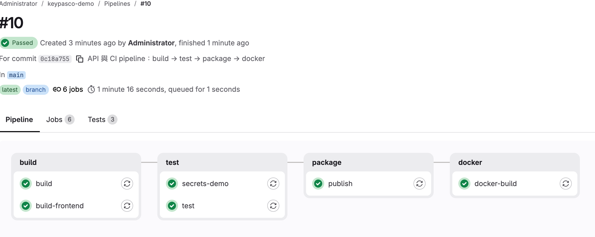

- 上方：`Passed`、**For commit `0c18a755`**、**In `main`**——這條 pipeline 是哪個 commit、哪個分支觸發的。
- 下方**由左到右一欄是一個 stage**：build → test → package → docker；**一格是一個 job**。
- build 欄有 `build`、`build-frontend` 兩個 job（同時跑）；test 欄有 `test` 和示範用的 `secrets-demo`。
- 上面的分頁：**Jobs 6**、**Tests 3**（3 個測試，步驟 4 會看）。

**全部綠勾，才會產出可以部署的 image。** 對照第 4 節：一欄＝一個工作站，一格＝一位作業員。

## 步驟 2：每次 push 都留下一筆紀錄

回到 **Build → Pipelines** 列表。

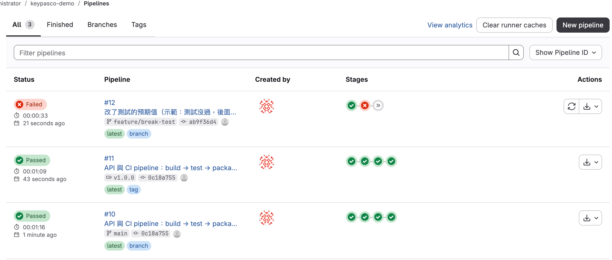

每一列告訴你：**哪個分支或 tag**（`feature/break-test`、`v1.0.0`、`main`）、**哪一次 commit**（`ab9f36d4`、`0c18a755`）、**每個 stage 的結果**（Stages 欄的圓圈）。

- **#12（最上面，紅色）**：`feature/break-test` 分支，測試沒過，後面直接停（第三個圓圈是 » 跳過）。
- **#11（中間）**：打 tag `v1.0.0` 也會跑一次 pipeline——正式版有完整紀錄。
- **#10（最下面）**：`main`。注意 #10 和 #11 是**同一個 commit `0c18a755`**。

**為什麼重要**：以前「誰在哪台電腦編的版本」查不到；現在每一次都在這裡。

## 步驟 3：測試沒過，後面的 stage 就不會跑

點 **#12**（紅色那條）。

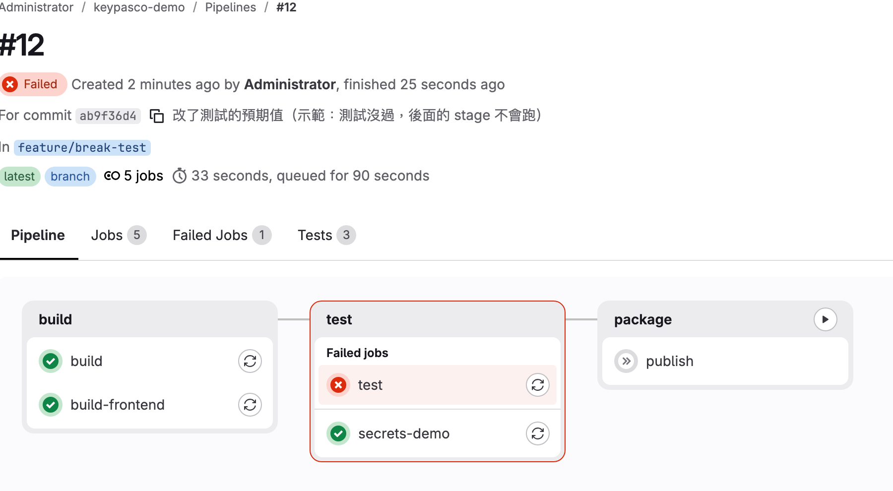

- 標題下面那行是 commit 訊息：「改了測試的預期值（示範：測試沒過，後面的 stage 不會跑）」——講師故意改壞一個測試推上去。
- **test** 欄被紅框圈起來，`Failed jobs` 底下是 `test`（紅叉）。`secrets-demo` 是綠的（它不跑測試）。
- **package** 欄的 `publish` 是灰色的 **»（skipped，被跳過）**。
- **沒有 docker 欄**：不是被跳過，是根本沒有——`docker-build` 的 `rules` 只允許 main 和 tag（步驟 1-7），feature 分支本來就不推 image。

**為什麼**：前一站沒過，不往下流。問題擋在打包之前，**不會產出一個壞掉的版本交給部署人員**。

## 步驟 4：哪個測試沒過？看 Tests 分頁

在 #12 點 **Tests** 分頁，再點 `test`。

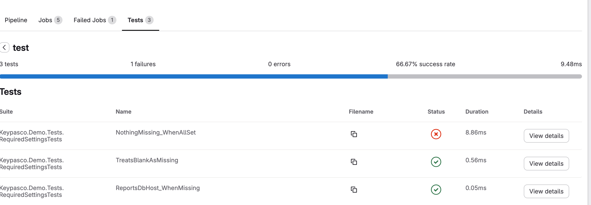

- 上方摘要：**3 tests、1 failures、0 errors、66.67% success rate**。
- 下方列表：`NothingMissing_WhenAllSet` 是紅叉，另外兩個是綠勾。

**看紅叉那一列的名稱就好**——它告訴你壞在哪裡、該找誰。這一頁就是 yml 裡 `reports: junit:` 那一行（步驟 1-5）的效果：GitLab 讀測試報告，**不用翻 log 也知道哪裡壞**。

## 步驟 5：失敗的 log 怎麼讀

點進 `test` 這個 job。

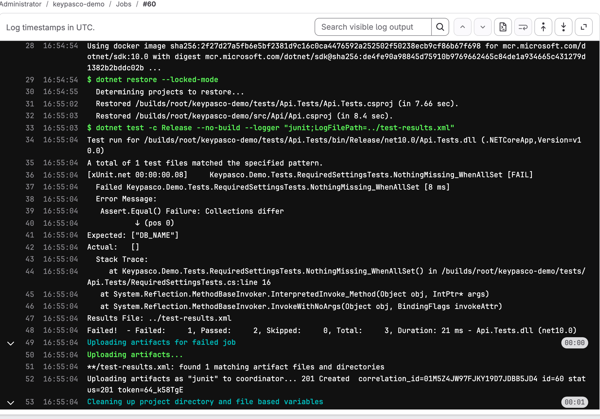

不用看懂 stack trace，看這幾行：

| log 行 | 內容 | 意思 |
|--------|------|------|
| 29 | `$ dotnet restore --locked-mode` | 照 lock file 還原（步驟 1-5 說的「再 restore 一次」） |
| 33 | `$ dotnet test -c Release --no-build --logger "junit;..."` | 跑測試 |
| 37 | `Failed Keypasco.Demo.Tests.RequiredSettingsTests.NothingMissing_WhenAllSet` | **哪一個測試**沒過 |
| 41 | `Expected: ["DB_NAME"]` | 程式**該回**什麼 |
| 42 | `Actual:   []` | 程式**實際回**了什麼 |
| 48 | `Failed!  - Failed: 1, Passed: 2, Skipped: 0, Total: 3` | **總共幾個沒過** |
| 49–52 | `Uploading artifacts for failed job` … `as "junit"` | `when: always` 的效果：**失敗了報告照樣上傳**，Tests 分頁才有東西看 |

> 第 48 行 `Total: 3` 很重要：它證明測試**真的有跑**。還記得步驟 1-3 的坑嗎？`--no-build` 卻少帶 `obj/` 時，會「一個測試都沒跑卻回 exit 0」——那種 log 裡就不會有這個數字。

## 步驟 6：image 怎麼被推上去、怎麼多掛一個名字

回到 #11（`v1.0.0` 那條 tag pipeline），點 `docker-build` job。

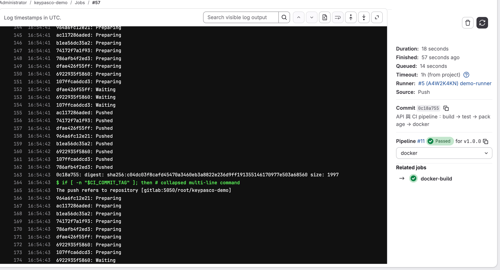

- 右側欄：**Commit `0c18a755`**、**Pipeline #11 Passed for v1.0.0**、**Runner** 是哪一台。
- log 第 163 行：`0c18a755: digest: sha256:c04dc03f8ca…`——用 commit SHA 名字推上去的 image，內容指紋（digest）是 `c04dc03…`。
- log 第 164 行：`$ if [ -n "$CI_COMMIT_TAG" ]; then # collapsed multi-line command`——就是 yml 第 92–96 行：這是 tag pipeline，所以把同一個 image 再掛 `v1.0.0` 推一次。
- 第 165 行起：`The push refers to repository [gitlab:5050/root/keypasco-demo]`，接著同一批 layer ID（`964a6fc12e21`、`ac117286aded`…）再出現一次——推的是同一個 image 的同一批 layer，只是換了名字。

## 步驟 7：同一個 image，兩個名字

**Deploy → Container Registry**，點 `keypasco-demo`。

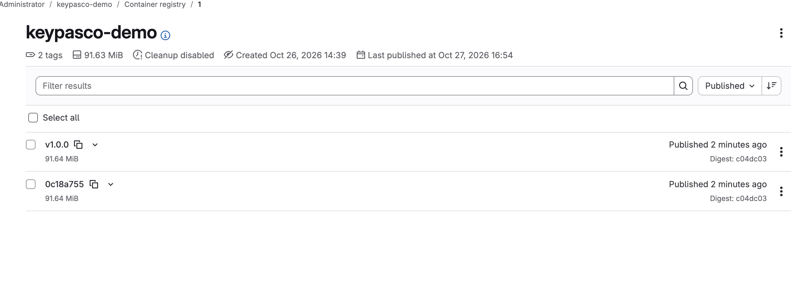

- 上方：**2 tags**。
- 每一列是一個名字：`v1.0.0`、`0c18a755`。
- 看右邊的 **Digest：兩列都是 `c04dc03`**——跟步驟 6 log 裡的 digest 一樣。

**Digest 一樣＝同一份檔案。** 打 tag 只是多掛一個名字，**沒有重新 build**。這就是 M1 的不可變交付物：正式版不是重新編出來的，是把測過的那一份多掛一個名字。你在 Part A 步驟 5 用 `docker image inspect` 看到三行相同的 ID，是同一件事。

## 步驟 8：產物放在哪：每個 job 的 artifacts

回到 #10（main），點 `publish` job → 右側 **Job artifacts → Browse**，進到 `publish` 資料夾。

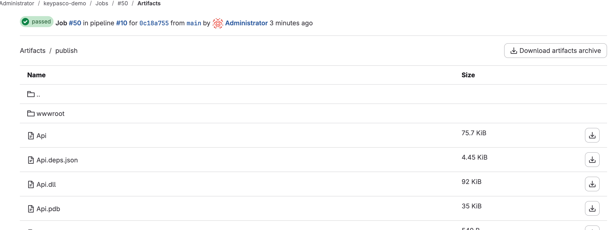

- 最上面那行：**Job #50 in pipeline #10 for `0c18a755` from `main`**——產物、pipeline、commit **三者對得起來**（第 7 節）。
- 裡面是 `wwwroot/`（前端，`build-frontend` 建的）、`Api.dll`、`Api.deps.json` 等後端檔案：yml 第 68–70 行產出的東西。
- 右上角 **Download artifacts archive** 可以整包下載。

**部署的人拿這個，不是從誰的電腦複製。** CI 版 Dockerfile（Part A 步驟 4）打包進 image 的，也就是這一份。

> 正式版的發版紀錄（Deploy → Releases：哪個 commit、哪個 image、版本說明一頁看完），見 [03b 第 8 節](03b-gitlab-environments-release.md#8-releases正式版本的發版紀錄)。

## 步驟 9：機密怎麼設定

**Settings → CI/CD**，展開 **Variables**。

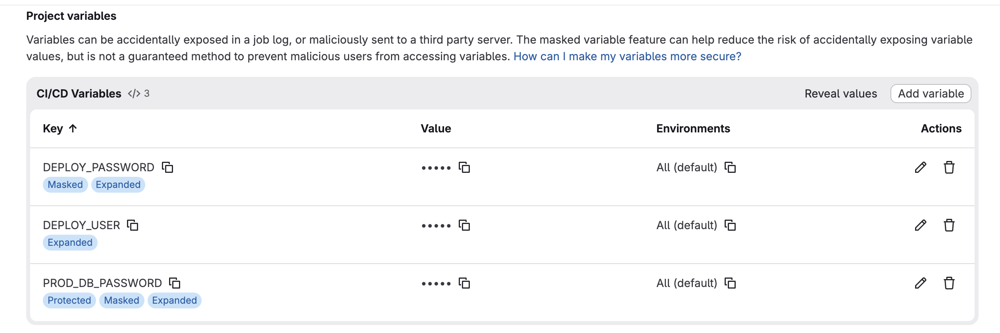

- **Value** 欄一律顯示 `•••••`，不直接顯示。
- 變數名稱**下方的小標籤**就是它的保護方式：

| 變數 | 標籤 | 保護 |
|------|------|------|
| `DEPLOY_USER` | Expanded | 一般變數（帳號不是機密） |
| `DEPLOY_PASSWORD` | **Masked**、Expanded | log 裡遮掉 |
| `PROD_DB_PASSWORD` | **Protected**、**Masked**、Expanded | log 裡遮掉＋只有 protected 分支／tag 拿得到 |

（`Expanded` 是 GitLab 的另一個選項：值裡的 `$` 會被當成變數展開，跟保護無關。）

頁面上方 GitLab 自己也寫了：Masked 能降低「不小心印出來」的風險，**但不保證擋得住惡意的人讀取變數**——所以要搭配 Protected。

## 步驟 10：同一段程式，在兩個分支跑出不同結果

兩張圖是**同一個 job（`secrets-demo`）**在兩個分支的 log。這個 job 只做三件事：印帳號、印密碼、檢查拿不拿得到 `PROD_DB_PASSWORD`。

**main（protected 分支）**：

![main：密碼是 [MASKED]，PROD_DB_PASSWORD 有注入](images/job-masked.png)

```
部署帳號：deployer
部署密碼：[MASKED]
PROD_DB_PASSWORD 已注入：[MASKED]
```

**一般 feature 分支（#12 那條）**：

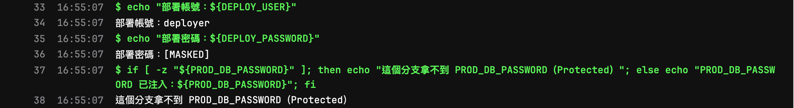

```
部署帳號：deployer
部署密碼：[MASKED]
這個分支拿不到 PROD_DB_PASSWORD（Protected）
```

| | main | feature 分支 |
|---|---|---|
| `DEPLOY_USER`（一般） | 印出明文 | 印出明文 |
| `DEPLOY_PASSWORD`（Masked） | `[MASKED]` | `[MASKED]`——**拿得到**，只是印不出來 |
| `PROD_DB_PASSWORD`（Masked＋Protected） | 有注入，印成 `[MASKED]` | **根本沒注入** |

**Masked 擋住「不小心印出來」，Protected 擋住「一般分支拿到正式環境的密碼」。** 注意 feature 分支其實**拿得到** `DEPLOY_PASSWORD`——如果有人在 feature 分支改 job，把它 base64 編碼後再印，遮罩就認不出來了。真正的權限邊界是 Protected。

## 步驟 11（接下來）：部署、環境切換、Rollback、Releases

講師的示範 pipeline 在 docker 之後還有 `deploy`、`release`：同一個 image 依序推到 dev → qa → poc、一鍵 Rollback、打 tag 自動產生 Release。完整步驟見 **[03b-gitlab-environments-release.md](03b-gitlab-environments-release.md)**。

---

## 程式設計：程式要怎麼寫才支援

「從產物反查 commit」要靠程式把版本寫進產物、再讀出來。`lab-project/Dockerfile` 在建置時寫入：

```dockerfile
ARG APP_VERSION=1.0.0
RUN dotnet publish -c Release -o /app --no-restore -p:InformationalVersion=$APP_VERSION
```

`lab-project/Program.cs` 第 113–114 行在執行時讀出，經 `/api/system` 顯示在頁首：

```csharp
var version = Assembly.GetExecutingAssembly()
    .GetCustomAttribute<AssemblyInformationalVersionAttribute>()?.InformationalVersion.Split('+')[0] ?? "dev";
```

但課程的 pipeline 都沒有傳版本號，所以畫面永遠是 `v1.0.0`（在 git repo 裡建置時，SDK 自動接上的 `+<commit SHA>` 也被 `Split('+')` 切掉了）。建議 CI 傳 commit SHA：`docker build --build-arg APP_VERSION="$CI_COMMIT_SHORT_SHA" …`；publish 用 `--no-build` 的 pipeline 則加在 `dotnet build -p:InformationalVersion="$CI_COMMIT_SHORT_SHA"`。為什麼寫 SHA 不寫 tag、lock file 和多階段建置怎麼配合，見 [08 程式設計 §6](08-app-design-for-ops.md#6-不可變交付物與建置)。

---

## 自我檢核清單

- [ ] 我說得出手動編譯的三個風險，以及 CI 怎麼解決
- [ ] 我看得懂 .NET 的 `restore --locked-mode → build → publish`、Java 的 `compile → test → package` 各在做什麼
- [ ] 我知道「沒有 lock file 時 `--locked-mode` 不會報錯」，也知道要 commit `packages.lock.json`
- [ ] 我知道前端要用 `npm ci` 而不是 `npm install`
- [ ] 我分得清 pipeline、stage、job、runner
- [ ] 我能解釋為什麼 test 沒過，`publish` 會被跳過；為什麼 feature 分支沒有 docker 那一站
- [ ] 我知道綠燈不一定代表測過了，會去 log 找 `Total:` 那一行
- [ ] 我會在 Tests 分頁和 job log 找出是哪個測試失敗（Failed／Expected／Actual）
- [ ] 我能解釋為什麼 image 用 commit SHA 當 tag，以及 git tag 為什麼「可以被移動」
- [ ] 我在 Part A 用 `docker tag`＋`docker image inspect` 親眼確認過「同一個 image、多個名字」
- [ ] 我知道從一個產物怎麼反查到 commit（artifacts 頁、Registry、pipeline）
- [ ] 我分得清 Masked 和 Protected，知道哪一個才是真正的權限邊界
- [ ] 我知道 `$CI_REGISTRY_USER`／`$CI_REGISTRY_PASSWORD` 不用自己設
- [ ] 我說得出至少一個 CI／CD 供應鏈事故，以及「引用外部 image／套件用 tag 還是 digest」為什麼重要

---

截圖來源：講師電腦上的本機 GitLab CE 19.4＋Runner（`ci-demo/`），由 `slides/build/capture-gitlab.js` 拍攝。部署、Rollback、Releases 的截圖見 [03b](03b-gitlab-environments-release.md)。
