# 手把手：GitLab 環境切換與發版（Environments × Releases）

> DevOps 實作課｜本機示範 GitLab（`ci-demo/`）｜Day 1 M3 現場示範、Day 2 正式講
> 這份文件一步一步帶你看：**同一個 image 怎麼從 dev 推到 qa、poc，每個環境的設定放哪裡，部署壞了怎麼一鍵退回，正式版本怎麼留下發版紀錄。**

---

## 你會學到什麼

| 功能 | 在 GitLab 哪裡 | 對應課程 |
|------|---------------|---------|
| 每個環境各自的設定（DB 名稱、環境名稱） | Settings → CI/CD → Variables（**Environment scope**） | M2：`.env.dev`／`.env.qa`／`.env.poc` |
| 依序推到 dev → qa → poc，qa／poc 要人放行 | Build → Pipelines（`deploy` stage） | M3：pipeline |
| 每個環境現在跑哪一版、部署歷史 | Operate → Environments | M3：版本號控管 |
| 一鍵退回上一版 | Operate → Environments → 環境 → **Rollback** | M4：部署失敗怎麼辦 |
| 部署前升級 Schema、部署後驗證 | deploy job 的 log | M6：migrate；M4：`/health/ready` |
| 正式版本的發版紀錄 | Deploy → Releases | M3：Release Artifacts |

---

## 0. 事前準備（講師電腦，第一次約 25 分鐘）

1. **啟動示範 GitLab**（第一次約 10 分鐘）

   ```bash
   cd instructor/ci-demo        # 在 devops-lab 根目錄下；說明見該資料夾的 README
   docker compose up -d
   ```

   瀏覽器打得開 http://localhost:8929/users/sign_in 再往下。

2. **讓瀏覽器認得 `gitlab` 這個主機名**（只要做一次）。GitLab 產生的連結都是 `http://gitlab:8929/...`：

   ```bash
   echo "127.0.0.1 gitlab" | sudo tee -a /etc/hosts
   ```

3. **建立示範內容**（setup.sh 跑完後，4 條 pipeline 還要約 12–13 分鐘才跑完）

   ```bash
   bash setup.sh
   ```

   這支腳本會：建專案、設好所有 CI 變數、註冊兩台 Runner、推 4 個版本：

   | 推了什麼 | 結果 |
   |---------|------|
   | `main` 第一版 | 綠燈，**自動部署到 dev** |
   | tag `v1.0.0` | 綠燈，**產生 Release**；poc 等人放行 |
   | `main` 第二版（加 CHANGELOG） | 綠燈，dev 第二次部署——所以 dev 有兩筆紀錄，可以 Rollback |
   | `feature/break-test` | 紅燈（故意改壞測試），不會部署 |

4. **登入**：http://gitlab:8929 ，帳號 `root`，密碼 `Keypasco-Demo-2026!`

> 示範做過 Rollback、放行之後，想回到上面這個初始狀態：再跑一次 `bash setup.sh`。

---

## 1. Pipeline 多了 deploy 和 release

左側選單 **Build → Pipelines**，點最上面那條 `main`。

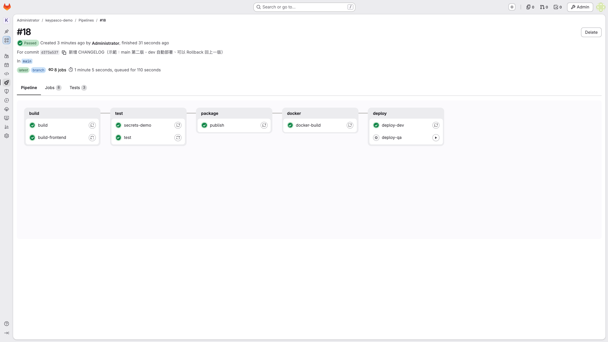

- `deploy-dev` ✅：main 一有新版本就**自動**部署到 dev
- `deploy-qa` ⚙️：齒輪圖示＝**手動 job**，要有人按 ▶ 才會跑（第 5 步）
- 打 tag 的 pipeline 另外有 `deploy-poc`（手動）和 `release`（自動）

> **重點**：三個 deploy job 用的是**同一個 image**（`docker-build` 用 commit SHA 打的 tag），只是部署到不同環境，**不重新 build**。

---

## 2. 每個環境的設定放哪裡：Environment scope 變數

左側選單 **Settings → CI/CD**，展開 **Variables**。

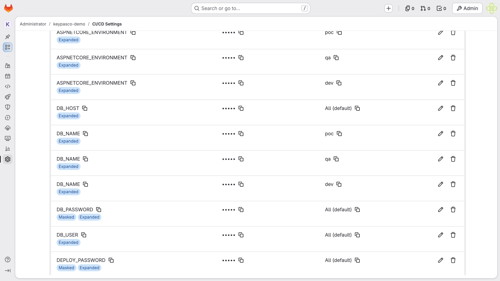

看最右邊 **Environments** 那一欄：

| 變數 | Environments | 值 |
|------|-------------|-----|
| `DB_NAME` | `dev` | `labdb` |
| `DB_NAME` | `qa` | `labdb_qa` |
| `DB_NAME` | `poc` | `labdb_poc` |
| `ASPNETCORE_ENVIRONMENT` | `dev`／`qa`／`poc` | `Development`／`QA`／`POC` |
| `DB_HOST`、`DB_USER`、`DB_PASSWORD` | `All (default)` | 三個環境共用；`DB_PASSWORD` 有 **Masked** |

**運作方式**：deploy job 在 `.gitlab-ci.yml` 宣告 `environment: qa`，GitLab 執行時**只把 scope 是 `qa`（和 All）的變數**注入這個 job。同一份部署腳本，換環境只換 environment 名稱。

> **對照 M2**：這就是 `.env.dev`／`.env.qa`／`.env.poc` 三個檔案，只是搬進 GitLab 保管——不會被誰在現場手改、改了有紀錄、密碼可以 Masked。

**自己加一個試試**（選做）：

1. 按 **Add variable**
2. **Environments** 下拉選 `qa`（沒有的話直接輸入 `qa`）
3. Key 填 `FEATURE_FLAG`、Value 填 `on`
4. 按 **Add variable** 儲存 → 列表多一行，Environments 欄寫 `qa`

---

## 3. 看 dev 是怎麼被部署的

回到 main pipeline，點 **`deploy-dev`** 那個 job。

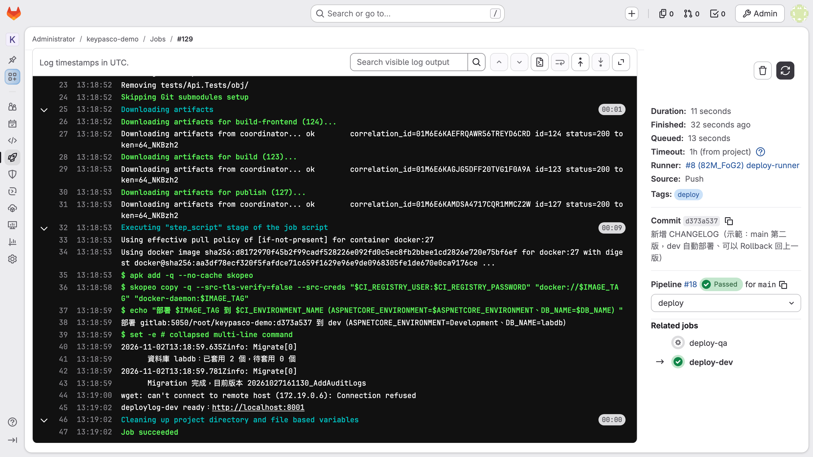

Log 依序做了四件事：

1. **拉 image**：從 GitLab Container Registry 拉這次 commit 的 image
2. **印出拿到的設定**：`部署 gitlab:5050/root/keypasco-demo:<commit> 到 dev（ASPNETCORE_ENVIRONMENT=Development、DB_NAME=labdb）`——證明 GitLab 只注入了 dev 那組
3. **migrate**（M6）：`資料庫 labdb：已套用 2 個，待套用 0 個`、`Migration 完成`。先升級 Schema，失敗就停在這裡，**舊版本繼續跑**
4. **換版＋驗證**（M4）：停掉舊容器、起新容器，等 `/health/ready` 回 200；60 秒內沒 ready，job 變紅燈。中間一行 `wget: can't connect … Connection refused` 是網站還在啟動，**正常**，下一次就 ready 了

右邊欄 **Runner** 寫 `deploy-runner`、**Tags** 寫 `deploy`：這個 job 是部署用 Runner 跑的（見第 9 節）。

最後一行 `deploylog-dev ready：http://localhost:8001` ＝部署成功。打開 http://localhost:8001 就是 dev 的 DeployLog 網站。

---

## 4. Environments：每個環境現在跑哪一版

左側選單 **Operate → Environments**。

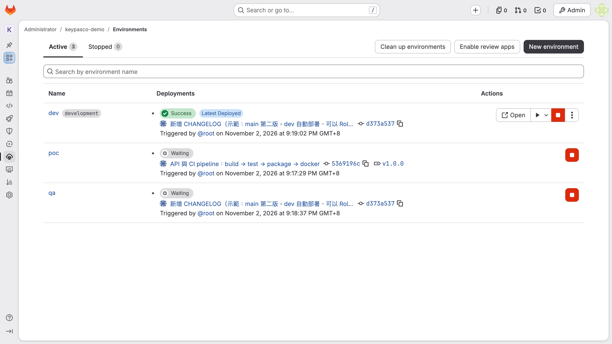

- **dev**：`Success`＋`Latest Deployed`，顯示目前的 commit、誰在什麼時候部署的
- **qa**、**poc**：`Waiting`（齒輪圖示）＝部署 job 在等人放行；poc 那筆旁邊有 tag `v1.0.0`
- dev 右邊 **Open** 直接打開那個環境的網址
- ⚠️ 紅色方塊是 **Stop**（停用環境），示範時不要按

> 現場問學員：「你們現在要知道客戶 POC 環境跑的是哪一版，要問誰？要多久？」——這一頁就是答案。

---

## 5. 一鍵 Rollback：退回上一版

點 **dev** 進去，切到 **Deployment history**。

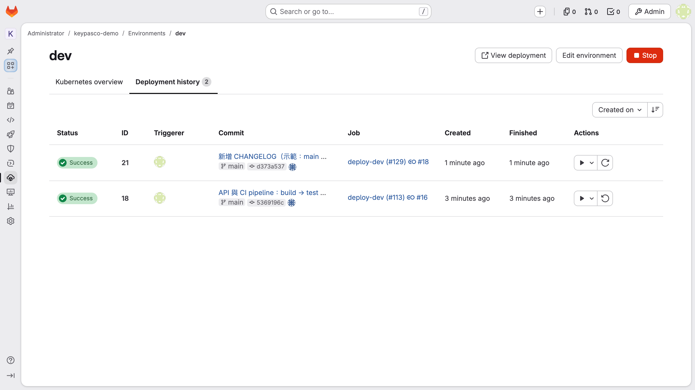

兩筆部署（上面是最新的）：

- 最新那筆右邊是 **Re-deploy**（↻）：用同一版重新部署一次
- 舊的那筆右邊是 **Rollback**（↺）：退回那一版

**步驟**：

1. 按**下面那筆**（舊版）右邊的 **Rollback environment** 按鈕（↺）
2. 跳出確認視窗，寫著要退回到哪個 commit：

   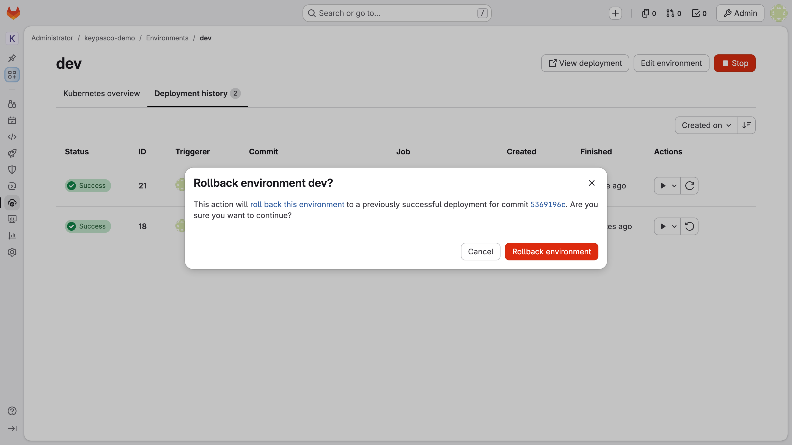

3. 按紅色 **Rollback environment**
4. 等約 30 秒，重新整理頁面：

   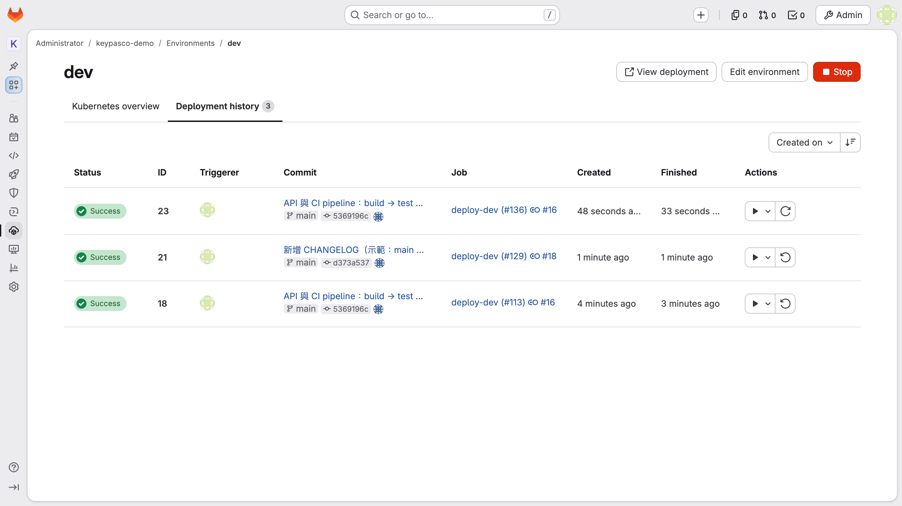

   變成 3 筆，最上面那筆的 commit 跟**最下面（第一版）一樣**；Job 欄看得出它重跑的是**舊 pipeline 的** `deploy-dev`——用的是當時那個 image。

5. 開 http://localhost:8001 確認網站還活著：

   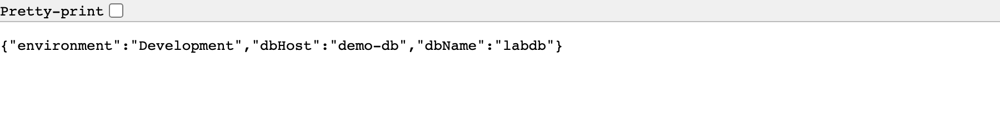

> **為什麼能一鍵退回？** 因為每一版都是**已經建好、測過的 image**，Rollback 只是「用那次的 image 再部署一次」，不重新編譯、不用找人。對照 M4：手動部署時代，退版要找到舊的安裝檔、舊的設定檔，常常找不到。

---

## 6. 放行到 qa：手動 job

回到 **Build → Pipelines**，點最上面那條 `main`。

1. 在 `deploy` 欄找到 **`deploy-qa`**（齒輪圖示）
2. 按它右邊的 **▶ Run**
3. 等約 30 秒，`deploy-qa` 變綠燈：

   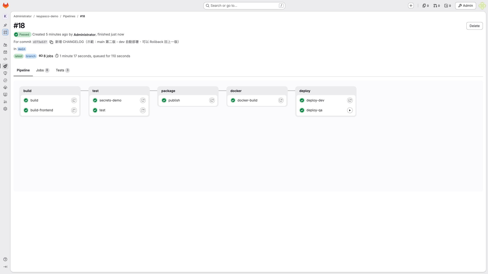

4. 開 http://localhost:8002/whoami ，看到 `QA` 和 `labdb_qa`：

   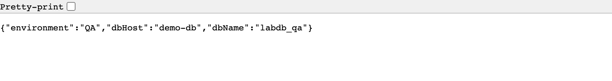

> **同一個 image，dev 跑 `labdb`、qa 跑 `labdb_qa`**——差別只在 GitLab 注入的變數。這就是 M1 的「不可變交付物」＋ M2 的「組態外部化」合在一起。

---

## 7. 放行到 poc：只有正式版本可以

poc（客戶現場）只接受**打了 tag 的版本**：

1. **Build → Pipelines**，點 `v1.0.0` 那條（tag pipeline）
2. `deploy` 欄只有 **`deploy-poc`**（沒有 dev、qa——那是 main 的事）
3. 按 ▶ **Run** 放行，約 30 秒後綠燈
4. 開 http://localhost:8003/whoami ，看到 `POC` 和 `labdb_poc`

> main 的 pipeline **根本沒有** `deploy-poc` 這個 job：沒打 tag 的版本，想推到客戶環境也推不上去。規則寫在 `.gitlab-ci.yml` 裡，不靠人記。

---

## 8. Releases：正式版本的發版紀錄

左側選單 **Deploy → Releases**。

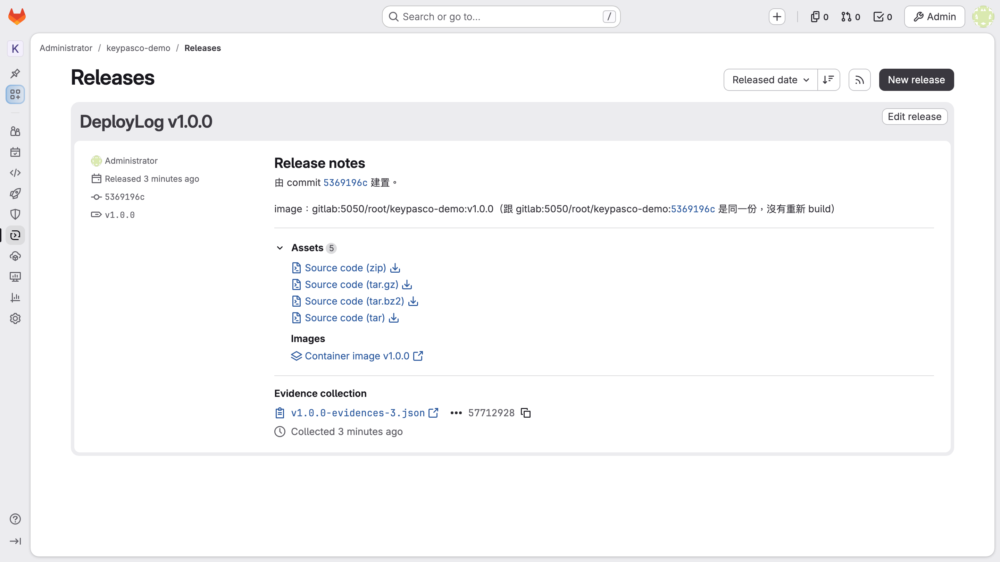

打 tag `v1.0.0` 時，`release` job 自動建了這一筆：

- **哪個 commit 建的**（`由 commit … 建置`）
- **對應哪個 image**：`…/keypasco-demo:v1.0.0`，跟 commit SHA 的 image **是同一份，沒有重新 build**
- **Assets**：GitLab 自動附的 4 種原始碼壓縮檔，加上 **Images → Container image v1.0.0**（`release` job 加的連結，點了到 Container Registry）
- **Evidence collection**：GitLab 自動存一份發版當下的快照 JSON（稽核用）

> 對照 slide 59、61：「這個版本到底是哪次 commit？」——git tag、image tag、Release 三者對得起來，不用翻聊天紀錄。

---

## 9. `.gitlab-ci.yml` 裡關鍵的幾行

完整檔案：`ci-demo/repo/.gitlab-ci.yml`。

```yaml
stages: [build, test, package, docker, deploy, release]

.deploy:                       # 三個環境共用的部署步驟
  stage: deploy
  tags: [deploy]               # 只給「部署用 Runner」跑（真實環境：裝在部署機上的 Runner）
  script:
    - echo "部署 $IMAGE_TAG 到 $CI_ENVIRONMENT_NAME（DB_NAME=$DB_NAME）"
    # migrate → 換容器 → 等 /health/ready（略）

deploy-dev:
  extends: .deploy
  environment: { name: dev, url: http://localhost:8001 }
  rules:
    - if: $CI_COMMIT_BRANCH == $CI_DEFAULT_BRANCH        # main 自動

deploy-qa:
  extends: .deploy
  environment: { name: qa, url: http://localhost:8002 }
  rules:
    - if: $CI_COMMIT_BRANCH == $CI_DEFAULT_BRANCH
      when: manual                                       # 要人按 ▶
      allow_failure: true

deploy-poc:
  extends: .deploy
  environment: { name: poc, url: http://localhost:8003 }
  rules:
    - if: $CI_COMMIT_TAG                                 # 只有 tag
      when: manual
      allow_failure: true

release:
  stage: release
  image: registry.gitlab.com/gitlab-org/cli:latest
  release:
    tag_name: $CI_COMMIT_TAG
    name: "DeployLog $CI_COMMIT_TAG"
  rules:
    - if: $CI_COMMIT_TAG
```

| 寫法 | 作用 |
|------|------|
| `environment: name: qa` | 這個 job 是部署到 qa：GitLab 記一筆部署紀錄、只注入 scope `qa` 的變數 |
| `when: manual` | 手動 job，要有人按 ▶ |
| `allow_failure: true` | 沒人按，pipeline 照樣算完成，不會卡住 |
| `rules: if: $CI_COMMIT_TAG` | 只有打 tag 的 pipeline 才有這個 job |
| `resource_group: qa`（完整檔有） | 同一個環境一次只跑一個部署，兩條 pipeline 不會互蓋 |
| `release:` | 建 Release（job image 要有 `glab`） |

---

## 10. 疑難排解

| 狀況 | 原因 | 處理 |
|------|------|------|
| 點 GitLab 的連結打不開（`gitlab` 找不到主機） | `/etc/hosts` 沒加 | 做第 0 步第 2 點 |
| 畫面跳出「Critical patch release」視窗 | GitLab 版本檢查 | `setup.sh` 已關掉；還是跳就按 **Remind me again in 3 days** |
| `deploy-dev` 一直 pending | 部署用 Runner 沒註冊到 | 再跑一次 `bash setup.sh` |
| deploy job 紅燈，log 最後是「60 秒內沒有 ready」 | 網站起不來（看 log 下面印的容器 log） | 通常是 DB 沒起來：`docker compose ps` 看 `demo-db` |
| http://localhost:8001 打不開 | 這個環境還沒部署，或被 Stop 了 | Environments 頁看狀態；pipeline 重跑 `deploy-dev` |
| Rollback 按鈕是灰的 | 只有一筆部署 | 至少要兩筆（`setup.sh` 會推兩版 main） |
| 想全部重來 | — | `bash setup.sh`（會清掉 pipeline、環境、Release、部署出來的容器） |
| 上完課 | 約 4 GB 記憶體 | `docker compose stop`；連資料一起刪：`docker compose down -v` |

---

## 附：本機示範和真實環境的差別

| 本機示範 | 真實環境 |
|---------|---------|
| 部署目標是講師電腦上的容器（port 8001–8003） | 各環境的主機（Linux systemd／Windows IIS／K8s） |
| 部署用 Runner 掛講師電腦的 Docker socket | Runner 裝在部署機上，或用 SSH／K8s agent 部署 |
| job 裡用 skopeo 拉 image（registry 沒 TLS） | `docker login` ＋ `docker pull` |
| 換版會中斷幾秒（先停舊的再起新的） | 藍綠部署或滾動更新 |
| poc 只靠 `when: manual` 擋 | 加 **Protected environments**（付費版）限定誰能按 ▶ |

---

截圖由 `slides/build/capture-env-release.js` 照本文件步驟在瀏覽器實際操作產生（2026-11-02，GitLab CE 19.4.3）。
