# 手把手：Day 2 接回自己的 GitLab 和 Runner

> DevOps 實作課｜M3 接續｜Day 1 照 [03a](03a-gitlab-from-zero.md) 在自己電腦架了 GitLab 的人
> 隔了一天，打開電腦發現 GitLab 打不開、pipeline 一直卡住、或找不到昨天推過的專案。這份教你先判斷是哪一種，再一步一步接回來。**每一步都有截圖**。

---

## 開始前

- **用公司 GitLab 的人不用看這份**。公司的 Runner 由管理員維護；pipeline 卡住請找管理員。
- **重新 clone devops-lab 不會弄壞 GitLab**。照 03a 做的話，GitLab 和 Runner 放在另一個資料夾（`gitlab-lab`），資料存在 Docker volume 裡，跟 devops-lab 是分開的。真正會讓它們「壞掉」的是下面這幾種情況。
- 下面的終端機截圖是講師的示範環境，容器名稱開頭是 `ci-demo-`，還多一個 `demo-db`。你的只有兩個容器：`gitlab-lab-gitlab-1` 和 `gitlab-lab-runner-1`。

---

## 先判斷你是哪一種

| 你看到 | 原因 | 照哪一段做 |
|--------|------|-----------|
| 瀏覽器打開 http://gitlab:8929 顯示 **This site can't be reached**、`ERR_CONNECTION_REFUSED` | 電腦或 Docker 重開過，GitLab 沒有自己起來 | [情況 1](#情況-1電腦或-docker-重開過gitlab-沒有自己起來) |
| 顯示 **HTTP 502: Waiting for GitLab to boot** | GitLab 正在開機 | [情況 1 的步驟 1-4](#步驟-1-4等它開機完成)：等 |
| GitLab 網頁正常，但電腦裡找不到 Day 1 推過的專案（重新 clone 了 devops-lab、舊資料夾刪了） | 本機那份 repo 跟著舊資料夾一起沒了，GitLab 上的還在 | [情況 2](#情況-2重新-clone-了-devops-lab本機的專案不見了) |
| pipeline 一直 **Pending**，job 頁寫 **This job is stuck…** | Runner 沒在跑，或已經失效 | [情況 3](#情況-3gitlab-正常pipeline-卡在-pending) |
| 登入後帳號、專案都不見，或 `gitlab-lab` 資料夾被刪了 | 教室電腦被還原，或 GitLab 資料被清掉 | [情況 4](#情況-4gitlab-整個不見了) |

最常見的是**先遇到情況 1，修好後再遇到情況 2**，照順序做下去就好。

---

## 情況 1：電腦或 Docker 重開過，GitLab 沒有自己起來

03a 的 `docker-compose.yml` 沒有設定「Docker 啟動時自動把容器開起來」，所以電腦或 Docker Desktop 重開後，GitLab 和 Runner 都停在那裡，要自己啟動。

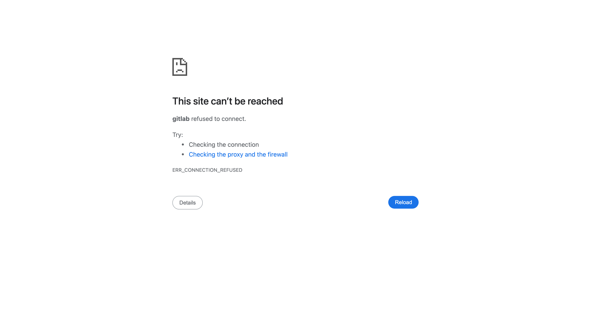

### 步驟 1-1：確認 Docker 開著

打開 Docker Desktop，等左下角顯示 **Engine running**。

### 步驟 1-2：看容器的狀態

**操作**：終端機進到 Day 1 放 `docker-compose.yml` 的資料夾（03a 的例子是桌面上的 `gitlab-lab`），然後執行：

```bash
cd ~/Desktop/gitlab-lab          # PowerShell：cd $HOME\Desktop\gitlab-lab
docker compose ps -a
```

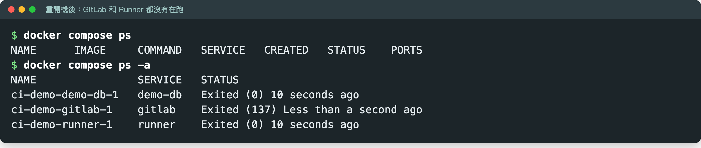

**你應該看到**：`docker compose ps` 什麼都沒列（沒有在跑的容器）。加了 `-a` 之後，`gitlab` 和 `runner` 的 STATUS 是 **Exited**：容器還在，只是停著。

**如果不是這樣**：
- `no configuration file provided: not found`：你不在放 `docker-compose.yml` 的資料夾。找不到那個資料夾的話，跳到[情況 4](#情況-4gitlab-整個不見了)。
- 列出來是空的，加了 `-a` 也是空的：容器已經被刪掉了，跳到[情況 4](#情況-4gitlab-整個不見了)。

### 步驟 1-3：啟動

**操作**：

```bash
docker compose start
```

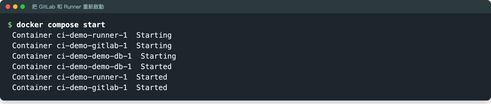

**你應該看到**：每個容器都是 `Started`。

### 步驟 1-4：等它開機完成

GitLab 要 1–3 分鐘才會開好。這段時間打開網頁，會看到 502：

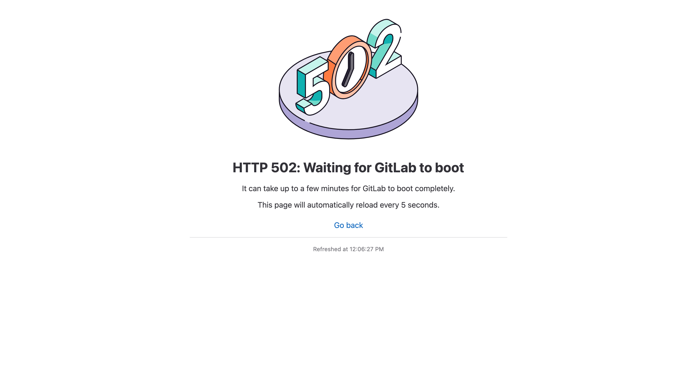

這是正常的，頁面每 5 秒會自己重新整理，**不用重開任何東西**。想在終端機看進度，就執行：

```bash
docker compose ps
```

剛啟動時，`gitlab` 是 `(health: starting)`：

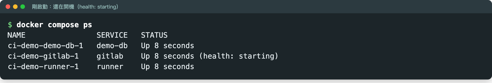

等到變成 **`(healthy)`** 就好了（`runner` 沒有健康檢查，顯示 `Up` 就對了）：

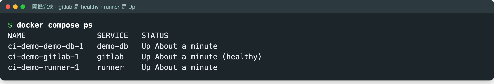

**如果不是這樣**：超過 15 分鐘還不是 healthy，或 STATUS 變成 `Restarting`，多半是記憶體不夠，回 [03a 步驟 0-1](03a-gitlab-from-zero.md#步驟-0-1給-docker-足夠的記憶體) 把 Docker 的記憶體調大。

### 步驟 1-5：確認 Runner 自己接上了

**操作**：瀏覽器登入 GitLab → 進到你的專案 → 左側 **Settings** → **CI/CD** → **Runners** 按 **Expand**。

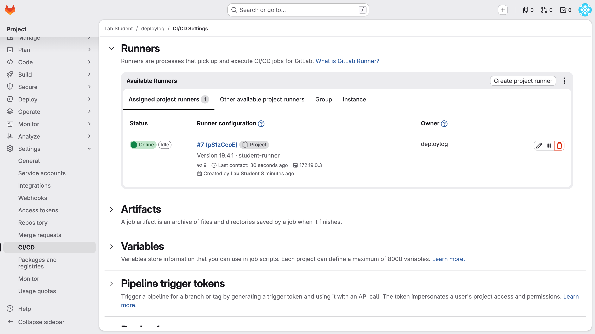

**你應該看到**：你的 Runner 狀態是 **Online**，Last contact 是幾秒前。

Runner 的註冊資料存在 Docker volume 裡，容器重開就會自己接回 GitLab，**不用重新註冊**。

**如果不是這樣**：等 1 分鐘後重新整理，還是 **Offline**，就照[情況 3](#情況-3gitlab-正常pipeline-卡在-pending) 處理。

---

## 情況 2：重新 clone 了 devops-lab，本機的專案不見了

Day 1 在 `sample-repo` 裡 `git init`、推上 GitLab 的那份程式，本機那份跟著舊的 devops-lab 資料夾一起不見了。**GitLab 上的專案都還在**，包括你寫的 `.gitlab-ci.yml` 和所有 commit，從那裡拿回來就好。

### ❌ 不要這樣做：在新的 sample-repo 重新 git init 再推

![git push 被拒絕：! [rejected] main -> main (fetch first)](images/reconnect/12-push-rejected.png)

新的 `sample-repo` 是一份全新的歷史，跟 GitLab 上的專案接不起來，push 會被拒絕（`fetch first`）。

- 訊息裡的 hint 叫你 `git pull`，**不要照做**。兩份歷史不相關，pull 會失敗，或者混出一份亂掉的歷史。
- **更不要 `git push -f`**。它會把 GitLab 上 Day 1 的 `.gitlab-ci.yml` 和所有紀錄整個蓋掉。

已經在新的 sample-repo 裡 `git init` 了也沒關係，把那個 `.git` 刪掉，資料夾就恢復原狀：

```bash
cd labs/m3-ci-pipeline/sample-repo
rm -rf .git                      # PowerShell：Remove-Item -Recurse -Force .git
```

### 步驟 2-1：找到專案的 clone 網址

**操作**：瀏覽器打開你的專案首頁，按右上的 **Code**，複製 **Clone with HTTP** 那一欄。

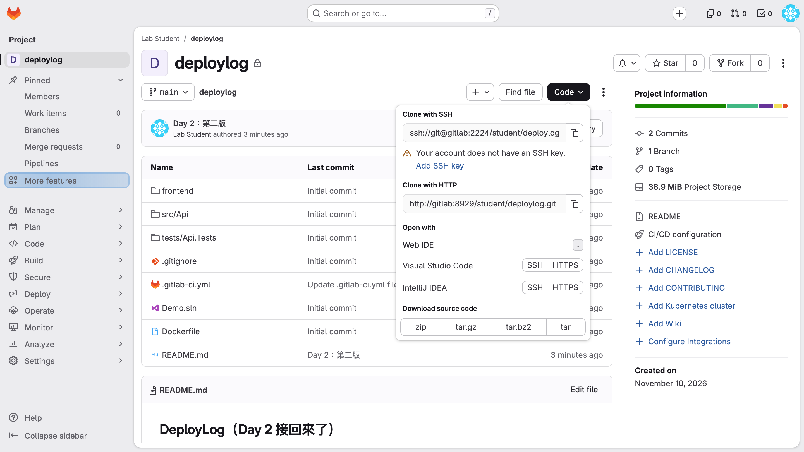

### 步驟 2-2：clone 回來

**操作**：換到 devops-lab **外面**的地方（例如桌面），貼上剛剛的網址：

```bash
cd ~/Desktop                     # PowerShell：cd $HOME\Desktop
git clone http://gitlab:8929/student/deploylog.git
cd deploylog
git log --oneline
```

問 **Username** 填你的帳號（例如 `student`）；問 **Password** 貼 Day 1 建的 **token**，不是登入密碼。token 忘了或沒存下來，照 [03a 步驟 1-3](03a-gitlab-from-zero.md#步驟-1-3建一把-personal-access-token給-git-用的密碼) 再建一把。

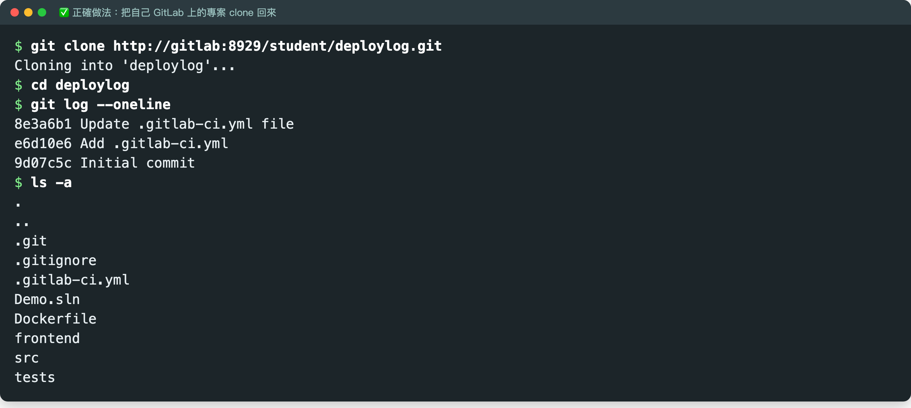

**你應該看到**：`git log` 列出 Day 1 的 commit，而且資料夾裡有 `.gitlab-ci.yml`。這就是你昨天的專案，可以接著做。

**為什麼放 devops-lab 外面**：這是你自己的專案，跟課程教材分開放，下次更新 devops-lab（重新 clone 或刪掉）才不會又被帶走。

**如果不是這樣**：
- `Could not resolve host: gitlab`：hosts 沒設，照 [03a 步驟 0-4](03a-gitlab-from-zero.md#步驟-0-4讓電腦認得-gitlab-這個名字)；或 GitLab 還沒開好，回[情況 1](#情況-1電腦或-docker-重開過gitlab-沒有自己起來)。
- `HTTP Basic: Access denied`：Password 貼成了登入密碼，或 token 少勾 `write_repository`。

### 步驟 2-3：推一版，確認 pipeline 會跑

**操作**：隨便改一個檔案推上去，例如加一份 README：

```bash
echo "# DeployLog" > README.md
git add README.md
git commit -m "Day 2：接回 GitLab"
git push
```

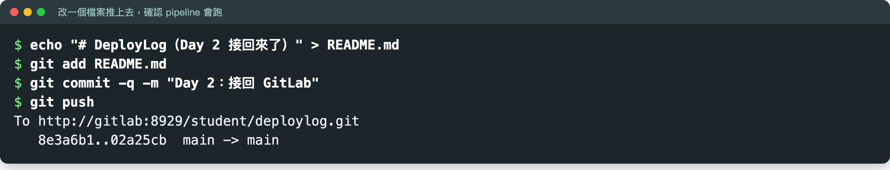

**操作**：瀏覽器 **Build** → **Pipelines**，點最上面那一條。

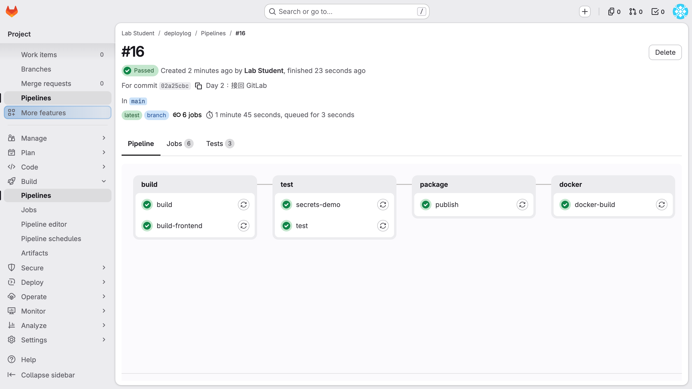

**你應該看到**：pipeline 跑起來，最後是 **Passed**。卡在 Pending 的話，接著做[情況 3](#情況-3gitlab-正常pipeline-卡在-pending)。

---

## 情況 3：GitLab 正常，pipeline 卡在 Pending

點進卡住的 job，會看到黃色提示：

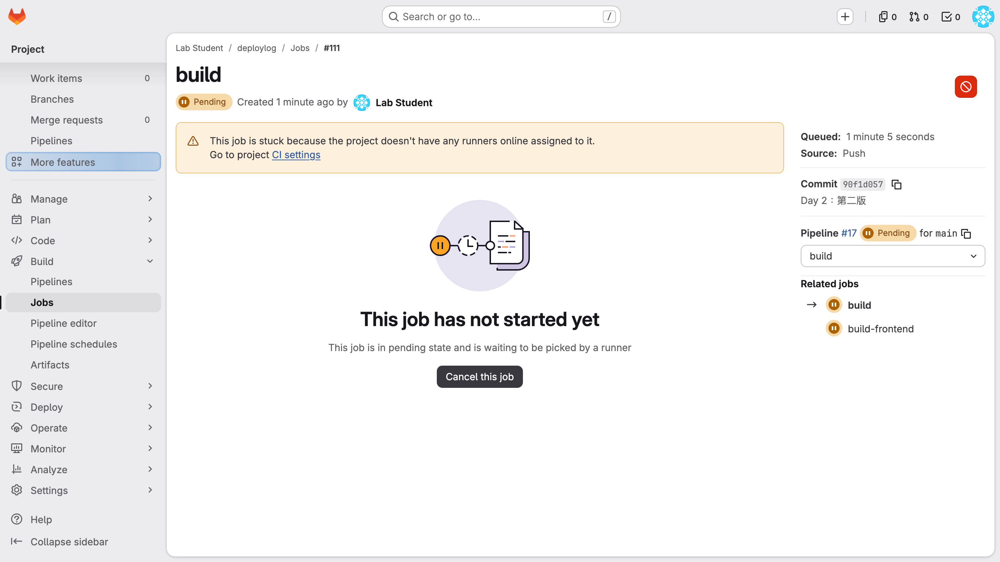

Settings → CI/CD → Runners 裡，你的 Runner 是 **Offline**，Last contact 停在很久以前：

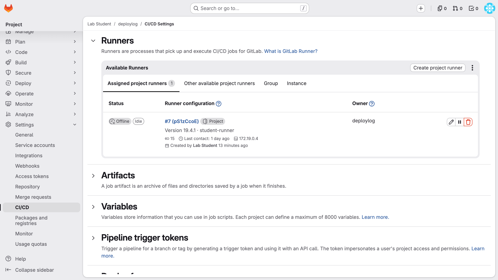

### 步驟 3-1：看 runner 容器有沒有在跑

**操作**：在 `gitlab-lab` 資料夾：

```bash
docker compose ps -a
```

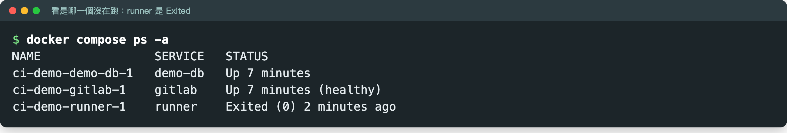

### 步驟 3-2：把 runner 啟動

**操作**：

```bash
docker compose start runner
```

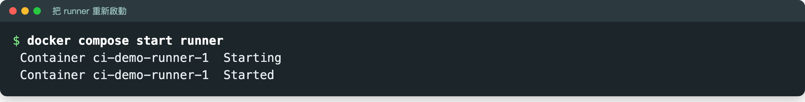

### 步驟 3-3：確認它接到卡住的 job

**操作**：

```bash
docker compose logs runner --tail 8
```

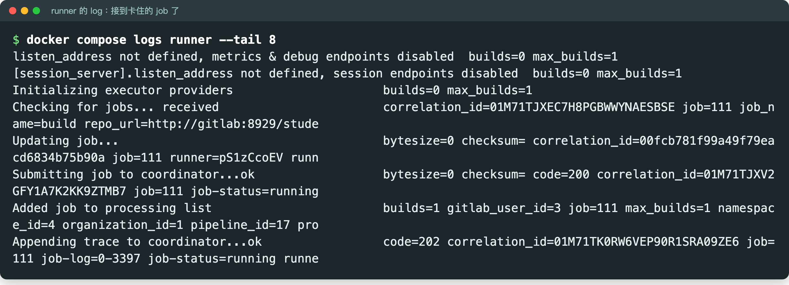

**你應該看到**：`Checking for jobs... received`，表示 runner 已經把卡住的 job 接走了，pipeline 會自己繼續跑，**不用重推**。回 Runners 頁，狀態會變成 **Online**（跟[步驟 1-5](#步驟-1-5確認-runner-自己接上了) 的截圖一樣）。

### 步驟 3-4：如果 log 一直是 forbidden，重新註冊

**你看到**：runner 在跑，但 log 一直出現 `forbidden`，最後一行是 `is unhealthy and will be disabled`：

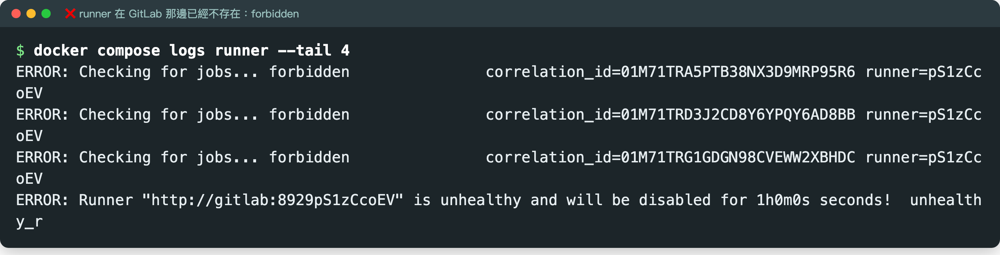

**原因**：這台 Runner 在 GitLab 那邊已經不存在了，例如有人在 Runners 頁按了刪除，或 GitLab 被重建過。Runner 拿著舊的身分去問工作，GitLab 不認得它。

**操作**：

1. 先把失效的那筆註冊從 Runner 的設定檔清掉：

   ```bash
   docker compose exec runner gitlab-runner verify --delete
   ```

   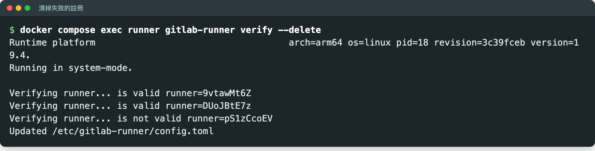

   **你應該看到**：失效的那台顯示 `is not valid`，最後一行是 `Updated /etc/gitlab-runner/config.toml`。截圖的示範環境還有兩台正常的 Runner，所以多了兩行 `is valid`；你的通常只有那一行 `is not valid`。

2. Runners 頁如果還留著舊的那台（顯示 Offline），按它右邊的**垃圾桶**刪掉。
3. 照 03a 重新建立並註冊一台，指令跟 Day 1 一模一樣，只是 token 要用新的：
   - [步驟 2-3：在畫面上建立 project runner](03a-gitlab-from-zero.md#步驟-2-3在畫面上建立-project-runner)（記得勾 **Run untagged jobs**）
   - [步驟 2-4：在終端機註冊](03a-gitlab-from-zero.md#步驟-2-4在終端機註冊)
   - [步驟 2-5：確認 Runner 上線](03a-gitlab-from-zero.md#步驟-2-5確認-runner-上線)

註冊好之後，卡在 Pending 的 job 會自己開始跑。

---

## 情況 4：GitLab 整個不見了

先查 GitLab 的資料還在不在：

```bash
docker volume ls
```

### 4-A：看得到 `gitlab-lab_gitlab-data` 這幾個 volume（只是資料夾不見了）

資料還在，只是放 `docker-compose.yml` 的資料夾被刪了。

**操作**：
1. 建一個**同名**的資料夾 `gitlab-lab`，名字一定要一樣。volume 名稱前面的 `gitlab-lab_` 就是資料夾名稱，換了名字就會開出一台全新、空的 GitLab。
2. 照 [03a 步驟 0-2](03a-gitlab-from-zero.md#步驟-0-2建一個資料夾放-docker-composeyml) 放回同一份 `docker-compose.yml`。
3. 在那個資料夾裡執行 `docker compose up -d`，再接著做[情況 1 的步驟 1-4](#步驟-1-4等它開機完成)。

帳號、專案和 Runner 的註冊都會回來。

### 4-B：volume 也不見了（教室電腦被還原、或執行過 `docker compose down -v`）

資料已經沒了，只能從 [03a Part 0](03a-gitlab-from-zero.md#part-0自己架一台-gitlab公司已有-gitlab-的人跳到-part-1) 重新架一台，再做 Part 1–3。第一次開機約 10 分鐘，全部做完約 40 分鐘。上課時間不夠的話，先看講師的示範畫面跟上進度，課後再自己做。

---

## 以後怎麼避免

- **自己的專案放在 devops-lab 外面**，例如 `~/Desktop/deploylog`。devops-lab 是課程教材，隨時可能重新 clone。
- **上完課用 `docker compose stop`，不要用 `down -v`**。`stop` 只是停住，下次 `start` 就回來；`down -v` 會連資料一起刪。
- **想讓 GitLab 跟著 Docker 一起起來**：在 03a 的 `docker-compose.yml` 裡，`gitlab` 和 `runner` 底下各加一行 `restart: unless-stopped`。代價是每次開 Docker 都會吃掉 3–4 GB 記憶體。只是上課用的話，需要時再 `docker compose start` 就好。
