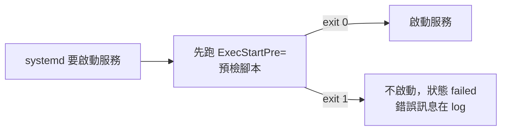
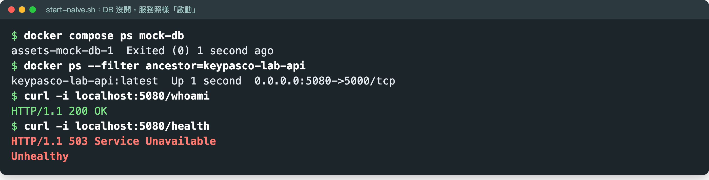
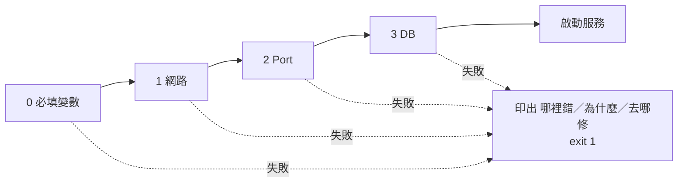
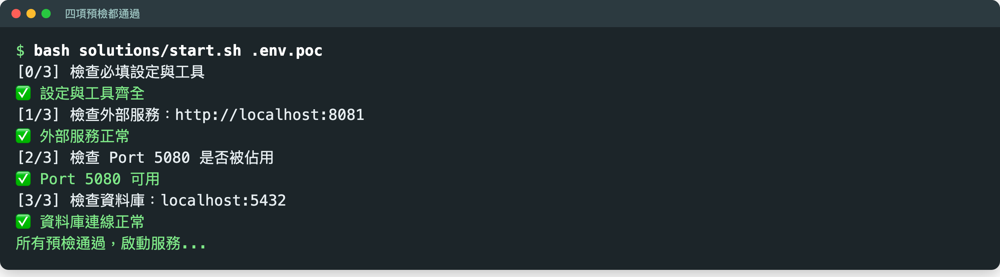
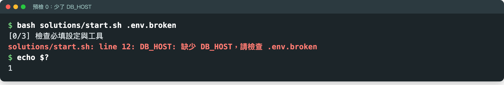
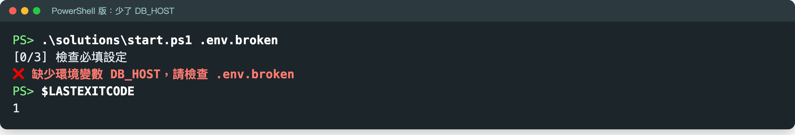
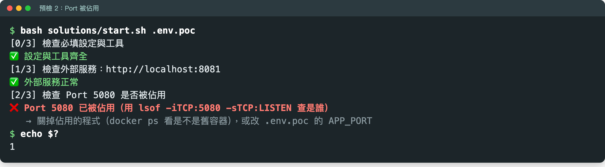
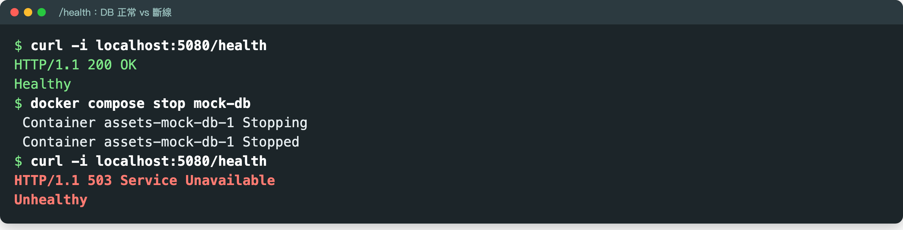
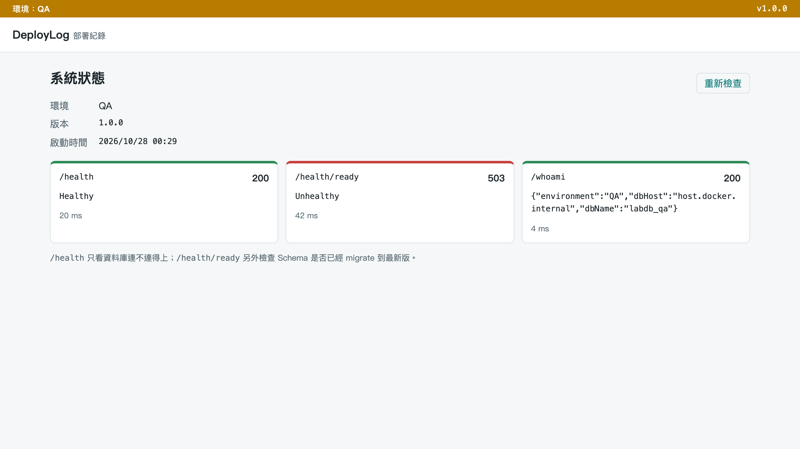

# 手把手：M4 部署腳本入門＋防禦性部署與預檢機制

> DevOps 實作課｜Part 1 在 Day 1 最後一段，Part 2 在 Day 2 開場（含 Lab 與檢核點 2）
> 這份文件一步一步帶你：**把「直接執行、祈禱它會動」的啟動方式，改成「先檢查四件事，任一項不對就講清楚哪裡錯、然後停下來」的啟動腳本。**

上一份：[03-m3-ci-pipeline.md](03-m3-ci-pipeline.md)｜下一份：[05-m5-logging.md](05-m5-logging.md)｜目錄：[README.md](README.md)

---

## 你會學到什麼

| 主題 | 你會帶走的東西 | 在哪一段 |
|------|--------------|---------|
| 為什麼部署要寫成腳本 | 腳本＝可以被執行的部署 SOP | Part 1 第 1 節 |
| 腳本骨架、讀變數、exit code、if | Shell 和 PowerShell 各一份寫法 | Part 1 第 2–7 節 |
| 快速失敗（Fail Fast） | 在最靠近原因的地方大聲停下來 | Part 1 第 6 節 |
| 四項預檢：必填設定、網路、Port、DB | 一支自己寫的 `start.sh` 或 `start.ps1` | Part 2 第 2–6 節（Lab 在第 4–6 節） |
| 縱深防禦 | 預檢只是第一道關卡 | Part 2 第 7 節 |
| `/health` 與 `/health/ready` | 活著 ≠ 能接客 | Part 2 第 8–9 節 |
| 檢核點 2：互相破壞 | 五種破壞都被擋下、exit 1 | Part 2 第 10–11 節 |

**本文的指令都在 `devops-lab/` 根目錄下執行**（就是你解壓 `keypasco-devops-lab.zip` 得到的資料夾）。凡是 Shell 和 PowerShell 寫法不同的地方都兩種都給：

- **Windows**：PowerShell
- **macOS／Linux**：bash

> Mac 小提醒：macOS 的 AirPlay 接收器佔用了 5000 port。用 Mac 做 Lab 時，把 `.env.poc` 的 `APP_PORT=5000` 改成 `5050`，下文的 5000 都換成 5050。教室電腦不受影響。

---

# Part 1　腳本入門（Day 1）

Day 2 的 Lab 只會用到四件事：**骨架、讀變數、exit code、if**。這一段先把這四件事講清楚，不假設你會寫 Shell。

## 1. 為什麼部署要寫成腳本

| 手動步驟清單（Word 文件） | 部署腳本 |
|------------------------|---------|
| 每個人照著做的結果不一樣 | 每次執行的步驟一樣 |
| 漏一步要等出事才知道 | 失敗時會停下來並告訴你 |
| 沒有版本 | 可以進版控、可以 code review |

**腳本就是「可以被執行的部署 SOP」**——把 SOP 從「人照著做」變成「電腦照著做」。想想看：你們現在的部署 SOP 是 Word、Wiki，還是在某個人腦袋裡？

---

## 2. 腳本最小骨架：失敗就停

每支部署腳本的第一行（或前兩行）先寫這個：

**Linux／systemd：Shell**

```bash
#!/bin/bash
set -euo pipefail   # 指令失敗就停、用到未定義變數就停、管線任一段失敗也算失敗
```

**Windows／IIS：PowerShell**

```powershell
$ErrorActionPreference = 'Stop'                  # PowerShell 指令（cmdlet）失敗就停
$PSNativeCommandUseErrorActionPreference = $true # 外部程式（dotnet、docker、sc.exe）失敗也停；PowerShell 7.4+ 才有
```

**為什麼**：沒有這一行，前面失敗了，腳本還會繼續往下跑，最後「看起來部署成功」。

> ⚠️ PowerShell 的坑：只設 `$ErrorActionPreference = 'Stop'`，**外部程式**（像 `docker`、`dotnet`）回傳非 0 時腳本照樣往下跑。Windows Server 內建的是 Windows PowerShell 5.1，**沒有**第二行那個設定，要自己檢查 `$LASTEXITCODE`（第 4 節）。所以 Lab 的 `start.ps1` 最後一行是 `exit $LASTEXITCODE`，把 `docker run` 的結果傳出去。

---

## 3. 讀環境變數與預設值

設定從外面給，腳本不寫死——跟 M2 程式碼「組態外部化」同一個原則（見 [02-m2-config.md](02-m2-config.md)）。

**bash**

```bash
APP_PORT="${APP_PORT:-5000}"        # 沒設就用 5000
echo "使用 Port：$APP_PORT"
```

**PowerShell**（Windows PowerShell 5.1 也能跑）

```powershell
$AppPort = if ($env:APP_PORT) { $env:APP_PORT } else { 5000 }
```

> PowerShell 7 可以寫成 `$env:APP_PORT ?? 5000`，但 5.1 不支援，所以這裡用 `if` 寫法。

**動手試（選做）**：

```bash
unset APP_PORT
APP_PORT="${APP_PORT:-5000}"; echo "使用 Port：$APP_PORT"
APP_PORT=8080; APP_PORT="${APP_PORT:-5000}"; echo "使用 Port：$APP_PORT"
```

```powershell
Remove-Item Env:APP_PORT -ErrorAction SilentlyContinue
$AppPort = if ($env:APP_PORT) { $env:APP_PORT } else { 5000 }; "使用 Port：$AppPort"
$env:APP_PORT = '8080'
$AppPort = if ($env:APP_PORT) { $env:APP_PORT } else { 5000 }; "使用 Port：$AppPort"
```

你應該看到：

```
使用 Port：5000
使用 Port：8080
```
<!-- 未驗證：PowerShell 尚未在 Windows 實測（bash 版已實測） -->

**想一想**：現場手改的那個設定檔，如果改成環境變數，部署人員還要開檔案嗎？

---

## 4. Exit code：腳本跟外界溝通的方式

| exit code | 意思 |
|-----------|------|
| `0` | 成功 |
| 非 `0`（通常是 `1`） | 失敗 |

- **誰在看**：systemd、Windows 排程／部署工具、GitLab CI job
- **它們只看 exit code，不看你印了什麼**——畫面上印「部署成功」但 exit code 是 1，CI 一樣是紅燈
- 怎麼看上一個指令的 exit code：

  | | 寫法 | 拿到什麼 |
  |---|------|---------|
  | bash | `$?` | 上一個指令的數字 |
  | PowerShell | `$LASTEXITCODE` | 上一個**外部程式**（`docker`、`powershell -File …`）的數字 |
  | PowerShell | `$?` | 上一步成功與否（`True`／`False`），不是數字 |

- 腳本自己判斷失敗時，用 `exit 1` 回報

**動手試**：

```bash
false; echo $?
true; echo $?
```

你應該看到：

```
1
0
```

PowerShell（Windows）：

```powershell
cmd /c exit 1; $LASTEXITCODE
```

你應該看到：

```
1
```
<!-- 未驗證：PowerShell 尚未在 Windows 實測 -->

> **MIS 最熟的對照**：systemd 的 `ExecStartPre=` 回非 0，服務就不會啟動。Day 2 的預檢腳本就是靠這個擋住壞掉的部署。

---

## 5. 流程圖：exit code 怎麼擋住一個壞掉的部署



**IIS、排程、GitLab CI 也一樣**：它們不讀你印了什麼，只看 exit code——0 繼續、非 0 停下來。Day 2 你寫的預檢腳本，就是圖中間那一格。

---

## 6. 理論：快速失敗（Fail Fast）

> **一發現不對，就在最靠近原因的地方大聲停下來——不要帶著錯誤繼續跑。**
> 出處：Jim Shore〈Fail Fast〉，IEEE Software 2004

| 慢慢失敗 | 快速失敗 |
|---------|---------|
| `DB_HOST` 沒設，服務照樣啟動 | 啟動前檢查 `DB_HOST`，沒設就 `exit 1` |
| 第一個使用者登入時才噴錯 | 部署當下就知道，還沒有使用者受影響 |
| 錯誤訊息是「連線逾時」，離原因很遠 | 訊息直接寫「缺少 DB_HOST」 |
| 排查要從使用者回報開始往回追 | 修的人就是部署的人 |

比喻：飛機起飛前的檢查——在地面發現問題，比在空中發現便宜太多（所以 Day 2 的 Lab 叫「預檢」）。Fail fast 不是「讓程式容易掛」，而是**掛在對的時間點、對的位置、帶著對的訊息**。

同一個原則在課程裡出現好幾次：

| 在哪裡 | 怎麼快速失敗 |
|-------|------------|
| M4（本篇） | `set -euo pipefail`：指令失敗就停 |
| M3 | `dotnet restore --locked-mode`：套件版本跟 lock 檔不符就失敗 |
| M3 | CI 紅燈就停，不往下打包、部署 |
| M6 | `migrate` 找不到資料庫就失敗 |

---

## 7. if 判斷＋友善錯誤訊息

**bash**

```bash
if [ -z "${DB_HOST:-}" ]; then
  echo "缺少 DB_HOST，請檢查 .env" >&2
  exit 1
fi
```

**PowerShell**

```powershell
if (-not $env:DB_HOST) {
  [Console]::Error.WriteLine("缺少 DB_HOST，請檢查 .env")
  exit 1
}
```

**好的錯誤訊息三要素**：


三個寫法細節（Day 2 Lab 會踩到）：

| 細節 | 為什麼 |
|------|-------|
| bash 寫 `${DB_HOST:-}`，不要只寫 `$DB_HOST` | 有 `set -u` 時，用到沒設的變數會先以「unbound variable」中止，你的友善訊息根本印不出來 |
| `>&2`／`[Console]::Error.WriteLine` | 錯誤訊息印到 stderr（標準錯誤），跟一般輸出分開，log 收集工具才分得出來 |
| PowerShell **不要**用 `Write-Error` | 搭配 `$ErrorActionPreference = 'Stop'` 時它會直接丟例外、印一大段紅字，後面的 `exit 1` 不會執行到，訊息很難讀 |

> `.ps1` 檔裡有中文時，存成 **UTF-8 with BOM**（記事本另存新檔選「UTF-8 (BOM)」），Windows PowerShell 5.1 才不會把中文變亂碼。課程附的 `.ps1` 都已經是這個格式。

**動手試（選做）**：把上面的 if 存成一支小腳本，看它擋下和放行的樣子。

> ⚠️ 不要直接在終端機貼含 `exit 1` 的那段——條件成立時，`exit` 會把你的終端機關掉。存成檔案再執行。

bash：

```bash
cat > try-check.sh <<'EOF'
#!/bin/bash
set -euo pipefail
if [ -z "${DB_HOST:-}" ]; then
  echo "缺少 DB_HOST，請檢查 .env" >&2
  exit 1
fi
echo "DB_HOST=${DB_HOST}，繼續"
EOF
bash try-check.sh; echo "exit code：$?"
DB_HOST=localhost bash try-check.sh; echo "exit code：$?"
```

PowerShell：

```powershell
@'
$ErrorActionPreference = 'Stop'
if (-not $env:DB_HOST) {
  [Console]::Error.WriteLine("缺少 DB_HOST，請檢查 .env")
  exit 1
}
Write-Host "DB_HOST=$env:DB_HOST，繼續"
'@ | Set-Content try-check.ps1 -Encoding UTF8
Remove-Item Env:DB_HOST -ErrorAction SilentlyContinue
powershell -ExecutionPolicy Bypass -File try-check.ps1; "exit code：$LASTEXITCODE"
$env:DB_HOST = 'localhost'
powershell -ExecutionPolicy Bypass -File try-check.ps1; "exit code：$LASTEXITCODE"
Remove-Item Env:DB_HOST
```

你應該看到：

```
缺少 DB_HOST，請檢查 .env
exit code：1
DB_HOST=localhost，繼續
exit code：0
```
<!-- 未驗證：PowerShell 尚未在 Windows 實測（bash 版已實測） -->

> ⚠️ **變數後面緊接中文標點，要用 `${}` 包起來**：`"$DB_HOST，繼續"` 在 macOS 內建的 bash 3.2 會變成 `DB_HOST�: unbound variable`——它把全形逗號的一部分當成變數名稱。寫成 `"${DB_HOST}，繼續"` 就沒事。自己寫腳本時記得這一點。

試完可以刪掉 `try-check.sh`／`try-check.ps1`。

---

## 8. 反面教材：什麼都不檢查的啟動腳本

打開 `labs/m4-preflight/starter/start-naive.sh`（Windows 版 `start-naive.ps1`，`docker run` 那一行一模一樣）：

```bash
#!/bin/bash
# 反面教材：直接啟動，什麼都不檢查
# （image 裡實際執行的就是 dotnet MyApi.dll）
# 用法（在 devops-lab/ 根目錄下）：bash labs/m4-preflight/starter/start-naive.sh
docker run --rm -p 5000:5000 --env-file .env.poc keypasco-lab-api
```

投影片上寫的是 `dotnet MyApi.dll`——那是服務本身的啟動指令。課堂上服務包在 Docker image 裡，所以腳本最後一行是 `docker run`，意思相同。

**帶回家的問題**：**DB 沒開的時候，這支腳本會發生什麼事？**（Day 2 開場會實際跑給你看。）

**一份沒被擋下的設定檔可以有多大殺傷力？** CrowdStrike（2024/7/19）推送一份 Windows sensor 的設定內容更新：sensor 預期 20 個輸入欄位，更新給了 21 個，內容驗證器本身的 bug 讓它通過了檢查。約 78 分鐘後撤回時，約 850 萬台 Windows 已經藍畫面（Microsoft 估計）。事後 CrowdStrike 改成先 canary、再分批釋出。教訓：**檢查有寫，但檢查本身有 bug，又沒有分批**——Day 2 我們寫的預檢，就是部署前的那道閘。

- [CrowdStrike RCA 公告](https://www.crowdstrike.com/en-us/blog/channel-file-291-rca-available/)
- [TechCrunch：850 萬台 Windows 受影響](https://techcrunch.com/2024/07/20/microsoft-says-8-5m-windows-devices-were-affected-by-crowdstrike-outage/)

> **Day 1 結束前**：今天建好的 Docker 環境（`keypasco-lab-api` image）請保留，Day 2 要用。

---

# Part 2　預檢機制＋Lab（Day 2）

## 0. 先把環境跑起來

1. **啟動 mock 依賴服務**（模擬 POC 環境的 DB 和一支外部服務）。先確認終端機在 `devops-lab` 資料夾裡（不在的話先 `cd` 過去，見 [00 第 3 步](00-setup.md)），PowerShell 和 bash 指令相同：

   ```bash
   docker compose up -d mock-db mock-external-api
   ```

   已經在跑的話只會印 `Container devops-lab-mock-… Running`，也是對的。

2. **確認有起來**：

   ```bash
   docker compose ps
   ```

   你應該看到：`STATUS` 欄 `mock-db` 是 `Up ... (healthy)`、`mock-external-api` 是 `Up ...`。

   **如果不是這樣**：`mock-db` 剛起來時是 `(health: starting)`，等 10–20 秒再看一次。

3. **確認 Day 1 建好的 image 還在**：

   ```bash
   docker image ls keypasco-lab-api
   ```

   你應該看到一行 `REPOSITORY` 是 `keypasco-lab-api`。

   **如果不是這樣**（教室電腦有還原卡、image 不見了）：重 build 一次：

   ```bash
   docker build -t keypasco-lab-api apps/dotnet-deploylog
   ```

4. **確認 `.env.poc` 在**，內含 `APP_PORT`、`EXTERNAL_API_URL`、`DB_HOST`、`DB_PORT`：

   ```
   ASPNETCORE_ENVIRONMENT=POC
   APP_PORT=5000
   EXTERNAL_API_URL=http://localhost:8081
   DB_HOST=localhost
   DB_PORT=5432
   DB_NAME=labdb_poc
   DB_USER=labuser
   DB_PASSWORD=labpass
   ```

---

## 1. 「看起來啟動了，其實整個是壞的」

很多團隊現在的部署流程長這樣：


程式已經 listen port、回應 200，但依賴的 DB／外部服務根本沒連上——要等第一個使用者打進來才發現。**你們怎麼判斷部署成功？「網頁打得開」就夠了嗎？**

### 實際看看：DB 沒開，服務照樣「啟動成功」（選做）

1. 把資料庫停掉：

   ```bash
   docker compose stop mock-db
   ```

2. 用 Day 1 的反面教材啟動（會停在前景，不要關）：

   | 環境 | 指令 |
   |------|------|
   | Windows | `powershell -ExecutionPolicy Bypass -File labs\m4-preflight\starter\start-naive.ps1` |
   | macOS／Linux | `bash labs/m4-preflight/starter/start-naive.sh` |

3. **另開一個終端機**（一樣 `cd devops-lab`），看四件事：

   ```bash
   docker compose ps -a mock-db
   docker ps --filter ancestor=keypasco-lab-api
   curl -i http://localhost:5000/whoami
   curl -i http://localhost:5000/health
   ```

   Windows PowerShell 5.1 的 `curl` 是 `Invoke-WebRequest` 的別名，請打 **`curl.exe`**：

   ```powershell
   docker compose ps -a mock-db
   docker ps --filter ancestor=keypasco-lab-api
   curl.exe -i http://localhost:5000/whoami
   curl.exe -i http://localhost:5000/health
   ```

   你應該看到（節錄重點行）：

   ```
   $ docker compose ps -a mock-db
   NAME               IMAGE                …   STATUS                     PORTS
   devops-lab-mock-db-1   postgres:16-alpine   …   Exited (0) 5 seconds ago
   $ docker ps --filter ancestor=keypasco-lab-api
   CONTAINER ID   IMAGE              COMMAND              CREATED         STATUS         PORTS                    NAMES
   ff530ff14e38   keypasco-lab-api   "dotnet MyApi.dll"   5 seconds ago   Up 5 seconds   0.0.0.0:5000->5000/tcp   condescending_dijkstra
   $ curl -i http://localhost:5000/whoami
   HTTP/1.1 200 OK
   …
   {"environment":"POC","dbHost":"localhost","dbName":"labdb_poc"}
   $ curl -i http://localhost:5000/health
   HTTP/1.1 503 Service Unavailable
   …
   Unhealthy
   ```

   `docker compose ps` 要加 `-a` 才會列出停掉的容器（不加的話只印標題列，像是 mock-db 不存在）。容器 ID 和最後的 NAMES（Docker 隨機取的名字）每次不同。

   

4. 回到第一個終端機按 `Ctrl+C` 停掉服務，再把 DB 開回來：

   ```bash
   docker compose start mock-db
   ```

| 資料庫 | 服務 | `/whoami` | `/health` |
|-------|------|----------|----------|
| 停了 | Up | 200 | **503** |

**為什麼**：容器是 `Up`、網頁也打得開，這就是「看起來啟動了」。只有 `/health` 說了實話。今天要做的，就是讓它**根本不要啟動**。

> 其實這支腳本還有第二個問題：就算 DB 開著，`/health` 也是 503——`.env.poc` 寫 `DB_HOST=localhost`，而容器裡的 `localhost` 是容器自己，連不到你電腦上的 mock-db（`docker logs` 看得到 `Failed to connect to 127.0.0.1:5432`）。所以第 4 步把 DB 開回來之後，反面教材的 `/health` 一樣是 503。第 5 節的 Lab 腳本最後一行會處理這件事。Mac 上 5000 被 AirPlay 佔用，這支腳本會直接綁不到 Port，看截圖就好。

### 同一個錯，兩種發現時間

| | 1 | 2 | 3 | 4 | 5 |
|---|---|---|---|---|---|
| **沒有預檢** | 部署 | 服務啟動，看起來正常 | 使用者打進來 | ❌ 錯誤、客服電話 | ❌ 好幾個小時回頭排查 |
| **有預檢** | 部署 | ⚠️ 3 秒內發現 DB 連不上 | 訊息寫清楚去哪修 | 修好再部署 | ✅ 服務真的正常 |

錯誤一樣會發生；差別是**在部署當下、由部署的人發現**，還是**上線後由客戶發現**。（技術支援的同事想想：客戶打電話來時，你手上有什麼資訊？）

---

## 2. 部署掛掉的三大死因 → 四項預檢

| 死因 | 對應的預檢 | 回扣 |
|------|----------|------|
| 1. 環境變數／設定檔打錯 | **預檢 0**：必填變數 | M2 組態管理 |
| 2. 網路／防火牆沒通 | **預檢 1**：網路　**預檢 2**：Port | — |
| 3. DB Schema 版本不符 | **預檢 3**：DB 連線（＋ M6） | M6 Schema 管理 |

Port 被佔用不在三大死因裡，但現場很常見（舊容器沒關、別的服務佔著），所以一起檢查。

### 預檢 0：必填變數（死因 1）

Day 1 那段 if 的一行簡寫：變數沒設或是空的 → 印訊息、`exit 1`。

```bash
: "${DB_HOST:?缺少 DB_HOST，請檢查 .env}"
: "${EXTERNAL_API_URL:?缺少 EXTERNAL_API_URL}"
```

- 「**有沒有設**」在這裡抓；「**設了但打錯**」（host、port 錯字）會在後面的網路／DB 檢查被抓到
- **為什麼排第一個？** `set -u` 遇到沒設的變數會直接中斷、訊息很不友善；先檢查才能告訴部署的人「去哪修」

### 預檢 1 網路、預檢 2 Port（死因 2）

```bash
curl -sf --max-time 3 "$EXTERNAL_API_URL/health" > /dev/null || exit 1   # 預檢 1
lsof -iTCP:"$APP_PORT" -sTCP:LISTEN > /dev/null 2>&1 && exit 1            # 預檢 2
```

- **預檢 1**：連得到依賴的外部服務嗎？3 秒內打不到 `/health` 就擋下
- **預檢 2**：Port 被別人佔了嗎？
- 開一條防火牆規則，你們的流程要多久？——這就是為什麼要在**部署前**就知道「沒通」

### 預檢 3：DB 連線（死因 3）——以及它抓不到的事

```bash
pg_isready -h "$DB_HOST" -p "$DB_PORT" > /dev/null 2>&1 || exit 1
```

| `pg_isready` 證明的 | 它抓不到的 |
|-------------------|----------|
| DB 在收連線 | 帳密對不對 → 啟動後由 `/health` 抓（第 8 節） |
| | Schema 是哪一版 → M6（[06-m6-db-migration.md](06-m6-db-migration.md)） |

**DB 連得上，就代表程式能用嗎？** 不一定——這就是為什麼後面還有 `/health` 和 `/health/ready`。

### 業界案例：Knight Capital（2012/8/1）——45 分鐘虧損 4.6 億美元

| 8 台 | 1 台 | 45 分鐘 | 4.6 億 |
|------|------|--------|--------|
| 伺服器 | 沒更新到 | 送出 400 多萬筆委託 | 美元虧損 |

部署新版交易程式時漏了 1 台，那台殘留多年前停用的舊程式（Power Peg）；一個被重複使用的旗標喚醒了舊邏輯。開盤前系統其實寄出了 97 封錯誤通知信，但那些信不是設計成告警，沒人處理。

**根因：部署後沒有驗證步驟確認 8 台都真的更新成功，也沒有第二個人複核。** 如果你是那個部署的人，什麼檢查能救你？（答案之一：部署後比對每台的版本。）

- [SEC：Knight Capital 處分新聞稿](https://www.sec.gov/newsroom/press-releases/2013-222)
- [Doug Seven：Knightmare（DevOps 角度整理）](https://dougseven.com/2014/04/17/knightmare-a-devops-cautionary-tale/)

---

## 3. 設計原則：任一項失敗 = exit 1



- 任一關沒過 → 印出「哪裡錯／為什麼／去哪修」→ `exit 1`，**不讓服務帶病上線**
- **誰在看 exit code**：systemd、IIS 部署流程、GitLab CI——Part 1 第 4 節
- **預檢自己也可能害你**：守門檢查（例如「缺憑證就拒絕啟動」）如果比它要檢查的東西先上線，服務會把自己擋成無限重啟。守門是對的，要注意的是啟用順序：要檢查的東西先就位，再打開檢查。另外，預檢用到的工具（`curl`、`lsof`、`pg_isready`）正式機上沒裝的話，預檢本身就會失敗——所以參考解答的 [0/3] 會先確認工具都在。

### 四項預檢串成 start.sh（精簡版）

```bash
#!/bin/bash
set -euo pipefail
: "${EXTERNAL_API_URL:?缺少 EXTERNAL_API_URL}"; : "${APP_PORT:?缺少 APP_PORT}"        # 預檢 0
: "${DB_HOST:?缺少 DB_HOST}"; : "${DB_PORT:?缺少 DB_PORT}"
if ! curl -sf --max-time 3 "$EXTERNAL_API_URL/health" > /dev/null; then          # 預檢 1
  echo "無法連線到外部服務：$EXTERNAL_API_URL/health" >&2; exit 1
fi
if lsof -iTCP:"$APP_PORT" -sTCP:LISTEN > /dev/null 2>&1; then                    # 預檢 2
  echo "Port $APP_PORT 已被佔用" >&2; exit 1
fi
if ! pg_isready -h "$DB_HOST" -p "$DB_PORT" > /dev/null 2>&1; then               # 預檢 3
  echo "無法連線到資料庫：$DB_HOST:$DB_PORT" >&2; exit 1
fi
echo "所有預檢通過，啟動服務..."
exec dotnet MyApi.dll                    # Lab 版這行是 docker run
```

Lab 的參考解答比這個多三樣：每項多一行「→ 去哪修」、印 `[0/3]`…`[3/3]` 進度、先檢查工具有沒有裝。`pg_isready` 需要安裝 PostgreSQL client。

### Shell 版 vs PowerShell 版

| 檢查項目 | Linux／systemd（Shell） | Windows／IIS（PowerShell） |
|---------|------------------------|---------------------------|
| 必填變數 | `: "${DB_HOST:?msg}"` | `if (-not $env:DB_HOST) { ...; exit 1 }` |
| 網路 | `curl -sf --max-time 3` | `Invoke-WebRequest -TimeoutSec 3 -UseBasicParsing` |
| Port | `lsof -iTCP:$APP_PORT -sTCP:LISTEN` | `GetActiveTcpListeners()` 比對 Port |
| DB | `pg_isready -h $DB_HOST -p $DB_PORT` | `[Net.Sockets.TcpClient]` 3 秒連線測試 |

兩邊邏輯一致、只是指令不同：POC 是 IIS 的做 `.ps1`，systemd 的做 `.sh`，組內自己選一版。

- PowerShell 版用 .NET 內建類別，Windows 和 Linux 的 PowerShell 都能跑；`Get-NetTCPConnection`、`Test-NetConnection` 只有 Windows 有（參考解答裡留成註解）
- DB 檢查只測 TCP 連得上（跟 `pg_isready` 同級），不驗帳密
- 字串裡寫 `$env:DB_HOST:` 後面接冒號會被 PowerShell 誤判，所以寫成 `$($env:DB_HOST):$($env:DB_PORT)`

---

## 4. Lab 準備：起始檔與分工

| 你的環境 | 起始檔 | 執行方式（在 `devops-lab/` 下） |
|---------|-------|---------------------------|
| Windows（PowerShell） | `labs\m4-preflight\starter\start.ps1` | `powershell -ExecutionPolicy Bypass -File labs\m4-preflight\starter\start.ps1 .env.poc` |
| Linux／macOS（bash） | `labs/m4-preflight/starter/start.sh` | `bash labs/m4-preflight/starter/start.sh .env.poc` |

> bash 版需要 `curl`、`lsof`、`pg_isready`。Windows 的 Git Bash 沒有 `lsof`、`pg_isready`，**Windows 請做 PowerShell 版**。

**兩人一組**：開發背景主打字；維運背景對照下面 5.0–5.3 逐段檢查，並準備第 10 節的「破壞方法」。兩個人都要做到第 10 節的 #0–#4；#5（`/health`）只要求開發職務。

起始檔已經幫你做好三件事：

1. 骨架（`set -euo pipefail`／`$ErrorActionPreference = 'Stop'`）
2. 讀進 `.env` 檔，變成環境變數
3. 最後啟動服務（`docker run`）

你要補的是中間**四段 TODO，順序固定：先 0，再 1、2、3**。起始檔裡每段 TODO 都附了提示。

---

## 5. Lab：補完四項預檢

> 用任何文字編輯器打開起始檔（VS Code、記事本都可以）。PowerShell 檔存檔時保持 **UTF-8 with BOM**。

### 5.0 必填設定檢查（死因 1）

**bash**：

```bash
echo "[0/3] 檢查必填設定與工具"
: "${EXTERNAL_API_URL:?缺少 EXTERNAL_API_URL，請檢查 $ENV_FILE}"
: "${APP_PORT:?缺少 APP_PORT，請檢查 $ENV_FILE}"
: "${DB_HOST:?缺少 DB_HOST，請檢查 $ENV_FILE}"
: "${DB_PORT:?缺少 DB_PORT，請檢查 $ENV_FILE}"
for tool in curl lsof pg_isready docker; do
  if ! command -v "$tool" > /dev/null; then
    echo "❌ 這台電腦沒有 $tool 指令，預檢沒辦法做（請先安裝）" >&2; exit 1
  fi
done
echo "✅ 設定與工具齊全"
```

`: "${變數:?訊息}"` 的意思：變數沒設或是空的，就印出訊息並結束腳本（exit 1）。後面的檢查會用到 `curl`、`lsof`、`pg_isready`，工具沒裝也先擋下來，免得預檢本身默默失效。

**PowerShell**：

```powershell
Write-Host "[0/3] 檢查必填設定"
foreach ($name in 'EXTERNAL_API_URL', 'APP_PORT', 'DB_HOST', 'DB_PORT') {
    if (-not [Environment]::GetEnvironmentVariable($name)) {
        [Console]::Error.WriteLine("❌ 缺少環境變數 $name，請檢查 $EnvFile")
        exit 1
    }
}
Write-Host "✅ 必填設定齊全"
```

### 5.1 網路連線檢查（死因 2）

**bash**：

```bash
echo "[1/3] 檢查外部服務：$EXTERNAL_API_URL"
if ! curl -sf --max-time 3 "$EXTERNAL_API_URL/health" > /dev/null; then
  echo "❌ 無法連線到外部服務：$EXTERNAL_API_URL/health" >&2
  echo "   → 確認 mock-external-api 有在跑（docker compose ps），或檢查 $ENV_FILE 的 EXTERNAL_API_URL" >&2
  exit 1
fi
echo "✅ 外部服務正常"
```

**PowerShell**：

```powershell
Write-Host "[1/3] 檢查外部服務：$env:EXTERNAL_API_URL"
try {
    Invoke-WebRequest -Uri "$env:EXTERNAL_API_URL/health" -TimeoutSec 3 -UseBasicParsing | Out-Null
} catch {
    [Console]::Error.WriteLine("❌ 無法連線到外部服務：$env:EXTERNAL_API_URL/health")
    [Console]::Error.WriteLine("   → 確認 mock-external-api 有在跑（docker compose ps），或檢查 $EnvFile 的 EXTERNAL_API_URL")
    exit 1
}
Write-Host "✅ 外部服務正常"
```

### 5.2 Port 佔用檢查（只看本機有沒有程式在 listen）

**bash**：

```bash
echo "[2/3] 檢查 Port $APP_PORT 是否被佔用"
if lsof -iTCP:"$APP_PORT" -sTCP:LISTEN > /dev/null 2>&1; then
  echo "❌ Port $APP_PORT 已被佔用（用 lsof -iTCP:$APP_PORT -sTCP:LISTEN 查是誰）" >&2
  echo "   → 關掉佔用的程式（docker ps 看是不是舊容器），或改 $ENV_FILE 的 APP_PORT" >&2
  exit 1
fi
echo "✅ Port $APP_PORT 可用"
```

沒有 `lsof` 的 Linux 可以改用 `ss -ltn | grep -q ":$APP_PORT "`（記得把 [0/3] 工具清單裡的 `lsof` 換成 `ss`）。

**PowerShell**（Windows 和 Linux 的 PowerShell 7 都能跑）：

```powershell
Write-Host "[2/3] 檢查 Port $env:APP_PORT 是否被佔用"
# Windows 也可以寫：Get-NetTCPConnection -LocalPort $env:APP_PORT -State Listen -ErrorAction SilentlyContinue
$listeners = [Net.NetworkInformation.IPGlobalProperties]::GetIPGlobalProperties().GetActiveTcpListeners()
if ($listeners | Where-Object { $_.Port -eq [int]$env:APP_PORT }) {
    [Console]::Error.WriteLine("❌ Port $env:APP_PORT 已被佔用")
    [Console]::Error.WriteLine("   → 關掉佔用的程式（docker ps 看是不是舊容器），或改 $EnvFile 的 APP_PORT")
    exit 1
}
Write-Host "✅ Port $env:APP_PORT 可用"
```

### 5.3 DB 連線檢查（死因 3）

**bash**：

```bash
echo "[3/3] 檢查資料庫：$DB_HOST:$DB_PORT"
if ! pg_isready -h "$DB_HOST" -p "$DB_PORT" > /dev/null 2>&1; then
  echo "❌ 無法連線到資料庫：$DB_HOST:$DB_PORT" >&2
  echo "   → 確認 mock-db 有在跑（docker compose ps），或檢查 $ENV_FILE 的 DB_HOST / DB_PORT" >&2
  exit 1
fi
echo "✅ 資料庫連線正常"
```

**PowerShell**（用 TCP 連線測試，跟 `pg_isready` 同級，不驗帳密）：

```powershell
Write-Host "[3/3] 檢查資料庫：$($env:DB_HOST):$($env:DB_PORT)"
# Windows 也可以寫：Test-NetConnection $env:DB_HOST -Port $env:DB_PORT -InformationLevel Quiet
$ok = $false
try { $c = [Net.Sockets.TcpClient]::new(); $ok = $c.ConnectAsync($env:DB_HOST, [int]$env:DB_PORT).Wait(3000) } catch {} finally { if ($c) { $c.Dispose() } }
if (-not $ok) {
    [Console]::Error.WriteLine("❌ 無法連線到資料庫：$($env:DB_HOST):$($env:DB_PORT)")
    [Console]::Error.WriteLine("   → 確認 mock-db 有在跑（docker compose ps），或檢查 $EnvFile 的 DB_HOST / DB_PORT")
    exit 1
}
Write-Host "✅ 資料庫連線正常"
```

### 5.4 最後一段（起始檔已經寫好，不用改）

```bash
echo "所有預檢通過，啟動服務..."
# 容器裡的 localhost 是容器自己，所以改用 host.docker.internal 連回這台電腦上的 mock-db
exec docker run --rm --name lab-api -p "$APP_PORT:5000" --env-file "$ENV_FILE" \
  --add-host=host.docker.internal:host-gateway -e DB_HOST=host.docker.internal \
  keypasco-lab-api
```

**為什麼要 `-e DB_HOST=host.docker.internal`？** 預檢在你的電腦上跑，`localhost:5432` 就是 mock-db；但服務跑在容器裡，容器裡的 `localhost` 是容器自己，連不到 mock-db。`host.docker.internal` 是 Docker 提供的名字，代表「跑容器的這台電腦」。少了這行，服務會啟動，但 `/health` 回 `Unhealthy`（log 裡是 `Failed to connect to 127.0.0.1:5432`）——剛好就是第 1 節看到的「看起來啟動了，其實是壞的」。

### 5.5 執行：四關全過

| 環境 | 指令 |
|------|------|
| Windows | `powershell -ExecutionPolicy Bypass -File labs\m4-preflight\starter\start.ps1 .env.poc` |
| macOS／Linux | `bash labs/m4-preflight/starter/start.sh .env.poc` |

你應該看到（bash 版）：

```
[0/3] 檢查必填設定與工具
✅ 設定與工具齊全
[1/3] 檢查外部服務：http://localhost:8081
✅ 外部服務正常
[2/3] 檢查 Port 5000 是否被佔用
✅ Port 5000 可用
[3/3] 檢查資料庫：localhost:5432
✅ 資料庫連線正常
所有預檢通過，啟動服務...
```



PowerShell 版只差在 [0/3] 那兩行：

```
[0/3] 檢查必填設定
✅ 必填設定齊全
[1/3] 檢查外部服務：http://localhost:8081
✅ 外部服務正常
[2/3] 檢查 Port 5000 是否被佔用
✅ Port 5000 可用
[3/3] 檢查資料庫：localhost:5432
✅ 資料庫連線正常
所有預檢通過，啟動服務...
```
<!-- 未驗證：PowerShell 尚未在 Windows 實測（內容依 labs/m4-preflight/solution/start.ps1 的 Write-Host 字串） -->

服務會在前景執行（後面接著是 .NET 的啟動 log），按 `Ctrl+C` 停止。**先不要停**，另開一個終端機做第 8 節。

**如果不是這樣**：

| 狀況 | 原因 | 處理 |
|------|------|------|
| `❌ 這台電腦沒有 pg_isready 指令` | 沒裝 PostgreSQL client | macOS：`brew install libpq` 後把它的 `bin` 加進 PATH；Ubuntu：`sudo apt install postgresql-client`；Windows 改做 PowerShell 版 |
| Mac 上 `❌ Port 5000 已被佔用` | AirPlay 接收器佔著 5000 | 這是**正確行為**。把 `.env.poc` 的 `APP_PORT` 改成 `5050` |
| bash 印 `DB_HOST: unbound variable` | 在檢查之前就用到了 `$DB_HOST` | 預檢 0 要放在最前面；自己寫 if 時用 `${DB_HOST:-}` |
| PowerShell 印出一大段紅字 | 用了 `Write-Error` | 改用 `[Console]::Error.WriteLine("...")` 再 `exit 1` |
| PowerShell 中文變亂碼 | 檔案存成沒有 BOM 的 UTF-8，Windows PowerShell 5.1 讀錯 | 記事本另存新檔，編碼選「UTF-8 (BOM)」 |
| ✅／❌ 顯示成 `?` | 主控台字型不支援 | 不影響判斷結果，可以忽略 |
| 「因為這個系統上已停用指令碼執行」 | Windows 執行原則 | 一定要用 `powershell -ExecutionPolicy Bypass -File ...` 執行 |
| 預檢全過，但服務起不來／`/health` 是 503 | 最後一行的 `-e DB_HOST=host.docker.internal` 被刪掉了 | 對照 5.4 改回來 |

---

## 6. 被擋下來的樣子

每一種破壞（第 10 節）你都應該看到「某一關 ❌ ＋ 箭頭告訴你去哪修 ＋ exit code 1」。看 exit code：bash 打 `echo $?`，PowerShell 打 `$LASTEXITCODE`。

### 預檢 0：少了必填設定

bash 版：

```
$ bash labs/m4-preflight/starter/start.sh .env.broken
[0/3] 檢查必填設定與工具
labs/m4-preflight/starter/start.sh: line 12: DB_HOST: 缺少 DB_HOST，請檢查 .env.broken
$ echo $?
1
```

`line 12` 是照參考解答的寫法；你的行號依你寫在第幾行而不同。

開頭的 `腳本路徑: line N: DB_HOST:` 是 bash 自己加的，後面才是你寫的訊息。

PowerShell 版（擷取時跑的是參考解答，你的指令是 `powershell -ExecutionPolicy Bypass -File labs\m4-preflight\starter\start.ps1 .env.broken`）：

```
PS> .\labs\m4-preflight\solution\start.ps1 .env.broken
[0/3] 檢查必填設定
❌ 缺少環境變數 DB_HOST，請檢查 .env.broken
PS> $LASTEXITCODE
1
```





你的訊息字句可以不一樣，只要三要素（哪裡錯、為什麼、去哪修）有到、exit code 是 1 就對了。

### 預檢 2：Port 被佔用

```
$ bash labs/m4-preflight/starter/start.sh .env.poc
[0/3] 檢查必填設定與工具
✅ 設定與工具齊全
[1/3] 檢查外部服務：http://localhost:8081
✅ 外部服務正常
[2/3] 檢查 Port 5000 是否被佔用
❌ Port 5000 已被佔用（用 lsof -iTCP:5000 -sTCP:LISTEN 查是誰）
   → 關掉佔用的程式（docker ps 看是不是舊容器），或改 .env.poc 的 APP_PORT
$ echo $?
1
```



### 預檢 3：資料庫連不上

```
$ bash labs/m4-preflight/starter/start.sh .env.poc
[0/3] 檢查必填設定與工具
✅ 設定與工具齊全
[1/3] 檢查外部服務：http://localhost:8081
✅ 外部服務正常
[2/3] 檢查 Port 5000 是否被佔用
✅ Port 5000 可用
[3/3] 檢查資料庫：localhost:5432
❌ 無法連線到資料庫：localhost:5432
   → 確認 mock-db 有在跑（docker compose ps），或檢查 .env.poc 的 DB_HOST / DB_PORT
$ echo $?
1
```

![預檢 3 擋下：前三關都過，第 [3/3] 擋下；箭頭那行告訴你去哪修（講師電腦用 5080）](images/m4-block-db.png)

**為什麼**：箭頭那一行就是「去哪修」。部署的人不用打電話問開發，看訊息就知道下一步。

---

## 7. 理論：縱深防禦——預檢只是第一道關卡

沒有一道檢查能擋下所有問題；多道各擋一部分，疊起來才可靠。

| 道 | 時機 | 誰來擋 | 檢查什麼 | 在哪學 |
|----|------|-------|---------|-------|
| 1 | 部署前 | 預檢腳本 | 設定、網路、Port、DB 連線 | 本篇 Lab |
| 2 | 啟動後 | `/health` | 服務活著、DB 連得上（含帳密） | 本篇第 8 節 |
| 3 | 接流量前 | `/health/ready` | Schema 是最新版、依賴都好了 | M6 |
| 4 | 執行中 | 監控＋告警 | 持續打 `/health`，異常通知人 | 課後 |

**像瑞士起司：每片都有洞，但洞不會剛好對齊。**（縱深防禦 Defense in Depth 源自軍事與資安；瑞士起司模型：James Reason，1990）

回頭看 Knight Capital：這四道都沒有——部署前沒檢查、部署後沒驗證、沒有自動停損。

---

## 8. ASP.NET Core 內建 Health Checks（`/health`）

預檢只檢查**啟動當下**一次；服務跑起來之後，還需要一個端點讓監控系統、負載平衡器**隨時**確認「活著且健康」。

| | 什麼時候檢查 | 誰在看 |
|---|------------|-------|
| 預檢腳本 | 啟動當下，只檢查一次 | 部署的人、systemd、CI |
| `/health` | 隨時，反覆確認 | 監控、負載平衡器 |

### 8.1 套件已經加好

`apps/dotnet-deploylog/MyApi.csproj` 已經引用社群套件 `AspNetCore.HealthChecks.NpgSql`（AspNetCore.Diagnostics.HealthChecks 專案，不是微軟維護的），不用自己 `dotnet add package`。

### 8.2 看 `apps/dotnet-deploylog/Program.cs` 註冊 Health Checks 的地方

```csharp
builder.Services.AddHealthChecks()
    .AddNpgSql(connectionString, name: "database", failureStatus: HealthStatus.Unhealthy, tags: ["ready"])
    .AddCheck<SchemaHealthCheck>("schema", tags: ["ready"]);

var app = builder.Build();

app.MapHealthChecks("/health", new() { Predicate = c => c.Name == "database" });
app.MapHealthChecks("/health/ready", new() { Predicate = c => c.Tags.Contains("ready") });
```

- `connectionString` 是範例專案用 `DB_*` 環境變數組出來的（M2）
- `/health` 只跑 `database` 這一項：**真的用帳密連 DB**，所以也抓得到預檢 3 抓不到的帳密錯誤
- `/health/ready` 跑所有標了 `ready` 的檢查：DB ＋ Schema 版本（第 9 節、M6）

> 非開發職務不用改 `Program.cs`，會用 `curl` 看結果就好。

### 8.3 測試：DB 斷線時 `/health` 回 503

服務用第 5.5 步跑著，**另開一個終端機**（`cd devops-lab`）：

1. 打一次 `/health`：

   ```bash
   curl -i http://localhost:5000/health
   ```

   ```powershell
   curl.exe -i http://localhost:5000/health
   ```

2. 把 DB 停掉，再打一次：

   ```bash
   docker compose stop mock-db
   curl -i http://localhost:5000/health
   ```

   （Windows 一樣用 `curl.exe`。）

   你應該看到（節錄，中間的 header 省略）：

   ```
   $ curl -i http://localhost:5000/health
   HTTP/1.1 200 OK
   …
   Healthy
   $ docker compose stop mock-db
   [+] Stopping 1/1
    ✔ Container devops-lab-mock-db-1  Stopped
   $ curl -i http://localhost:5000/health
   HTTP/1.1 503 Service Unavailable
   …
   Unhealthy
   ```

   

3. 測完把 DB 開回來，幾秒後 `/health` 又會變回 `Healthy`：

   ```bash
   docker compose start mock-db
   ```

| 狀況 | HTTP 狀態碼 | 內文 |
|------|-----------|------|
| DB 正常 | **200** | `Healthy` |
| DB 斷線 | **503** | `Unhealthy` |

ASP.NET Core 的預設對應：`Healthy`／`Degraded` → 200，`Unhealthy` → 503。**監控、負載平衡器只看這個數字**，決定要不要繼續把流量導進來——以後設監控時，要看的就是它。

> 範例專案是一個完整網站（登入、權限、部署紀錄）。服務跑著時用瀏覽器開 http://localhost:5000/system ，可以看到同一組檢查的結果；DB 停掉時按「重新檢查」，`/health` 那一格會變紅。

---

## 9. 理論：活著 ≠ 能接客——Liveness 與 Readiness

| | Liveness（存活） | Readiness（就緒） |
|---|----------------|-----------------|
| 問的問題 | 程式還活著嗎？ | 現在可以把使用者導過來嗎？ |
| 失敗代表 | 卡死了，重啟它 | 暫時別送流量，等它準備好 |
| 範例網站 | `/health`：DB 連得上 | `/health/ready`：DB ＋ Schema 版本 |
| 誰在看 | Docker／systemd／IIS 的重啟機制 | 負載平衡器、Kubernetes、部署流程 |



**`/health` 200、`/health/ready` 503：服務活著，但還不該接客。** 只看第一個，就會把使用者導進一個登入必錯的網站。

服務跑著時打一次：

```bash
curl -i http://localhost:5000/health/ready
```

（Windows 用 `curl.exe`）如果你做過 [M1 步驟 1](01-m1-operability.md)，`labdb_poc` 已經 migrate 過，這裡會是 `HTTP/1.1 200 OK`、`Healthy`。

想親眼看到「活著但不能接客」，把 POC 的資料庫清成空的（服務不用停；這一步 M6 開頭本來就會做，所以不用擔心清掉）：

```bash
docker compose exec mock-db psql -U labuser -d postgres -c "DROP DATABASE IF EXISTS labdb_poc WITH (FORCE)" -c "CREATE DATABASE labdb_poc"
```

你應該看到 `DROP DATABASE`、`CREATE DATABASE` 兩行。等 1–2 秒（服務手上舊的資料庫連線被切斷，清完後的第一次檢查可能兩個都是 503），再打一次 `/health` 和 `/health/ready`：

```
$ curl -i http://localhost:5000/health
HTTP/1.1 200 OK
…
Healthy
$ curl -i http://localhost:5000/health/ready
HTTP/1.1 503 Service Unavailable
…
Unhealthy
```

M6 跑完 migrate 之後，它會變回 200（見 [06-m6-db-migration.md](06-m6-db-migration.md)）。

- 名詞來自 Kubernetes 的 liveness／readiness／startup probe，但概念不限 K8s：IIS 的 Application Initialization、負載平衡器的健康檢查都是 readiness 的角色
- 常見錯誤：把 DB 檢查放進 liveness——DB 短暫斷線時，所有實例被一起重啟，反而擴大事故。範例網站為了教學把 DB 放在 `/health`，正式系統要依架構決定

---

## 10. 檢核點 2：組內互相破壞

維運背景的人動手破壞一項條件、開發背景的人跑自己的腳本看反應，再互換。每次破壞都要看到「友善錯誤訊息＋exit 1」；全部恢復後，服務要能正常啟動。

**每次跑之前**：先在跑服務的終端機按 `Ctrl+C` 停掉服務，不然 Port 一定被佔用。

| # | 怎麼破壞 | 預期擋在 | 預期訊息（bash 版） |
|---|---------|--------|------------------|
| 0 | 拿掉 `.env.poc` 的 `DB_HOST=` 那一行（見下方指令） | [0/3] | `DB_HOST: 缺少 DB_HOST，請檢查 .env.broken` |
| 1 | `docker compose stop mock-external-api` | [1/3] | `❌ 無法連線到外部服務：http://localhost:8081/health` |
| 2 | `docker run -d --name squatter -p 5000:80 nginx:alpine` | [2/3] | `❌ Port 5000 已被佔用` |
| 3 | `DB_HOST` 改錯成 `localhsot`（見下方指令） | [3/3] | `❌ 無法連線到資料庫：localhsot:5432` |
| 3 | `docker compose stop mock-db` | [3/3] | `❌ 無法連線到資料庫：localhost:5432` |
| 4 | 全部恢復，四項都通過 | 服務啟動 | `所有預檢通過，啟動服務...` |
| 5 | 服務跑著時 `docker compose stop mock-db`（開發職務） | — | `/health` 回 503 `Unhealthy` |

**#0、#3 不直接改 `.env.poc`**，複製一份改壞的，比較不會忘記改回來：

bash：

```bash
grep -v '^DB_HOST=' .env.poc > .env.broken                              # #0：拿掉 DB_HOST
sed 's/^DB_HOST=.*/DB_HOST=localhsot/' .env.poc > .env.typo              # #3：DB_HOST 打錯
bash labs/m4-preflight/starter/start.sh .env.broken; echo $?
bash labs/m4-preflight/starter/start.sh .env.typo; echo $?
```

PowerShell：

```powershell
Get-Content .env.poc | Where-Object { $_ -notmatch '^DB_HOST=' } | Set-Content .env.broken -Encoding ASCII
(Get-Content .env.poc) -replace '^DB_HOST=.*', 'DB_HOST=localhsot' | Set-Content .env.typo -Encoding ASCII
powershell -ExecutionPolicy Bypass -File labs\m4-preflight\starter\start.ps1 .env.broken; $LASTEXITCODE
powershell -ExecutionPolicy Bypass -File labs\m4-preflight\starter\start.ps1 .env.typo; $LASTEXITCODE
```
<!-- 未驗證：PowerShell 尚未在 Windows 實測（bash 版五種破壞已實測，輸出與第 6 節相同） -->

（`-Encoding ASCII` 會把 `.env.poc` 第一行中文註解變成 `?`，不影響：註解行本來就會被跳過。）

#1、#2、#3（停 DB）用原本的 `.env.poc` 跑，指令同第 5.5 步。

**測完一定要復原**：

```bash
docker rm -f squatter
docker compose start mock-db mock-external-api
```

`.env.broken`、`.env.typo` 可以刪掉（bash：`rm .env.broken .env.typo`；PowerShell：`Remove-Item .env.broken, .env.typo`）。

---

## 11. 用自我測試工具一次跑完五種破壞

上面的破壞，`tools/` 裡的自我測試腳本可以自動幫你跑一輪（也是講師抽查用的同一支）。先 `Ctrl+C` 停掉你自己跑著的服務，再執行：

| 環境 | 指令 |
|------|------|
| Windows | `powershell -ExecutionPolicy Bypass -File tools\selftest.ps1 m4 labs\m4-preflight\starter\start.ps1` |
| macOS／Linux | `bash tools/selftest.sh m4 labs/m4-preflight/starter/start.sh` |

> Mac：`LAB_PORT=5050 bash tools/selftest.sh m4 labs/m4-preflight/starter/start.sh`

你應該看到（bash 版；PowerShell 版腳本路徑是 `labs\m4-preflight\starter\start.ps1`，其他相同）：

```

== 1. 啟動 mock 服務 ==
  [PASS] mock-db healthy
  [PASS] mock-external-api /health 200
  [PASS] image keypasco-lab-api 已存在

== 3. Lab M4：預檢腳本 labs/m4-preflight/starter/start.sh ==
  [PASS] #0 缺 DB_HOST → exit 1，訊息含「DB_HOST」
  [PASS] #1 外部服務停掉 → exit 1，訊息含「外部服務」
  [PASS] #2 Port 5000 被佔用 → exit 1，訊息含「佔用」
  [PASS] #3 DB_HOST 打錯 → exit 1，訊息含「資料庫」
  [PASS] #3 資料庫停掉 → exit 1，訊息含「資料庫」

== 4. 全部通過時啟動服務＋/health ==
  [PASS] #4 四項預檢通過，服務啟動，/health 200
  [PASS] #5 DB 停掉後 /health 503
  [PASS] DB 恢復後 /health 回到 200

結果：PASS 11／WARN 0／FAIL 0
```

整輪約 30 秒（腳本有漏洞時，每種破壞最多等 20 秒，會拖到 1–2 分鐘）。

**如果不是這樣**：

| 結果 | 意思 | 處理 |
|------|------|------|
| `[FAIL] … → 沒有擋下（服務直接啟動了）` | 那一關的 TODO 還沒寫，或判斷條件寫反了 | 對照第 5 節那一段 |
| `[WARN] … → 有擋下（exit 1），但訊息沒有「…」` | 有擋下，但錯誤訊息少了關鍵字 | 工具用關鍵字比對：#0 要有 `DB_HOST`、#1 要有 `外部服務`、#2 要有 `佔用`、#3 要有 `資料庫`。補進訊息即可 |
| `[FAIL] #4 服務沒有起來` | 四關有一關擋錯了，或 Port 被你自己的服務佔著 | 先 `Ctrl+C` 停掉自己的服務、`docker ps` 確認沒有 `lab-api` 或 `squatter` |

---

## 12. 延伸：CI 部署 job 裡的同一個想法

部署後要驗證——Knight Capital 缺的就是這一步。課程的示範 GitLab 裡，deploy job 換完版之後，等 `/health/ready` 回 200 才算成功；60 秒內沒 ready，job 變紅燈（摘自 `ci-demo/repo/.gitlab-ci.yml`）：

```bash
# Module 4：部署完要驗證，/health/ready 沒回 200 就讓 job 失敗（紅燈＝這次部署沒成功）
for i in $(seq 1 30); do
  if wget -q -O /dev/null "http://$APP:5000/health/ready"; then echo "$APP ready：http://localhost:$HOST_PORT"; exit 0; fi
  sleep 2
done
echo "$APP 60 秒內沒有 ready"; docker logs --tail 30 "$APP"; exit 1
```

跟你的預檢腳本是同一套語言：**檢查 → 不對就印出原因 → exit 1 → CI 看 exit code 變紅燈**。完整流程（環境切換、Rollback、發版）見 [03b-gitlab-environments-release.md](03b-gitlab-environments-release.md) 第 3 節。

課後可以再往前一步：

- 把你的預檢腳本放進 GitLab CI 的 deploy job，部署前先跑一次
- IIS 環境：把預檢邏輯包成 PowerShell 的 `Install.ps1`，搭配 Web Deploy 使用
- systemd：在 unit 檔用 `ExecStartPre=` 呼叫這支腳本（Part 1 第 5 節那張圖）
- 想一想：`DB_NAME` 打錯時，預檢會通過（DB 主機連得上），但 `/health` 會回 `Unhealthy`。要在部署前就擋下，預檢還要多做什麼？（提示：M6 的 `migrate` 找不到資料庫就失敗；`/health/ready` 會比對 Schema 版本）

---

## 程式設計：程式要怎麼寫才支援

第 8.2 節看過註冊方式；「能不能接客」要檢查什麼，是程式自己決定的。`apps/dotnet-deploylog/Infrastructure/SchemaHealthCheck.cs` 實作一個方法就是一項檢查：

```csharp
public class SchemaHealthCheck(AppDbContext db) : IHealthCheck
{
    public async Task<HealthCheckResult> CheckHealthAsync(HealthCheckContext context, CancellationToken ct = default)
    {
        var (_, pending) = await MigrationState.GetAsync(db, ct);
        return pending.Count == 0
            ? HealthCheckResult.Healthy("Schema 是最新版")
            : HealthCheckResult.Unhealthy($"還有 {pending.Count} 個 Migration 沒套用：{string.Join(", ", pending)}");
    }
}
```

- 連線字串裡的 `Timeout=3`：DB 不通時健康檢查 3 秒內就回 503，不會卡住監控。
- HTTP 回應只有 `Healthy`／`Unhealthy`；`Unhealthy` 的說明寫在伺服器 log（`docker logs lab-api | grep "Health check"`）。
- 第 9 節說 DB 放進 liveness 是教學簡化；正式環境可以另開一個不跑任何檢查的存活端點（範例，已實測）：`app.MapHealthChecks("/health/live", new() { Predicate = _ => false });`

逐行說明、常見錯誤與 Spring Boot Actuator 對照，見 [08 程式設計 §2](08-app-design-for-ops.md#2-健康檢查)。

**Java 組**：Spring Boot 的 liveness／readiness（DB 停掉時 200／503）和 `@NotBlank` 必填設定（缺值 exit 1），實際跑一次見 [09 步驟 3、4](09-java-spring-demo.md#步驟-3健康檢查分兩種m4)；少一個冒號讓預檢失效的坑見步驟 8。

---

## 13. 自我檢查清單

**觀念**

- [ ] 能說出部署腳本比 Word 版 SOP 好在哪三點
- [ ] 知道 `set -euo pipefail` 和 `$ErrorActionPreference = 'Stop'` 各在防什麼，以及 PowerShell 5.1 遇到外部程式失敗要自己看 `$LASTEXITCODE`
- [ ] 知道 exit code 0／非 0 的意思，以及 systemd、CI 只看 exit code、不看畫面輸出
- [ ] 能用一句話說明 Fail Fast
- [ ] 能說出好的錯誤訊息三要素：哪裡錯、為什麼、去哪修
- [ ] 能說出三大死因各對應哪一項預檢
- [ ] 知道 `pg_isready`／TCP 檢查抓不到什麼（帳密、Schema 版本），由誰來補
- [ ] 能說出 `/health` 和 `/health/ready` 的差別（活著 vs 能接客）

**實作（檢核點 2）**

- [ ] #0 必填設定缺漏時，腳本印出清楚錯誤訊息並 `exit 1`
- [ ] #1 外部服務連不到時，腳本印出清楚錯誤訊息並 `exit 1`
- [ ] #2 Port 被佔用時，腳本印出清楚錯誤訊息並 `exit 1`
- [ ] #3 DB 連不上（打錯或停掉）時，腳本印出清楚錯誤訊息並 `exit 1`
- [ ] #4 全部通過時，服務正常啟動
- [ ] #5（開發職務）`/health` 在 DB 斷線時回 `Unhealthy`（HTTP 503）
- [ ] 測完已 `docker rm -f squatter`、`docker compose start mock-db mock-external-api`

---

## 附：參考解答

先自己寫，卡住再看。檔案也在 `labs/m4-preflight/solution/start.sh`、`labs/m4-preflight/solution/start.ps1`。

<details><summary>參考解答（bash：labs/m4-preflight/solution/start.sh）</summary>

```bash
#!/bin/bash
# 預檢啟動腳本（參考解答）：預檢全部通過，才啟動服務
# 用法（在 devops-lab/ 根目錄下）：bash labs/m4-preflight/solution/start.sh .env.poc
set -euo pipefail   # 任一指令失敗就停、用到未定義變數就停

ENV_FILE="${1:-.env.poc}"
set -a; source "$ENV_FILE"; set +a   # 把 .env 裡的設定讀成環境變數

echo "[0/3] 檢查必填設定與工具"
: "${EXTERNAL_API_URL:?缺少 EXTERNAL_API_URL，請檢查 $ENV_FILE}"
: "${APP_PORT:?缺少 APP_PORT，請檢查 $ENV_FILE}"
: "${DB_HOST:?缺少 DB_HOST，請檢查 $ENV_FILE}"
: "${DB_PORT:?缺少 DB_PORT，請檢查 $ENV_FILE}"
for tool in curl lsof pg_isready docker; do
  if ! command -v "$tool" > /dev/null; then
    echo "❌ 這台電腦沒有 $tool 指令，預檢沒辦法做（請先安裝）" >&2; exit 1
  fi
done
echo "✅ 設定與工具齊全"

echo "[1/3] 檢查外部服務：$EXTERNAL_API_URL"
if ! curl -sf --max-time 3 "$EXTERNAL_API_URL/health" > /dev/null; then
  echo "❌ 無法連線到外部服務：$EXTERNAL_API_URL/health" >&2
  echo "   → 確認 mock-external-api 有在跑（docker compose ps），或檢查 $ENV_FILE 的 EXTERNAL_API_URL" >&2
  exit 1
fi
echo "✅ 外部服務正常"

echo "[2/3] 檢查 Port $APP_PORT 是否被佔用"
if lsof -iTCP:"$APP_PORT" -sTCP:LISTEN > /dev/null 2>&1; then
  echo "❌ Port $APP_PORT 已被佔用（用 lsof -iTCP:$APP_PORT -sTCP:LISTEN 查是誰）" >&2
  echo "   → 關掉佔用的程式（docker ps 看是不是舊容器），或改 $ENV_FILE 的 APP_PORT" >&2
  exit 1
fi
echo "✅ Port $APP_PORT 可用"

echo "[3/3] 檢查資料庫：$DB_HOST:$DB_PORT"
if ! pg_isready -h "$DB_HOST" -p "$DB_PORT" > /dev/null 2>&1; then
  echo "❌ 無法連線到資料庫：$DB_HOST:$DB_PORT" >&2
  echo "   → 確認 mock-db 有在跑（docker compose ps），或檢查 $ENV_FILE 的 DB_HOST / DB_PORT" >&2
  exit 1
fi
echo "✅ 資料庫連線正常"

echo "所有預檢通過，啟動服務..."
# 容器裡的 localhost 是容器自己，所以改用 host.docker.internal 連回這台電腦上的 mock-db
exec docker run --rm --name lab-api -p "$APP_PORT:5000" --env-file "$ENV_FILE" \
  --add-host=host.docker.internal:host-gateway -e DB_HOST=host.docker.internal \
  keypasco-lab-api
```

</details>

<details><summary>參考解答（PowerShell：labs/m4-preflight/solution/start.ps1）</summary>

```powershell
# 預檢啟動腳本（參考解答）：預檢全部通過，才啟動服務
# 用法（在 devops-lab\ 根目錄下）：powershell -ExecutionPolicy Bypass -File labs\m4-preflight\solution\start.ps1 .env.poc
param([string]$EnvFile = ".env.poc")
$ErrorActionPreference = 'Stop'   # 任一指令失敗就停

# 把 .env 裡的 KEY=VALUE 讀成環境變數（# 開頭的是註解，跳過）
Get-Content $EnvFile | Where-Object { $_ -match '^[A-Za-z_]+=' } | ForEach-Object {
    $key, $value = $_ -split '=', 2
    Set-Item -Path "env:$key" -Value $value
}

Write-Host "[0/3] 檢查必填設定"
foreach ($name in 'EXTERNAL_API_URL', 'APP_PORT', 'DB_HOST', 'DB_PORT') {
    if (-not [Environment]::GetEnvironmentVariable($name)) {
        [Console]::Error.WriteLine("❌ 缺少環境變數 $name，請檢查 $EnvFile")
        exit 1
    }
}
Write-Host "✅ 必填設定齊全"

Write-Host "[1/3] 檢查外部服務：$env:EXTERNAL_API_URL"
try {
    Invoke-WebRequest -Uri "$env:EXTERNAL_API_URL/health" -TimeoutSec 3 -UseBasicParsing | Out-Null
} catch {
    [Console]::Error.WriteLine("❌ 無法連線到外部服務：$env:EXTERNAL_API_URL/health")
    [Console]::Error.WriteLine("   → 確認 mock-external-api 有在跑（docker compose ps），或檢查 $EnvFile 的 EXTERNAL_API_URL")
    exit 1
}
Write-Host "✅ 外部服務正常"

Write-Host "[2/3] 檢查 Port $env:APP_PORT 是否被佔用"
# 列出這台電腦正在 listen 的 TCP Port（Windows / Linux 都能用）
# Windows 也可以寫：Get-NetTCPConnection -LocalPort $env:APP_PORT -State Listen -ErrorAction SilentlyContinue
$listeners = [Net.NetworkInformation.IPGlobalProperties]::GetIPGlobalProperties().GetActiveTcpListeners()
if ($listeners | Where-Object { $_.Port -eq [int]$env:APP_PORT }) {
    [Console]::Error.WriteLine("❌ Port $env:APP_PORT 已被佔用")
    [Console]::Error.WriteLine("   → 關掉佔用的程式（docker ps 看是不是舊容器），或改 $EnvFile 的 APP_PORT")
    exit 1
}
Write-Host "✅ Port $env:APP_PORT 可用"

Write-Host "[3/3] 檢查資料庫：$($env:DB_HOST):$($env:DB_PORT)"
# 試著用 TCP 連線，3 秒內連得上就算通過（跟 pg_isready 同級，不驗帳密）
# Windows 也可以寫：Test-NetConnection $env:DB_HOST -Port $env:DB_PORT -InformationLevel Quiet
$ok = $false
try { $c = [Net.Sockets.TcpClient]::new(); $ok = $c.ConnectAsync($env:DB_HOST, [int]$env:DB_PORT).Wait(3000) } catch {} finally { if ($c) { $c.Dispose() } }
if (-not $ok) {
    [Console]::Error.WriteLine("❌ 無法連線到資料庫：$($env:DB_HOST):$($env:DB_PORT)")
    [Console]::Error.WriteLine("   → 確認 mock-db 有在跑（docker compose ps），或檢查 $EnvFile 的 DB_HOST / DB_PORT")
    exit 1
}
Write-Host "✅ 資料庫連線正常"

Write-Host "所有預檢通過，啟動服務..."
# 容器裡的 localhost 是容器自己，所以改用 host.docker.internal 連回這台電腦上的 mock-db
docker run --rm --name lab-api -p "$($env:APP_PORT):5000" --env-file $EnvFile `
    --add-host=host.docker.internal:host-gateway -e DB_HOST=host.docker.internal `
    keypasco-lab-api
exit $LASTEXITCODE
```

</details>

---

終端機截圖（`images/m4-*.png`）在講師 Mac 上擷取：port 是 5080、跑的是 `labs/m4-preflight/solution/` 版；教室電腦會是 5000、你跑的是 `labs/m4-preflight/starter/` 版。
