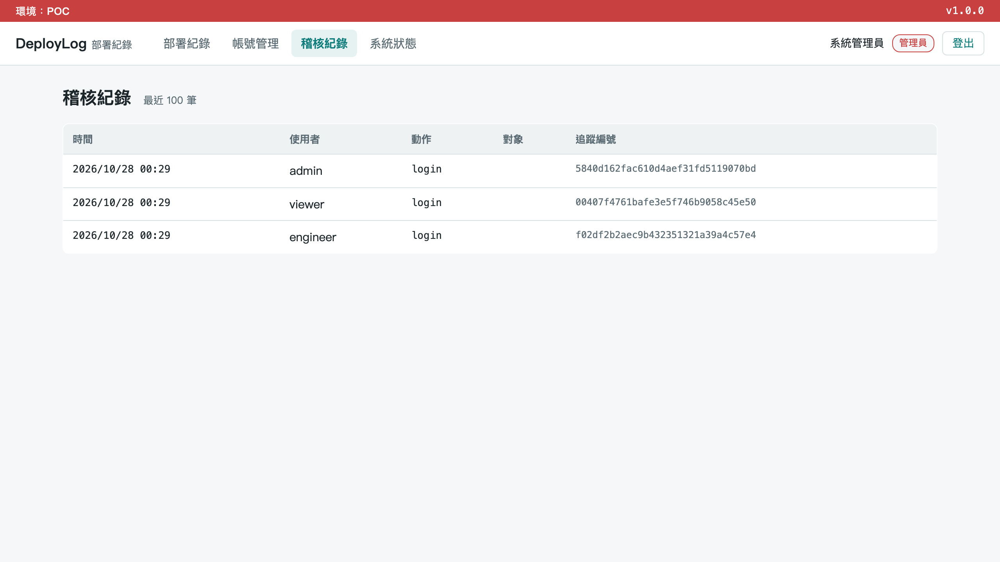
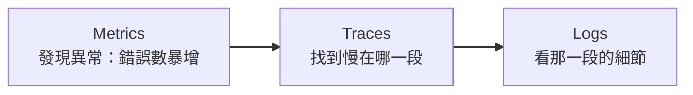
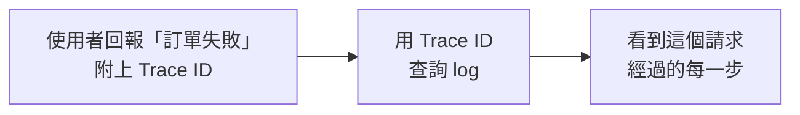
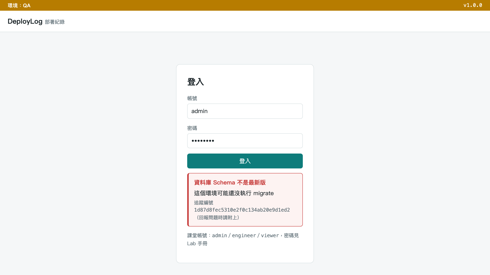
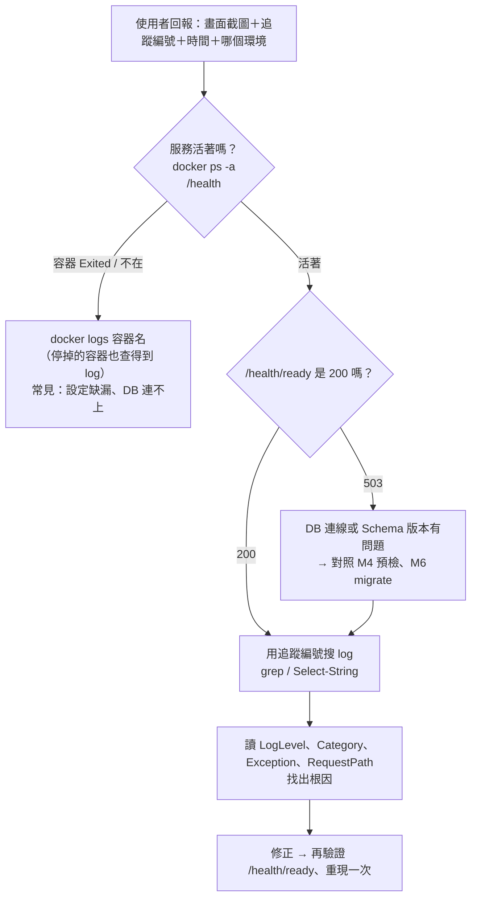

# 手把手：M5 維運友善的日誌與問題排查

> DevOps 實作課｜Day 2｜Logging & Diagnostics
> 上一段的預檢擋住了「啟動前」的問題；服務啟動之後出的事，要靠 log 找。這份文件從**看 log 的人**（技術支援、MIS、QA）倒推**寫 log 的人**（RD）該怎麼寫，最後用範例網站 DeployLog 實際走一次：**使用者看到錯誤畫面上的追蹤編號 → 維運拿編號在 log 裡找到那一行 → 看懂原因**。

---

## 你會學到什麼

| 觀念 | 一句話 | 在範例網站哪裡看得到 |
|------|-------|-------------------|
| 日誌分級 | Error 一定要能讓人採取行動；Info 只記有意義的節點 | `appsettings*.json` 的 `LogLevel`：Dev 開到 Debug、POC 只留 Warning |
| 結構化日誌（JSON） | 每個欄位都有名字，工具可以直接查詢、過濾 | QA／POC 的 `docker logs` 一行一筆 JSON |
| Trace ID（追蹤編號） | 一個請求從進來到結束都帶著同一個編號 | 錯誤畫面上的「追蹤編號」＝ log 裡的 `TraceId` |
| 稽核紀錄 ≠ 日誌 | 稽核回答「誰做了什麼」，日誌回答「哪裡出問題」 | 管理員的「稽核紀錄」頁 |
| 問題排查流程 | 從使用者回報到找到根因的固定步驟 | 本文第 13 節 |

---

## 1. 先想一件事：POC 現場掛掉時，你希望看到什麼 log？

- **如果你是看 log 的人**（技術支援、MIS、QA）：你打開 log 時，最想看到什麼？是「哪個客戶、哪一筆、什麼時候、為什麼失敗」，還是一大片 `Request started`？
- **如果你是寫 log 的人**（RD）：你寫 log 時，心裡想的讀者是誰？是自己在開發機上除錯，還是半夜被叫起來、手上沒有原始碼的維運人員？

把你的答案記下來，讀完這份文件再回頭對照。這就是 M1「Design for Operations」的延伸：**log 是寫給維運看的介面**，跟 API 一樣需要設計。

---

## 2. 日誌分級：像醫院檢傷分類

急診不會把每個病人都當成最緊急；log 也一樣，用等級決定「這件事要多少人注意」。

| 等級 | 用途 | 正式環境 |
|------|------|---------|
| Trace | 最細節的追蹤資訊 | 通常關閉 |
| Debug | 開發除錯用 | 通常關閉或設高門檻 |
| Info | 正常流程的重要節點 | 開 |
| **Warn** | 異常但服務還能運作（例如重試後成功） | 開 |
| **Error** | 服務功能失敗，需要人關注 | 開 |

名稱各家不同、概念一樣：

| | .NET（`ILogger`） | Java（Logback／Log4j2） |
|---|---|---|
| 警告 | `Warning` | `WARN` |
| 最高一級 | `Critical` | Log4j2 有 `FATAL`（Logback 沒有） |

**「正式環境通常關閉」是什麼意思？** 設定檔裡設一個門檻，低於門檻的 log 根本不會輸出。範例網站就是這樣設的：

| 環境 | 設定檔 | 門檻（`LogLevel.Default`） | 看得到 |
|------|-------|--------------------------|-------|
| Development | `appsettings.Development.json` | `Debug` | Debug 以上全部 |
| QA | `appsettings.json`（QA 沒覆寫） | `Information` | Info 以上 |
| POC | `appsettings.POC.json` | `Warning` | 只有 Warn、Error、Critical |

這是 M2「分層設定」的另一個用途：**同一個 image，換環境連 log 量都跟著換**，不用改程式。

---

## 3. 兩個最常見的反模式

| 反模式 | 後果 |
|-------|------|
| **全部塞 Info** | log 量爆炸，真正的問題被淹沒，查問題像大海撈針 |
| **關鍵錯誤只印 Debug** | 正式環境 Debug 通常關閉——出事時「明明有寫 log，但完全看不到」 |

想一想：
- 技術支援／MIS：你們一天的 log 有多大？真的打開過嗎？
- RD：你上一次 `catch` 例外，log 寫的是哪個等級？

### 其他常見反模式

| 反模式 | 後果 |
|-------|------|
| 迴圈內灌爆式記錄 | busy loop 裡逐筆記錄，瞬間產生大量重複 log，拖垮 log 系統 |
| 同一錯誤跨層重複記錄 | repository → service → controller 各 `catch` 記一次，同一個根因出現三次，反而更難判讀 |
| 缺少上下文 | 只有一句文字描述，沒有 user id／order id／request id，判斷不了影響範圍 |

> **沒有 Error，不代表沒出錯。** 兩種業界常見的情況：
> - 同步程式遇到處理不了的項目就直接 `continue` 跳過，結果全部被跳過，整次同步卻回報「成功」。→ 跳過也要計數，也要留一筆 Warn 或 Error。
> - 為了「讓程序不死」加了全域 `catch`，結果每一次處理都失敗，卻沒有一行 Error。→ 吞掉例外的地方，一定要記下來。

---

## 4. 判斷準則：你來分級

分級時問自己一句話：

> **「這行 log，如果只有正式環境等級看得到，夠不夠讓我知道發生什麼事？」**

- **Error**：一定要能讓人採取行動。看到 Error，就該有人去處理。
- **Info**：一定是有意義的節點（例如「部署紀錄 #42 已建立」），不是每一行程式碼都印。

**練習**：下面三件事，各該用哪個等級？想好再展開答案。

| 事件 | 你的答案 |
|------|---------|
| 呼叫外部服務，重試 3 次後成功 | ? |
| DB 連不上，這個請求失敗 | ? |
| 收到請求，參數是 … | ? |

<details>
<summary>參考答案</summary>

| 事件 | 等級 | 理由 |
|------|------|------|
| 重試 3 次後成功 | **Warn** | 服務還能運作，但有異常；次數變多就是前兆 |
| DB 連不上，請求失敗 | **Error** | 功能失敗，需要有人處理 |
| 收到請求，參數是 … | **Debug** | 開發除錯才需要；正式環境印出來只會灌爆 log，參數裡還可能有個資 |

</details>

---

## 5. 純文字 log vs 結構化日誌（JSON）

同一件事，兩種寫法：

```text
純文字：
2026-11-05 14:32 ERROR order 12345 failed
```

```json
JSON：
{"timestamp":"2026-11-05T14:32:00Z","level":"Error",
 "orderId":12345,"traceId":"a1b2c3","message":"payment gateway timeout"}
```

要找「orderId 12345 的所有紀錄」，哪一種快？

- 純文字：只能 `grep 12345`，可能也撈到金額 12345 元、電話號碼含 12345 的行，欄位要靠肉眼對。
- JSON：**每個欄位都有名字**，工具可以直接查 `orderId == 12345`、過濾 `level == "Error"`、統計每小時幾筆。

非開發職務只要記住一句：**JSON 就是「每個欄位都有名字」的 log。**

---

## 6. 程式怎麼寫出 JSON log

### .NET：Serilog

```csharp
// NuGet：Serilog.AspNetCore
using Serilog;
using Serilog.Formatting.Json;

Log.Logger = new LoggerConfiguration()
    .WriteTo.Console(new JsonFormatter())
    .CreateLogger();
builder.Services.AddSerilog();   // 既有的 ILogger<T> 改走 Serilog，程式碼不用改

_logger.LogError("Order {OrderId} failed: {Reason}", orderId, reason);
```

實際輸出（.NET 10 實跑，節錄）：

```json
{"Level":"Error","MessageTemplate":"Order {OrderId} failed: {Reason}",
 "Properties":{"OrderId":12345,"Reason":"payment gateway timeout"}}
```

> ⚠️ `{OrderId}` 是**具名欄位**，值會變成 `Properties.OrderId`。**不要寫** `$"Order {orderId} failed"`（字串內插）——那樣整句先變成一個字串，欄位就不見了，跟純文字 log 一樣。

不用 Serilog 也可以：範例網站用的是 .NET 內建的 JSON Console formatter（第 12 節），`ILogger` 的具名欄位寫法完全一樣。

### Java：Logback ＋ logstash encoder

`logback.xml`（依賴：`net.logstash.logback:logstash-logback-encoder`）：

```xml
<appender name="JSON" class="ch.qos.logback.core.ConsoleAppender">
  <encoder class="net.logstash.logback.encoder.LogstashEncoder" />
</appender>
```

```java
import static net.logstash.logback.argument.StructuredArguments.kv;

log.error("Order {} failed: {}", kv("orderId", 12345), kv("reason", "payment gateway timeout"));
// → {"level":"ERROR", ..., "orderId":12345, "reason":"payment gateway timeout"}
```

> Spring Boot 3.4 起內建 JSON 日誌，不用加 logstash encoder：`logging.structured.format.console: ecs` 一行設定，程式用 `log.atError().addKeyValue("orderId", 12345)`。實際跑一次見 [09 步驟 5](09-java-spring-demo.md#步驟-5換-profile-就換-log-格式m2m5)。

> ⚠️ 沒有 `kv()`，欄位一樣只會埋在 message 字串裡。Logback 1.3.8+ 內建的 `JsonEncoder` 也能輸出 JSON，但參數不會變成具名欄位；Log4j2 用 `JsonTemplateLayout`。輸出格式跟 .NET 版對齊，跨語言團隊可以共用同一套查詢工具。

---

## 7. 結構化日誌對維運的幫助

| 好處 | 例子 |
|------|------|
| **能查詢** | 依欄位篩選：`orderId=12345` |
| **能過濾** | 依 level／service 快速定位：只看 Error、只看付款服務 |
| **能串接工具** | 現在沒有 ELK／Splunk 沒關係，未來要接也不用重寫 log 格式 |

你們現在 log 寫到哪裡？檔案、Windows 事件檢視器、還是 `journalctl`？——**JSON 三種都能放**，不用先買工具才開始。

---

## 8. 稽核紀錄 ≠ 應用程式日誌

兩者常被混在一起，但用途完全不同：

| | 應用程式日誌（Log） | 稽核紀錄（Audit Log） |
|---|---|---|
| 回答的問題 | 系統哪裡出問題？ | 誰、在什麼時候、做了什麼？ |
| 讀者 | 開發、維運 | 資安、稽核、主管 |
| 保存 | 幾天到幾週，量大可以輪替 | 依法規／合約，通常更久，不能被竄改 |
| 範例網站 | `docker logs`（JSON） | `AuditLogs` 資料表，管理員的「稽核紀錄」頁 |



範例網站的設計：

- 稽核紀錄跟業務資料**在同一個交易裡寫入**——資料改成功，紀錄就一定在（`Infrastructure/Audit.cs`）。
- 登入失敗也記（動作 `login.failed`），但**不記密碼**。
- 每一筆都帶**追蹤編號**，可以跟 log 對起來。

> 常見錯誤：把稽核需求塞進一般 log，log 一輪替就沒了；或在 log 裡記了密碼、身分證字號。

---

## 9. 可觀測性（Observability）的三種訊號

**可觀測性**：只看系統對外輸出的資料，就能回答「裡面發生了什麼事」——包括事前沒想到要問的問題。（監控回答事前想好的問題，例如「CPU 高不高」；可觀測性讓你能問沒想過的問題。）

| 訊號 | 記錄什麼 | 例子 | 本課程 |
|------|---------|------|-------|
| **Logs 日誌** | 一件事的細節 | 「14:03 admin 登入失敗」 | M5 本段 |
| **Metrics 指標** | 數字隨時間的變化 | 「每分鐘錯誤數從 2 升到 40」 | 課後（Prometheus 等） |
| **Traces 追蹤** | 一個請求經過哪些地方 | 「這個請求在 DB 等了 2.8 秒」 | M5 Trace ID |



三者靠**同一個 Trace ID** 串起來。沒有預算買 APM 工具時，**先把 Logs 做好（結構化＋Trace ID）**，已經能解決大部分排查問題——這就是本模組的重點。

> 出處：Cindy Sridharan《Distributed Systems Observability》（O'Reilly，2018）；OpenTelemetry 把三者統一成同一套標準。

---

## 10. 沒有 APM 工具怎麼辦：Trace ID

**Trace ID：一個請求從進來到結束，全程帶著同一個 ID——像醫院的掛號單號碼。**



都不用買工具：

- **ASP.NET Core**：每個請求本來就有 ID（`HttpContext.TraceIdentifier`，以及 W3C 格式的 `Activity.Current.TraceId`）。
- **Java**：用 MDC 放 ID，Logback 就能把它印進每一行。

對技術支援最實用的一招：**錯誤頁面把 Trace ID 顯示給使用者**，客戶回報時直接貼過來。想想看：你們現在客戶回報問題時，給你的資訊有哪些？

### 情境：一個請求，三台機器的 log

使用者看到「訂單失敗，追蹤碼 a1b2c3」，客服把追蹤碼轉給你。你在三台機器上搜 `a1b2c3`：

| 機器 | log |
|------|-----|
| 前端 Nginx | `10:32:01 GET /orders  traceId=a1b2c3  status=500` |
| 訂單 API | `10:32:01 建立訂單 12345  traceId=a1b2c3` |
| 付款服務 | `10:32:04 Error 呼叫金流逾時 3s  traceId=a1b2c3` |

三台機器的紀錄串成一條：**問題出在付款服務呼叫金流逾時。**

沒有 Trace ID 呢？只能拿「10:32 左右」去三台機器各自翻，還不確定翻到的是不是同一個人。

> 延伸：Trace ID 的標準格式是 W3C Trace Context，見文末附錄。

---

## 11. 可觀測性本身不可靠，排查就會變慢

Slack 2021/1/4 全域中斷的事後報告提到，事故初期儀表板和告警服務本身也掛了：

> "all debugging and investigation was now hampered by the lack of our usual dashboards and alerts"

工程師只能直接查 metrics 後端，效率差很多。這不是「log level 用錯」，而是**監控／日誌／追蹤本身不可靠，讓能快速定位的問題變成長時間排查**。（來源：[Slack Engineering：Slack's Outage on January 4th 2021](https://slack.engineering/slacks-outage-on-january-4th-2021/)）

同一個道理放到我們的部署：**從沒啟動成功的服務，不會有任何 log。** 部署卡住 15 分鐘看起來像「在跑」，其實容器根本沒起來。所以部署腳本逾時時，要自動印出容器狀態和上一次執行的 log（課程的 GitLab deploy job 就是這樣做：60 秒內沒 ready 就 `docker logs --tail 30`，見 [03b-gitlab-environments-release.md](03b-gitlab-environments-release.md) 第 3 節）。

> 另一個同類的坑：metrics 的標籤放了實際網址 `/orders/12345`，每個 ID 都變成一個新序列，監控系統被撐爆。要用路由樣式 `/orders/{id}`——跟第 6 節「具名欄位，不要字串內插」是同一個道理。

---

## 12. Code Review：這段 log 有什麼問題？

```csharp
// 改寫前（反面教材）
Console.WriteLine("error");
Console.WriteLine(ex.Message);
```

先自己找出三個問題，再往下看。

<details>
<summary>問題與改寫</summary>

問題：**沒有分級**（`Console.WriteLine` 沒有等級，關不掉也過濾不了）、**沒有結構化**、**沒有上下文**（哪個訂單？哪個使用者？——非開發職務也看得出來：「看不出是哪一筆」）。

```csharp
// 改寫後
_logger.LogError(ex, "Order {OrderId} processing failed for user {UserId}",
    orderId, userId);
```

| 改善 | 怎麼做到的 |
|------|-----------|
| 分級正確 | `LogError` |
| 結構化欄位 | `{OrderId}`、`{UserId}` 是具名欄位，可以查詢 |
| 帶上下文 | 哪一筆訂單、哪個使用者 |
| 完整例外與 stack trace | 把 `ex` 整個傳進去，不只 `ex.Message` |

</details>

再問一次：**這行 log 裡有沒有不該出現的東西？** 密碼、token、身分證號一律不記。範例網站登入失敗時只記 `登入失敗 {UserName}`，不記密碼（`Endpoints/AuthEndpoints.cs`）。

---

## 實作：從錯誤畫面找到那一行 log

> 情境：QA 環境的網站登入就出錯。使用者截圖給你，上面有一串追蹤編號。你要在伺服器 log 裡找到那一行，說出原因。
> 以下指令都在 `assets/` 目錄下執行。Mac 的 5000 被 AirPlay 佔用時，把 `-p 5000:5000` 改成 `-p 5050:5000`、網址改 5050。

### 範例網站的 log 是怎麼設定的

先知道你待會會看到什麼（不用改，看就好）：

| 做法 | 在哪裡 | 效果 |
|------|-------|------|
| JSON 格式＋`IncludeScopes` | `appsettings.json` 的 `Logging.Console` | QA／POC 的 log 一行一筆 JSON，每行都帶 `TraceId`、`RequestPath` |
| Development 改回純文字 | `appsettings.Development.json`：`"FormatterName": "simple"` | 開發時人眼好讀 |
| 錯誤回應用 Problem Details 格式（RFC 9457），附 `traceId` | `Program.cs` 的 `AddProblemDetails` | 畫面上能顯示追蹤編號 |
| 每個回應都有 `X-Trace-Id` 標頭 | `Program.cs` | 瀏覽器開發者工具也看得到編號 |
| 資料庫錯誤翻成「看得懂的原因」，完整錯誤只寫 log | `Infrastructure/DbExceptionHandler.cs` | 使用者看到原因，維運看到細節 |
| JSON 裡的中文不轉成 `\uXXXX` | `Program.cs` 的 `JsonConsoleFormatterOptions` | `docker logs` 直接看得懂中文 |

### 步驟 0：前置確認

```bash
docker compose up -d mock-db
docker compose ps
docker image ls keypasco-lab-api
```

**你應該看到**：`mock-db` 的 STATUS 是 `Up … (healthy)`；`keypasco-lab-api` 有一行。

**如果不是這樣**：
- mock-db 一直不是 healthy → 第一次啟動在建資料庫，等 10–20 秒再看一次
- 沒有 image → `docker build -t keypasco-lab-api lab-project`（或用隨堂 USB 的 `docker load -i keypasco-lab-images-amd64.tar`）
- 上一個 Lab 的容器還在 → `docker rm -f lab-api`

為了少打字，先把「讓容器連回這台電腦的 DB」那兩個參數存成變數（跟 M6 Lab 一樣）：

```bash
# bash／zsh（macOS 終端機預設是 zsh，這個寫法兩邊都能用）
H=(--add-host=host.docker.internal:host-gateway -e DB_HOST=host.docker.internal)
```

```powershell
# PowerShell
$H = @('--add-host=host.docker.internal:host-gateway', '-e', 'DB_HOST=host.docker.internal')
```

之後的指令 bash 寫 `"${H[@]}"`、PowerShell 寫 `@H`。

> ⚠️ **不要寫成 `H="--add-host=… -e DB_HOST=…"` 再用 `$H`**：bash 會把它拆成三個參數，但 macOS 預設的 zsh 不會拆，docker 會報 `invalid argument "host.docker.internal:host-gateway -e DB_HOST=host.docker.internal" for "--add-host" flag`。用上面的括號（陣列）寫法就兩邊都對。

> **為什麼要這兩個參數？** `.env.qa` 寫的 `DB_HOST=localhost`，在容器裡指的是容器自己，連不到 mock-db。`host.docker.internal` 代表「跑容器的這台電腦」（M4 Lab 有完整說明）。

### 步驟 1：把 QA 資料庫清成空的（製造故障）

```bash
docker compose exec mock-db psql -U labuser -d postgres -c "DROP DATABASE IF EXISTS labdb_qa WITH (FORCE)" -c "CREATE DATABASE labdb_qa"
```

PowerShell 指令完全一樣。

**你應該看到**：

```text
DROP DATABASE
CREATE DATABASE
```

**為什麼**：資料庫在、連得上，但裡面一張表都沒有——模擬「新版程式上線，但這個環境的 Schema 沒升級」。這是部署死因 3，M6 會正式處理；這裡先拿來當故障現場。

### 步驟 2：用 QA 設定啟動網站

```bash
# bash
docker run -d --name lab-api -p 5000:5000 --env-file .env.qa "${H[@]}" keypasco-lab-api
```

```powershell
# PowerShell
docker run -d --name lab-api -p 5000:5000 --env-file .env.qa @H keypasco-lab-api
```

**你應該看到**：印出一長串容器 ID。

**如果不是這樣**：
- `port is already allocated` → 上一輪容器沒刪（`docker rm -f lab-api`），或 Mac 的 AirPlay 佔了 5000（改 5050）
- `Conflict. The container name "/lab-api" is already in use` → `docker rm -f lab-api` 再跑一次
- PowerShell 報 `invalid reference format` → `$H` 沒先設定，或寫成 `$H` 而不是 `@H`
- Mac 報 `invalid argument "host.docker.internal:host-gateway -e DB_HOST=…" for "--add-host" flag` → `H` 用了引號字串寫法；照步驟 0 改用括號 `H=(…)`，指令裡寫 `"${H[@]}"`

### 步驟 3：先看一眼 QA 的 log 長什麼樣

```bash
docker logs lab-api
```

**你應該看到**：每一行都是一筆 JSON，例如（排版過，實際是一行）：

```json
{"Timestamp":"…","EventId":14,"LogLevel":"Information",
 "Category":"Microsoft.Hosting.Lifetime","Message":"Now listening on: http://[::]:5000", …}
```

最前面兩行是 `"LogLevel":"Warning"` 的 `Microsoft.AspNetCore.DataProtection…`（容器裡沒有地方永久保存登入用的金鑰，重啟後大家要重新登入），課堂環境可以忽略。

**為什麼**：QA 沒有覆寫 log 設定，吃的是 `appsettings.json`——JSON 格式、門檻 Information。啟動訊息是 Info，所以看得到。

### 步驟 4：使用者看到的畫面

瀏覽器開 http://localhost:5000 ，用 `admin`／`Lab@2026` 登入。

**你應該看到**：頁首是 **QA（黃色）**，登入框下面出現紅色錯誤框：



- 第一行：**資料庫 Schema 不是最新版**（看得懂的原因）
- 第二行：這個環境可能還沒執行 migrate（下一步該找誰）
- **追蹤編號**：一串 32 碼的英數字（每次都不一樣，你的會跟截圖不同）

把**你畫面上的追蹤編號**整串複製下來（下面用 `<追蹤編號>` 代表）。

> 想看更多：按 F12 開開發者工具 → Network → 點 `login` 那一筆，回應內容是 Problem Details 格式的 JSON，裡面的 `traceId` 跟畫面上同一串：
>
> ```json
> {"type":"https://tools.ietf.org/html/rfc9110#section-15.6.4","title":"資料庫 Schema 不是最新版","status":503,"detail":"這個環境可能還沒執行 migrate","traceId":"3f01e44cfada40f103ec90996e0be8eb"}
> ```
>
> 一般的回應（例如 `/health`、帳密錯誤的 401）標頭裡也有 `X-Trace-Id`；但這種程式出例外的 503，標頭裡**沒有** `X-Trace-Id`，要看回應內容的 `traceId`。
>
> 另開 http://localhost:5000/system ：`/health` 是 200（DB 連得上），`/health/ready` 是 503（Schema 不對）——這個差別 M6 再講。

**為什麼畫面不直接顯示 SQL 錯誤？** 資料表名稱、SQL、stack trace 是攻擊者最喜歡的資訊（OWASP：Improper Error Handling）。所以分兩層：

| 給誰看 | 內容 | 為什麼這樣分 |
|-------|------|------------|
| 使用者 | 看得懂的原因＋追蹤編號 | 不洩漏內部細節 |
| 維運／開發 | 完整例外、SQL 錯誤碼、請求路徑 | 排查需要；只存在伺服器端 |

追蹤編號就是兩層之間的那條線。

### 步驟 5：維運拿編號查 log

把 `<追蹤編號>` 換成你複製的那串：

```bash
# bash
docker logs lab-api 2>&1 | grep <追蹤編號>
```

```powershell
# PowerShell
docker logs lab-api 2>&1 | Select-String <追蹤編號>
```

**你應該看到**：至少一行 JSON，其中 `Category` 是 `MyApi.Infrastructure.DbExceptionHandler` 的那一行就是我們要的。實際是一長行，以下排版後節錄（這是課程截圖時真實存下的那一行，編號跟上面截圖同一串）：

```json
{"Timestamp":"2026-10-27T16:29:17.425Z",
 "LogLevel":"Error",
 "Category":"MyApi.Infrastructure.DbExceptionHandler",
 "Message":"資料庫錯誤：資料庫 Schema 不是最新版",
 "Exception":"Npgsql.PostgresException (0x80004005): 42P01: relation \"Users\" does not exist …",
 "State":{"Title":"資料庫 Schema 不是最新版","{OriginalFormat}":"資料庫錯誤：{Title}"},
 "Scopes":[{"TraceId":"1d87d8fec5310e2f0c134ab20e9d1ed2","SpanId":"a113b5020f4d0cc2", …},
           {"ConnectionId":"0HNPK8TOM9LBT", …},
           {"RequestPath":"/api/auth/login","RequestId":"0HNPK8TOM9LBT:00000003", …}]}
```

> 同一個編號會搜到**兩行**，都是 `"LogLevel":"Error"`：第一行 `Category` 是 `Microsoft.EntityFrameworkCore.Query`（EF Core 自己記的查詢失敗，`Message` 是英文加一長串 stack trace），第二行才是上面這行 `DbExceptionHandler`。這正是 Trace ID 的用途：**同一個請求留下的所有紀錄，一次全部撈出來**。
<!-- 未驗證：PowerShell 的 Select-String 版尚未在 Windows 實測（bash 版已實測） -->

**如果不是這樣**：
- 什麼都沒搜到 → 編號沒複製完整（要 32 碼），或你在步驟 4 之後重啟過容器（log 跟著舊容器走了）
- PowerShell 裡中文變亂碼 → 先執行 `[Console]::OutputEncoding = [Text.Encoding]::UTF8` 再查一次。編號是英數字，就算中文亂碼也搜得到
- 看到的是 `…Zfail: …` 這種純文字 → 你用的是 `.env.dev`（Development 是純文字格式，見步驟 9）

### 步驟 6：讀懂這一行

| 欄位 | 值 | 告訴你什麼 |
|------|-----|-----------|
| `Timestamp` | `2026-10-27T16:29:17.425Z` | 發生時間（UTC，結尾的 Z；台灣時間要 +8 小時） |
| `LogLevel` | `Error` | 功能失敗，要有人處理 |
| `Category` | `MyApi.Infrastructure.DbExceptionHandler` | 哪一段程式記的 |
| `Message` | `資料庫錯誤：資料庫 Schema 不是最新版` | 人看的摘要 |
| `Exception` | `42P01: relation "Users" does not exist` | **根因**：資料表 `Users` 不存在；後面接完整 stack trace |
| `State.Title` | `資料庫 Schema 不是最新版` | 具名欄位：`{Title}` 的值，工具可以直接篩 |
| `Scopes[].TraceId` | 跟畫面同一串 | 把畫面和 log 對起來 |
| `Scopes[].RequestPath` | `/api/auth/login` | 哪個 API 出事 |

結論：**QA 的資料庫是空的，還沒執行 migrate。** 從使用者截圖到根因，不用翻任何一行原始碼。

`42P01` 是 PostgreSQL 的錯誤碼。範例網站把常見的幾個翻成白話（`DbExceptionHandler.cs`）：

| SQL 錯誤 | 畫面上的訊息 | 通常的原因 |
|---------|------------|-----------|
| `42P01` 資料表不存在 | 資料庫 Schema 不是最新版 | 這個環境還沒跑 migrate |
| `3D000` 資料庫不存在 | 找不到資料庫 | `DB_NAME` 打錯 |
| `28P01` 帳密錯誤 | 資料庫帳號或密碼錯誤 | `DB_USER`／`DB_PASSWORD` 設錯 |
| 其他連線錯誤 | 資料庫連不上 | `DB_HOST`／`DB_PORT` 錯、網路不通、DB 沒開 |

### 步驟 7（選做）：JSON 的好處——用欄位查

只想看 Error、只看三個欄位：

```bash
# bash（需要 jq：macOS 15 以後內建；Linux 用 sudo apt install jq）
docker logs lab-api 2>&1 | grep '"LogLevel":"Error"' | jq '{LogLevel, Category, Message}'
```

```powershell
# PowerShell（內建 ConvertFrom-Json）
docker logs lab-api 2>&1 | ForEach-Object { "$_" | ConvertFrom-Json } | Where-Object LogLevel -eq 'Error' | Select-Object LogLevel, Category, Message
```

**你應該看到**：只剩 Error 那幾筆，每筆三個欄位，例如：

```json
{
  "LogLevel": "Error",
  "Category": "MyApi.Infrastructure.DbExceptionHandler",
  "Message": "資料庫錯誤：資料庫 Schema 不是最新版"
}
```

前面還會有一筆 `Microsoft.EntityFrameworkCore.Query`（`Message` 很長，含 stack trace）；如果你開過 `/system` 頁，還會多一筆 `Health check schema with status Unhealthy …`。
<!-- 未驗證：PowerShell 的 ConvertFrom-Json 版尚未在 Windows 實測（bash＋jq 版已實測） -->

**為什麼**：這就是第 5 節說的「每個欄位都有名字」。純文字 log 做不到 `LogLevel -eq 'Error'` 這種查法，只能靠字串比對碰運氣。

### 步驟 8：修好它，再看一次 Warn 和稽核紀錄

先把 QA 的 Schema 升到最新（M6 的主角，這裡先借用）：

```bash
# bash
docker run --rm --env-file .env.qa "${H[@]}" keypasco-lab-api migrate
```

```powershell
# PowerShell
docker run --rm --env-file .env.qa @H keypasco-lab-api migrate
```

**你應該看到**（每行是一筆 JSON，這裡只列 `Message`）：

```text
資料庫 labdb_qa：已套用 0 個，待套用 2 個 20261027161121_InitialCreate, 20261027161130_AddAuditLogs
已建立預設帳號 admin／engineer／viewer（課堂用預設密碼，正式環境請勿使用）
Migration 完成，目前版本 20261027161130_AddAuditLogs
```

不用重啟網站，回到瀏覽器：

1. 用 `admin` 登入，但**故意打錯密碼**。畫面出現「帳號或密碼錯誤」＋追蹤編號。
2. 拿這個編號再查一次 log（同步驟 5 的指令）。

**你應該看到**：一行 `"LogLevel":"Warning"`、`"Message":"登入失敗 admin"` 的 JSON：

```json
{"Timestamp":"…","EventId":0,"LogLevel":"Warning","Category":"MyApi.Endpoints.LoginRequest","Message":"登入失敗 admin","State":{"UserName":"admin","{OriginalFormat}":"登入失敗 {UserName}"},"Scopes":[…]}
```

3. 用正確密碼 `Lab@2026` 登入，點上方「稽核紀錄」：最上面一筆是你剛剛成功的 `login`，**下面那一筆**是 `login.failed`，追蹤編號跟剛剛同一串。

**為什麼**：
- 登入失敗不是系統壞了，是**異常但服務照常運作**——所以是 **Warn**，不是 Error。
- log 裡只有帳號、**沒有密碼**。
- 同一件事，log（給維運）和稽核紀錄（給資安）各記一份，用追蹤編號對得起來。

### 步驟 9（選做）：對照 Development 的純文字格式

用同一份 `.env.qa`，只把環境名稱換成 Development：

```bash
# bash
docker rm -f lab-api
docker run -d --name lab-api -p 5000:5000 --env-file .env.qa "${H[@]}" -e ASPNETCORE_ENVIRONMENT=Development keypasco-lab-api
```

```powershell
# PowerShell
docker rm -f lab-api
docker run -d --name lab-api -p 5000:5000 --env-file .env.qa @H -e ASPNETCORE_ENVIRONMENT=Development keypasco-lab-api
```

再故意打錯密碼登入一次，然後 `docker logs lab-api`。

**你應該看到**：純文字格式，一筆 log 拆成好幾行，類似

```text
2026-11-02T14:09:05.548Zwarn: MyApi.Endpoints.LoginRequest[0]
      => SpanId:67ad0ceacd1a4022, TraceId:60271795694b39afa0cb682d04c08c14, ParentId:0000000000000000 => ConnectionId:0HNPOTBD90RFR => RequestPath:/api/auth/login RequestId:0HNPOTBD90RFR:00000001
      登入失敗 admin
```

（時間和 `warn:` 黏在一起，是共用設定裡的時間格式沿用過來的，不影響閱讀。）

拿畫面上的追蹤編號去 `grep`／`Select-String`，**搜得到**中間那行 `=> … TraceId:…`——但只有那一行，「登入失敗 admin」在下一行，`LogLevel`、`Category` 也沒有欄位名稱可以篩；步驟 7 的 `jq`／`ConvertFrom-Json` 在這裡完全不能用。

**為什麼**：Development 是給開發者在自己電腦上用眼睛看的，所以用純文字、開到 Debug；QA／POC 是給維運用工具查的，所以用 JSON：每個欄位有名字、一筆就是一行，工具才查得動。這也是 M2 分層設定的用途：`-e ASPNETCORE_ENVIRONMENT=…` 一換，log 格式和等級都跟著換，程式完全沒動。

### 步驟 10：收尾

```bash
docker rm -f lab-api
```

PowerShell 指令一樣。`labdb_qa` 已經 migrate 過，留著不影響後面的 Lab。

---

## 13. 問題排查流程（把今天的東西串起來）



| 步驟 | bash | PowerShell |
|------|------|-----------|
| 容器在不在、狀態 | `docker ps -a --filter name=lab-api` | 同左 |
| 活著嗎 | `curl -i http://localhost:5000/health` | `curl.exe -i http://localhost:5000/health` |
| 能接客嗎 | `curl -i http://localhost:5000/health/ready` | `curl.exe -i http://localhost:5000/health/ready` |
| 最近 30 行 log | `docker logs --tail 30 lab-api` | 同左 |
| 持續看新 log | `docker logs -f lab-api`（Ctrl+C 離開） | 同左 |
| 最近 10 分鐘 | `docker logs --since 10m lab-api` | 同左 |
| 用編號找 | `docker logs lab-api 2>&1 \| grep <編號>` | `docker logs lab-api 2>&1 \| Select-String <編號>` |

> Windows PowerShell 的 `curl` 是 `Invoke-WebRequest` 的別名，輸出格式不同，一定要打 `curl.exe`，或直接用瀏覽器開 `/system` 頁。

---

## 疑難排解

| 狀況 | 原因 | 處理 |
|------|------|------|
| 畫面有追蹤編號，但 log 搜不到 | 編號沒複製完整／容器重啟過 | 重新複製 32 碼；確認是同一個容器（`docker rm -f` 之後舊 log 就沒了） |
| `docker logs` 的中文在 PowerShell 變亂碼 | 主控台編碼不是 UTF-8 | `[Console]::OutputEncoding = [Text.Encoding]::UTF8` |
| POC 環境的 log 幾乎是空的 | POC 門檻是 Warning，Info 不會輸出 | 正常；Error、Warn 還是看得到 |
| 登入畫面「資料庫連不上」 | 少了 `-e DB_HOST=host.docker.internal`，或 mock-db 停了 | 檢查 `"${H[@]}"`／`@H`；`docker compose ps` |
| 登入畫面「找不到資料庫」 | `DB_NAME` 打錯 | 檢查 `.env` 的 `DB_NAME` |
| 容器跑一下就不見 | 啟動失敗 | `docker ps -a` 看 STATUS，`docker logs lab-api` 看最後幾行 |
| PowerShell 的 `ConvertFrom-Json` 報錯 | 混到非 JSON 的行（例如 Development 格式） | 只在 QA／POC（JSON 格式）用 |

---

## 程式設計：程式要怎麼寫才支援

JSON 格式、等級、`TraceId` 自動帶進每一行，全在 `appsettings*.json` 設定（`IncludeScopes: true`），程式碼不用改。程式要做的是**用具名欄位寫 log**、**錯誤回應帶 `traceId`**、**稽核紀錄也存追蹤編號**（`lab-project/Infrastructure/Audit.cs`）：

```csharp
TraceId = Activity.Current?.TraceId.ToString(),
```

步驟 4 看到「例外的 503 標頭裡沒有 `X-Trace-Id`」，原因是 `Program.cs` 在呼叫 `next()` 之前就設好標頭，例外處理寫錯誤回應時先把標頭全部清掉了。建議寫法（已編譯、實測：改完 503 也有標頭）：

```csharp
app.Use(async (ctx, next) =>
{
    var traceId = Activity.Current?.TraceId.ToString();
    ctx.Response.OnStarting(() =>
    {
        ctx.Response.Headers["X-Trace-Id"] = traceId;
        return Task.CompletedTask;
    });
    await next();
});
```

`DbExceptionHandler` 逐行說明、log 設定每一項的作用、Java 對照，見 [08 程式設計 §4](08-app-design-for-ops.md#4-結構化日誌與追蹤編號)。Spring Boot 實跑版見 [09 步驟 5](09-java-spring-demo.md#步驟-5換-profile-就換-log-格式m2m5)。

---

## 自我檢查

- [ ] 能說出 Trace／Debug／Info／Warn／Error 各用在什麼情況，以及為什麼「關鍵錯誤只印 Debug」在正式環境等於沒寫
- [ ] 能替「重試後成功」「請求失敗」「收到請求參數」各選一個等級並說出理由
- [ ] 能說出 JSON 日誌比純文字好在哪裡（欄位有名字：能查詢、能過濾、能串工具）
- [ ] 知道 .NET 要寫 `{OrderId}` 具名欄位、不要寫 `$"…{orderId}"`；Java 要用 `kv()`
- [ ] 能說出稽核紀錄和應用程式日誌的差別（回答的問題、讀者、保存）
- [ ] 能說出 Logs／Metrics／Traces 各記錄什麼，以及怎麼用 Trace ID 串起來
- [ ] 實際做過：從錯誤畫面的追蹤編號，用 `grep`／`Select-String` 在 `docker logs` 找到那一行，並說出根因
- [ ] 能指出改寫前的 `Console.WriteLine(ex.Message)` 缺了哪四件事
- [ ] 知道 log 裡不能出現密碼、token、身分證號
- [ ] 回到第 1 節：你當初「希望看到的 log」，今天學到的哪幾招可以做到？

**M5 帶走三個觀念**：**日誌分級**／**結構化日誌**／**Trace ID**。

下一段 [M6](06-m6-db-migration.md)：log 能告訴你「壞了」，但 Schema 版本不符這類問題，最好在部署時就擋下來。

---

## 附錄：延伸閱讀

### 監控該看哪些數字：RED 與 USE

| 方法 | 看什麼 | 適合 | 範例網站可以怎麼量 |
|------|-------|------|------------------|
| RED | **R**ate 請求量、**E**rrors 錯誤數、**D**uration 回應時間 | 對外服務（API、網站） | 每分鐘 `/api` 請求數、5xx 比例、登入 API 的 P95 時間 |
| USE | **U**tilization 使用率、**S**aturation 飽和度、**E**rrors 錯誤 | 資源（CPU、記憶體、DB 連線池） | 容器 CPU、DB 連線池滿了沒、磁碟 |

先從 RED 開始：使用者感受到的問題，幾乎都會先出現在這三個數字。（RED：Tom Wilkie，2015；USE：Brendan Gregg，2012。DORA 指標量的是「團隊交付」，RED／USE 量的是「系統本身」，兩者不要混在一起。）

### Trace ID 長什麼樣：W3C Trace Context

HTTP 標頭：

```text
traceparent: 00-936f546ed261c15719d3b1807d4e5848-b7ad6b7169203331-01
```

| `00` | `936f546ed261c15719d3b1807d4e5848` | `b7ad6b7169203331` | `01` |
|------|------|------|------|
| 版本 | trace-id：整條請求鏈共用（32 碼） | span-id：這一段（16 碼） | 取樣旗標 |

- 2020 年成為 W3C 標準；.NET（`Activity`）、Java（OpenTelemetry）、瀏覽器、雲端服務都支援。
- 服務 A 呼叫服務 B 時把這個標頭帶過去，B 的 log 就會有同一個 trace-id。
- **範例網站畫面上的追蹤編號，就是這裡的 trace-id**（所以是 32 碼）；log 裡的 `SpanId` 就是 span-id。
- 自己產生 GUID 當 Request ID 也能用，但跨系統串接時，用標準格式省很多事。Java 端 Spring Boot 3 用 Micrometer Tracing 會自動處理 `traceparent`，並把 traceId 放進 MDC。
