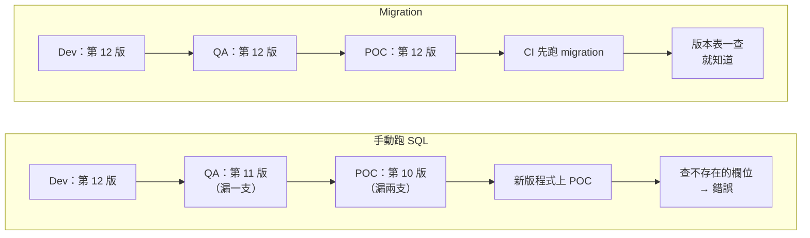
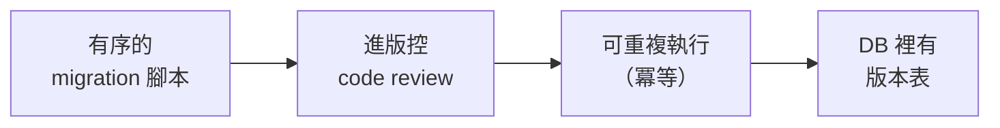
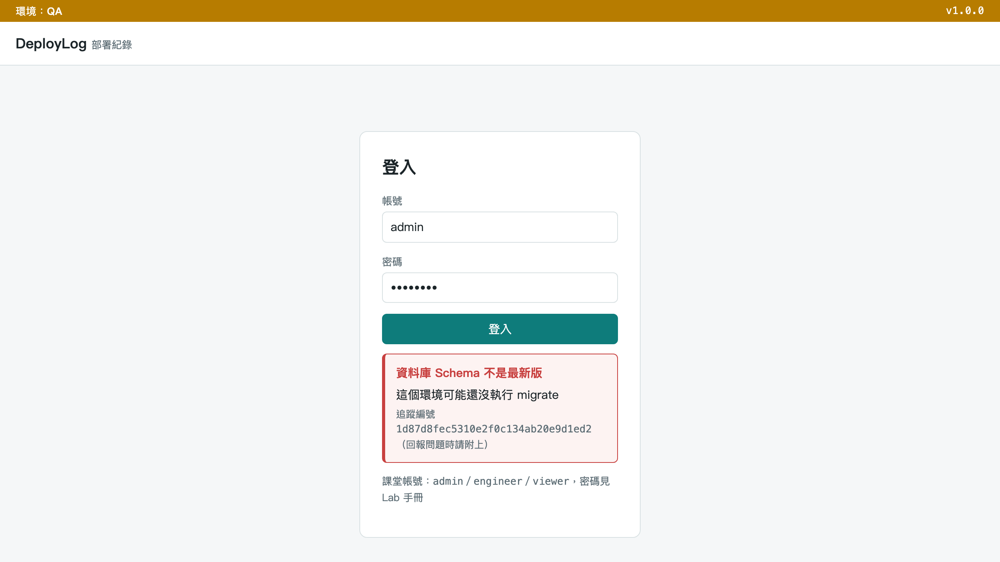
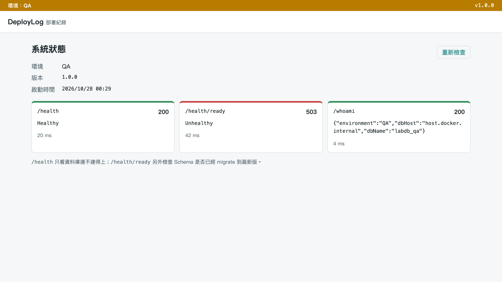
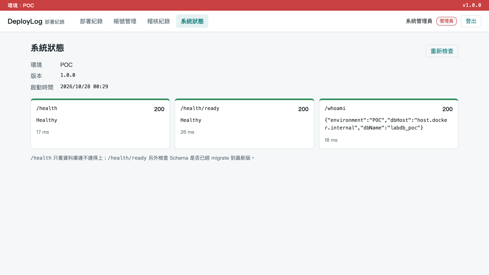
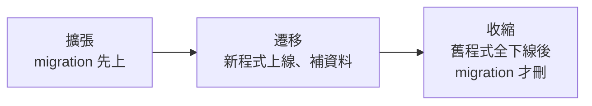
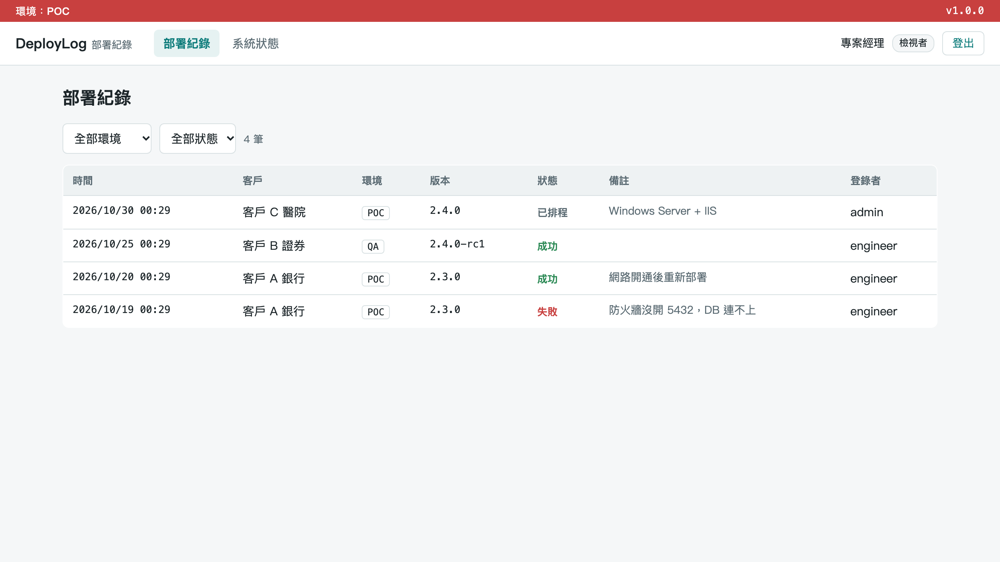

# 手把手：M6 資料庫狀態與 Schema 管理

> DevOps 實作課｜Day 2｜為什麼手動跑 SQL 腳本是部署災難的開始？
> M4 的預檢留了一個洞：**DB 連得上，Schema 卻可能是舊的。** 這份文件說明怎麼把 Schema 變更當程式碼管（Migration），再用範例網站 DeployLog 親手做一次：先看「程式碼的 Schema 版本」和「資料庫的 Schema 版本」對不上會怎樣，再用一個指令把它對齊。

---

## 你會學到什麼

| 觀念 | 一句話 | 範例網站對應 |
|------|-------|------------|
| 手動改 Schema 的三個風險 | 漏改、順序錯、無法回溯 | — |
| Migration as code | Schema 變更寫成有序的檔案、進版控，DB 裡有版本表 | `apps/dotnet-deploylog/Migrations/`、`__EFMigrationsHistory` |
| migrate 是獨立的一步 | 部署流程裡先跑 migrate，不在服務啟動時偷偷做 | `docker run … keypasco-lab-api migrate` |
| Readiness 檢查 Schema 版本 | `/health` 看活著沒，`/health/ready` 看能不能接客 | `Infrastructure/SchemaHealthCheck.cs` |
| 進 CI：migration 失敗就不部署 | deploy job 先 migrate 再換容器 | `ci-demo` 的 deploy job，見 [03b](03b-gitlab-environments-release.md) |
| Expand–Contract | 改 Schema 不停機：先加、再搬、最後才刪 | — |
| 最小權限 | 網站帳號只讀寫資料，改 Schema 的權限只給 migrate | 三種角色、後端擋權限 |

---

## 1. 手動改 Schema 的三個風險

先想想：你們現在 Schema 變更是怎麼上的？手動連線跑 SQL，還是有版控機制？誰在現場跑過 SQL 檔？**怎麼知道這台跑過了沒？**

| 風險 | 說明 |
|------|------|
| **漏改** | 多個環境要同步改，容易漏掉一個 |
| **順序錯** | 加欄位要先上 migration 再上程式；砍欄位相反——順序顛倒是常見事故原因 |
| **無法回溯** | 沒有版本紀錄，出錯時不確定 DB 實際在哪一版 |

QA 的同事可以自問：**我測的 QA 環境，DB 跟客戶的 POC 一樣嗎？我怎麼確定？** 答不出來，就是「無法回溯」。

### 情境：三個環境，三個不同版本的資料庫



**手動的問題不是「會不會漏」，而是「漏了沒人知道」**；版本表讓每個環境自己說出它在哪一版。

### 業界案例：GitLab.com（2017/1/31）300GB 在錯的機器上被刪

工程師修 replication 時，本來要清空 secondary 的資料目錄，卻在 **primary** 上執行，約 300GB 資料被刪才中止。回頭找備份才發現：

| 該有的保護 | 實際狀況 |
|-----------|---------|
| 每日 `pg_dump` 備份 | **從沒成功過**：備份程式是 pg_dump 9.2、資料庫是 PostgreSQL 9.6——版本不符；失敗通知信又被擋掉，沒人知道 |
| 雲端磁碟快照 | DB 伺服器沒有開啟 |
| 最後怎麼救回 | 碰巧約 6 小時前有人手動做的快照；停機約 18 小時，那段時間的資料變更永久遺失（約 5,000 個 project、5,000 則留言、700 個新帳號） |

這裡面有幾個「版本不符」？——**手動操作＋從沒驗證過的備份，一起發生才變災難。** 備份要定期做還原演練，而且還原後要**用應用程式的身分**實際讀寫驗證，不是只看還原指令回傳成功。（來源：[GitLab 官方事後報告](https://about.gitlab.com/blog/postmortem-of-database-outage-of-january-31/)）

---

## 2. Migration 工具：把 Schema 變更當程式碼管



| 工具 | 版本表 |
|------|-------|
| EF Core Migrations（.NET） | `__EFMigrationsHistory` |
| Flyway（Java，Liquibase 同類） | `flyway_schema_history` |

給非開發職務的一句話：**以後要知道這台 DB 是哪一版，查版本表，不用問人。**

Migration 腳本跟程式碼變更一樣走 code review、走 CI，不是「連上資料庫手動下指令」。從資安角度看，手動 SQL 通常也代表有人拿著高權限帳號在現場。

> 三種常見做法，由好到壞：(1) 編號檔案＋版本表（本模組的做法）；(2) 程式開機時跑冪等的 `ADD COLUMN IF NOT EXISTS`（能動，但沒有版本紀錄）；(3)「空 DB 才跑 schema.sql，之後靠沒記錄的手動 ALTER」——第 3 種就是本模組要消滅的。

---

## 3. .NET：EF Core Migrations

**開發時**（需要 .NET SDK；一次性安裝 `dotnet tool install --global dotnet-ef`，專案另需 `Microsoft.EntityFrameworkCore.Design` 套件）：

```bash
dotnet ef migrations add AddOrderStatusColumn   # 改了資料模型後，產生有序、可版控的 migration 檔
dotnet ef database update                       # 本機開發／測試用：直接套用到 DB
```

**正式環境**，微軟官方建議兩條路：

```bash
# 自動化部署：CI 產生 migration bundle（單一執行檔，部署端不用裝 SDK）
dotnet ef migrations bundle --self-contained --target-runtime linux-x64 --output artifacts/efbundle
./artifacts/efbundle --connection "$MIGRATION_CONNECTION"

# 要 DBA 審 SQL：產生冪等腳本（只套用還沒套過的 migration）
dotnet ef migrations script --idempotent --output artifacts/migrations.sql
```

- MIS／系統工程師只要記住：**部署端拿到的是一個執行檔或一份 SQL，不是原始碼。**
- Windows／IIS 端產生的是 `efbundle.exe`，用法相同。
- `--connection` 用的是**有改 Schema 權限的部署專用帳號**；網站平常用的帳號不該有這個權限（第 9 節）。

---

## 4. 範例網站的 Schema 版本：兩個 Migration

| 程式碼這邊（進版控） | 資料庫這邊（版本表） |
|-------------------|------------------|
| `apps/dotnet-deploylog/Migrations/`<br/>`20261027161121_InitialCreate.cs`　v1：兩張表<br/>`20261027161130_AddAuditLogs.cs`　v2：加稽核<br/>`AppDbContextModelSnapshot.cs`　目前全貌 | `SELECT * FROM "__EFMigrationsHistory";`<br/>`20261027161121_InitialCreate │ 10.0.14`<br/>`20261027161130_AddAuditLogs  │ 10.0.14` |

**兩邊一對，就知道差幾版。** 範例網站的程式碼裡就有這個比對（`Data/MigrationState.cs`）：「程式碼裡有的 Migration」減掉「資料庫已套用的」＝待套用清單。

範例網站的 `migrate` 指令（`Data/DbSetup.cs`）怎麼設計：

| 設計 | 為什麼 |
|------|-------|
| 部署時多一步：`docker run … keypasco-lab-api migrate`，跑完就結束，不啟動網站 | Schema 變更是部署流程裡**獨立的一步** |
| 冪等：已套用的跳過，重跑不會壞 | 可以放心放進部署流程的固定步驟 |
| `DB_NAME` 打錯 → 失敗、exit 1，**不會自己建新庫** | EF Core 原生的 `Migrate()` 遇到不存在的資料庫會自己建一個空庫——打錯字就默默多一個庫。部署工具寧可停下來，也不要「貼心地」猜你的意思 |
| 沒跑 migrate → `/health/ready` 503，登入畫面說「Schema 不是最新版」 | 讓問題在部署驗證時就被看見（第 6 節） |
| log 印出「已套用 N 個，待套用 M 個」與最後版本 | 部署紀錄裡看得出這次改了什麼 |

**為什麼不在服務啟動時自動 `Migrate()`？**

1. 多個實例同時啟動，會**搶著改 Schema**。
2. 改失敗，**服務整個起不來**。
3. 應用程式帳號就得有**改 Schema 的權限**——違反最小權限（第 9 節）。

> **migrate 是部署流程裡獨立的一步，不在服務啟動時偷偷做。**

---

## 5. Java：Flyway

```text
src/main/resources/db/migration/
  V1__create_orders.sql
  V2__add_order_status.sql
```

檔名格式 `V<版本>__<描述>.sql`（雙底線，跟 M2 的環境變數雙底線無關）。

```bash
flyway -url="jdbc:postgresql://$DB_HOST:$DB_PORT/$DB_NAME" -user="$DB_USER" -password="$DB_PASSWORD" migrate
flyway ... info      # 看目前套用到哪一版
```

- 每個已套用的檔案都記了 checksum：**改過已套用的檔案會被抓出來**。要改就新增下一版，不改舊檔。
- QA 可以把 `flyway info` 當成驗收的一步。
- ⚠️ **Spring Boot 預設啟動時自動跑 Flyway**，正式環境要用 `SPRING_FLYWAY_ENABLED=false` 關掉，改由部署流程單獨跑。

**Java 組**：Flyway 的版本表、改舊檔被 checksum 擋下、關掉自動 migrate 改用 Flyway CLI，實際跑一次見 [09 步驟 6、7](09-java-spring-demo.md#步驟-6改了已經套用的-migration-會怎樣m6)。

---

## 6. `/health` vs `/health/ready`：活著 ≠ 能接客

| | Liveness（存活） | Readiness（就緒） |
|---|---|---|
| 問的問題 | 程式還活著嗎？ | 現在可以把使用者導過來嗎？ |
| 失敗代表 | 卡死了，重啟它 | 暫時別送流量，等它準備好 |
| 範例網站 | `/health`：DB 連得上 | `/health/ready`：DB ＋ **Schema 版本** |
| 誰在看 | Docker／systemd／IIS 的重啟機制 | 負載平衡器、Kubernetes、部署流程 |

`/health/ready` 多了一個 `SchemaHealthCheck`：還有 Migration 沒套用就回 Unhealthy（503），訊息會列出還差哪幾個。

只看 `/health`，就會把使用者導進一個「登入必錯」的網站。這也回答了 M4 的問題：**`pg_isready` 只知道連得上，不知道表在不在、是不是新版。**

---

## Lab：讓 Schema 跟程式碼對齊

> 兩人一組：維運背景負責下指令、看 exit code、查版本表；開發背景對照 `apps/dotnet-deploylog/Migrations/` 解說每一步，說明 `Up()` 和 `Down()` 各做什麼。
> 以下指令都在 `devops-lab/` 根目錄下執行。Mac 的 5000 被 AirPlay 佔用時，`-p 5000:5000` 改 `-p 5050:5000`、網址改 5050。


### 步驟 0：前置確認

```bash
docker compose ps
docker image ls keypasco-lab-api
```

**你應該看到**：`mock-db` 是 `Up … (healthy)`；`keypasco-lab-api` 有一行。

**如果不是這樣**：mock-db 沒在跑 → `docker compose up -d mock-db`；沒有 image → `docker build -t keypasco-lab-api apps/dotnet-deploylog`（或 `docker load -i keypasco-lab-images-amd64.tar`）；上一個 Lab 的 `lab-api` 還在 → `docker rm -f lab-api`。

為了少打字，先把「連回這台電腦的 DB」那兩個參數存成變數：

```bash
# bash／zsh（macOS 終端機預設是 zsh，這個寫法兩邊都能用）
H=(--add-host=host.docker.internal:host-gateway -e DB_HOST=host.docker.internal)
```

```powershell
# PowerShell
$H = @('--add-host=host.docker.internal:host-gateway', '-e', 'DB_HOST=host.docker.internal')
```

之後的指令 bash 寫 `"${H[@]}"`、PowerShell 寫 `@H`（不是 `$H`）。

> ⚠️ 不要寫成 `H="--add-host=… -e DB_HOST=…"` 再用 `$H`：macOS 預設的 zsh 不會把它拆開，docker 會報 `invalid argument "host.docker.internal:host-gateway -e DB_HOST=host.docker.internal" for "--add-host" flag`。

### 步驟 1：一個空的 POC 資料庫

```bash
docker compose exec mock-db psql -U labuser -d postgres -c "DROP DATABASE IF EXISTS labdb_poc WITH (FORCE)" -c "CREATE DATABASE labdb_poc"
```

PowerShell 指令完全一樣。

**你應該看到**：

```text
DROP DATABASE
CREATE DATABASE
```

接著用 POC 設定啟動網站：

```bash
# bash
docker run -d --name lab-api -p 5000:5000 --env-file .env.poc "${H[@]}" keypasco-lab-api
```

```powershell
# PowerShell
docker run -d --name lab-api -p 5000:5000 --env-file .env.poc @H keypasco-lab-api
```

**你應該看到**：印出一長串容器 ID。

瀏覽器開 http://localhost:5000 ，用 `engineer`／`Lab@2026` 登入：

- 畫面顯示 **「資料庫 Schema 不是最新版」**，下面有一串追蹤編號（M5 教過怎麼用它查 log）

  

  （截圖是 QA 環境，頁首黃色；你的是 POC，頁首紅色，訊息相同。）

- 開 http://localhost:5000/system ：`/health` 是 **200**（DB 連得上），`/health/ready` 是 **503**（Schema 不對）

  

也可以用指令看：

```bash
# bash
curl -i http://localhost:5000/health/ready
```

```powershell
# PowerShell
curl.exe -i http://localhost:5000/health/ready
```

**你應該看到**：`HTTP/1.1 503 Service Unavailable`，內容 `Unhealthy`。

**如果不是這樣**：
- 畫面是「資料庫連不上」、`/health` 也是 503 → 少了 `"${H[@]}"`／`@H`，容器連不到 mock-db
- `port is already allocated` → `docker rm -f lab-api`，或 Mac 改 5050

**想一想**：M4 的預檢（`pg_isready`）在這個狀態下會通過嗎？——**會。**它只知道「連得上」，不知道「表在不在、是不是新版」。這就是 M4 留下的洞。

### 步驟 2：看程式碼裡的 Schema 版本（開發背景帶）

打開 `apps/dotnet-deploylog/Migrations/`：

```text
20261027161121_InitialCreate.cs     ← 第 1 版：Users、Deployments 兩張表
20261027161130_AddAuditLogs.cs      ← 第 2 版：加一張 AuditLogs（稽核紀錄）
AppDbContextModelSnapshot.cs        ← 目前模型的全貌（EF 用來算下一版要改什麼）
```

打開 `20261027161130_AddAuditLogs.cs`：

- `Up()`：升版要做什麼——建立 `AuditLogs` 資料表（時間、使用者、動作、對象、追蹤編號），並在時間欄位建索引
- `Down()`：退版要做什麼——刪掉 `AuditLogs` 資料表

檔名開頭是時間戳記，**順序就是套用順序**——這就是「有序、可版控」的意思。

> 注意 `Down()` 會把資料表連資料一起刪掉。能退版，不代表退版沒有代價——見文末「回滾還是往前修」。

### 步驟 3：先故意打錯資料庫名稱

```bash
# bash
docker run --rm --env-file .env.poc "${H[@]}" -e DB_NAME=labdb_pco keypasco-lab-api migrate
echo $?
```

```powershell
# PowerShell
docker run --rm --env-file .env.poc @H -e DB_NAME=labdb_pco keypasco-lab-api migrate
$LASTEXITCODE
```

**你應該看到**：一行 JSON，`LogLevel` 是 `Critical`，最後 exit code 是 **1**：

```text
{"Timestamp":"…","EventId":0,"LogLevel":"Critical","Category":"Migrate","Message":"找不到資料庫 labdb_pco（host.docker.internal:5432），請確認 DB_NAME；migrate 不會自動建立資料庫","State":{…},"Scopes":[]}
1
```

**為什麼**：`-e DB_NAME=…` 蓋掉 `.env.poc` 裡的值（M2：越後面的設定優先權越高），模擬設定打錯字。EF Core 原生的 `Migrate()` 會自己建一個新的空庫，資料就寫到錯的地方；範例網站的 `migrate` 刻意先檢查、找不到就失敗。exit code 1 讓 CI／部署腳本知道「這一步失敗了，後面不要繼續」（M4：exit code 是腳本跟外界溝通的方式）。

### 步驟 4：正確套用

```bash
# bash
docker run --rm --env-file .env.poc "${H[@]}" keypasco-lab-api migrate
```

```powershell
# PowerShell
docker run --rm --env-file .env.poc @H keypasco-lab-api migrate
```

**你應該看到**（節錄每行 JSON 的 `Message`）：

```text
資料庫 labdb_poc：已套用 0 個，待套用 2 個 20261027161121_InitialCreate, 20261027161130_AddAuditLogs
已建立預設帳號 admin／engineer／viewer（課堂用預設密碼，正式環境請勿使用）
Migration 完成，目前版本 20261027161130_AddAuditLogs
```

**不用重啟網站**，重新整理瀏覽器：可以登入了；`/system` 的 `/health/ready` 變 **200**。



再跑一次同一個指令：

**你應該看到**：

```text
資料庫 labdb_poc：已套用 2 個，待套用 0 個
Migration 完成，目前版本 20261027161130_AddAuditLogs
```

沒有「已建立預設帳號」那行，什麼都沒改——Migration 是**冪等**的，重跑不會壞，所以可以放心放進部署流程的固定步驟。

**為什麼不用重啟網站？** 網站的 `/health/ready` 每次被呼叫都重新比對一次版本表；Schema 一對齊，馬上變 ready。部署流程就是靠這個：先 migrate、再換新版、最後等 ready。

**如果不是這樣**：
- exit code 不是 0、log 是「Migration 失敗」 → mock-db 沒在跑，或少了 `"${H[@]}"`／`@H`
- 第一次就看到「已套用 2 個」 → 步驟 1 的 `DROP DATABASE` 沒做成功，資料庫本來就 migrate 過了

### 步驟 5：看資料庫裡的版本表（維運背景帶）

```bash
# bash
docker compose exec mock-db psql -U labuser -d labdb_poc -c 'SELECT * FROM "__EFMigrationsHistory"'
```

```powershell
# PowerShell（用管線把 SQL 送進 psql，避開雙引號在參數裡被吃掉的問題）
'SELECT * FROM "__EFMigrationsHistory";' | docker compose exec -T mock-db psql -U labuser -d labdb_poc
```
<!-- 未驗證：PowerShell 尚未在 Windows 實測（bash 版已實測） -->

**你應該看到**：

```text
         MigrationId          | ProductVersion
------------------------------+----------------
 20261027161121_InitialCreate | 10.0.14
 20261027161130_AddAuditLogs  | 10.0.14
(2 rows)
```

**以後要知道這台 DB 是哪一版，查這張表，不用問人。** 跟步驟 2 的檔案清單一對，就知道差幾版。

**如果不是這樣**：`ERROR:  relation "__efmigrationshistory" does not exist`（注意變成小寫）→ 表名外面的雙引號被 shell 吃掉了。PostgreSQL 沒加雙引號的名稱一律轉小寫，而 EF 建的表名有大寫。用上面 PowerShell 那種管線寫法。

### 步驟 6：收尾

```bash
docker rm -f lab-api
```

PowerShell 指令一樣。

---

## 7. 進版控、進 CI：migration 失敗就不部署

在 GitLab CI 裡，migration 是部署前獨立的一個 job／一個步驟：

```yaml
migrate-poc:
  stage: migrate
  image: mcr.microsoft.com/dotnet/runtime-deps:10.0   # self-contained bundle 不需要 SDK
  needs: [build]            # build job 產出 artifacts/efbundle
  script:
    - chmod +x artifacts/efbundle
    - ./artifacts/efbundle --connection "$POC_MIGRATION_CONNECTION"   # Masked + Protected 變數（M3）
  environment: poc

deploy-poc:
  stage: deploy
  needs: [migrate-poc]      # migration 失敗 → 不部署程式
```

兩個原則：

- **不要讓每個實例啟動時各自跑**：bundle 在 build 時產生，DB 健康後用**一次性的 job** 執行。
- **先跑 migration＝最直接的 Schema 預檢**：migration 是冪等的，部署前先跑一次，Schema 不對就在這裡擋下，對應 M4 預檢 3 留下的洞。

CI 還可以加一步 `dotnet ef migrations has-pending-model-changes`：改了資料模型卻忘了產 Migration，pipeline 直接紅燈。

### 課程的示範 GitLab 就是這樣做的

[03b-gitlab-environments-release.md](03b-gitlab-environments-release.md) 第 3 節的 `deploy-dev` job，log 依序是：拉 image → 印出拿到的環境設定 → **migrate**（`資料庫 labdb：已套用 2 個，待套用 0 個`、`Migration 完成`）→ 停舊容器、起新容器 → 等 `/health/ready` 回 200。對應的腳本（`ci-demo/repo/.gitlab-ci.yml`，節錄）：

```bash
# Module 6：先升級 Schema；失敗就停在這裡，舊版本繼續跑
docker run --rm --network ci-demo $ENVS "$IMAGE_TAG" migrate
# 換版
docker rm -f "$APP" > /dev/null 2>&1 || true
docker run -d --name "$APP" … $ENVS "$IMAGE_TAG"
# Module 4：部署完要驗證，/health/ready 沒回 200 就讓 job 失敗
```

跟 Lab 用的是**同一個 image、同一個 `migrate` 指令**——你在步驟 3、4 手動做的事，CI 每次部署都會自動做一次；migrate 失敗（exit 1），後面的換版根本不會執行。

---

## 8. 改 Schema 不停機：擴張—收縮（Expand–Contract）

第 1 節的「順序錯」，可以整理成一個方法。

**例子**：把 `Deployments.Note` 拆成 `Note`＋`RollbackPlan` 兩個欄位。正式環境多台機器，新舊版程式會同時在線上一段時間。

| 步驟 | 做什麼 | 為什麼安全 |
|------|-------|-----------|
| **1. 擴張** | 只加不刪：新增 `RollbackPlan` 欄位（可為空） | 舊程式不知道新欄位，照常運作 |
| **2. 遷移** | 新程式同時寫新舊欄位；補跑舊資料 | 新舊程式並存都正確 |
| **3. 收縮** | 確認沒有舊程式在跑了，才刪舊的東西 | 這時才是破壞性變更 |



- **擴張的 migration 一定先於程式；收縮的 migration 一定晚於程式。**
- 每一步都是獨立的 Migration、獨立的部署；任一步出事，都還能退回上一步。
- 非開發職務的記法：**先蓋新路、兩條路一起通車、確定沒人走舊路才拆。**
- POC 環境常常只有一台、可以停機，不一定要三步；但正式環境多台同時在線，就一定會遇到新舊版並存。

> 出處：Danilo Sato〈Parallel Change〉（martinfowler.com，2014）；Ambler & Sadalage《Refactoring Databases》（2006）。

其他 Schema 變更的常見坑（課後自查）：

- 對已經有 NULL 值的欄位加 `NOT NULL`——測試環境資料乾淨測不出來，正式環境直接失敗。
- 本機小資料量跑得好好的 migration，正式環境千萬筆資料可能鎖表數十分鐘。大量回填要分批，並設短的 lock timeout。

---

## 9. 最小權限：網站的角色、部署的帳號都一樣

範例網站的三種角色：

| | Viewer | Engineer | Admin |
|---|:---:|:---:|:---:|
| 看部署紀錄 | ✓ | ✓ | ✓ |
| 登錄／修改 | — | ✓ | ✓ |
| 刪除、帳號管理 | — | — | ✓ |



兩個原則：

1. **權限在後端擋**：前端藏按鈕只是方便；規則寫在伺服器（`Program.cs` 的 `AddAuthorizationBuilder`），未登入回 401、權限不足回 403。用 viewer 登入後，就算在瀏覽器開發者工具直接打 API，也一樣被擋。
2. **帳號也分工**：網站平常用的 DB 帳號只能讀寫資料；改 Schema 的權限只給 migrate 用的部署帳號。CI 裡的部署帳號也適用同一個原則（M3：Pipeline 本身就是攻擊面）。

> ⚠️ 教室的 `labuser` 是 PostgreSQL 超級使用者，網站和 migrate 共用——這是為了 Lab 方便，**正式環境不要這樣**。
>
> 出處：最小權限原則，Saltzer & Schroeder〈The Protection of Information in Computer Systems〉（1975）。

---

## 10. M2 和 M6：同一個精神

| | M2 組態管理 | M6 Schema 管理 |
|---|---|---|
| 管的東西 | 設定 | Schema |
| 從哪裡搬出來 | 程式碼、部署人員的筆記 | 部署人員手上的 SQL 檔 |
| 放到哪 | 版控＋環境變數 | 版控＋版本表 |
| 對應部署死因 | 設定檔打錯 | Schema 版本不符 |

**不靠人記得，交給版控和流程。** 想一想還有哪裡可以套用？（例如 IIS／systemd 設定、防火牆規則。）

---

## 疑難排解

| 狀況 | 原因 | 處理 |
|------|------|------|
| 登入畫面「資料庫 Schema 不是最新版」 | 這個環境還沒跑 migrate | 步驟 4 的 migrate 指令（`--env-file` 要跟網站用的同一份） |
| 登入畫面「資料庫連不上」，`/health` 也 503 | 少了 `"${H[@]}"`／`@H`，或 mock-db 停了 | 補上參數；`docker compose ps` 看 mock-db |
| migrate 印「找不到資料庫」，exit 1 | `DB_NAME` 打錯（這是設計好的行為） | 檢查 `.env` 或 `-e DB_NAME=` |
| migrate 印「Migration 失敗」，exit 1 | DB 連不上 | 同上，檢查 mock-db 與 `"${H[@]}"`／`@H` |
| PowerShell 報 `invalid reference format` | `$H` 沒設定，或寫成 `$H` 而不是 `@H` | 重新設定 `$H`；指令裡用 `@H` |
| Mac 報 `invalid argument "host.docker.internal:host-gateway -e …" for "--add-host" flag` | `H` 用了引號字串，zsh 不會拆開 | 照步驟 0 用括號 `H=(…)`，指令裡寫 `"${H[@]}"` |
| psql 報 `relation "__efmigrationshistory" does not exist` | 表名的雙引號被 shell 吃掉 | 用步驟 5 的 PowerShell 管線寫法 |
| migrate 成功了，`/health/ready` 還是 503 | 網站和 migrate 用了不同的 `.env`（不同資料庫） | 兩個指令用同一份 `--env-file` |
| `port is already allocated` | 上一輪容器沒刪／Mac AirPlay 佔 5000 | `docker rm -f lab-api`；Mac 改 5050 |

---

## 程式設計：程式要怎麼寫才支援

`migrate` 不是另一個工具，是同一個程式的另一個進入點。`apps/dotnet-deploylog/Program.cs` 第 79–81 行在 `builder.Build()` 之後、開始聽 port 之前分岔，回傳值就是 exit code：

```csharp
if (args.FirstOrDefault() == "migrate")
    return await DbSetup.MigrateAsync(app.Services, config);
```

`apps/dotnet-deploylog/Data/DbSetup.cs` 第 21–26 行先拒絕「貼心地」建新庫：

```csharp
if (!await db.GetService<IRelationalDatabaseCreator>().ExistsAsync())
{
    log.LogCritical("找不到資料庫 {Database}（{Host}:{Port}），請確認 DB_NAME；migrate 不會自動建立資料庫",
        config["DB_NAME"], config["DB_HOST"], config["DB_PORT"]);
    return 1;
}
```

因為連線資訊全部來自 `DB_*`，第 9 節的帳號分工**不用改程式**：跑 `migrate` 時給部署帳號的 `DB_USER`／`DB_PASSWORD`，啟動網站時給只能讀寫資料的帳號。PostgreSQL 的授權 SQL（已實測）與逐行說明見 [08 程式設計 §3](08-app-design-for-ops.md#3-migration-是獨立指令)、[§7](08-app-design-for-ops.md#7-機密與最小權限)。

---

## 自我檢查

- [ ] 能說出手動改 Schema 的三個風險（漏改、順序錯、無法回溯）
- [ ] 能說出 `/health` 和 `/health/ready` 的差別（連得上 vs. Schema 對得上），以及 M4 的 `pg_isready` 為什麼抓不到 Schema 問題
- [ ] 能說出為什麼 `migrate` 是獨立的一步，不在服務啟動時自動跑（多台同時啟動會搶著改 Schema；改失敗服務也起不來；改 Schema 要高權限帳號）
- [ ] 知道去哪裡查一台資料庫目前的 Schema 版本（`__EFMigrationsHistory`；Flyway 是 `flyway_schema_history`）
- [ ] 實際做過：空資料庫 → `/health/ready` 503 → 打錯 `DB_NAME` 看到 exit 1 → migrate → 200 → 重跑一次確認冪等 → 查版本表
- [ ] 能說出 CI 裡 migrate 和 deploy 的先後順序，以及 migrate 失敗時會發生什麼（不換版，舊版繼續跑）
- [ ] 能用「先蓋新路、一起通車、確定沒人走才拆」解釋 Expand–Contract
- [ ] 能說出網站帳號和 migrate 帳號為什麼要分開

**M6 帶走三個觀念**：**Migration 工具取代手動 SQL**／**Schema 進版控，DB 有版本表**／**CI 先跑 migration 再部署程式**。

---

## 課後可以做什麼

- 在自己的專案找出「SQL 檔交給部署人員手動跑」的地方，改成 EF Core Migrations（.NET）或 Flyway（Java war）
- CI 加一步 `dotnet ef migrations has-pending-model-changes`
- 正式環境用 migration bundle（`dotnet ef migrations bundle`）或 DBA 可審的冪等 SQL（`dotnet ef migrations script --idempotent`），部署端不需要原始碼和 SDK
- migration 用有改 Schema 權限的部署帳號跑；網站平常用的帳號只給讀寫資料的權限
- 備份排定還原演練，還原後用應用程式帳號實際讀寫驗證

---

## 附錄：部署出事，回滾還是往前修？

| | 回滾（Roll back） | 往前修（Roll forward） |
|---|---|---|
| 做法 | 換回上一版 image：最快止血 | 修好問題，再部署一個新版 |
| 前提 | 產物有版本號（M3 的 commit SHA） | CI 夠快、測試夠多，修好能馬上出 |
| 難處／適合 | 資料庫已經 migrate 過了怎麼辦？→ 這就是 Expand–Contract 要先擴張的原因 | 適合 Schema 已經不可逆地改了 |
| 風險 | `Down()` 可以退版，但會刪掉新欄位裡的資料 | 壓力下趕出來的修正又帶新 bug |

**事先決定「什麼情況回滾、誰拍板」，不要出事當下才開會。** GitLab 的一鍵 Rollback 見 [03b](03b-gitlab-environments-release.md) 第 5 節——它換回的是 image，不會幫你退 Schema；先擴張、後收縮的 Schema 變更，才讓「換回舊 image」安全。DeployLog 的部署狀態裡有「已回滾（RolledBack）」，就是要把這件事記下來。
