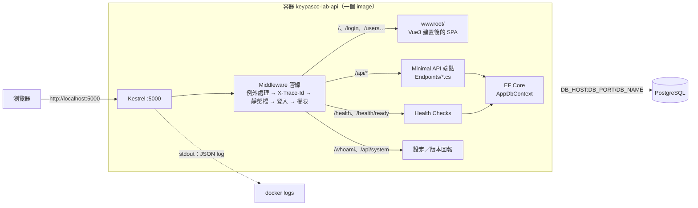
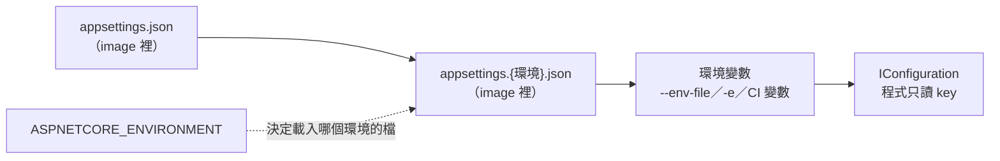
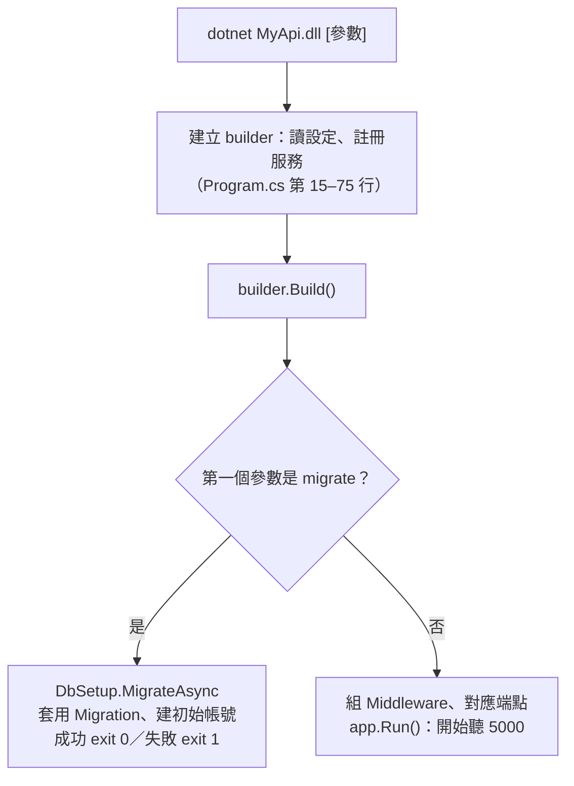
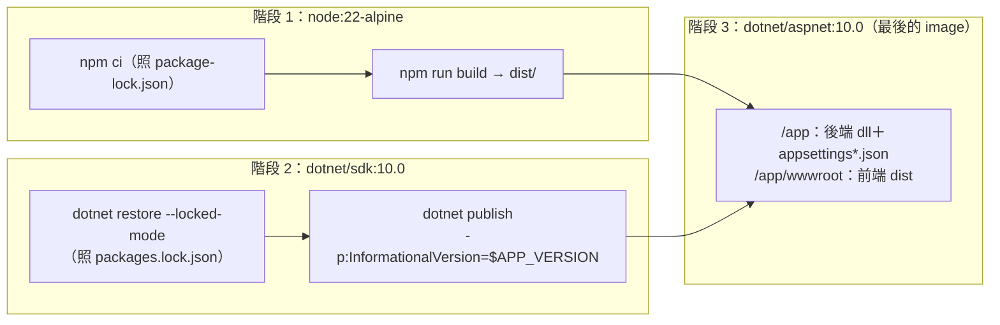

# 程式設計：讓應用程式支援這些維運機制

> DevOps 實作課｜開發者必讀（維運／QA 讀第 0 節和最後兩節）
> 前面六個模組教的是「怎麼部署、怎麼查」：換 `.env` 切環境、`/health/ready` 判斷能不能接客、`migrate` 升 Schema、拿追蹤編號查 log。**這些機制都要程式先寫好才用得上**：程式沒讀環境變數，`.env` 換了也沒用；沒有 `/health/ready`，部署腳本就沒東西可等。
> 這一份把範例網站 DeployLog 的程式逐段拆開：每個機制**要解決什麼問題 → 設計原則 → 專案裡實際的程式 → 怎麼驗證 → 常見錯誤 → Java 怎麼寫**。

**怎麼讀程式碼區塊**

| 標示 | 意思 |
|------|------|
| **專案實際程式** `lab-project/…` | 從 `assets/lab-project/` 原封不動複製，附檔名與行號，可以打開對照 |
| **範例／建議寫法** | 專案裡**沒有**，是建議你加的。每一段 C# 範例都套在專案副本上用 .NET 10 SDK 編譯過，標「實測」的另外實際跑過（見文末附錄） |
| **Java 參考寫法** | Spring Boot／Maven 的對應做法，**未在本課程專案驗證**，用之前請在自己的專案上測 |
| **✅ 已在 spring-demo 實跑** | Java 對照裡標這個的部分，在 `assets/spring-demo/`（Spring Boot 3.4）實際跑過，步驟見 [09](09-java-spring-demo.md) |

驗證指令都在 `assets/` 資料夾下執行，前提跟 M1 一樣：`mock-db` 在跑、`keypasco-lab-api` image 已經 build 好、網站開在 port 5000（Mac 被 AirPlay 佔用就改 5050）。PowerShell 一律打 `curl.exe`。

---

## 你會學到什麼

| 章 | 機制 | 程式要做到的一件事 | 對應模組 |
|----|------|------------------|---------|
| 0 | 架構全貌 | 一個 image、兩個進入點（網站／`migrate`），設定全部從外面來 | M1 |
| 1 | 組態外部化與分層 | 程式只寫「要哪個設定」，值由環境決定；缺必填設定就不啟動 | M2、M4 |
| 2 | 健康檢查 | `/health`（活著）和 `/health/ready`（能接客）分開 | M4、M6 |
| 3 | Migration 是獨立指令 | 同一個 image 加 `migrate` 參數只升 Schema，用 exit code 回報結果 | M6 |
| 4 | 結構化日誌與追蹤編號 | 一行一筆 JSON、具名欄位、每個錯誤都帶追蹤編號 | M5 |
| 5 | 無狀態與可拋棄 | 收到 SIGTERM 會收尾；重啟、多開一台都不影響使用者 | M1、M4 |
| 6 | 不可變交付物與建置 | 依 lock file 建置、一個 image 走所有環境、畫面看得到版本 | M1、M3 |
| 7 | 機密與最小權限 | 密碼只從環境變數來；網站帳號和 migrate 帳號分開 | M2、M3、M6 |
| 8 | 權限與稽核 | 後端擋權限；「誰改了什麼」寫進稽核紀錄 | M1、M5、M6 |

---

## 0. 先看全貌：DeployLog 的架構

### 0.1 一個請求怎麼走



- **前端和後端是同一個 image、同一個網址**：Vue 建置後的檔案放在 `wwwroot/`，由 ASP.NET Core 直接送出，不需要另外架 Nginx、不需要 CORS。
- **API 打錯網址回 404，其他網址交給前端路由**（`Program.cs` 第 122–123 行）：

  ```csharp
  app.MapFallback("/api/{**path}", () => Results.NotFound());   // 打錯的 API 回 404，不要回首頁
  app.MapFallbackToFile("index.html");                         // 其他網址交給前端路由
  ```

  少了第一行，打錯的 `/api/xxx` 會回 200 和一份 HTML 首頁——前端拿去 `JSON.parse` 才爆，錯誤離真正的原因很遠。

### 0.2 設定從哪裡來



image 裡只有**非機密**的預設值和各環境差異；密碼只從最右邊那層進來。細節見第 1 章。

### 0.3 同一個 image，兩個進入點



`migrate` 和網站共用同一套設定讀取、同一個 `AppDbContext`、同一套 log 格式，差別只在**要不要開始收請求**。第 3 章細講。

### 0.4 一個 image 怎麼建出來



SDK、node、原始碼都留在前兩個階段，**最後的 image 只有執行環境和成品**。第 6 章細講。

### 0.5 機制 → 哪個模組教 → 程式在哪裡

| 機制 | 哪個模組教 | 程式在哪裡（`lab-project/`） | 本文 |
|------|-----------|---------------------------|------|
| 設定分層、`/whoami` | [M2](02-m2-config.md) | `Program.cs` 第 18–23、98–105 行；`appsettings*.json` | 第 1 章 |
| 必填設定檢查 | [M3](03-m3-ci-pipeline.md)（單元測試）、[M4](04-m4-deploy-scripts.md)（預檢 0） | `RequiredSettings.cs`（**目前啟動時沒有呼叫**） | 第 1 章 |
| `/health`、`/health/ready` | [M4](04-m4-deploy-scripts.md) §8–9、[M6](06-m6-db-migration.md) §6 | `Program.cs` 第 35–39、107–110 行；`Infrastructure/SchemaHealthCheck.cs` | 第 2 章 |
| `migrate` 指令 | [M6](06-m6-db-migration.md) §4 | `Program.cs` 第 79–81 行；`Data/DbSetup.cs`、`Data/MigrationState.cs`、`Migrations/` | 第 3 章 |
| JSON log、日誌等級 | [M5](05-m5-logging.md) | `appsettings.json`、`appsettings.Development.json`、`appsettings.POC.json`；`Program.cs` 第 25–31 行 | 第 4 章 |
| 追蹤編號、錯誤格式 | [M5](05-m5-logging.md) | `Program.cs` 第 72–75、83–91 行；`Infrastructure/DbExceptionHandler.cs`；`frontend/src/api.js` | 第 4 章 |
| 優雅關閉、無狀態 | [M1](01-m1-operability.md) §7 精華 4 | `Dockerfile` 第 26 行（`ENTRYPOINT`）；`Program.cs` 第 41–65 行（cookie 登入） | 第 5 章 |
| 多階段建置、lock file、版本號 | [M1](01-m1-operability.md) §8、[M3](03-m3-ci-pipeline.md) §3、§6 | `Dockerfile`、`MyApi.csproj`、`packages.lock.json`、`.dockerignore`；`Program.cs` 第 112–116 行 | 第 6 章 |
| 機密、DB 帳號分工 | [M2](02-m2-config.md) §5.3、[M3](03-m3-ci-pipeline.md) §8、[M6](06-m6-db-migration.md) §9 | `appsettings.json`（刻意沒有密碼）；`Data/DbSetup.cs`（`SEED_PASSWORD`） | 第 7 章 |
| 角色權限、稽核紀錄 | [M1](01-m1-operability.md) 步驟 8、[M5](05-m5-logging.md) §8、[M6](06-m6-db-migration.md) §9 | `Program.cs` 第 41–70 行；`Endpoints/*.cs`；`Infrastructure/Audit.cs` | 第 8 章 |

### 0.6 Middleware 的順序就是規格

`Program.cs` 第 83–96 行，請求**由上往下**經過每一層，回應由下往上回來：

```csharp
app.UseExceptionHandler();
app.UseStatusCodePages();

// 每個回應都帶 X-Trace-Id：畫面上的錯誤訊息、瀏覽器開發者工具、伺服器 log 用同一個編號對得起來
app.Use(async (ctx, next) =>
{
    ctx.Response.Headers["X-Trace-Id"] = Activity.Current?.TraceId.ToString();
    await next();
});

app.UseDefaultFiles();
app.UseStaticFiles();     // 前端（Vue 建置後的檔案）放在 wwwroot，跟 API 同一個 image、同一個網址
app.UseAuthentication();
app.UseAuthorization();
```

| 順序 | 為什麼在這個位置 |
|------|----------------|
| 1. `UseExceptionHandler` | 放最外層，後面任何一層丟例外都接得到，轉成 Problem Details（第 4 章） |
| 2. `UseStatusCodePages` | 401／403／404 這種「沒有內文」的錯誤，也補上 Problem Details 格式的內文（含 `traceId`） |
| 3. X-Trace-Id | 在靜態檔和 API 之前，所有回應都經過它（但有一個坑，見第 4 章） |
| 4. 靜態檔 | 在登入之前：登入頁本身的 JS／CSS 不需要登入就要拿得到 |
| 5. 登入、權限 | 在端點之前，端點只要宣告「要哪條規則」 |

---

## 1. 組態外部化與分層

### 要解決什麼問題

同一個 image 要跑 Dev／QA／POC，差別只在「連哪個資料庫、log 開多細、密碼是什麼」。如果值寫在程式裡，換環境就要改程式、重新編譯——那就不是同一個產物了（[M2](02-m2-config.md) §2–3）。

### 設計原則

1. **程式碼只寫「要哪個設定」（key），不寫「值是多少」。**
2. **非機密的預設值和環境差異進版控**（`appsettings*.json`）；**機密只從環境變數來**。
3. **後面蓋前面**：環境變數一定能蓋掉檔案裡的值，現場要改就改環境變數。
4. **缺必填設定就不啟動**（Fail Fast），不要帶著錯的設定跑起來、等第一個使用者踩到才發現。

### 專案實際程式

`lab-project/Program.cs` 第 15–23 行：

```csharp
var builder = WebApplication.CreateBuilder(args);
var config = builder.Configuration;

// 設定值的來源（後面蓋前面）：
//   appsettings.json → appsettings.{環境}.json → 環境變數（--env-file 帶進來的）
// 程式碼裡只寫「要哪個設定」，不寫「值是多少」。
var connectionString =
    $"Host={config["DB_HOST"]};Port={config["DB_PORT"]};Database={config["DB_NAME"]};" +
    $"Username={config["DB_USER"]};Password={config["DB_PASSWORD"]};Timeout=3;Gss Encryption Mode=Disable";
```

`lab-project/appsettings.json`（節錄設定值的部分）：

```json
  "AllowedHosts": "*",
  "DB_HOST": "localhost",
  "DB_PORT": "5432",
  "DB_NAME": "labdb",
  "DB_USER": "labuser"
```

`lab-project/appsettings.QA.json` 全文：

```json
{
  "DB_NAME": "labdb_qa"
}
```

`lab-project/Program.cs` 第 100–105 行（回報「我吃到哪組設定」）：

```csharp
app.MapGet("/whoami", () => new
{
    environment = app.Environment.EnvironmentName,  // 來自 ASPNETCORE_ENVIRONMENT
    dbHost = config["DB_HOST"],
    dbName = config["DB_NAME"]
});
```

### 逐行說明

| 程式 | 說明 |
|------|------|
| `WebApplication.CreateBuilder(args)` | 內建就會依序載入：`appsettings.json` → `appsettings.{環境}.json` → （Development 才有的 User Secrets）→ 環境變數 → 命令列參數。**不用寫任何程式**，順序是框架定的 |
| `builder.Configuration` | 把上面所有來源合成一個 `IConfiguration`。程式各處都讀這一個，不要自己去讀 `Environment.GetEnvironmentVariable` 或自己開 json 檔——那樣會跳過分層 |
| `config["DB_HOST"]` | 只寫 key。值是 `localhost`（json）還是 `host.docker.internal`（`-e` 蓋過去），程式不知道也不需要知道 |
| `config["DB_PASSWORD"]` | json 裡**沒有**這個 key，只可能從環境變數來（M2 §5.1） |
| `Timeout=3` | 連資料庫最多等 3 秒。資料庫不通時，健康檢查和 API 在 3 秒內就回錯，不會卡住（第 2 章） |
| `appsettings.QA.json` 只有一行 | 只寫跟共用值不同的 key，其他的沿用 `appsettings.json` |
| `app.Environment.EnvironmentName` | 就是 `ASPNETCORE_ENVIRONMENT` 的值，大小寫要跟檔名 `appsettings.QA.json` 一致 |

**巢狀的 key 用 `__`**：`appsettings.json` 裡的 `Logging` → `LogLevel` → `Default`，在程式裡是 `Logging:LogLevel:Default`，寫成環境變數是 `Logging__LogLevel__Default`（冒號在 Linux 環境變數名稱裡不能用，雙底線各平台都可以）。範例專案的 `DB_*` 刻意設計成平的 key，就是為了讓 `.env` 好寫、M4 的預檢腳本也讀得到同一組（M2 §5.4）。

### 建議補強 1：啟動時就檢查必填設定（範例）

`lab-project/RequiredSettings.cs` 已經寫好了「列出缺少哪些必填設定」，M3 的 CI 單元測試也在測它：

```csharp
// 啟動前要有的設定：少一個就列出來（跟 Lab M4 預檢 0 同一件事，這裡是程式裡的版本，給 CI 的單元測試測）
public static class RequiredSettings
{
    public static readonly string[] Keys = ["DB_HOST", "DB_PORT", "DB_NAME", "DB_USER"];

    public static string[] Missing(IConfiguration config) =>
        Keys.Where(key => string.IsNullOrWhiteSpace(config[key])).ToArray();
}
```

**但 `Program.cs` 沒有呼叫它**——檢查寫好了、測試也過了，服務啟動時卻沒有用上。建議加在 `var config = builder.Configuration;` 的下一行（**範例，實測**）：

```csharp
// 範例：必填設定少一個就不啟動（Fail Fast）；放在 Build() 之前，migrate 指令也一樣會被擋
if (RequiredSettings.Missing(config) is { Length: > 0 } missing)
{
    Console.Error.WriteLine($"缺少必填設定：{string.Join(", ", missing)}，服務不啟動");
    return 1;
}
```

- `Program.cs` 是 top-level 程式，結尾已經是 `return 0;`，所以這裡 `return 1` 就是 exit code 1——跟 M4 預檢腳本一樣，CI／systemd 看得懂。
- 放在 `builder.Build()` **之前**：網站和 `migrate` 兩個進入點都會經過，一處檢查兩處受惠。這時 log 系統還沒建好，所以用 `Console.Error` 印純文字。
- 實測：`DB_HOST`、`DB_NAME` 給空值跑 `migrate`，印出 `缺少必填設定：DB_HOST, DB_NAME，服務不啟動`、exit 1。不加這段的話，要等到連資料庫才失敗，log 只看到 `Migration 失敗` 和 `ArgumentNullException ... (Parameter 'Host')`，得自己去猜是哪個設定。

> ⚠️ **這個檢查目前只擋得到「給了空值」，擋不到「完全沒給」。** 因為 `appsettings.json` 替 `DB_HOST`／`DB_PORT`／`DB_NAME`／`DB_USER` 都放了預設值（`localhost`、`labdb`…），環境變數沒給時會靜靜退回預設值，`Missing()` 永遠找不到缺的。`DB_PASSWORD` 又不在 `Keys` 裡。
> 正式專案的做法：**本機開發用的預設值放 `appsettings.Development.json`**，`appsettings.json` 只放各環境真的共用的值；這樣 QA／POC 少給一個值就會被擋下來。改 `Keys` 前記得同步改 M3 的單元測試。

### 建議補強 2：用 Builder 組連線字串（範例）

用字串內插組連線字串，值裡只要有 `;` 就會被當成下一個參數。DBA 給一組含 `;` 的強密碼，網站就連不上，而且錯誤訊息完全看不出跟密碼有關。Npgsql 有現成的 builder 會處理跳脫（**範例，已編譯**）：

```csharp
using Npgsql;

var connectionString = new NpgsqlConnectionStringBuilder
{
    Host = config["DB_HOST"],
    Port = int.Parse(config["DB_PORT"]!),
    Database = config["DB_NAME"],
    Username = config["DB_USER"],
    Password = config["DB_PASSWORD"],
    Timeout = 3,
    GssEncryptionMode = GssEncryptionMode.Disable,
}.ConnectionString;
```

`DB_PORT` 不是數字時，`int.Parse` 會在啟動時就丟例外——這也是一種 Fail Fast，只是訊息沒那麼友善。SQL Server 用 `SqlConnectionStringBuilder`，道理一樣。

### 怎麼驗證

不給 `.env`，只給環境名稱，看值從哪一層來；再用 `-e` 蓋一個值、用 `__` 改一個巢狀設定（PowerShell 和 bash 相同，Windows 把 `curl` 換成 `curl.exe`）：

```bash
docker run --rm -d --name lab-api -p 5000:5000 -e ASPNETCORE_ENVIRONMENT=QA -e Logging__LogLevel__Default=Warning keypasco-lab-api
curl http://localhost:5000/whoami
docker logs lab-api
docker rm -f lab-api
```

你應該看到：

```
{"environment":"QA","dbHost":"localhost","dbName":"labdb_qa"}
```

| 值 | 從哪一層來 |
|----|-----------|
| `environment: QA` | 環境變數 `ASPNETCORE_ENVIRONMENT` |
| `dbHost: localhost` | `appsettings.json`（QA 沒覆寫、也沒給環境變數） |
| `dbName: labdb_qa` | `appsettings.QA.json` 蓋掉 `appsettings.json` 的 `labdb` |

`docker logs` 只剩幾行 `"LogLevel":"Warning"`，平常會有的 `Now listening on…`（Information）不見了——`Logging__LogLevel__Default=Warning` 蓋掉了 `appsettings.json` 裡的 `Logging:LogLevel:Default`。

再加一個 `-e DB_NAME=labdb_poc` 重跑一次，`dbName` 會變成 `labdb_poc`：環境變數蓋過兩層 json。（這個網站沒給密碼、`DB_HOST` 也不對，只能用來看設定，登入會失敗，正常。）

### 常見錯誤

| 錯誤 | 後果 | 改法 |
|------|------|------|
| `if (env == "POC") connStr = "..."` | 每多一個環境就要改程式、重新編譯 | 值放 `appsettings.POC.json` 或環境變數 |
| 自己 `File.ReadAllText("config.json")` 或 `Environment.GetEnvironmentVariable(...)` | 跳過分層，現場用環境變數蓋不掉 | 一律讀 `IConfiguration` |
| 正式環境的預設值放 `appsettings.json`（例如正式 DB 主機） | 少給一個環境變數也不會報錯，靜靜連到預設值 | 開發用的預設值放 `appsettings.Development.json` |
| 密碼寫進 `appsettings.*.json` | commit 過一次就當作外洩（M2 §7） | 只放環境變數；repo 只放 `.env.example` |
| 環境名稱 `Poc`、檔名 `appsettings.POC.json` | Linux／容器大小寫有差，那一層被靜靜跳過 | 名稱跟檔名一字不差 |
| 字串內插組連線字串 | 值裡有 `;` 就壞 | `NpgsqlConnectionStringBuilder`／`SqlConnectionStringBuilder` |

### Java／Spring Boot 對照（參考寫法、未在本課程專案驗證）

> ✅ **已在 `assets/spring-demo/` 實跑**（[09 步驟 2、4](09-java-spring-demo.md#步驟-2用-poc-環境的設定啟動m2)）：`application.yml` 用 `${DB_HOST}` 讀環境變數、`SPRING_PROFILES_ACTIVE` 切 profile、`@ConfigurationProperties`＋`@Validated`＋`@NotBlank` 缺值時 exit 1。
>
> ⚠️ 實跑抓到的坑：yml 寫 `${X}`（沒有冒號）而變數沒設時，Spring 會把字面字串 `${X}` 當成值，`@NotBlank` 擋不下來；必填設定要寫 `${X:}`（[09 步驟 8](09-java-spring-demo.md#步驟-8選做少一個冒號預檢就失效m4)）。

| .NET | Spring Boot |
|------|-------------|
| `appsettings.json` | `application.yml` |
| `appsettings.{環境}.json`＋`ASPNETCORE_ENVIRONMENT` | `application-{profile}.yml`＋`SPRING_PROFILES_ACTIVE` |
| 環境變數蓋設定，巢狀用 `__` | 環境變數蓋設定，relaxed binding：`spring.datasource.password` ↔ `SPRING_DATASOURCE_PASSWORD` |
| `RequiredSettings` 啟動檢查 | `@ConfigurationProperties`＋`@Validated`，啟動時驗證失敗就不啟動 |

```yaml
# application.yml：只寫 key 對應到哪個環境變數，值從外面來
spring:
  datasource:
    url: jdbc:postgresql://${DB_HOST}:${DB_PORT}/${DB_NAME}
    username: ${DB_USER}
    password: ${DB_PASSWORD}
```

```java
// 必填設定：少一個，Spring 啟動時就報錯停下來（需要 spring-boot-starter-validation）
@Validated
@ConfigurationProperties(prefix = "app.db")
public record DbSettings(@NotBlank String host, @NotBlank String name, @NotBlank String user) {}
```

war 部署到外部 Tomcat 時，環境變數設在 Tomcat 的 `bin/setenv.sh`（Windows 是 `setenv.bat`）或 systemd 的 `EnvironmentFile=`，**不要改 war 裡面的設定檔**。

---

## 2. 健康檢查

### 要解決什麼問題

預檢腳本只在啟動當下檢查一次；服務跑起來之後，監控、負載平衡器、部署 job 要**隨時**問得到「你活著嗎？能接客嗎？」。而且「活著」不等於「能接客」：資料庫連得上、Schema 卻還沒升級，網站照樣登入必錯（[M4](04-m4-deploy-scripts.md) §8–9、[M6](06-m6-db-migration.md) §6）。

### 設計原則

1. **兩個端點、兩個問題**：liveness（程式卡死了嗎？失敗就重啟）和 readiness（現在能導流量進來嗎？失敗就先別送）。
2. **用狀態碼回答**：200＝好、503＝不好。監控只看數字。
3. **檢查要快、有逾時**：健康檢查本身卡住，比沒有健康檢查更糟。
4. **不需要登入**，但不回傳內部細節（主機名稱、連線字串、例外內容）。

### 專案實際程式

`lab-project/Program.cs` 第 35–39 行（註冊）：

```csharp
// Lab M4 步驟四：註冊 Health Check，檢查資料庫連不連得上
// "ready" 標籤的另外加檢查 Schema 版本（Module 6）：/health 看「活著沒」，/health/ready 看「能不能接客」
builder.Services.AddHealthChecks()
    .AddNpgSql(connectionString, name: "database", failureStatus: HealthStatus.Unhealthy, tags: ["ready"])
    .AddCheck<SchemaHealthCheck>("schema", tags: ["ready"]);
```

`lab-project/Program.cs` 第 107–110 行（對應網址）：

```csharp
// DB 正常回 200 Healthy；DB 斷線回 503 Unhealthy
app.MapHealthChecks("/health", new() { Predicate = c => c.Name == "database" });
// 再加 Schema 版本：還有 Migration 沒跑也回 503（部署死因 3）
app.MapHealthChecks("/health/ready", new() { Predicate = c => c.Tags.Contains("ready") });
```

`lab-project/Infrastructure/SchemaHealthCheck.cs`：

```csharp
// 「DB 連得上」不等於「DB 的 Schema 跟程式碼對得上」（部署死因 3）：
// 這個檢查比對程式碼裡有的 Migration 和資料庫已套用的，還有沒套的就回 Unhealthy
public class SchemaHealthCheck(AppDbContext db) : IHealthCheck
{
    public async Task<HealthCheckResult> CheckHealthAsync(HealthCheckContext context, CancellationToken ct = default)
    {
        var (_, pending) = await MigrationState.GetAsync(db, ct);
        return pending.Count == 0
            ? HealthCheckResult.Healthy("Schema 是最新版")
            : HealthCheckResult.Unhealthy($"還有 {pending.Count} 個 Migration 沒套用：{string.Join(", ", pending)}");
    }
}
```

### 逐行說明

| 程式 | 說明 |
|------|------|
| `AddHealthChecks()` | 內建在 ASP.NET Core，不用另外裝套件 |
| `.AddNpgSql(connectionString, name: "database", …)` | 社群套件 `AspNetCore.HealthChecks.NpgSql`：真的用帳密連一次 DB、跑一個簡單查詢。所以帳密錯也抓得到（M4 預檢 3 的 TCP 檢查抓不到） |
| `failureStatus: HealthStatus.Unhealthy` | 失敗時算 Unhealthy（→ 503）。如果寫 `Degraded`，失敗時仍回 200 |
| `tags: ["ready"]` | 貼標籤。標籤是給 `MapHealthChecks` 篩選用的，一個檢查可以同時出現在好幾個端點 |
| `.AddCheck<SchemaHealthCheck>("schema", …)` | 自己寫的檢查，實作 `IHealthCheck` 一個方法就好。可以透過建構子注入 `AppDbContext`（每次檢查都在新的 scope 裡建立） |
| `MigrationState.GetAsync(db, ct)` | 程式碼裡的 Migration 減掉資料庫已套用的＝待套用清單（第 3 章）。`migrate` 指令和健康檢查**共用同一段比對邏輯**，兩邊的答案不會不一致 |
| `Predicate = c => c.Name == "database"` | `/health` 只跑名字是 `database` 的那一項 |
| `Predicate = c => c.Tags.Contains("ready")` | `/health/ready` 跑所有貼了 `ready` 的：DB＋Schema |
| 連線字串的 `Timeout=3` | DB 不通時 3 秒內就回 503，不會讓監控的請求一直掛著 |

**HTTP 回應只有一個字**（`Healthy`／`Unhealthy`）。`SchemaHealthCheck` 回傳的說明（「還有 2 個 Migration 沒套用：…」）**寫在伺服器 log 裡**，不在回應內容裡：每次檢查失敗，框架會記一筆 `LogLevel: Error`、`Category: Microsoft.Extensions.Diagnostics.HealthChecks.DefaultHealthCheckService`，訊息是 `Health check schema with status Unhealthy … with message '…'`。對外只給結果，細節留在伺服器端——跟第 4 章錯誤訊息的分層是同一個原則。

> 監控每幾秒打一次健康檢查，DB 斷線期間**每一次**都會留一筆 Error log。設監控告警時，這類 log 要跟應用程式本身的錯誤分開看，不然會被洗版。

### 建議：正式環境的 liveness 不要放 DB 檢查（範例）

M4 §9 提過：範例網站為了教學，把 DB 檢查放在 `/health`。正式環境如果用它當 liveness（例如 Docker／Kubernetes 失敗就重啟），DB 短暫斷線時**所有實例會被一起重啟**，反而擴大事故。正式環境可以另外開一個不跑任何檢查的存活端點（**範例，實測**：DB 連不上時 `/health/live` 仍回 200、`/health` 回 503）：

```csharp
// 範例：正式環境的存活檢查——不跑任何檢查，回得出 200 就代表程序沒卡死
app.MapHealthChecks("/health/live", new() { Predicate = _ => false });
```

| 端點 | 給誰用 | 檢查什麼 |
|------|-------|---------|
| `/health/live`（建議新增） | 重啟機制（Docker `HEALTHCHECK`、K8s liveness） | 什麼都不查，回得出來就是活著 |
| `/health/ready` | 負載平衡器、部署 job、K8s readiness | DB＋Schema |
| `/health`（現有） | 監控儀表板 | DB |

### 怎麼驗證

M4 §8.3（停 DB 看 `/health` 變 503）和 M4 §9（清空資料庫看 `/health/ready` 變 503）就是驗證步驟。做 M4 §9 那一步時，多下一個指令看說明寫在哪裡：

```bash
docker logs lab-api 2>&1 | grep "Health check schema"
```

```powershell
docker logs lab-api 2>&1 | Select-String "Health check schema"
```

你應該看到一行 JSON，`"Message"` 是 `Health check schema with status Unhealthy completed after …ms with message '還有 2 個 Migration 沒套用：20261027161121_InitialCreate, 20261027161130_AddAuditLogs'`（DB 剛被清掉的那一瞬間，也可能是 `Health check schema threw an unhandled exception`）。

### 常見錯誤

| 錯誤 | 後果 | 改法 |
|------|------|------|
| 健康檢查永遠回 200（`app.MapGet("/health", () => "OK")`） | 部署 job 等到 200 就以為成功，其實 DB 根本連不上 | 用 `AddHealthChecks` 真的檢查依賴 |
| 只有一個端點，什麼都塞進去 | 外部服務一慢，所有實例被判定死掉、一起重啟 | liveness 和 readiness 分開 |
| 健康檢查沒有逾時 | DB 卡住時檢查也卡住，監控以為網路斷了 | 連線字串設 timeout；檢查要輕量 |
| 回應裡印出連線字串、例外內容 | 不用登入就能拿到內部資訊 | 回應只給狀態，細節寫 log |
| 健康檢查要登入 | 負載平衡器拿不到 token，永遠 401 | 健康檢查端點不套權限 |

### Java／Spring Boot 對照（參考寫法、未在本課程專案驗證）

> ✅ **已在 `assets/spring-demo/` 實跑**（[09 步驟 3](09-java-spring-demo.md#步驟-3健康檢查分兩種m4)）：`probes.enabled`＋readiness 群組 `readinessState,db`，DB 停掉時 liveness 200、readiness 503。下面的 `SchemaHealthIndicator` 仍是參考寫法。

| .NET | Spring Boot（`spring-boot-starter-actuator`） |
|------|-------------|
| `/health` | `/actuator/health/liveness` |
| `/health/ready` | `/actuator/health/readiness` |
| `tags: ["ready"]`＋`Predicate` | 健康群組：`management.endpoint.health.group.readiness.include=...` |
| `IHealthCheck` | `HealthIndicator` |

```properties
management.endpoint.health.probes.enabled=true
management.endpoint.health.group.readiness.include=readinessState,db,schema
```

```java
// Schema 版本檢查：Flyway 還有沒套用的 migration 就回 DOWN（bean 名稱 schemaHealthIndicator → 群組裡的 "schema"）
@Component
class SchemaHealthIndicator implements HealthIndicator {
    private final DataSource dataSource;
    SchemaHealthIndicator(DataSource dataSource) { this.dataSource = dataSource; }

    @Override
    public Health health() {
        var pending = Flyway.configure().dataSource(dataSource).load().info().pending();
        return pending.length == 0 ? Health.up().build()
                                   : Health.down().withDetail("pending", pending.length).build();
    }
}
```

不用 Spring Boot 的 war 專案：寫一個 Servlet 或 JAX-RS 端點，依序檢查 DB 連線和 `flyway_schema_history`，失敗回 503。

---

## 3. Migration 是獨立指令

### 要解決什麼問題

Schema 要跟著程式版本走，但**不能在服務啟動時自動改**：多台同時啟動會搶著改 Schema、改失敗服務就整個起不來、網站帳號還得有改 Schema 的權限（[M6](06-m6-db-migration.md) §4）。所以 Schema 升級要變成部署流程裡**獨立、可重跑、會回報成敗**的一步。

### 設計原則

1. **同一個產物、不同進入點**：不另外做一個 migration 工具專案，image 加個參數就能跑。
2. **用 exit code 回報**：成功 0、失敗 1，CI 和部署腳本看得懂（M4 §4）。
3. **冪等**：已套用的跳過，重跑不會壞，才能放進每次部署的固定步驟。
4. **不貼心**：找不到資料庫就失敗，不要自己建一個。
5. **跑完就結束**，不開 port、不收請求。

### 專案實際程式

`lab-project/Program.cs` 第 77–81 行：

```csharp
var app = builder.Build();

// Module 6：`docker run ... keypasco-lab-api migrate` 只做 Schema 升級就結束，不啟動網站
if (args.FirstOrDefault() == "migrate")
    return await DbSetup.MigrateAsync(app.Services, config);
```

`lab-project/Data/DbSetup.cs` 第 12–42 行：

```csharp
public static async Task<int> MigrateAsync(IServiceProvider services, IConfiguration config)
{
    using var scope = services.CreateScope();
    var db = scope.ServiceProvider.GetRequiredService<AppDbContext>();
    var log = scope.ServiceProvider.GetRequiredService<ILoggerFactory>().CreateLogger("Migrate");
    try
    {
        // EF Core 的 Migrate 遇到不存在的資料庫會自己建一個新的空庫：DB_NAME 打錯字就默默多出一個庫。
        // 部署工具不該這麼「貼心」——找不到就失敗，讓人去查設定
        if (!await db.GetService<IRelationalDatabaseCreator>().ExistsAsync())
        {
            log.LogCritical("找不到資料庫 {Database}（{Host}:{Port}），請確認 DB_NAME；migrate 不會自動建立資料庫",
                config["DB_NAME"], config["DB_HOST"], config["DB_PORT"]);
            return 1;
        }

        var (applied, pending) = await MigrationState.GetAsync(db);
        log.LogInformation("資料庫 {Database}：已套用 {AppliedCount} 個，待套用 {PendingCount} 個 {Pending}",
            config["DB_NAME"], applied.Count, pending.Count, string.Join(", ", pending));

        await db.Database.MigrateAsync();
        await SeedAsync(db, config, log);
        log.LogInformation("Migration 完成，目前版本 {Version}", pending.LastOrDefault() ?? applied.LastOrDefault());
        return 0;
    }
    catch (Exception ex)
    {
        log.LogCritical(ex, "Migration 失敗，資料庫 {Host}:{Port}/{Database}", config["DB_HOST"], config["DB_PORT"], config["DB_NAME"]);
        return 1;
    }
}
```

`lab-project/Data/MigrationState.cs` 第 10–19 行：

```csharp
public static async Task<(List<string> Applied, List<string> Pending)> GetAsync(AppDbContext db, CancellationToken ct = default)
{
    // 全新的資料庫連紀錄表（__EFMigrationsHistory）都還沒有：先確認，避免查一張不存在的表
    var history = db.GetService<IHistoryRepository>();
    var applied = await history.ExistsAsync(ct)
        ? (await history.GetAppliedMigrationsAsync(ct)).Select(m => m.MigrationId).ToList()
        : [];
    var pending = db.Database.GetMigrations().Except(applied).ToList();
    return (applied, pending);
}
```

### 逐行說明

| 程式 | 說明 |
|------|------|
| 分支放在 `builder.Build()` **之後** | 這時設定、DI、log 都已經就緒，`migrate` 拿到的連線字串、log 格式跟網站完全一樣 |
| 分支放在 `app.UseXxx()`、`app.Run()` **之前** | 還沒開始聽 port，所以 `migrate` 不會跟網站搶 5000，也不會被負載平衡器導流量 |
| `return await …` | `MigrateAsync` 回傳 `int`，直接當程序的 exit code |
| `services.CreateScope()` | `AppDbContext` 是 scoped 服務（一個請求一個），沒有 HTTP 請求時要自己開 scope |
| `CreateLogger("Migrate")` | log 的 `Category` 是 `Migrate`。`appsettings.json` 特別寫了 `"Migrate": "Information"`：就算 POC 把 `Default` 調到 `Warning`，migrate 的進度還是印得出來 |
| `IRelationalDatabaseCreator.ExistsAsync()` | 先問資料庫存不存在；不存在就 `LogCritical`＋`return 1`。EF 原生的 `MigrateAsync()` 會自己建庫，這裡刻意攔下來 |
| `MigrationState.GetAsync` | 先查 `__EFMigrationsHistory` 存不存在（全新的庫還沒有這張表），再比對程式碼裡的 Migration 清單 |
| `{AppliedCount}`、`{Pending}` | 具名欄位（第 4 章），部署 log 裡看得出這次套用了哪幾個 |
| `db.Database.MigrateAsync()` | EF Core 依 `Migrations/` 裡的檔案依序套用還沒套用的；已套用的跳過（冪等） |
| `SeedAsync` | 只在 `Users` 是空的時候建初始帳號（`if (await db.Users.AnyAsync()) return;`），重跑不會重複建 |
| `catch (Exception ex)` → `LogCritical(ex, …)`＋`return 1` | 任何失敗（連不上、權限不足、SQL 錯）都變成一行看得懂的 log＋exit 1 |

**`Migrations/` 資料夾**：`dotnet ef migrations add <名稱>` 產生的檔案，檔名開頭是時間戳記（`20261027161121_InitialCreate.cs`、`20261027161130_AddAuditLogs.cs`），順序就是套用順序；`AppDbContextModelSnapshot.cs` 是目前模型的全貌，EF 拿它算下一版要改什麼。**這些檔案要 commit**，跟程式一起 code review（M6 §2）。

### 怎麼驗證

M6 Lab 步驟 3、4 就是驗證步驟。開發者多看一件事：**exit code**。

```bash
docker run --rm --env-file .env.poc --add-host=host.docker.internal:host-gateway -e DB_HOST=host.docker.internal -e DB_NAME=labdb_typo keypasco-lab-api migrate; echo "exit=$?"
docker run --rm --env-file .env.poc --add-host=host.docker.internal:host-gateway -e DB_HOST=host.docker.internal keypasco-lab-api migrate; echo "exit=$?"
```

```powershell
docker run --rm --env-file .env.poc --add-host=host.docker.internal:host-gateway -e DB_HOST=host.docker.internal -e DB_NAME=labdb_typo keypasco-lab-api migrate; "exit=$LASTEXITCODE"
docker run --rm --env-file .env.poc --add-host=host.docker.internal:host-gateway -e DB_HOST=host.docker.internal keypasco-lab-api migrate; "exit=$LASTEXITCODE"
```

你應該看到：第一次 `找不到資料庫 labdb_typo（host.docker.internal:5432）…`、`exit=1`，而且**資料庫裡沒有多出 `labdb_typo`**；第二次 `Migration 完成`、`exit=0`。第二次再跑一遍，會是 `已套用 2 個，待套用 0 個`、`exit=0`（冪等）。

### 常見錯誤

| 錯誤 | 後果 | 改法 |
|------|------|------|
| 在 `Program.cs` 啟動時呼叫 `db.Database.Migrate()` | 多台搶著改 Schema；改失敗服務起不來；網站帳號要有 DDL 權限 | 獨立的 `migrate` 進入點或 migration bundle |
| `EnsureCreated()` | 直接照模型建表，**不寫版本表**，之後的 Migration 全部對不上 | 正式專案只用 Migrations |
| migrate 失敗只印 log、exit code 還是 0 | CI 以為成功，接著換版，新程式碰到舊 Schema | 失敗一定 `return 1` |
| 手動改過資料庫，沒產 Migration | 版本表說是最新，實際 Schema 不一樣 | 所有變更都走 `dotnet ef migrations add` |
| 改了 Entity 忘了產 Migration | 程式和 Schema 不一致，要到執行時才爆 | CI 加 `dotnet ef migrations has-pending-model-changes`（M6 §7） |
| 修改已經套用過的 Migration 檔 | 已套用的環境不會重跑，各環境 Schema 開始分岔 | 要改就新增下一個 Migration |

### Java／Spring Boot 對照（參考寫法、未在本課程專案驗證）

> ✅ **已在 `assets/spring-demo/` 實跑**（[09 步驟 6、7](09-java-spring-demo.md#步驟-6改了已經套用的-migration-會怎樣m6)）：Spring Boot 啟動時自動 migrate、改舊檔被 checksum 擋、`SPRING_FLYWAY_ENABLED=false` 關掉後用 Flyway CLI image 單獨 migrate。Flyway 10 起 PostgreSQL 要另外加 `flyway-database-postgresql`。下面 `main` 加 `migrate` 參數的寫法仍是參考寫法。

> ⚠️ **Spring Boot 只要 classpath 上有 Flyway，預設就會在啟動時自動 migrate**——正好是 M6 要避免的做法。要明確關掉，改成獨立步驟。

```properties
# 網站啟動時不跑 migration；Hibernate 也不准自己改表，只驗證 Schema 對得上
spring.flyway.enabled=false
spring.jpa.hibernate.ddl-auto=validate
```

```java
// 跟 .NET 版一樣的設計：同一個 jar／war，加 migrate 參數只升 Schema，用 exit code 回報
public static void main(String[] args) {
    if (args.length > 0 && args[0].equals("migrate")) {
        try {
            Flyway.configure()
                  .dataSource(System.getenv("DB_URL"), System.getenv("DB_USER"), System.getenv("DB_PASSWORD"))
                  .load().migrate();
            System.exit(0);
        } catch (Exception e) {
            e.printStackTrace();
            System.exit(1);
        }
    }
    SpringApplication.run(Application.class, args);
}
```

war 部署到外部 Tomcat、沒有 `main` 可以加參數時，最單純的做法是部署流程裡先跑 Flyway CLI（M6 §5 的 `flyway … migrate`），失敗就不換 war。Flyway 也不會自動建資料庫，`DB_NAME` 打錯會直接失敗。

---

## 4. 結構化日誌與追蹤編號

### 要解決什麼問題

POC 現場出事，維運只拿得到 `docker logs` 和使用者的一張截圖。log 要**分級**（關得掉雜訊、留得住錯誤）、要**結構化**（能用欄位查）、要能**從截圖上的編號一次撈出這個請求的所有紀錄**（[M5](05-m5-logging.md)）。

### 設計原則

1. **log 寫到 stdout**，不寫檔案、不管輪替。收集交給 Docker／systemd／log 平台。
2. **格式由設定決定，不由程式決定**：QA／POC 輸出 JSON，開發時輸出好讀的純文字，程式碼一行都不用改。
3. **等級由設定決定，而且可以依 Category（哪段程式）分開調**。
4. **用 message template 寫具名欄位**，不要字串內插。
5. **錯誤回應分兩層**：使用者看到「看得懂的原因＋追蹤編號」，完整例外只寫 log。
6. **追蹤編號要出現在每一個地方**：錯誤畫面、回應標頭、log、稽核紀錄。

### 專案實際程式：格式與等級（全在設定檔）

`lab-project/appsettings.json` 第 2–17 行：

```json
  "Logging": {
    "LogLevel": {
      "Default": "Information",
      "Microsoft.AspNetCore": "Warning",
      "Microsoft.EntityFrameworkCore": "Warning",
      "Migrate": "Information"
    },
    "Console": {
      "FormatterName": "json",
      "FormatterOptions": {
        "IncludeScopes": true,
        "TimestampFormat": "yyyy-MM-ddTHH:mm:ss.fffZ",
        "UseUtcTimestamp": true
      }
    }
  },
```

`lab-project/appsettings.Development.json` 全文：

```json
{
  "Logging": {
    "LogLevel": {
      "Default": "Debug"
    },
    "Console": {
      "FormatterName": "simple"
    }
  }
}
```

`lab-project/appsettings.POC.json` 的 `"Logging": { "LogLevel": { "Default": "Warning" } }`：POC 只留 Warning 以上。

| 設定 | 說明 |
|------|------|
| `LogLevel.Default` | 沒特別指定的 Category 用這個門檻 |
| `"Microsoft.AspNetCore": "Warning"` | Category 是**前綴比對**：`Microsoft.AspNetCore.*` 底下的框架 log 只留 Warning 以上，不然每個請求都有好幾行 |
| `"Migrate": "Information"` | 第 3 章的 `CreateLogger("Migrate")`；POC 的 `Default: Warning` 也蓋不到它（比對時越具體的 Category 越優先） |
| `FormatterName: json` | .NET 內建的 JSON Console formatter，不用裝 Serilog |
| `IncludeScopes: true` | 每一行自動帶上 scope 裡的 `TraceId`、`SpanId`、`RequestPath`、`ConnectionId`——**程式不用自己傳追蹤編號給每一行 log** |
| `UseUtcTimestamp` | 一律 UTC（結尾 `Z`），多台機器的 log 才排得起來 |
| Development 的 `simple` | 開發時人眼好讀；同一個設定 key，換環境就換格式 |

### 專案實際程式：Program.cs 裡跟 log 有關的三段

`lab-project/Program.cs` 第 25–31 行：

```csharp
// JSON log 裡的中文直接輸出，不轉成 \uXXXX（docker logs 才看得懂）
builder.Services.Configure<JsonConsoleFormatterOptions>(o =>
    o.JsonWriterOptions = new JsonWriterOptions { Encoder = JavaScriptEncoder.UnsafeRelaxedJsonEscaping });

// 新資料庫還沒有 __EFMigrationsHistory 時，EF 會先記一筆「SQL 執行失敗」再自己處理掉，看起來像出事其實沒事；
// 關掉這一類，真正的資料庫錯誤由 DbExceptionHandler 和 migrate 指令自己記
builder.Logging.AddFilter("Microsoft.EntityFrameworkCore.Database.Command", LogLevel.Critical);
```

- 第一段：預設的 JSON 輸出會把中文跳脫成 `資料…`，`grep 資料庫` 搜不到。`UnsafeRelaxedJsonEscaping` 的 Unsafe 指的是「放進 HTML 不安全」，log 不會被當 HTML 顯示，所以可以用。
- 第二段：**會誤導人的 log 比沒有更糟**。維運看到 Error 就會去查，查半天發現是正常流程——之後真的 Error 也沒人信了。這裡用程式把特定 Category 調到只剩 Critical。

`lab-project/Program.cs` 第 72–75 行（錯誤回應格式）：

```csharp
// 錯誤回應統一格式（RFC 9457 Problem Details），帶 traceId 讓使用者回報、維運查 log（Module 5）
builder.Services.AddProblemDetails(o => o.CustomizeProblemDetails = ctx =>
    ctx.ProblemDetails.Extensions["traceId"] = Activity.Current?.TraceId.ToString() ?? ctx.HttpContext.TraceIdentifier);
builder.Services.AddExceptionHandler<DbExceptionHandler>();
```

- `AddProblemDetails`：所有錯誤回應（例外、`Results.Problem`、`UseStatusCodePages` 補的 401／403／404、`Results.ValidationProblem`）都變成同一種 JSON：`type`／`title`／`status`／`detail`。
- `CustomizeProblemDetails`：每一份都加一個 `traceId`。`Activity.Current.TraceId` 是 W3C 格式的 32 碼編號，跟 log 裡 `Scopes[].TraceId` 是同一個值。
- `AddExceptionHandler<DbExceptionHandler>()`：註冊自己的例外翻譯器，由第 83 行的 `app.UseExceptionHandler()` 呼叫。

### 專案實際程式：把資料庫錯誤翻成人話

`lab-project/Infrastructure/DbExceptionHandler.cs` 第 8–33 行：

```csharp
public class DbExceptionHandler(IProblemDetailsService problems, ILogger<DbExceptionHandler> log) : IExceptionHandler
{
    public async ValueTask<bool> TryHandleAsync(HttpContext http, Exception ex, CancellationToken ct)
    {
        var (title, detail) = Unwrap(ex) switch
        {
            // 42P01 = 資料表不存在：多半是這個環境還沒跑 migrate
            PostgresException { SqlState: "42P01" } => ("資料庫 Schema 不是最新版", "這個環境可能還沒執行 migrate"),
            // 3D000 = 資料庫不存在：DB_NAME 打錯
            PostgresException { SqlState: "3D000" } => ("找不到資料庫", "請檢查 DB_NAME 設定"),
            // 28P01 = 帳密錯誤
            PostgresException { SqlState: "28P01" } => ("資料庫帳號或密碼錯誤", "請檢查 DB_USER／DB_PASSWORD 設定"),
            NpgsqlException => ("資料庫連不上", "請檢查 DB_HOST／DB_PORT 與網路"),
            _ => (null, null),
        };
        if (title is null) return false;   // 其他錯誤交給預設處理（500）

        log.LogError(ex, "資料庫錯誤：{Title}", title);
        http.Response.StatusCode = StatusCodes.Status503ServiceUnavailable;
        return await problems.TryWriteAsync(new ProblemDetailsContext
        {
            HttpContext = http,
            Exception = ex,
            ProblemDetails = new ProblemDetails { Status = 503, Title = title, Detail = detail },
        });
    }
```

| 程式 | 說明 |
|------|------|
| `ILogger<DbExceptionHandler>` | log 的 `Category` 自動是類別全名 `MyApi.Infrastructure.DbExceptionHandler`——M5 步驟 6 表格裡那一欄就是這樣來的 |
| `Unwrap(ex) switch { … }` | EF Core 會把 Npgsql 的例外包在 `DbUpdateException` 之類的外層，先往 `InnerException` 找到 `NpgsqlException` |
| `SqlState: "42P01"` | 用資料庫的錯誤碼判斷原因，不是比對英文訊息字串（訊息會隨版本、語系改變，錯誤碼不會） |
| `return false` | 不認得的例外不處理，交給框架預設：500＋Problem Details（仍然帶 `traceId`）。**不要什麼都吃掉** |
| `log.LogError(ex, "資料庫錯誤：{Title}", title)` | 第一個參數傳**整個例外**，log 才有 stack trace 和 `42P01` 這些根因；`{Title}` 是具名欄位，會變成 `State.Title` |
| 狀態碼 503 | 「暫時無法服務」：是環境的問題，不是使用者送錯資料（4xx）也不是程式 bug（500） |
| `problems.TryWriteAsync(…)` | 用同一個 Problem Details 服務寫回應，所以也會經過 `CustomizeProblemDetails` 加上 `traceId` |

### 具名欄位：專案裡的寫法

`lab-project/Endpoints/AuthEndpoints.cs` 第 28 行、第 44 行：

```csharp
log.LogWarning("登入失敗 {UserName}", req.UserName);
log.LogInformation("登入成功 {UserName} {Role}", user.UserName, user.Role);
```

`{UserName}` 是**欄位名稱**，JSON log 裡會變成 `State.UserName`，可以用 `jq 'select(.State.UserName=="admin")'` 查。寫成 `$"登入失敗 {req.UserName}"`（字串內插）的話，整句先變成一個字串，欄位就消失了（M5 §6）。另外注意**登入失敗不記密碼**。

### 專案實際程式：X-Trace-Id 標頭，以及一個已知的坑

`lab-project/Program.cs` 第 86–91 行：

```csharp
// 每個回應都帶 X-Trace-Id：畫面上的錯誤訊息、瀏覽器開發者工具、伺服器 log 用同一個編號對得起來
app.Use(async (ctx, next) =>
{
    ctx.Response.Headers["X-Trace-Id"] = Activity.Current?.TraceId.ToString();
    await next();
});
```

前端 `lab-project/frontend/src/api.js` 第 32–35 行把兩個來源合在一起：

```js
  if (!res.ok) {
    const problem = res.headers.get('content-type')?.includes('json') ? await res.json() : null
    throw new ApiError(res.status, { traceId: res.headers.get('X-Trace-Id'), ...problem })
  }
```

先拿標頭的編號，回應內容是 Problem Details 就用內容裡的 `traceId` 蓋過去。所以就算某種錯誤沒有標頭，畫面上的追蹤編號還是在。

**坑：程式出例外的回應，標頭裡沒有 `X-Trace-Id`。** M5 步驟 4 已經觀察到這件事（「這種程式出例外的 503，標頭裡**沒有** `X-Trace-Id`」）。原因：

1. 請求進來，這個 middleware 先把標頭設好，再呼叫 `next()`。
2. 後面的端點查資料庫時丟例外。
3. 例外一路往外傳到最外層的 `UseExceptionHandler`。它要寫一份全新的錯誤回應，所以先**清掉回應的狀態碼和所有標頭**（`Response.Clear()`），剛剛設的 `X-Trace-Id` 也一起被清掉了。

**把這個 middleware 移到 `UseExceptionHandler` 前面也沒用**——不管誰先設，清除都發生在寫錯誤回應之前。正確做法是「回應真的要送出的那一刻再設」（**建議寫法，實測**）：

```csharp
// 建議寫法：在回應標頭送出前一刻才設，例外處理清掉標頭之後也還會補上
app.Use(async (ctx, next) =>
{
    var traceId = Activity.Current?.TraceId.ToString();
    ctx.Response.OnStarting(() =>
    {
        ctx.Response.Headers["X-Trace-Id"] = traceId;
        return Task.CompletedTask;
    });
    await next();
});
```

- `Response.OnStarting(…)`：登記一個「回應標頭送出前」才執行的動作。例外處理清掉的是標頭，**不會清掉登記的動作**。
- `traceId` 先存在區域變數：送出時已經在請求的尾聲，不要依賴那時候的 `Activity.Current`。
- 實測（資料庫連不上時呼叫登入 API）：原本的寫法回 `503`、標頭沒有 `X-Trace-Id`、內容有 `traceId`；改成這個寫法後，`503` 的標頭也有 `X-Trace-Id`，而且跟內容的 `traceId` 同一串。401 和 `/health` 兩種寫法都有標頭。

### 怎麼驗證

1. 未登入呼叫 API，看標頭和內容是不是同一個編號：

   ```bash
   curl -i http://localhost:5000/api/deployments
   ```

   （Windows 用 `curl.exe`。）你應該看到 `HTTP/1.1 401 Unauthorized`、一行 `X-Trace-Id: <32 碼>`，最後一行 JSON 的 `"traceId"` 是同一串——這是 `UseStatusCodePages`＋`AddProblemDetails` 替沒有內文的 401 補上的。

2. 從錯誤畫面查到 log：照 [M5](05-m5-logging.md) 實作步驟 4–6 做一次。做步驟 4 時打開開發者工具 → Network → `login` → Headers，確認 503 的 Response Headers 裡沒有 `X-Trace-Id`（就是上面那個坑）。

### 常見錯誤

| 錯誤 | 後果 | 改法 |
|------|------|------|
| `Console.WriteLine`、自己寫 log 檔 | 沒有等級、沒有格式、容器重建就沒了 | `ILogger<T>`＋Console provider，寫 stdout |
| `log.LogError($"Order {id} failed")` | 欄位消失，只剩一串字 | `log.LogError("Order {OrderId} failed", id)` |
| `log.LogError(ex.Message)` | 沒有 stack trace、沒有 inner exception | `log.LogError(ex, "…")` |
| 例外訊息、SQL 直接回給前端 | 洩漏資料表名稱、內部結構（OWASP） | Problem Details 只給原因＋`traceId`，細節寫 log |
| 每個請求自己產生一個 GUID 當追蹤編號 | 跟框架的 `TraceId` 對不起來，log 的 scope 裡也沒有它 | 用 `Activity.Current.TraceId` |
| log 記了密碼、token、身分證號 | log 的權限通常比資料庫寬，外洩面更大 | 只記帳號、ID；敏感欄位遮罩 |
| 在 middleware 開頭直接設回應標頭 | 錯誤回應的標頭被清掉 | `Response.OnStarting` |

### Java／Spring Boot 對照（參考寫法、未在本課程專案驗證）

> ✅ **已在 `assets/spring-demo/` 實跑**（[09 步驟 5](09-java-spring-demo.md#步驟-5換-profile-就換-log-格式m2m5)）：`logging.structured.format.console: ecs`＋`log.atError().addKeyValue(...)`，`orderId` 是 JSON 第一層欄位。`@RestControllerAdvice` 那段仍是參考寫法。

| .NET | Java |
|------|------|
| JSON Console formatter | Spring Boot 3.4 起內建 `logging.structured.format.console=ecs`（或 `logstash`）；舊版用 logstash-logback-encoder（M5 §6） |
| `IncludeScopes` 帶 `TraceId` | MDC：加上 Micrometer Tracing 後，`traceId`／`spanId` 會自動放進 MDC |
| 具名欄位 `{UserName}` | logstash encoder 的 `kv("userName", …)`（M5 §6） |
| `AddProblemDetails` | `spring.mvc.problemdetails.enabled=true`；`ProblemDetail` 類別 |
| `IExceptionHandler` | `@RestControllerAdvice`＋`@ExceptionHandler` |

```java
@RestControllerAdvice
class DbErrorAdvice {
    private static final Logger log = LoggerFactory.getLogger(DbErrorAdvice.class);

    @ExceptionHandler(CannotGetJdbcConnectionException.class)
    ProblemDetail dbDown(Exception ex) {
        log.error("資料庫錯誤：{}", "資料庫連不上", ex);          // 完整例外只寫 log
        var pd = ProblemDetail.forStatusAndDetail(HttpStatus.SERVICE_UNAVAILABLE, "請檢查 DB_HOST／DB_PORT 與網路");
        pd.setTitle("資料庫連不上");
        pd.setProperty("traceId", MDC.get("traceId"));          // 畫面上的編號＝log 裡的編號
        return pd;
    }
}
```

回應標頭 `X-Trace-Id` 用一個 `OncePerRequestFilter` 加。Java 這邊同樣要用 `curl -i` 確認**錯誤回應**也帶得到標頭——.NET 踩到的坑，換個框架也可能出現。

---

## 5. 無狀態與可拋棄（Disposability）

### 要解決什麼問題

容器會被重啟、換版、多開一台；IIS 的 App Pool 會回收；systemd 會 restart。**服務隨時會被關掉、重開**（[M1](01-m1-operability.md) §7 精華 4、§10 Pets vs Cattle）。程式要做到：收到關閉訊號時把手上的請求做完再走；任何一台、重開幾次，使用者都感覺不到差別。

### 設計原則

1. **收到 SIGTERM 要收尾**：停止接新請求、做完手上的、在時限內結束。
2. **狀態不放在程序記憶體或容器檔案系統裡**：登入狀態、上傳的檔案、快取，換一台就沒了。要嘛放 cookie／資料庫，要嘛放共用儲存。
3. **啟動要快**：不在啟動時做 migration、不做大量暖機；準備好沒有由 `/health/ready` 回答。

### 專案實際程式：誰收得到 SIGTERM

`lab-project/Dockerfile` 第 26 行：

```dockerfile
ENTRYPOINT ["dotnet", "MyApi.dll"]
```

這是 **exec 形式**（JSON 陣列）：`dotnet` 直接是容器裡的 1 號程序，`docker stop` 送的 SIGTERM 直接送到它。寫成 shell 形式 `ENTRYPOINT dotnet MyApi.dll` 的話，Docker 官方文件的提醒是：程式會以 `/bin/sh -c` 的子程序啟動，**收不到 SIGTERM**，`docker stop` 等到時限就用 SIGKILL 強制砍掉，手上的請求全斷。

.NET 這邊**不用寫任何程式**：`WebApplication` 內建處理 SIGTERM（Windows 是 Ctrl+C／服務停止）。收到後依序：停止接新連線 → 等手上的請求做完 → 結束，exit code 0。最多等多久由 `HostOptions.ShutdownTimeout` 決定，**預設 30 秒**（實測印出 `00:00:30`）。

> ⚠️ **`docker stop` 預設只等 10 秒**，到了就 SIGKILL。.NET 願意等 30 秒，Docker 只給 10 秒——長一點的請求還是會被砍。兩邊要對齊：`docker stop -t 30`、compose 的 `stop_grace_period: 30s`；或反過來把 .NET 的時限調短（下面的範例）。

### 建議補強：明確設定關閉時限、記一筆 log（範例）

```csharp
// 範例：收到 SIGTERM 後最多等 20 秒讓手上的請求做完（要比 docker stop -t 的秒數短）
builder.Services.Configure<HostOptions>(o => o.ShutdownTimeout = TimeSpan.FromSeconds(20));
```

```csharp
// 範例：放在 builder.Build() 之後。收到關閉訊號時記一筆，log 裡看得出「是被正常關掉的，不是當掉」
app.Lifetime.ApplicationStopping.Register(() =>
    app.Logger.LogWarning("收到關閉訊號，停止接新請求，等手上的請求做完"));
```

- `app.Lifetime` 就是 `IHostApplicationLifetime`，有 `ApplicationStarted`／`ApplicationStopping`／`ApplicationStopped` 三個時間點。要在關閉時釋放資源（送出還在 buffer 的資料、關掉外部連線），就登記在 `ApplicationStopping`。
- 用 Warning：POC 的門檻是 Warning，這一行在 POC 也看得到。
- 實測：送 SIGTERM 後依序印出框架的 `Application is shutting down...` 和這一行，程序 exit code 0。

### 專案實際程式：登入狀態放在哪

`lab-project/Program.cs` 第 42–65 行（節錄）：

```csharp
builder.Services.AddAuthentication(CookieAuthenticationDefaults.AuthenticationScheme)
    .AddCookie(o =>
    {
        o.Cookie.Name = "lab.auth";
        // …
        // 每個請求都回資料庫確認：帳號被停用或改了角色，馬上生效，不用等 cookie 過期
        o.Events.OnValidatePrincipal = async ctx =>
        {
            var db = ctx.HttpContext.RequestServices.GetRequiredService<AppDbContext>();
            // …
            var user = await db.Users.AsNoTracking().SingleOrDefaultAsync(u => u.Id == id);
            if (user is not { IsActive: true } || user.Role != principal.FindFirstValue(ClaimTypes.Role))
            {
                ctx.RejectPrincipal();
                await ctx.HttpContext.SignOutAsync(CookieAuthenticationDefaults.AuthenticationScheme);
            }
        };
    });
```

- **伺服器沒有 Session**：登入者是誰、什麼角色，加密後放在瀏覽器的 cookie 裡，每個請求帶回來。任何一台都看得懂這個 cookie，不需要「黏」在同一台（sticky session）。
- 帳號狀態每次回資料庫確認：資料庫是唯一的真相來源，不是某一台記憶體裡的快取。代價是每個請求多一次查詢。
- 程序裡只有兩個值是記憶體裡的：`version` 和 `startedAt`（`Program.cs` 第 113–115 行）。它們本來就是「這一台」的資訊，重啟改變是正確的。

### 坑：cookie 的加密金鑰沒有保存下來

cookie 是用 ASP.NET Core **Data Protection** 的金鑰加密的。範例專案沒有設定金鑰放哪，框架就放在容器裡的 `/root/.aspnet/DataProtection-Keys`。M5 步驟 3 提到的兩行啟動 Warning 就是在說這件事：

```
Storing keys in a directory '/root/.aspnet/DataProtection-Keys' that may not be persisted outside of the container. …
No XML encryptor configured. Key {…} may be persisted to storage in unencrypted form.
```

| 情況 | 會發生什麼 |
|------|-----------|
| `docker restart lab-api`（同一個容器） | 金鑰還在容器的檔案系統裡，沒事 |
| 換版／`docker rm -f` 再 `docker run`（新容器） | 新容器產生新金鑰，舊 cookie 解不開 → **所有人被登出**（API 回 401，前端跳回登入頁） |
| 同時跑兩台（負載平衡） | 每台各自一組金鑰，請求打到 A 登入、下一個打到 B → **隨機 401** |

課堂只有一台、換版時被登出也無所謂；正式環境每次部署都把所有人踢出去就是事故。修法是讓所有實例用**同一組、保存在容器外**的金鑰（**範例，實測**：金鑰檔寫進指定的資料夾）：

```csharp
using Microsoft.AspNetCore.DataProtection;

// 範例：登入 cookie 的加密金鑰存到容器外（掛 volume），重啟、多台都用同一組
if (config["DATAPROTECTION_KEYS_DIR"] is { Length: > 0 } keysDir)
    builder.Services.AddDataProtection()
        .SetApplicationName("DeployLog")
        .PersistKeysToFileSystem(new DirectoryInfo(keysDir));
```

```bash
docker run -d --name lab-api -p 5000:5000 -v deploylog-keys:/keys -e DATAPROTECTION_KEYS_DIR=/keys --env-file .env.qa --add-host=host.docker.internal:host-gateway -e DB_HOST=host.docker.internal keypasco-lab-api
```

- Data Protection 是框架內建的，**不用加套件**。
- 資料夾位置也是設定（第 1 章）：沒給就維持原本行為，開發時不用多準備什麼。
- `SetApplicationName`：不同站台、不同部署路徑（IIS 和容器）共用金鑰時，名稱一樣才解得開彼此的 cookie。
- 多台在不同主機上時，資料夾要是共用儲存（NFS、SMB）；或改存資料庫（`Microsoft.AspNetCore.DataProtection.EntityFrameworkCore` 套件，要多一個 Migration）。
- 第二行 Warning（金鑰沒加密）在 Linux 上仍會出現：金鑰是明文 XML，**這個 volume 要當機密保護**。正式環境可以再加 `ProtectKeysWithCertificate(…)`。第一行 Warning 也會繼續出現，因為框架分辨不出那個資料夾是不是 volume。

### 怎麼驗證

1. 確認 `dotnet` 是 1 號程序（exec 形式）：

   ```bash
   docker image inspect keypasco-lab-api --format "{{json .Config.Entrypoint}}"
   ```

   你應該看到 `["dotnet","MyApi.dll"]`。

2. 優雅關閉：用 **QA** 設定啟動（POC 的門檻是 Warning，看不到 Information 等級的關閉訊息），然後正常停止：

   ```bash
   docker run -d --name lab-api -p 5000:5000 --env-file .env.qa --add-host=host.docker.internal:host-gateway -e DB_HOST=host.docker.internal keypasco-lab-api
   docker stop lab-api
   docker logs --tail 3 lab-api
   docker inspect lab-api --format "{{.State.ExitCode}}"
   docker rm lab-api
   ```

   你應該看到 `"Message":"Application is shutting down..."`，exit code `0`。如果是 `137`，代表被 SIGKILL 強制結束（沒在時限內收完，或程式根本沒收到 SIGTERM）。

3. 換版會被登出：QA 已經 migrate 過的話（M2 L6 或 M5），照上面第 2 點的第一行啟動，瀏覽器登入。先重新整理一次：前端每次載入都會打 `/api/auth/me` 確認登入狀態（`frontend/src/router.js`），所以仍在登入狀態。接著 `docker rm -f lab-api`、用同一行再啟動，再重新整理——這次被帶回登入頁：新容器的新金鑰解不開舊 cookie。（加了上面的範例程式、重新 build、啟動時掛 `-v deploylog-keys:/keys -e DATAPROTECTION_KEYS_DIR=/keys` 之後，再做一次就不會被登出。）

### 常見錯誤

| 錯誤 | 後果 | 改法 |
|------|------|------|
| `ENTRYPOINT` 用 shell 形式，或用 `sh start.sh` 包一層卻沒 `exec` | SIGTERM 到不了程式，每次停止都等 10 秒被砍 | exec 形式；腳本最後一行寫 `exec dotnet MyApi.dll` |
| 平台給的停止時限比程式的短 | 長請求被砍、資料寫一半 | 兩邊對齊（`docker stop -t`、`stop_grace_period`、IIS 的 shutdown time limit） |
| 登入狀態放 `ISession`／記憶體快取 | 重啟就全體登出；多台要 sticky session | cookie／token；要 Session 就放 Redis 或資料庫 |
| 使用者上傳的檔案寫在容器裡 | 換版就消失 | 物件儲存、共用磁碟或資料庫 |
| Data Protection 金鑰沒有保存 | 換版全體登出、多台隨機 401 | `PersistKeysToFileSystem`＋volume，或存資料庫 |
| 啟動時跑 migration、預熱大量快取 | 啟動慢，換版時沒有實例能接客 | migration 獨立（第 3 章）；準備好沒有讓 `/health/ready` 回答 |

### Java／Spring Boot 對照（參考寫法、未在本課程專案驗證）

```properties
# 收到 SIGTERM：停止接新請求、等手上的做完，最多 20 秒
server.shutdown=graceful
spring.lifecycle.timeout-per-shutdown-phase=20s
```

| 狀態 | Spring Boot | war＋外部 Tomcat |
|------|-------------|-----------------|
| 登入狀態 | 無狀態 token，或 Spring Session（`spring-session-jdbc`／Redis）把 Session 放共用儲存 | Tomcat 的 `HttpSession` 預設在記憶體：多台要 sticky session，或改用 Spring Session |
| 關閉時收尾 | `@PreDestroy`、`SmartLifecycle` | `ServletContextListener.contextDestroyed` |

Dockerfile 一樣要用 exec 形式：`ENTRYPOINT ["java", "-jar", "app.jar"]`。

---

## 6. 不可變交付物與建置

### 要解決什麼問題

測過的那一版要**就是**上線的那一版（[M1](01-m1-operability.md) §8–9）：同一份原始碼，任何人、任何一台 CI runner 建出來都要一樣（[M3](03-m3-ci-pipeline.md) §3）；而且上線之後，要能從畫面一路追回是哪次 commit 建的（[M3](03-m3-ci-pipeline.md) §6–7）。

### 設計原則

1. **依 lock file 建置**，對不上就失敗，不偷偷升版。
2. **一個產物走所有環境**：image 裡不放任何「只屬於某個環境」的東西，尤其是機密。
3. **版本資訊在建置時寫進產物**，執行時讀出來給人看。
4. **最後的產物只放執行需要的東西**。

### 專案實際程式

`lab-project/Dockerfile` 全文：

```dockerfile
# 第一階段：建置前端（Vue3）——依 package-lock.json 安裝，版本跟大家一樣
FROM node:22-alpine AS web
WORKDIR /web
COPY frontend/package.json frontend/package-lock.json ./
RUN npm ci --no-audit --no-fund
COPY frontend/ .
RUN npm run build

# 第二階段：用 .NET SDK image 編譯後端（自己電腦不用裝 .NET SDK）
FROM mcr.microsoft.com/dotnet/sdk:10.0 AS build
ARG APP_VERSION=1.0.0
WORKDIR /src
COPY MyApi.csproj packages.lock.json ./
# 依 packages.lock.json 還原；跟 csproj 對不上就失敗，不會偷偷升版
RUN dotnet restore --locked-mode
COPY . .
RUN dotnet publish -c Release -o /app --no-restore -p:InformationalVersion=$APP_VERSION

# 第三階段：只放執行環境、編好的後端和前端靜態檔，image 比較小
FROM mcr.microsoft.com/dotnet/aspnet:10.0
WORKDIR /app
COPY --from=build /app .
COPY --from=web /web/dist ./wwwroot
ENV ASPNETCORE_HTTP_PORTS=5000
EXPOSE 5000
ENTRYPOINT ["dotnet", "MyApi.dll"]
```

`lab-project/MyApi.csproj` 第 7–10 行：

```xml
    <!-- 產生 packages.lock.json 鎖住套件版本（要 commit 進版控） -->
    <RestorePackagesWithLockFile>true</RestorePackagesWithLockFile>
    <!-- 前端原始碼（frontend/）由 Vite 另外建置，不要被當成 .NET 專案的內容檔 -->
    <DefaultItemExcludes>$(DefaultItemExcludes);frontend/**</DefaultItemExcludes>
```

`lab-project/.dockerignore` 全文：

```
bin/
obj/
frontend/node_modules/
frontend/dist/
wwwroot/
```

`lab-project/Program.cs` 第 112–116 行：

```csharp
// 畫面頁首的環境色條與版本號用：不登入也看得到，但只給環境名稱和版本
var version = Assembly.GetExecutingAssembly()
    .GetCustomAttribute<AssemblyInformationalVersionAttribute>()?.InformationalVersion.Split('+')[0] ?? "dev";
var startedAt = DateTime.UtcNow;
app.MapGet("/api/system", () => new { environment = app.Environment.EnvironmentName, version, startedAt });
```

### 逐行說明

| 程式 | 說明 |
|------|------|
| `COPY package.json package-lock.json` → `npm ci` → 才 `COPY frontend/ .` | 先只複製 lock file 安裝套件，再複製原始碼。只改程式碼時，套件那一層用 Docker 快取，不用重裝 |
| `npm ci` | 只照 `package-lock.json` 裝，跟 `package.json` 對不上就失敗（M3 §3）。不是 `npm install` |
| `ARG APP_VERSION=1.0.0` | 建置參數，`docker build --build-arg APP_VERSION=…` 可以蓋掉，沒給就是 `1.0.0` |
| `dotnet restore --locked-mode` | 照 `packages.lock.json` 還原；要先在 csproj 開 `RestorePackagesWithLockFile`，否則沒有 lock file 可照 |
| `--no-restore` | publish 不再還原一次，用的就是上一步鎖定的套件 |
| `-p:InformationalVersion=$APP_VERSION` | 版本號寫進 dll 的 `AssemblyInformationalVersion` 屬性。實測：`-p:InformationalVersion=0c18a755` 編出來的屬性就是 `"0c18a755"` |
| 第三階段 `aspnet:10.0` | 只有執行環境，沒有 SDK、node、原始碼 |
| `COPY --from=web /web/dist ./wwwroot` | 前端成品放進後端的 `wwwroot`：一個 image、一個網址 |
| `ENV ASPNETCORE_HTTP_PORTS=5000` | 容器裡固定聽 5000；對外用哪個 port 是 `docker run -p` 的事（M2 §5.5） |
| `.dockerignore` | 本機的 `bin/`、`obj/`、`node_modules/`、`dist/` 不准進 build context。不然你電腦上編好的舊檔可能被 `COPY . .` 帶進 image，「在我電腦上」又回來了 |
| `DefaultItemExcludes` | `frontend/` 裡的檔案不要被 .NET 專案當成要發佈的內容 |
| `GetCustomAttribute<AssemblyInformationalVersionAttribute>()` | 執行時讀出建置時寫進去的版本，經 `/api/system` 給前端頁首顯示（`App.vue` 的 `v{{ session.system?.version }}`） |
| `.Split('+')[0]` | 去掉 `+` 後面的部分（見下面的坑） |

**image 裡有所有環境的 `appsettings.*.json`**：Dev、QA、POC 三份都在同一個 image 裡，由 `ASPNETCORE_ENVIRONMENT` 選一份。這不違反「不可變」，因為它們都是**非機密**、都進版控、每個環境拿到的 image 一模一樣。機密從來不在 image 裡（第 7 章）。

### 坑：畫面上的版本號永遠是 1.0.0

- 課程的 CI 範例（`gitlab-ci-dotnet-example.yml`）和示範 GitLab 的 pipeline 都**沒有傳版本號**（沒有 `--build-arg APP_VERSION`，`dotnet build` 也沒有 `-p:InformationalVersion`），版本就是預設的 `1.0.0`。
- 在 git repo 裡建置時，.NET SDK 會自動在版本後面接上 `+<完整 commit SHA>`（實測：`1.0.0+aa6420a1…`）。而 `Split('+')[0]` 剛好把這段 SHA 切掉了。

結果是**每一版的頁首都顯示 `v1.0.0`**，這個版本號對追版本沒有幫助。建議 CI 建置時把 commit SHA 傳進去（**建議寫法**）：

```yaml
# lab-project 這種「Dockerfile 裡編譯」的寫法：用 build-arg 傳進去
- docker build --build-arg APP_VERSION="$CI_COMMIT_SHORT_SHA" -t "$IMAGE_TAG" .
```

```yaml
# CI 範例那種「build job 編譯、publish --no-build、Dockerfile 只 COPY」的寫法：在 build job 編譯時就給
- dotnet build -c Release --no-restore -p:InformationalVersion="$CI_COMMIT_SHORT_SHA"
```

> 第二種寫法的 `publish` 帶了 `--no-build`，不會重新編譯，dll 裡的版本是 `build` job 編進去的。所以 `-p:InformationalVersion` 要加在 `dotnet build` 那一行，加在 `publish` 那行沒有作用。

**為什麼寫 commit SHA，不寫 `v1.0.0`？** M3 §6：正式版是把測過的 image **多掛一個 tag 名字，不重新 build**。如果版本號要寫進產物，就只能寫建置當下就確定、而且不會變的東西——commit SHA。`v1.0.0` ↔ SHA 的對應，查 GitLab 的 Releases（03b §8）或 Container Registry。

### 怎麼驗證

```bash
curl http://localhost:5000/api/system
```

現在你應該看到 `"version":"1.0.0"`。用 build-arg 另外建一個 image 再看一次（第一次約 1–3 分鐘）：

```bash
docker build --build-arg APP_VERSION=0c18a755 -t keypasco-lab-api:0c18a755 lab-project
docker run --rm -d --name lab-ver -p 5001:5000 --env-file .env.qa keypasco-lab-api:0c18a755
curl http://localhost:5001/api/system
docker rm -f lab-ver
```

`version` 變成 `0c18a755`。開瀏覽器到 http://localhost:5001 ，頁首右邊也是 `v0c18a755`。（這個容器沒接資料庫，只用來看版本。）

### 常見錯誤

| 錯誤 | 後果 | 改法 |
|------|------|------|
| `packages.lock.json`／`package-lock.json` 沒 commit | `--locked-mode` 不會報錯，等於沒鎖（M3 §3） | 開 lock file、commit、CI 用 `--locked-mode`／`npm ci` |
| 每個環境各自 `docker build` | 每個環境的產物都不一樣（M1 §9） | build 一次，同一個 image 推到各環境 |
| `COPY . .` 卻沒有 `.dockerignore` | 本機的 `bin/`、`obj/`、`.env` 被帶進 image | `.dockerignore` 排除建置產物和 `.env*` |
| 機密用 `ENV`／`ARG` 寫進 Dockerfile | 任何拿得到 image 的人都看得到（`docker image inspect`、`docker history`） | 機密只在 `docker run` 時給 |
| 版本號手寫在程式碼常數裡 | 忘了改就跟實際版本對不上 | 建置時由 CI 注入 |
| 基底 image 用浮動 tag | 同一份 Dockerfile 隔月建出來不一樣 | 正式專案釘到 digest（M3 §9） |

> 再進一步（建議，未在本課程驗證）：`aspnet` image 預設用 root 執行。在最後一個階段加 `USER $APP_UID`（.NET 8 起的官方 image 都內建 `app` 使用者），程式就不是用 root 在跑。port 5000 大於 1024，不受影響；但掛進來的 volume（例如第 5 章的 `/keys`）要讓這個使用者寫得進去。

### Java／Maven 對照（參考寫法、未在本課程專案驗證）

| .NET | Java |
|------|------|
| `packages.lock.json`＋`--locked-mode` | pom.xml 每個依賴寫死版本（不用 SNAPSHOT、不用範圍）；Gradle 用 lockfile（M3 §3） |
| `-p:InformationalVersion=$APP_VERSION` | Maven CI friendly versions：pom 寫 `<version>${revision}</version>`，CI 跑 `mvn -B -Drevision=$CI_COMMIT_SHORT_SHA package` |
| 執行時讀 `AssemblyInformationalVersion` | Spring Boot：`spring-boot-maven-plugin` 的 `build-info` goal → 注入 `BuildProperties`；war：MANIFEST 的 `Implementation-Version` |

```xml
<!-- war 專案：把 pom 的版本寫進 MANIFEST.MF，程式用 getClass().getPackage().getImplementationVersion() 讀 -->
<plugin>
  <artifactId>maven-war-plugin</artifactId>
  <configuration>
    <archive>
      <manifest><addDefaultImplementationEntries>true</addDefaultImplementationEntries></manifest>
    </archive>
  </configuration>
</plugin>
```

`${revision}` 的專案要 `mvn install`／`deploy` 到 repository 時，另外需要 `flatten-maven-plugin`。

---

## 7. 機密與最小權限

### 要解決什麼問題

密碼一旦 commit 就當作已外洩（[M2](02-m2-config.md) §7）；CI 本身是攻擊面（[M3](03-m3-ci-pipeline.md) §9）；網站帳號如果能改 Schema、刪表，被打穿時損害就是整個資料庫（[M6](06-m6-db-migration.md) §9）。

### 設計原則

1. **程式只讀機密的 key，值只從環境變數（或 Secret Manager）來**；設定檔、程式碼、image、log 裡都不出現。
2. **不提供「方便」的預設密碼**：沒給就失敗。
3. **帳號分工**：網站用的 DB 帳號只能讀寫資料；改 Schema 的權限只給 migrate 用的帳號。
4. **程式要讓「分開帳號」不需要改程式**。

### 專案實際程式

- `lab-project/appsettings.json` **沒有** `DB_PASSWORD`（第 1 章）；程式裡只有 `config["DB_PASSWORD"]`。
- 登入失敗只記帳號、不記密碼（第 4 章）；`migrate` 失敗的 log 只印主機、port、資料庫名稱，不印連線字串：

  ```csharp
  log.LogCritical(ex, "Migration 失敗，資料庫 {Host}:{Port}/{Database}", config["DB_HOST"], config["DB_PORT"], config["DB_NAME"]);
  ```

- 使用者 API 回傳時刻意不帶密碼雜湊（`lab-project/Endpoints/UserEndpoints.cs` 第 18–22 行）：

  ```csharp
  // 回傳時不帶 PasswordHash：雜湊值也不該離開後端
  g.MapGet("/", async (AppDbContext db) =>
      await db.Users.AsNoTracking().OrderBy(u => u.Id)
          .Select(u => new { u.Id, u.UserName, u.DisplayName, u.Role, u.IsActive, u.CreatedAt })
          .ToListAsync());
  ```

- 課堂用的初始帳號密碼（`lab-project/Data/DbSetup.cs` 第 50 行）：

  ```csharp
  var password = config["SEED_PASSWORD"] ?? "Lab@2026";
  ```

  這是**刻意為課堂留的反面教材**：沒給 `SEED_PASSWORD` 就用寫死的預設密碼。程式裡的註解也寫了「正式環境不要有預設密碼——第一個管理員應該由部署人員用一次性指令建立」。正式專案沒給就失敗，不要有 `?? "預設值"`。

### 網站帳號和 migrate 帳號分開：程式不用改

第 3 章的設計（同一個 image、`migrate` 參數、所有連線資訊都從 `DB_*` 來）讓帳號分工**只是部署設定的事**：

```bash
# migrate：用有建表權限的部署帳號
docker run --rm -e DB_USER=deployer -e DB_PASSWORD="$MIGRATION_DB_PASSWORD" … keypasco-lab-api migrate
# 網站：用只能讀寫資料的帳號
docker run -d -e DB_USER=app_user -e DB_PASSWORD="$APP_DB_PASSWORD" … keypasco-lab-api
```

在 GitLab 裡就是兩組 Masked＋Protected 變數，migrate 那一步注入 `deployer` 的、啟動網站那一步注入 `app_user` 的（M3 §8、03b §2）。

PostgreSQL 這邊要事先建好兩個帳號（**範例 SQL，實測**：用 PostgreSQL 16 跑過整個流程）：

```sql
-- 管理員執行一次。部署帳號擁有資料庫，migrate 建的表都屬於它
CREATE ROLE deployer LOGIN PASSWORD '<部署帳號密碼>';
CREATE ROLE app_user LOGIN PASSWORD '<網站帳號密碼>';
CREATE DATABASE deploylog OWNER deployer;

-- 以下連到 deploylog 執行
GRANT CONNECT ON DATABASE deploylog TO app_user;
GRANT USAGE ON SCHEMA public TO app_user;
-- 之後 deployer 建的每一張表，app_user 自動拿到讀寫權限（不含改結構、刪表）
ALTER DEFAULT PRIVILEGES FOR ROLE deployer IN SCHEMA public
  GRANT SELECT, INSERT, UPDATE, DELETE ON TABLES TO app_user;
```

實測結果：

| 動作 | 結果 |
|------|------|
| 用 `app_user` 跑 `migrate` | `Migration 失敗`、exit 1（沒有建表權限） |
| 用 `deployer` 跑 `migrate` | 兩個 Migration 套用成功、建好初始帳號、exit 0 |
| 用 `app_user` 啟動網站 | `/health/ready` 200（`SchemaHealthCheck` 讀得到 `__EFMigrationsHistory`）；登入、新增部署紀錄都正常 |
| `app_user` 執行 `DROP TABLE`／`CREATE TABLE` | `must be owner of table`／`permission denied for schema public` |

- `ALTER DEFAULT PRIVILEGES` 只管**之後**建的表。資料庫裡已經有表的話，另外補一次 `GRANT SELECT, INSERT, UPDATE, DELETE ON ALL TABLES IN SCHEMA public TO app_user;`。
- EF Core 在 PostgreSQL 用 identity 欄位當自動編號，實測 `app_user` 不需要另外給 sequence 權限；如果你的專案用 `serial` 欄位，要另外 `GRANT USAGE ON SEQUENCES`。
- 課堂的 `labuser` 是超級使用者、網站和 migrate 共用，M6 §9 已經說明這只是為了 Lab 方便。

### 怎麼驗證

確認 image 裡沒有密碼：

```bash
docker run --rm --entrypoint grep keypasco-lab-api -ri password /app/appsettings.json /app/appsettings.QA.json /app/appsettings.POC.json /app/appsettings.Development.json
docker image inspect keypasco-lab-api --format "{{json .Config.Env}}"
```

第一行應該**沒有任何輸出**；第二行列出的環境變數裡只有 `ASPNETCORE_HTTP_PORTS=5000` 和基底 image 自帶的幾個，沒有 `DB_PASSWORD`。

### 常見錯誤

| 錯誤 | 後果 | 改法 |
|------|------|------|
| `config["X"] ?? "某個預設密碼"` | 忘了設就帶著預設密碼上線 | 沒給就啟動失敗（第 1 章） |
| 連線字串整串寫進 log 或錯誤畫面 | 密碼跟著 log 外流 | log 只記主機、資料庫名稱 |
| 網站用 DB 超級使用者 | SQL injection 一個洞就能刪整個庫 | 網站帳號只給 DML；migrate 另一個帳號 |
| 一組帳密所有環境共用、從不更換 | 一個環境外洩等於全部外洩 | 每個環境各一組，GitLab 用 Environment scope 分開（03b §2） |
| `/whoami` 這類診斷端點在正式環境不需登入 | 對外洩漏主機名稱、資料庫名稱 | 正式環境拿掉或要求管理員權限（程式註解已提醒） |

### Java 對照（參考寫法、未在本課程專案驗證）

| .NET（本專案） | Spring Boot | war＋外部 Tomcat |
|---------------|-------------|-----------------|
| `config["DB_PASSWORD"]`，值從環境變數來 | `${DB_PASSWORD}` 或環境變數 `SPRING_DATASOURCE_PASSWORD` | Tomcat `conf/context.xml` 定義 JNDI DataSource，密碼留在伺服器、不進 war；或 `setenv.sh` 帶環境變數 |
| `migrate` 時換 `DB_USER`／`DB_PASSWORD` | Flyway 用另一組帳號（下面） | Flyway CLI 讀 `FLYWAY_USER`／`FLYWAY_PASSWORD` |

```properties
# 網站用 app_user；Flyway（若在程式裡跑）用有建表權限的另一組帳號
spring.datasource.username=${DB_USER}
spring.datasource.password=${DB_PASSWORD}
spring.flyway.user=${MIGRATION_DB_USER}
spring.flyway.password=${MIGRATION_DB_PASSWORD}
```

---

## 8. 權限與稽核

### 要解決什麼問題

維運要回答兩件事：**誰能做什麼**（權限）、**誰在什麼時候做了什麼**（稽核，[M5](05-m5-logging.md) §8）。前端藏按鈕擋不住直接打 API 的人（[M1](01-m1-operability.md) 步驟 8）；log 會輪替、會被 Warning 門檻過濾掉，不能拿來當稽核紀錄。

### 設計原則

1. **權限規則集中定義，在後端擋**：未登入 401、權限不足 403。
2. **稽核紀錄寫資料庫**，跟業務資料在**同一個交易**：資料改成功，紀錄就一定在。
3. **稽核紀錄帶追蹤編號**，從稽核紀錄可以跳到那個請求的 log。

### 專案實際程式

`lab-project/Program.cs` 第 50–51、67–70 行：

```csharp
        o.Events.OnRedirectToLogin = ctx => { ctx.Response.StatusCode = 401; return Task.CompletedTask; };
        o.Events.OnRedirectToAccessDenied = ctx => { ctx.Response.StatusCode = 403; return Task.CompletedTask; };
```

```csharp
// 權限規則集中定義：端點只寫「要哪條規則」，不在各處散落 if (role == ...)
builder.Services.AddAuthorizationBuilder()
    .AddPolicy("CanEdit", p => p.RequireRole(Roles.Admin, Roles.Engineer))
    .AddPolicy("AdminOnly", p => p.RequireRole(Roles.Admin));
```

`lab-project/Endpoints/DeploymentEndpoints.cs` 第 14–15、25–38 行：

```csharp
        // 預設：登入就能看；改資料要 CanEdit，刪除要 AdminOnly——權限在後端擋，前端藏按鈕只是方便
        var g = app.MapGroup("/api/deployments").RequireAuthorization();
```

```csharp
        g.MapPost("/", async (DeploymentInput input, AppDbContext db, ClaimsPrincipal me) =>
        {
            if (Validate(input) is { } error) return error;
            var d = new Deployment
            {
                Customer = input.Customer.Trim(), Environment = input.Environment, Version = input.Version.Trim(),
                Status = input.Status, Note = input.Note, DeployedAt = input.DeployedAt.ToUniversalTime(),
                CreatedBy = me.Identity!.Name!,
            };
            db.Deployments.Add(d);
            Audit.Add(db, me, "deployment.create", $"{d.Customer} {d.Environment} {d.Version}");
            await db.SaveChangesAsync();
            return Results.Created($"/api/deployments/{d.Id}", d);
        }).RequireAuthorization("CanEdit");
```

刪除端點（第 53–61 行）結尾是 `.RequireAuthorization("AdminOnly")`。

`lab-project/Infrastructure/Audit.cs`：

```csharp
public static class Audit
{
    // 跟業務資料同一個 SaveChanges 寫入：資料改成功、稽核紀錄就一定在
    public static void Add(AppDbContext db, ClaimsPrincipal user, string action, string? target = null) =>
        db.AuditLogs.Add(new AuditLog
        {
            UserName = user.Identity?.Name ?? "anonymous",
            Action = action,
            Target = target,
            TraceId = Activity.Current?.TraceId.ToString(),
        });
}
```

| 程式 | 說明 |
|------|------|
| `OnRedirectToLogin`／`OnRedirectToAccessDenied` | Cookie 登入預設會 302 轉到登入頁；API 要的是狀態碼，所以改成直接回 401／403。前端看到 401 就清掉登入狀態（`api.js` 第 29–31 行） |
| `AddAuthorizationBuilder().AddPolicy(…)` | 規則有名字、集中一處。要改「誰能編輯」只改這裡 |
| `MapGroup(…).RequireAuthorization()` | 整組 API 預設要登入；個別端點再加 `RequireAuthorization("CanEdit")` 收緊 |
| `Validate(input)` | 輸入驗證也在後端，錯誤用 `Results.ValidationProblem` 回 400＋Problem Details |
| `Audit.Add(…)` 在 `SaveChangesAsync()` **之前** | 只是加進同一個 `DbContext`，跟業務資料一起 `SaveChanges`，同一個交易：要嘛一起成功，要嘛一起失敗 |
| `TraceId = Activity.Current?.TraceId` | 稽核紀錄頁看到可疑操作，拿這個編號去 `docker logs` 搜，就能看到那個請求的所有 log |
| `Target` 記「改了什麼」 | 例如更新時記 `#{id} {舊狀態} → {新狀態}`：稽核要能回答「改之前是什麼」 |

其他端點的同類設計：登入失敗也寫稽核（`login.failed`，`AuthEndpoints.cs` 第 29 行）；管理員不能降低自己的權限或停用自己（`UserEndpoints.cs` 第 47–49 行），避免系統裡沒有管理員。帳號被停用或改角色，`OnValidatePrincipal`（第 5 章）讓它在下一個請求就生效。

### 怎麼驗證

M1 步驟 8（viewer 直接打 API 被 403）就是驗證步驟。再用 admin 登入、新增一筆部署紀錄，到「稽核紀錄」頁看到 `deployment.create` 那一筆，拿它的追蹤編號：

```bash
docker logs lab-api 2>&1 | grep <追蹤編號>
```

（PowerShell 用 `Select-String`。）POC／QA 的門檻是 Warning／Information，一般的成功請求不一定留 log——**這正是稽核紀錄要另外寫進資料庫的原因**：log 有門檻、會輪替，稽核紀錄不能有漏。

### 常見錯誤

| 錯誤 | 後果 | 改法 |
|------|------|------|
| 只在前端藏按鈕 | 直接打 API 就繞過 | 後端每個端點都要宣告權限 |
| 端點裡散落 `if (user.Role == "Admin")` | 改規則要改好幾個地方，漏一個就是漏洞 | Policy 集中定義 |
| 稽核紀錄只寫 log | 被門檻過濾、輪替刪掉，關鍵時刻找不到 | 寫資料庫，同一個交易 |
| 稽核紀錄另外開交易、在業務資料之後寫 | 業務資料成功、稽核失敗時，就少一筆 | 同一個 `SaveChanges` |
| API 回 302 轉址到登入頁 | 前端 `fetch` 拿到一份 HTML，看不出是沒登入 | API 回 401／403 |

### Java／Spring Boot 對照（參考寫法、未在本課程專案驗證）

```java
@Bean
SecurityFilterChain api(HttpSecurity http) throws Exception {
    return http
        .authorizeHttpRequests(a -> a
            .requestMatchers(HttpMethod.DELETE, "/api/deployments/**").hasRole("ADMIN")
            .requestMatchers(HttpMethod.POST, "/api/deployments/**").hasAnyRole("ADMIN", "ENGINEER")
            .requestMatchers("/health/**").permitAll()
            .anyRequest().authenticated())
        // API 未登入回 401，不轉址到登入頁
        .exceptionHandling(e -> e.authenticationEntryPoint(new HttpStatusEntryPoint(HttpStatus.UNAUTHORIZED)))
        .build();
}
```

稽核紀錄：在同一個 `@Transactional` 方法裡，業務資料和稽核紀錄一起寫；追蹤編號從 `MDC.get("traceId")` 拿。

---

## 新專案檢查清單

開新的 .NET 或 Java 服務（或檢查既有的），逐項打勾：

**組態**
- [ ] 程式只透過 `IConfiguration`／`@ConfigurationProperties` 讀設定，沒有寫死主機、帳號、網址
- [ ] 共用預設值／各環境差異／機密三層分開；機密不在任何進版控的檔案裡
- [ ] 本機開發用的預設值只放 Development 那一層
- [ ] 啟動時檢查必填設定，缺了就印出缺哪個並 exit 1
- [ ] 連線字串用 builder 組，不用字串內插
- [ ] repo 裡有 `.env.example`，列出所有需要的變數名稱

**健康檢查**
- [ ] 有 liveness 端點（不依賴外部服務）和 readiness 端點（DB、Schema 版本、必要的外部依賴）
- [ ] 失敗回 503；健康檢查有逾時、不需要登入、不回傳內部細節

**Schema**
- [ ] Schema 變更都是 Migration（EF Core／Flyway），進版控
- [ ] 服務啟動時**不**自動 migrate（Spring Boot 要明確關掉 Flyway 自動執行）
- [ ] 有獨立的 migrate 指令或 bundle，失敗 exit 1，找不到資料庫不自動建
- [ ] CI 檢查「改了模型卻沒產 Migration」

**日誌與錯誤**
- [ ] log 寫 stdout，正式環境 JSON 格式，時間用 UTC
- [ ] 等級可以依 Category 用設定調整；正式環境不靠改程式調等級
- [ ] 用 message template／`kv()` 寫具名欄位；例外傳整個 exception
- [ ] 錯誤回應統一格式（Problem Details），帶 `traceId`；不回傳 stack trace、SQL
- [ ] 回應標頭帶追蹤編號，**錯誤回應也有**（用 `curl -i` 實際確認）
- [ ] log 不含密碼、token、個資

**可拋棄**
- [ ] Dockerfile 的 `ENTRYPOINT` 用 exec 形式
- [ ] 程式的關閉時限 ≤ 平台給的停止時限
- [ ] 沒有放在程序記憶體或容器檔案系統裡的使用者狀態（Session、上傳檔、Data Protection 金鑰）
- [ ] 換版、重啟後使用者不會被登出；兩台同時跑不會隨機 401

**建置**
- [ ] lock file 已開啟並 commit；建置用 `--locked-mode`／`npm ci`
- [ ] 多階段 Dockerfile，最後的 image 只有 runtime；有 `.dockerignore`
- [ ] CI 把 commit SHA 寫進產物，畫面或 API 看得到版本
- [ ] image 裡沒有機密（`docker image inspect`、`docker history` 檢查過）

**權限與稽核**
- [ ] 權限規則集中定義，後端每個端點都有宣告；API 回 401／403 不轉址
- [ ] 重要操作寫稽核紀錄，跟業務資料同一個交易，帶追蹤編號
- [ ] 網站的 DB 帳號只有讀寫資料的權限；改 Schema 用另一個帳號

---

## 給維運／QA：要跟開發要什麼

不用看懂程式，照這張表問開發、要東西。拿不到的那一項，就是將來部署會卡住的地方。

| 跟開發要 | 為什麼 | 怎麼確認給對了 |
|---------|-------|--------------|
| **設定清單**（`.env.example`）：每個變數的意思、哪些必填、設錯會怎樣 | 部署時不用猜 key 名稱，不用打開 json 手改 | 少給一個必填值，服務會不會**拒絕啟動並說缺哪個** |
| **哪些是機密** | 決定哪些要放 Masked＋Protected 變數 | `docker image inspect`、設定檔裡找不到密碼 |
| **健康檢查網址**：liveness、readiness 各是哪個，各檢查什麼 | 設監控、負載平衡器、部署後驗證 | 停掉 DB：readiness 變 503；清空 Schema：readiness 503、liveness 仍 200 |
| **Schema 升級指令**：怎麼跑、要什麼帳號、失敗時的 exit code | 部署流程裡獨立一步，失敗就不換版 | `DB_NAME` 打錯會 exit 1、不會自己建庫；重跑不會壞 |
| **兩組 DB 帳號**：網站用、migrate 用，各需要什麼權限 | 最小權限 | 用網站帳號跑 migrate 會失敗 |
| **log 格式與等級**：怎麼調、Category 有哪些 | 正式環境開 Warning、查問題時暫時開 Information，不用重新 build | 設 `Logging__LogLevel__Default` 環境變數就生效 |
| **追蹤編號在哪裡**：畫面、回應標頭、log 欄位名稱 | 使用者回報 → 查 log 的那條線 | 錯誤畫面的編號在 `docker logs` 搜得到；錯誤回應的標頭也有 |
| **版本號在哪裡看**：畫面、API，以及對應哪個 commit | 「現場跑的是哪一版」5 分鐘內答得出來 | 畫面上的版本是 commit SHA，不是永遠一樣的 1.0.0 |
| **停止要多久**：程式的關閉時限 | 設 `docker stop -t`、IIS shutdown time limit | `docker stop` 後 exit code 是 0，不是 137 |
| **狀態放在哪**：登入、上傳檔、金鑰 | 能不能多開一台、換版會不會把人踢出去 | 換版後重新整理，不用重新登入 |
| **稽核紀錄在哪查**、帶不帶追蹤編號 | 資安稽核、事故調查 | 做一個操作，稽核紀錄裡找得到人、時間、追蹤編號 |

---

## 附錄：本章範例程式怎麼驗證的

C# 範例全部套在 `lab-project` 的一份副本上（課程專案本身沒有改），用 `mcr.microsoft.com/dotnet/sdk:10.0` 執行 `dotnet build`：0 個警告、0 個錯誤。標「實測」的另外在隔離的容器裡實際跑過：

| 範例 | 實際觀察到的結果 |
|------|----------------|
| 啟動時檢查必填設定（第 1 章） | `DB_HOST`、`DB_NAME` 給空值跑 `migrate`：印出 `缺少必填設定：DB_HOST, DB_NAME，服務不啟動`、exit 1；完全不給 `DB_HOST`：退回 `appsettings.json` 的 `localhost`，正常啟動 |
| `__` 巢狀設定、分層覆寫（第 1 章） | `Logging__LogLevel__Default=Warning` 後只剩 Warning；`/whoami` 的值與第 1 章表格一致 |
| `/health/live`（第 2 章） | DB 連不上時 `/health/live` 200、`/health` 503 |
| 健康檢查說明寫在 log（第 2 章） | `DefaultHealthCheckService` 記 `LogLevel: Error`、`Health check … with status Unhealthy … with message '…'` |
| `OnStarting` 補 `X-Trace-Id`（第 4 章） | 原本的寫法：503 沒有標頭；改寫後：503 有標頭，且等於內容的 `traceId` |
| 關閉時限、關閉 log（第 5 章） | `ShutdownTimeout` 預設值印出 `00:00:30`；SIGTERM 後印出 `Application is shutting down...` 與範例的 Warning，exit 0 |
| Data Protection 金鑰（第 5 章） | 指定資料夾裡出現 `key-<guid>.xml`；兩行 Warning 仍會出現（第 5 章說明） |
| 版本號注入（第 6 章） | `-p:InformationalVersion=0c18a755` → 屬性值 `0c18a755`；在 git repo 裡不傳 → `1.0.0+<完整 SHA>` |
| 帳號分工 SQL（第 7 章） | 見第 7 章的實測結果表 |

`NpgsqlConnectionStringBuilder`（第 1 章）只做了編譯檢查。Java 程式碼、YAML 片段與 `USER $APP_UID` 都**沒有**驗證過。

---

上一步：[M6 資料庫 Schema 管理](06-m6-db-migration.md)｜速查：[07 指令速查與自我檢測](07-cheatsheet-selfcheck.md)｜回 [目錄](README.md)
