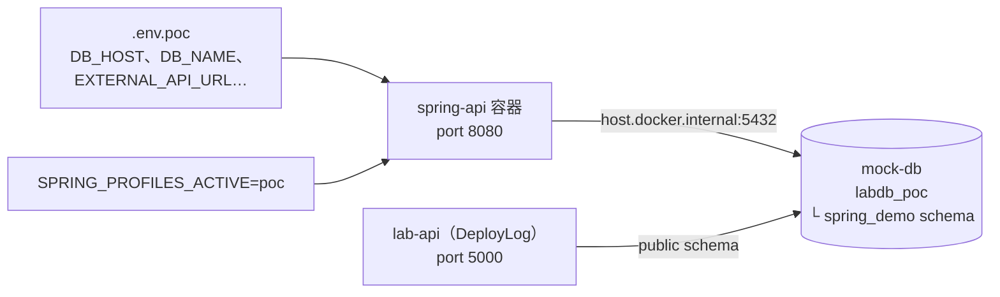

# 手把手：Java 組加碼——用 Spring Boot 再做一次

> DevOps 實作課｜Day 2 加碼／課後｜同一套觀念，換成 Java Spring Boot
> 前面六個模組都用 .NET 的 DeployLog 練習。這一份用一個很小的 Spring Boot 專案（`apps/java-spring-demo/`），把 **M2 組態、M4 預檢與健康檢查、M5 結構化日誌、M6 Schema 版本管理** 再做一次：每一步都對照「DeployLog 是怎麼做的」，讓 Java 背景的同學知道回到自己的專案要改哪裡。
> **只需要 Docker**，不用裝 JDK 或 Maven。每一步大約 5 分鐘，可以挑想看的做，但步驟 0～2 要先做。

---

## 你會學到什麼

| 步驟 | 對應模組 | 你會看到 | DeployLog 對應 |
|------|---------|---------|---------------|
| 2. 用 POC 設定啟動 | M2 | 同一份 `.env.poc`、同一個 mock-db，Spring 也吃得下 | `--env-file .env.poc` |
| 3. 健康檢查分兩種 | M4 | DB 停掉：liveness 200、readiness 503 | `/health`、`/health/ready` |
| 4. 必填設定 | M4 預檢 0 | 少 `EXTERNAL_API_URL` 就不啟動，exit 1 | `RequiredSettings.cs` |
| 5. 換 profile 換 log 格式 | M2、M5 | dev 是文字、poc 是 JSON，`orderId` 是獨立欄位 | `appsettings.{環境}.json` 的 log 設定 |
| 6. 改舊的 migration | M6 | `Migration checksum mismatch`，服務拒絕啟動 | `__EFMigrationsHistory` |
| 7. migrate 拆成獨立一步 | M6 | 關掉自動 migrate，改用 Flyway CLI 跑 | `keypasco-lab-api migrate` |
| 8.（選做）少一個冒號 | M4 | 設定沒給，服務卻照常啟動 | `start-naive.sh` |

---

## 這個專案長什麼樣子

```text
apps/java-spring-demo/
├── pom.xml                                  套件清單（Spring Boot 3.4.1、Java 17、Flyway、PostgreSQL）
├── Dockerfile                               兩階段：Maven 編譯 → 只放 JRE 執行
├── README.md                                精簡版說明（內容同這份）
└── src/main/
    ├── java/demo/App.java                   必填設定檢查＋一行結構化日誌，整個程式就這一個檔
    └── resources/
        ├── application.yml                  共用設定：DB 連線、健康檢查、JSON log
        ├── application-dev.yml              Dev：文字 log、DEBUG
        ├── application-qa.yml               QA：沿用共用設定
        ├── application-poc.yml              POC：只留 WARN 以上
        └── db/migration/
            ├── V1__create_orders.sql        建 orders 表
            └── V2__add_order_status.sql     加 status 欄位
```

它刻意**沒有**畫面和 API，只留對照用得到的部分。跟 DeployLog 共用同一個 `mock-db` 和同一份 `.env.*`；表建在獨立的 `spring_demo` schema，不會動到 DeployLog 的表。



---

## 步驟 0：前置確認

以下指令都在 `devops-lab/` 根目錄下執行。Windows 用 **PowerShell**（不要用 cmd 或 Git Bash），macOS 用終端機。

```bash
docker compose up -d mock-db mock-external-api
docker compose ps
```

**你應該看到**：`mock-db` 是 `Up … (healthy)`，`mock-external-api` 是 `Up`。

**如果不是這樣**：`port is already allocated`（5432）→ 你電腦本來就裝了 PostgreSQL，先停掉它（Windows：「服務」裡停 postgresql；Mac：`brew services stop postgresql`）。

跟 M6 一樣，先把「連回這台電腦的 DB」那兩個參數存成變數：

```bash
# bash／zsh（macOS 終端機預設是 zsh，這個寫法兩邊都能用）
H=(--add-host=host.docker.internal:host-gateway -e DB_HOST=host.docker.internal)
```

```powershell
# PowerShell
$H = @('--add-host=host.docker.internal:host-gateway', '-e', 'DB_HOST=host.docker.internal')
```

之後的指令 bash 寫 `"${H[@]}"`、PowerShell 寫 `@H`。為什麼要這兩個參數：`.env` 的 `DB_HOST=localhost` 是給你電腦上的腳本用的；容器裡的 `localhost` 是容器自己，要用 `host.docker.internal` 才連得回你的電腦（M4 有完整說明）。

> ⚠️ 開新的終端機視窗，`H` 就不見了，要重設一次。

---

## 步驟 1：建置 image

```bash
docker build -t deploylog-spring apps/java-spring-demo
```

第一次約 2～5 分鐘（要下載 Maven、JDK 和套件），之後只改程式的話幾十秒。

**你應該看到**：最後一行有 `naming to docker.io/library/deploylog-spring` 或 `Successfully tagged deploylog-spring`。

**如果不是這樣**：卡在下載很久 → 教室網路慢，等它；`Cannot connect to the Docker daemon` → Docker Desktop 沒開。

**為什麼這樣做**：`Dockerfile` 第一階段用 `maven:3.9-eclipse-temurin-17` image 編譯，所以你的電腦不用裝 JDK。這跟 DeployLog 的 Dockerfile 用 .NET SDK image 編譯是同一個做法（M1 不可變交付物、M3 建置環境一致）。

---

## 步驟 2：用 POC 環境的設定啟動（M2）

```bash
# bash
docker run -d --name spring-api -p 8080:8080 --env-file .env.poc -e SPRING_PROFILES_ACTIVE=poc "${H[@]}" deploylog-spring
```

```powershell
# PowerShell
docker run -d --name spring-api -p 8080:8080 --env-file .env.poc -e SPRING_PROFILES_ACTIVE=poc @H deploylog-spring
```

等 10 秒左右：

```bash
# bash
curl http://localhost:8080/actuator/health
```

```powershell
# PowerShell
curl.exe http://localhost:8080/actuator/health
```

**你應該看到**：`{"status":"UP","groups":["liveness","readiness"]}`。也可以直接用瀏覽器開這個網址。

**如果不是這樣**：
- `curl: (7) Failed to connect` → 還在啟動，再等幾秒；或 `docker logs spring-api` 看是不是啟動失敗
- `Conflict. The container name "/spring-api" is already in use` → 上次的還在：`docker rm -f spring-api`
- `port is already allocated`（8080）→ 改 `-p 8090:8080`，後面網址都改 8090
- log 裡有 `Connection to host.docker.internal:5432 refused` → 少了 `"${H[@]}"`／`@H`，或 mock-db 沒開

**對照 DeployLog**：

| | DeployLog（.NET） | apps/java-spring-demo（Java） |
|---|---|---|
| 讀哪份設定 | `--env-file .env.poc` | **同一份** `--env-file .env.poc` |
| 告訴程式現在是哪個環境 | `.env` 裡的 `ASPNETCORE_ENVIRONMENT=POC` | `-e SPRING_PROFILES_ACTIVE=poc`（Spring 不認 `ASPNETCORE_ENVIRONMENT`） |
| 環境專屬設定檔 | `appsettings.POC.json` | `application-poc.yml` |
| 設定檔怎麼讀環境變數 | 環境變數直接蓋掉同名設定 | yml 裡寫 `${DB_HOST}` |

打開 `apps/java-spring-demo/src/main/resources/application.yml` 看一下：

```yaml
spring:
  datasource:
    url: jdbc:postgresql://${DB_HOST}:${DB_PORT:5432}/${DB_NAME}?currentSchema=spring_demo
    username: ${DB_USER}
    password: ${DB_PASSWORD}
```

**檔案裡只寫「值從哪個環境變數來」，沒有任何一個真正的值。** 所以同一顆 image 放到 QA、POC、客戶那台，都不用重新編譯——這就是 M2 的組態解耦。

---

## 步驟 3：健康檢查分兩種（M4）

```bash
# bash
curl http://localhost:8080/actuator/health/liveness
curl http://localhost:8080/actuator/health/readiness
```

```powershell
# PowerShell
curl.exe http://localhost:8080/actuator/health/liveness
curl.exe http://localhost:8080/actuator/health/readiness
```

**你應該看到**：兩個都是 `{"status":"UP"}`。

現在把資料庫停掉：

```bash
docker compose stop mock-db
```

等 3 秒，再跑一次上面兩行，外加整體的 `/actuator/health`（想看狀態碼就加 `-i`：`curl -i …`／`curl.exe -i …`）。

**你應該看到**：

| 端點 | 意思 | DB 停掉後 |
|------|------|----------|
| `/actuator/health/liveness` | 程式本身還活著嗎？ | **200** `UP` |
| `/actuator/health/readiness` | 現在能接請求嗎？（含 DB） | **503** `DOWN` |
| `/actuator/health` | 整體 | **503** `DOWN` |

把 DB 開回來，幾秒後 readiness 自己變回 `UP`：

```bash
docker compose start mock-db
```

**想一想**：DB 掛了，該不該把服務重開？——**不該，重開也連不上。** 所以要分兩種：平台（Kubernetes、負載平衡器）看 **liveness** 決定要不要重開，看 **readiness** 決定要不要把流量導進來。DeployLog 的 `/health` 和 `/health/ready` 也是這個分工。

**程式在哪裡**：`application.yml` 的 `management.endpoint.health`，三行設定，沒寫程式：

```yaml
management:
  endpoint:
    health:
      probes:
        enabled: true                         # 開 /liveness、/readiness
      group:
        readiness:
          include: readinessState,db          # readiness 要算進 DB 連線
```

> DeployLog 的 `/health/ready` 還會檢查 **Schema 是不是最新版**；這個範例的 readiness 只看 DB 連線。Spring 要做到一樣，見 [08 §2 Java 對照](08-app-design-for-ops.md#2-健康檢查) 的 `SchemaHealthIndicator`。

---

## 步驟 4：必填設定沒給，就不要啟動（M4 預檢 0）

故意把 `EXTERNAL_API_URL` 設成空的。這裡用 dev profile，因為它的 log 是一般文字，比較好讀。

```bash
# bash
docker run --rm --env-file .env.dev -e SPRING_PROFILES_ACTIVE=dev -e EXTERNAL_API_URL= "${H[@]}" deploylog-spring
echo "exit code: $?"
```

```powershell
# PowerShell
docker run --rm --env-file .env.dev -e SPRING_PROFILES_ACTIVE=dev -e EXTERNAL_API_URL= @H deploylog-spring
echo "exit code: $LASTEXITCODE"
```

<!-- 未驗證：PowerShell 尚未在 Windows 實測（bash 欄已實測，exit code 1） -->

**你應該看到**：

```text
***************************
APPLICATION FAILED TO START
***************************

Description:

Binding to target demo.App$AppProperties failed:

    Property: app.externalApiUrl
    Value: ""
    Reason: must not be blank

exit code: 1
```

**程式在哪裡**：`apps/java-spring-demo/src/main/java/demo/App.java`

```java
@Validated                                              // 啟動時要驗證
@ConfigurationProperties(prefix = "app")                // 對應 yml 的 app.*
public record AppProperties(@NotBlank String externalApiUrl) {}   // 不能是空的
```

`application.yml` 那一端：

```yaml
app:
  external-api-url: ${EXTERNAL_API_URL:}     # 從環境變數讀；冒號後面是「空的預設值」
```

**對照 DeployLog**：M4 的 `start.sh` 預檢 0 是在**啟動前**用腳本檢查；`RequiredSettings.cs` 和這裡的 `@NotBlank` 是在**程式啟動時**檢查。兩道都做最保險：腳本擋的是「這台機器的環境」，程式擋的是「不管誰用什麼方式啟動我」。共同點：**有缺就在門口擋下，錯誤訊息講清楚缺哪一個**，不要等第一個請求打進來才出錯。

> 第 8 步會看到：yml 那個冒號少打，這道檢查就失效了。

---

## 步驟 5：換 profile 就換 log 格式（M2＋M5）

先刪掉步驟 2 的容器，用 dev 啟動一次，看完按 `Ctrl+C` 停：

```bash
# bash
docker rm -f spring-api
docker run --rm --env-file .env.dev -e SPRING_PROFILES_ACTIVE=dev "${H[@]}" deploylog-spring
```

```powershell
# PowerShell
docker rm -f spring-api
docker run --rm --env-file .env.dev -e SPRING_PROFILES_ACTIVE=dev @H deploylog-spring
```

**你應該看到**（節錄）：

```text
INFO 1 --- [main] demo.App : The following 1 profile is active: "dev"
INFO 1 --- [main] o.f.core.internal.command.DbMigrate : Migrating schema "spring_demo" to version "1 - create orders"
ERROR 1 --- [main] demo.App : Order failed
```

再用 poc 啟動一次：

```bash
# bash
docker run --rm --env-file .env.poc -e SPRING_PROFILES_ACTIVE=poc "${H[@]}" deploylog-spring
```

```powershell
# PowerShell
docker run --rm --env-file .env.poc -e SPRING_PROFILES_ACTIVE=poc @H deploylog-spring
```

**你應該看到**：每一行都是 JSON。找 `Order failed` 那一行（為了好讀，這裡換了行、刪掉幾個欄位）：

```json
{
  "@timestamp": "2026-11-09T01:20:42.645Z",
  "log.level": "ERROR",
  "log.logger": "demo.App",
  "message": "Order failed",
  "orderId": 12345,
  "reason": "payment gateway timeout"
}
```

| profile | 設定檔 | log 長相 | 對照 DeployLog |
|---------|--------|---------|---------------|
| `dev` | `application-dev.yml` | 一般文字，看得到 DEBUG | `appsettings.Development.json`（simple） |
| `qa` | `application-qa.yml` | JSON（ECS 格式），INFO 以上 | `appsettings.json`（json） |
| `poc` | `application-poc.yml` | JSON，只剩 WARN 以上（Flyway 例外保留） | `appsettings.POC.json`（Warning） |

**重點一：同一顆 image。** 兩次跑的是同一個 `deploylog-spring`，差別只在 `SPRING_PROFILES_ACTIVE`。

**重點二：`orderId` 是獨立欄位。** dev 那行只看得到 `Order failed`，看不到訂單編號；poc 的 JSON 裡 `orderId`、`reason` 各自是一個欄位。log 系統（ELK、Loki）可以直接查 `orderId = 12345`，不用寫正規表示式拆字串。這是 M5「具名欄位」的 Java 版：

```java
log.atError()
   .addKeyValue("orderId", 12345)                       // 獨立欄位
   .addKeyValue("reason", "payment gateway timeout")
   .log("Order failed");
// 不要寫成 log.error("Order " + orderId + " failed")——訂單編號會被埋進字串裡
```

JSON 格式是 Spring Boot 3.4 起內建的，`application.yml` 一行就開：`logging.structured.format.console: ecs`。M5 §6 講的 logstash-logback-encoder 是更舊版本的做法。

---

## 步驟 6：改了已經套用的 migration 會怎樣（M6）

前面每次啟動，Spring 都自動跑了 Flyway。檔名就是版本號：

```text
V1__create_orders.sql       → 版本 1
V2__add_order_status.sql    → 版本 2
```

版本紀錄存在資料庫的 `spring_demo.flyway_schema_history` 表，作用跟 DeployLog 的 `__EFMigrationsHistory` 一樣。看一下：

```bash
docker compose exec mock-db psql -U labuser -d labdb_poc -c "SELECT version, description, checksum, success FROM spring_demo.flyway_schema_history"
```

<!-- 未驗證：PowerShell 尚未在 Windows 實測；SQL 裡沒有雙引號，預期兩邊同一行可用 -->

**你應該看到**：三列。第一列 `<< Flyway Schema Creation >>` 是 Flyway 建 `spring_demo` schema 的紀錄；接著版本 1 和 2，各有一個 `checksum` 數字，`success` 是 `t`。

**現在故意改 V2**：用編輯器（記事本、VS Code 都可以）打開 `apps/java-spring-demo/src/main/resources/db/migration/V2__add_order_status.sql`，把 `'NEW'` 改成 `'PENDING'`，存檔。重建 image 再啟動：

```bash
# bash
docker build -t deploylog-spring apps/java-spring-demo
docker run --rm --env-file .env.poc -e SPRING_PROFILES_ACTIVE=poc "${H[@]}" deploylog-spring
```

```powershell
# PowerShell
docker build -t deploylog-spring apps/java-spring-demo
docker run --rm --env-file .env.poc -e SPRING_PROFILES_ACTIVE=poc @H deploylog-spring
```

**你應該看到**：服務起不來，log 裡有：

```text
Migration checksum mismatch for migration version 2
-> Applied to database : 1665690257
-> Resolved locally    : 1929741163
```

（數字跟你的可能不同。）

**想一想**：為什麼 Flyway 要這麼兇？——如果它不擋，Dev 套用的是新版 V2、客戶那台是舊版 V2，兩邊都說自己在「版本 2」，Schema 卻不一樣。這正是 M6 說的「無法回溯」。**已經上線的 migration 不改；要改就新增 V3。**

做完**一定要改回來並重建**，否則後面每次啟動都會卡在這裡：

```bash
# 用 git clone 的：一行還原（Windows、macOS 相同）
git checkout -- apps/java-spring-demo/src/main/resources/db/migration/V2__add_order_status.sql
docker build -t deploylog-spring apps/java-spring-demo
```

用 zip 解壓的沒有 git：手動把 `'PENDING'` 改回 `'NEW'` 存檔，再 `docker build`。

> 💡 Windows 記事本存檔把換行改成 CRLF，不會造成 checksum 不符（實測過：同一個檔案轉成 CRLF，`flyway validate` 照樣通過）；改的是**內容**才會。

---

## 步驟 7：正式環境把 migrate 拆出來（M6）

Spring Boot 只要 classpath 上有 Flyway，預設就**每個實例啟動時自己跑 migrate**。開發時方便；正式環境開三個實例，就是三個人同時改 Schema，而且網站帳號必須有改表的權限（違反 M6 §9 最小權限）。

M6 的做法是：**服務啟動時不碰 Schema，migrate 由部署流程單獨跑一次。** 用 QA 環境做一次。

**7-1. 關掉自動 migrate 啟動服務**

```bash
# bash
docker run -d --name spring-api -p 8080:8080 --env-file .env.qa -e SPRING_PROFILES_ACTIVE=qa -e SPRING_FLYWAY_ENABLED=false "${H[@]}" deploylog-spring
```

```powershell
# PowerShell
docker run -d --name spring-api -p 8080:8080 --env-file .env.qa -e SPRING_PROFILES_ACTIVE=qa -e SPRING_FLYWAY_ENABLED=false @H deploylog-spring
```

`SPRING_FLYWAY_ENABLED` 會自動對應到 yml 的 `spring.flyway.enabled`（Spring 的 relaxed binding：全大寫、`.` 換成 `_`）。不用改設定檔、不用重建 image，啟動時給一個環境變數就關掉了。

確認 QA 資料庫裡還**沒有** `spring_demo`：

```bash
docker compose exec mock-db psql -U labuser -d labdb_qa -c "\dn"
```

**你應該看到**：只有 `public` 一列。（如果你之前用 QA 跑過開著自動 migrate 的服務，這裡會看到 `spring_demo`，沒關係，繼續做。）

**7-2. 用 Flyway 官方 image 單獨跑 migrate**

讀的是同一份 SQL 檔，用 `-v` 把資料夾掛進容器：

```bash
# bash
docker run --rm --add-host=host.docker.internal:host-gateway \
  -v "$PWD/apps/java-spring-demo/src/main/resources/db/migration:/flyway/sql" \
  flyway/flyway:10 \
  -url=jdbc:postgresql://host.docker.internal:5432/labdb_qa \
  -user=labuser -password=labpass -schemas=spring_demo migrate
```

```powershell
# PowerShell（行尾是反引號 `，後面不能有空白）
docker run --rm --add-host=host.docker.internal:host-gateway `
  -v "${PWD}/apps/java-spring-demo/src/main/resources/db/migration:/flyway/sql" `
  flyway/flyway:10 `
  -url=jdbc:postgresql://host.docker.internal:5432/labdb_qa `
  -user=labuser -password=labpass -schemas=spring_demo migrate
```

<!-- 未驗證：PowerShell 尚未在 Windows 實測（${PWD} 掛載路徑；bash 欄已實測） -->

**你應該看到**（第一次會先下載 flyway image）：

```text
Migrating schema "spring_demo" to version "1 - create orders"
Migrating schema "spring_demo" to version "2 - add order status"
Successfully applied 2 migrations to schema "spring_demo", now at version v2
```

把最後的 `migrate` 換成 `info`，可以列出每個版本的狀態——QA 驗收時可以當成一個檢查步驟（M6 §5）。

**如果不是這樣**：
- `Unable to obtain connection` → mock-db 沒開，或少了 `--add-host`
- PowerShell 說找不到路徑、或 migrate 說 `No migrations found` → 確認目前位置是 `devops-lab/`，而且用的是 PowerShell 不是 Git Bash
- `Migration checksum mismatch` → 步驟 6 的 V2 沒改回來

**對照 DeployLog**：

| | DeployLog（.NET） | apps/java-spring-demo（Java） |
|---|---|---|
| 預設行為 | 網站啟動**不**碰 Schema | 網站啟動**會**自動 migrate |
| 單獨跑 migrate | `docker run … keypasco-lab-api migrate` | Flyway CLI image（或自己在 `main` 加 `migrate` 參數，見 [08 §3](08-app-design-for-ops.md#3-migration-是獨立指令)） |
| 正式環境要做的事 | 什麼都不用改 | 記得設 `SPRING_FLYWAY_ENABLED=false` |
| CI 裡怎麼放 | deploy job 先 migrate 再換容器（[03b](03b-gitlab-environments-release.md)） | 一樣：flyway image 的 job 放在 deploy 前面；GitLab CI 用這個 image 要加 `entrypoint: [""]` |

> **代價**：開著自動 migrate 時，DB 連不上服務就起不來，等於多一道預檢；關掉之後這道保護就沒了，要靠步驟 3 的 readiness 補上。

---

## 步驟 8（選做）：少一個冒號，預檢就失效（M4）

打開 `apps/java-spring-demo/src/main/resources/application.yml`，最後一行：

```yaml
  external-api-url: ${EXTERNAL_API_URL:}
```

把冒號刪掉，變成 `${EXTERNAL_API_URL}`。重建 image，再跑一次步驟 4 的指令，但這次**完全不給** `EXTERNAL_API_URL`。`.env.dev` 裡有這個變數，所以改成不用 `--env-file`，直接給 DB 的設定：

```bash
# bash
docker build -t deploylog-spring apps/java-spring-demo
docker run --rm -e SPRING_PROFILES_ACTIVE=dev -e DB_PORT=5432 -e DB_NAME=labdb -e DB_USER=labuser -e DB_PASSWORD=labpass "${H[@]}" deploylog-spring
```

```powershell
# PowerShell
docker build -t deploylog-spring apps/java-spring-demo
docker run --rm -e SPRING_PROFILES_ACTIVE=dev -e DB_PORT=5432 -e DB_NAME=labdb -e DB_USER=labuser -e DB_PASSWORD=labpass @H deploylog-spring
```

<!-- 未驗證：PowerShell 尚未在 Windows 實測（bash 欄已實測） -->

**你應該看到**：服務**照常啟動**，`Ctrl+C` 停掉。

**為什麼**：沒有冒號時，變數沒設，Spring 會把**字面字串** `${EXTERNAL_API_URL}` 當成值。它不是空字串，`@NotBlank` 就放行了。

**想一想**：這跟 M4 的 `start-naive.sh` 哪裡像？——**看起來啟動了，其實設定是錯的**，要等到真的去呼叫外部服務才爆。寫 `${變數:}`（給空預設值）才能讓必填檢查真的生效。

做完把冒號加回去（或 `git checkout -- apps/java-spring-demo/src/main/resources/application.yml`），再 `docker build -t deploylog-spring apps/java-spring-demo`。

---

## 步驟 9：收尾

| 做什麼 | 指令（Windows、macOS 相同） |
|-------|---------------------------|
| 刪掉 Spring 容器 | `docker rm -f spring-api` |
| 停掉 mock 服務（資料保留） | `docker compose stop` |
| 刪掉 image | `docker rmi deploylog-spring` |

`spring_demo` schema 留在資料庫裡不影響 DeployLog。想清掉：`docker compose exec mock-db psql -U labuser -d labdb_poc -c "DROP SCHEMA spring_demo CASCADE"`（`labdb`、`labdb_qa` 同理）。

---

## 疑難排解

| 症狀 | 原因 | 處理 |
|------|------|------|
| `port is already allocated`（8080） | 8080 被佔用 | `-p 8090:8080`，網址改 8090。查誰佔用：Windows `netstat -ano \| findstr :8080`；Mac `lsof -iTCP:8080 -sTCP:LISTEN` |
| `Conflict. The container name "/spring-api" is already in use` | 上一次的容器還在 | `docker rm -f spring-api` |
| `Connection to host.docker.internal:5432 refused` | mock-db 沒開，或少了 `"${H[@]}"`／`@H` | `docker compose ps`；補參數 |
| PowerShell 報 `invalid reference format` | 沒設 `$H`，或寫成 `$H` 而不是 `@H` | 重設 `$H`，指令用 `@H` |
| Mac 報 `invalid argument … for "--add-host" flag` | `H` 用了引號字串，zsh 不會拆開 | 用括號 `H=(…)`，指令寫 `"${H[@]}"` |
| Windows：`curl` 跑出一堆 `StatusCode`、`Content` | 打成 `curl` 了 | 打 `curl.exe` |
| Windows：反引號換行的指令跑一半出錯 | 反引號後面多了空白 | 刪掉空白，或整段接成一行 |
| 每次啟動都 `Migration checksum mismatch` | 步驟 6 的 V2 沒改回來，或改回來了沒重建 image | 還原後 `docker build` |

---

## 程式設計：回到自己的 Spring 專案要改什麼

| 機制 | 要寫的東西 | 這個範例的位置 | 詳細說明 |
|------|----------|--------------|---------|
| 組態外部化 | yml 只寫 `${變數:}`，值從環境變數來；環境差異放 `application-{profile}.yml` | `application*.yml` | [08 §1](08-app-design-for-ops.md#1-組態外部化與分層) |
| 必填設定 | `@ConfigurationProperties`＋`@Validated`＋`@NotBlank`；yml 一定要有冒號 | `App.java`、`application.yml` | [08 §1](08-app-design-for-ops.md#1-組態外部化與分層) |
| 健康檢查 | `spring-boot-starter-actuator`＋`probes.enabled`＋readiness 群組加 `db` | `application.yml` | [08 §2](08-app-design-for-ops.md#2-健康檢查) |
| 結構化日誌 | `logging.structured.format.console: ecs`；用 `addKeyValue` 帶欄位 | `application.yml`、`App.java` | [08 §4](08-app-design-for-ops.md#4-結構化日誌與追蹤編號) |
| Migration | Flyway＋`flyway-database-postgresql`（Flyway 10 起要另外加）；正式環境 `SPRING_FLYWAY_ENABLED=false`，由 CI 跑 | `pom.xml`、`db/migration/` | [08 §3](08-app-design-for-ops.md#3-migration-是獨立指令) |
| 不可變建置 | Dockerfile 用 Maven image 編譯，執行階段只放 JRE | `Dockerfile` | [08 §6](08-app-design-for-ops.md#6-不可變交付物與建置) |

**不用 Docker、直接用 JDK 跑**（電腦有 JDK 17＋Maven 3.9 的話）：服務在你電腦上跑，所以 `DB_HOST=localhost` 就連得到。

```bash
# macOS：變數寫在指令前面，只對這一次執行有效
cd apps/java-spring-demo
mvn -DskipTests package
DB_HOST=localhost DB_PORT=5432 DB_NAME=labdb DB_USER=labuser DB_PASSWORD=labpass \
EXTERNAL_API_URL=http://localhost:8081 SPRING_PROFILES_ACTIVE=dev \
java -jar target/deploylog-spring-1.0.0.jar
```

```powershell
# Windows（PowerShell）：$env:名稱 設定的變數只在這個視窗有效
cd apps/java-spring-demo
mvn -DskipTests package
$env:DB_HOST="localhost"; $env:DB_PORT="5432"; $env:DB_NAME="labdb"
$env:DB_USER="labuser"; $env:DB_PASSWORD="labpass"
$env:EXTERNAL_API_URL="http://localhost:8081"; $env:SPRING_PROFILES_ACTIVE="dev"
java -jar target\deploylog-spring-1.0.0.jar
```

<!-- 未驗證：PowerShell 尚未在 Windows 實測（macOS 欄已實測） -->

---

## 自我檢查

- [ ] 說得出 Spring 用哪個環境變數切環境（`SPRING_PROFILES_ACTIVE`），以及它跟 .NET 的 `ASPNETCORE_ENVIRONMENT` 的對應
- [ ] 看過 DB 停掉時 liveness 200、readiness 503，說得出平台各拿它們做什麼
- [ ] 看過缺 `EXTERNAL_API_URL` 時 `APPLICATION FAILED TO START`、exit 1，知道是 `@NotBlank` 擋的
- [ ] 比較過 dev 的文字 log 和 poc 的 JSON log，說得出 `orderId` 當獨立欄位的好處
- [ ] 改過已套用的 V2、看過 `Migration checksum mismatch`，也已經改回來
- [ ] 用 `SPRING_FLYWAY_ENABLED=false` 啟動、再用 Flyway CLI 單獨 migrate 過
- [ ] 說得出 yml 寫 `${X}` 和 `${X:}` 的差別

**帶走一句話**：DeployLog 和 apps/java-spring-demo 寫法完全不同，做的事情一模一樣——**設定從外面來、缺了就不啟動、活著和能接客分開回報、log 是機器讀得懂的欄位、Schema 有版本而且單獨升級。** 回到自己的專案，不管什麼語言，就檢查這五件事。
