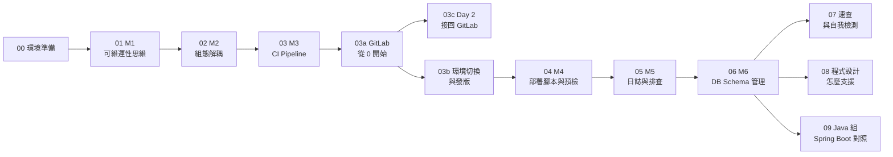

# DevOps 實作課 — 手把手教程

> 兩天、六個模組，從「在我的電腦上會動」到「一鍵部署、一鍵退版、出事查得到」。
> 每一份文件都可以自己從頭照著做：指令 → 你應該看到什麼 → 不是這樣怎麼辦 → 為什麼要這樣做。

---

## 怎麼用這份教程

1. **先把環境跑起來**：已經裝好 Docker，照 [環境啟動快速版](00-quickstart.md) 貼指令就好；第一次安裝或想看完整說明，看 [00 環境準備](00-setup.md)。後面每一章都假設你已經在 `devops-lab/` 資料夾裡、環境檢查全部 PASS。
2. **照順序做**：每一章會用到前一章的觀念（M2 的組態 → M3 的 pipeline 注入 → M4 的預檢 → M6 的 migrate），跳著做會看不懂為什麼。
3. **指令都有兩種寫法**：Windows 用 **PowerShell**、macOS／Linux 用 **bash**，兩個版本並列，挑你的那一個。
4. **每一章最後都有「程式設計：程式要怎麼寫才支援」**：開發者看這段知道要改什麼，完整說明在 [08](08-app-design-for-ops.md)。Java 背景的同學，做完 M6 再做 [09](09-java-spring-demo.md)，用 Spring Boot 把 M2／M4／M5／M6 實際跑一次。
5. **GitLab**：公司已有 GitLab 的，從 [03a](03a-gitlab-from-zero.md) Part 1 開始；沒有的，照 03a Part 0 在自己電腦架一台（Docker 要給 6 GB 以上記憶體）。標「講師示範」的段落（03b 部署到三個環境）需要額外的部署用 Runner，看截圖跟著理解就好。

---

## 課程地圖

| # | 文件 | 你會做到 | 天 |
|---|------|---------|----|
| 00 | [環境準備](00-setup.md) | 從一台空電腦到 Lab 環境跑起來、環境檢查全 PASS | 課前 |
| 01 | [M1 從開發到部署：可維運性思維](01-m1-operability.md) | 說得出「在我電腦會動」的原因；啟動範例網站 DeployLog，用三種角色逛一圈 | Day 1 |
| 02 | [M2 組態解耦與環境配置管理](02-m2-config.md) | **Lab**：同一個 image，不改程式、不重新編譯，切換 Dev／QA／POC 三個環境 | Day 1 |
| 03 | [M3 自動化打包與持續整合](03-m3-ci-pipeline.md) | 讀懂 `.gitlab-ci.yml`（.NET、Java war）；看懂 pipeline、測試報告、版本號、機密注入 | Day 1 |
| 03a | [GitLab 從 0 開始](03a-gitlab-from-zero.md) | 自己架一台 GitLab（公司已有就跳過）→ 建專案、推程式、註冊 Runner、Pipeline editor、測試失敗與 MR、CI 變數、tag、Container registry、Release，每個畫面都有截圖 | Day 1 |
| 03c | [Day 2 接回自己的 GitLab 和 Runner](03c-day2-reconnect-gitlab.md) | 隔天 GitLab 打不開、pipeline 卡 Pending、找不到昨天推的專案：先判斷是哪一種，再照截圖接回來 | Day 2 開場 |
| 03b | [GitLab 環境切換與發版](03b-gitlab-environments-release.md) | dev 自動部署、qa／poc 放行、一鍵 Rollback、Releases（講師示範） | Day 1–2 |
| 04 | [M4 部署腳本與預檢機制](04-m4-deploy-scripts.md) | 寫出「環境不對就友善報錯、拒絕啟動」的預檢腳本（bash／PowerShell）；**Lab**：五種破壞全部擋下 | Day 1–2 |
| 05 | [M5 維運友善的日誌與問題排查](05-m5-logging.md) | 分得清日誌等級；用追蹤編號從錯誤畫面找到那一行 JSON log | Day 2 |
| 06 | [M6 資料庫狀態與 Schema 管理](06-m6-db-migration.md) | **Lab**：空資料庫 → 打錯 DB 名稱被擋 → migrate → 網站 ready | Day 2 |
| 07 | [指令速查與自我檢測](07-cheatsheet-selfcheck.md) | 一頁查完所有指令；兩天的自我檢測清單；疑難排解總表 | 課後 |
| 08 | [程式設計：讓應用程式支援這些維運機制](08-app-design-for-ops.md) | 架構圖＋每個機制的程式寫法（組態分層、健康檢查、migrate 指令、結構化日誌與追蹤編號、優雅關閉、不可變建置、機密、稽核），.NET 實際程式＋Java 對照；新專案檢查清單 | 開發者必讀 |
| 09 | [Java 組加碼：用 Spring Boot 再做一次](09-java-spring-demo.md) | 同一個 mock-db、同一份 `.env.*`，用 Spring Boot 跑 M2 profile 切換、M4 liveness／readiness 與必填設定、M5 JSON 日誌、M6 Flyway（改舊檔被擋、migrate 拆出來）；只需要 Docker | Day 2 加碼／課後 |

---

## 範例網站：DeployLog

整門課都用同一個網站練習：**DeployLog（部署紀錄系統）**——Vue3 前端＋ASP.NET Core 10 API＋PostgreSQL，打包成**一個 Docker image**。

- 登入、三種角色（Viewer 只能看、Engineer 能新增部署紀錄、Admin 能管帳號和看稽核紀錄）
- `/whoami`：目前讀到哪個環境、哪個資料庫（M2）
- `/health`、`/health/ready`：活著沒、能不能接流量（M4、M6）
- `migrate` 指令：升級資料庫 Schema（M6）
- QA／POC 環境輸出 JSON 日誌、錯誤畫面有追蹤編號（M5）

詳細說明在 [apps/dotnet-deploylog/README.md](../apps/dotnet-deploylog/README.md)。

---

## 遇到問題

1. 先看該章最後的「如果不是這樣」
2. 再查 [07 疑難排解總表](07-cheatsheet-selfcheck.md)
3. 跑一次環境檢查：`tools\selftest.ps1 env`（Windows）／`bash tools/selftest.sh env`（macOS／Linux），把結果截圖給講師
